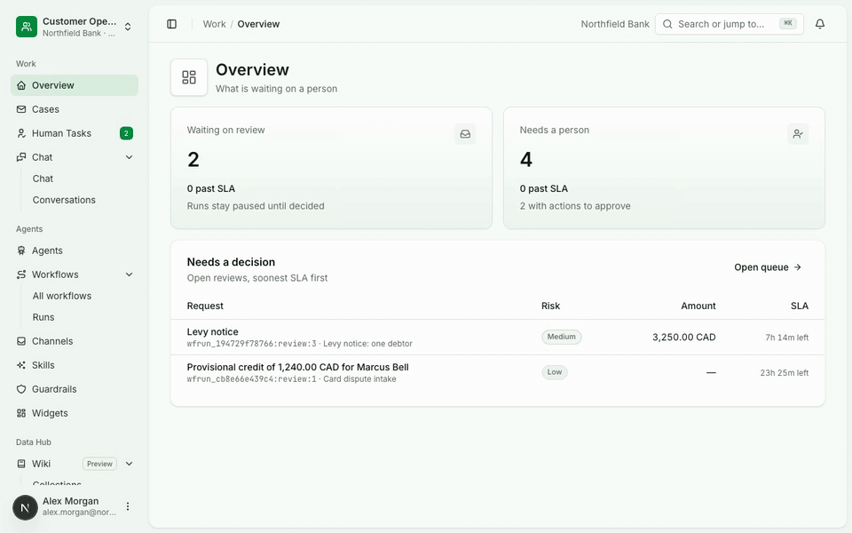
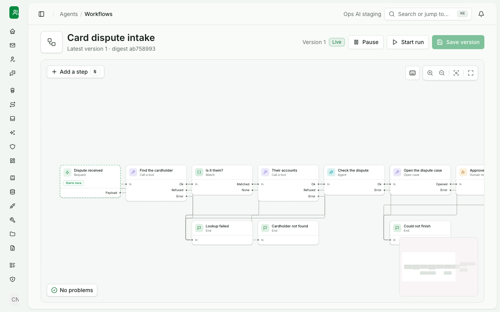
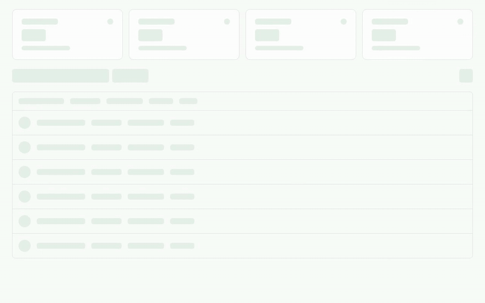
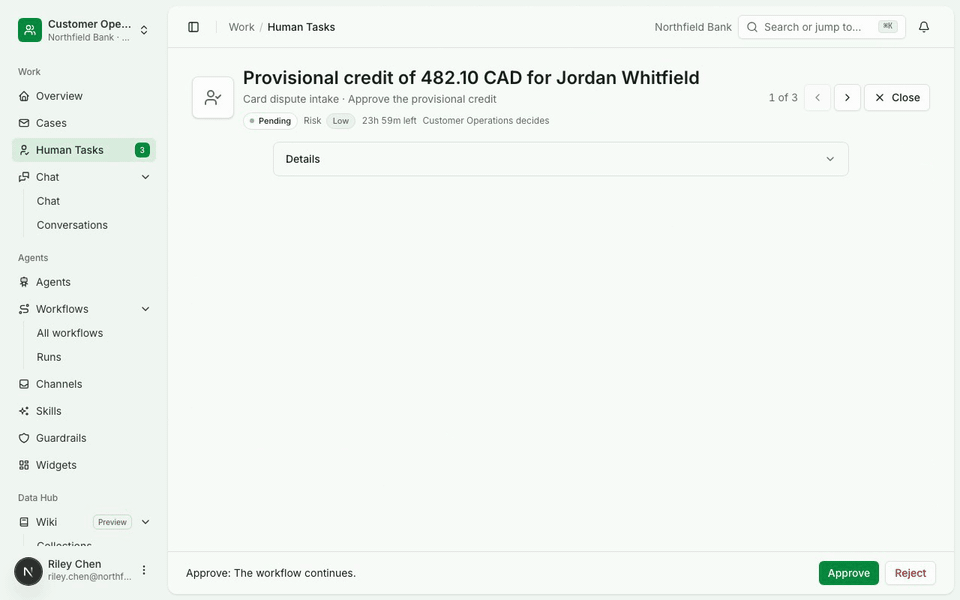
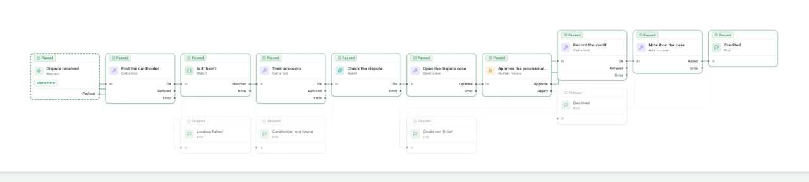
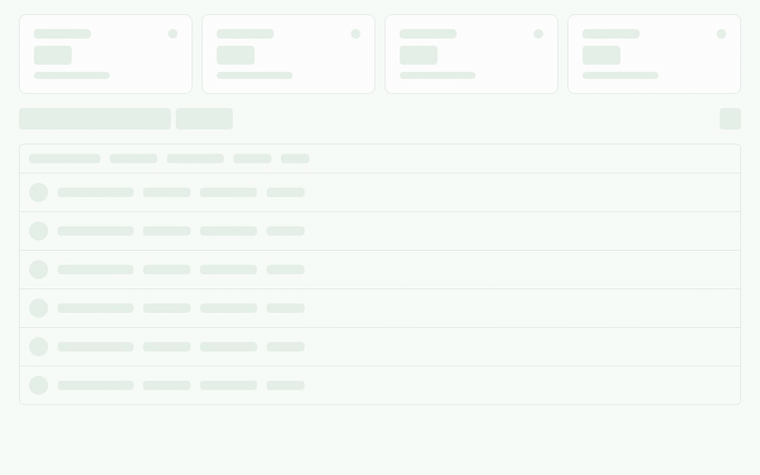
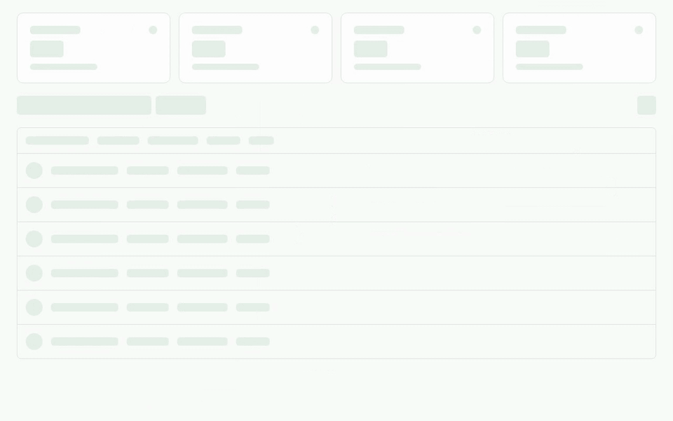
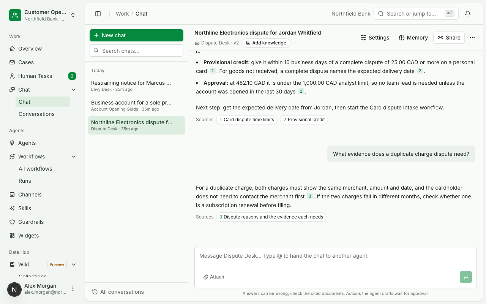
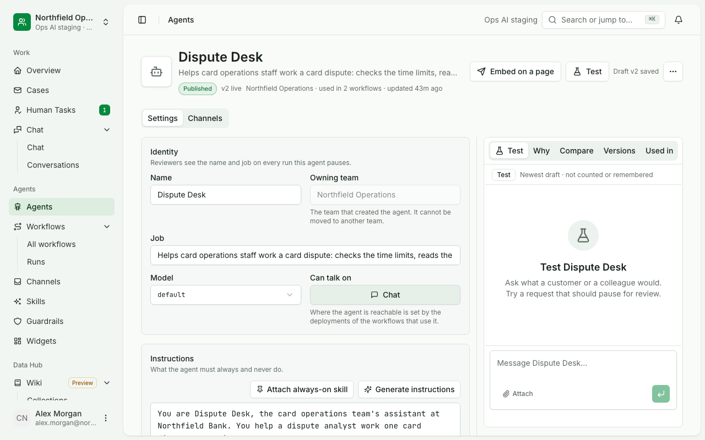

<p align="center">
  <picture>
    <source media="(prefers-color-scheme: dark)" srcset="docs/media/logo-dark.svg" />
    <source media="(prefers-color-scheme: light)" srcset="docs/media/logo-light.svg" />
    
  </picture>
</p>

<h1 align="center">Ops AI</h1>

<p align="center">
  <b>An agent builder for regulated operations.</b><br />
  Deterministic workflows with AI steps where judgement is needed. Every data, tool and model call goes through a
  gateway, people approve the steps that matter, and every run leaves a record.
</p>

<p align="center">by <a href="https://chanl.ai">Chanl AI</a></p>

<p align="center">
  <a href="LICENSE"></a>
  <a href="pyproject.toml"></a>
  <a href="package.json"></a>
  <a href="apps/console"></a>
  <a href="docs/deploy/database.md"></a>
</p>

<p align="center">
  <a href="#why-ops-ai">Why Ops AI</a> &bull;
  <a href="#a-court-order-from-inbox-to-record">See it work</a> &bull;
  <a href="#use-cases">Use cases</a> &bull;
  <a href="#quick-start">Quick start</a> &bull;
  <a href="#roadmap">Roadmap</a> &bull;
  <a href="https://opsai.chanl.ai">Docs</a>
</p>

---

## Why Ops AI

Every regulated operations team has a pile of work AI could already do. A bank's card team works through hundreds of
disputes a week. An insurer's claims team reads the same policy wording fifty times a day. A branch calls the back
office to ask what the handbook says about a frozen account.

Pilots for this work go well. Then they reach the risk review, and the review asks questions most agent tools were
never built to answer:

| The review asks | What usually happens |
|---|---|
| Who approved this change to the customer's account? | The agent called the system itself; no approval is tied to that call |
| Which version of the agent ran? | Agents are edited in place, so a run cannot be traced to a version |
| What data could it reach, and as whom? | Keys live in the agent, so access belongs to the key and cannot be tied to a person |
| Can this step run the same way every time? | Every step is a model decision; there is no fixed path |
| Where is the record? | Logs are spread across tools, models and chat history |

So the pilot stays a pilot, or the team builds approvals, versions, access and audit by hand for one use case, and
again for the next. Ops AI builds those answers into every run, once, for every use case.

## What makes it different

**People are a step in the workflow.** A step a policy reserves for a person waits in Human Tasks with the facts
needed to decide. Approving it sends the tool call with a token bound to the exact input the reviewer saw. Moving
money asks for a fresh sign-in and, where the policy says so, a second approver.

**Fixed steps and AI steps in one workflow.** Matching, branching, system calls, waits and case steps run the same
way every time. An agent step is used only where judgement is needed, and it answers in a shape the next step checks.
Workflows are versioned, and each run keeps the version it started on.

**The data gateway stands on its own.** Every tool, data and model call goes through a gateway with per-team access,
credentials kept as secrets, approval rules and a call log. A team can adopt the gateway alone, for the assistants it
already has, and add agents and workflows later.

**One platform for the whole organisation.** Teams own their agents, workflows and data, with roles inside each team
and the database itself keeping teams apart. A team works like a workspace: everything in it belongs to that team
only, and a person can belong to several teams. Teams start from ready-made agents, tools and workflows by installing
a copy.

**Runs where your data lives.** PostgreSQL today and SQL Server in progress, on one machine, Docker or Kubernetes. A
built-in fake model answers from fixed rules, so the whole platform runs with no model key and no network.

## A card dispute, from request to record

Card disputes are a daily job in every retail bank, and a good example of work that is partly fixed and partly a
judgement call. Here is the flow from the demo, end to end. Harbor & Pine Bank and every person and customer in it
are fictional; the screens are the product as it runs today.

This clip is one morning in the console: what waits on a person, an agent answering from the handbook, and the Human
Tasks queue.

<p align="center">
  
</p>

**1. The dispute comes in.** A cardholder's dispute arrives through the dispute form or the API: who they are, the
merchant, the amount and what went wrong. The workflow that owns disputes starts on its own.

**2. Fixed steps find the cardholder.** The workflow looks up the customer and their accounts in the core banking
system through the tool gateway. These steps run the same way every time, and a cardholder it cannot confirm goes to a
person instead of guessing. This is the workflow on the canvas, with the failure ends below:

<p align="center"><picture><source media="(prefers-color-scheme: dark)" srcset="docs/media/workflow-dark.png"></picture></p>

**3. An agent checks the dispute against the handbook.** Dispute Desk reads the card dispute handbook and answers in a
fixed shape: is it in time, which rule applies, how much provisional credit is allowed, with the sections cited. The
next step checks that shape before anything moves.

**4. A person approves the credit.** The provisional credit is a Human Task with the amount, the account and where
each fact came from. Approving it sends the credit through the gateway with a token bound to exactly what the
reviewer saw. A test run lights each step up until it waits at that approval:

<p align="center"></p>

Riley Chen opens the task, reads where the amount came from, approves it, and the run ends at Credited:

<p align="center"></p>

**5. The case and the record stay behind.** The dispute's case holds its run, the credit and every decision, and the
run keeps its full path:

<p align="center"><picture><source media="(prefers-color-scheme: dark)" srcset="docs/media/run-dark.png"></picture></p>

Back to the review's five questions. Who approved the credit: the person named on the Human Task, with the input they
saw. Which version ran: the one the run records. What data it reached, and as whom: what the gateway logged, under the
team's grants. Did the lookups run the same way every time: yes, they are fixed steps. Where is the record: on the
case and in the activity record.

## Email to a case

Work that arrives by email goes the same way. A team connects a mailbox, and each new email starts the workflow that
watches it: attachments are stored and read field by field with the quote and page for every value, a case opens for
each person the email names, and replies go out once a person approves them. This clip shows a mailbox, the run an
email started, and the case it opened:

<p align="center"> Email, the run its court order notice started waiting at Hold or flag, the team's cases, and the court order case for Marcus Bell with the Human Task it waits on" width="850"></p>

## Ask an agent, get a cited answer

Agents answer staff from the knowledge bases they are granted and call the tools they are granted, through the same
gateway. Every answer cites the handbook passages it used, and a write the agent drafts waits for approval before it
runs. Here a person asks Dispute Desk for a cardholder's accounts; the agent calls the core banking tools and shows
the result as a table.

<p align="center"></p>

A finished chat on a dispute's time limit, each answer citing the handbook section it came from:

<p align="center"><picture><source media="(prefers-color-scheme: dark)" srcset="docs/media/chat-dark.png"></picture></p>

An agent is a job description, instructions, a model alias, its tools and its knowledge. Each save is a version, and
publishing goes through the team's publish policy, which can require a second person's review. This is the Dispute
Desk agent page, with the test panel beside its instructions.

<p align="center"><picture><source media="(prefers-color-scheme: dark)" srcset="docs/media/agent-dark.png"></picture></p>

## Use cases

Examples of the work teams put on Ops AI. Each is agents, workflows, document types and settings made through the
public API, with no code written for any of them.

| Industry | Example | Where people stay in the loop | Status |
|---|---|---|---|
| Banking | **Card disputes and chargebacks.** Find the cardholder, check the dispute against the handbook, open a case | A person approves the provisional credit | In the demo |
| Banking | **Staff questions.** Branch and back-office staff ask an agent about products and procedures | Answers cite the handbook section they came from | In the demo |
| Banking | **Loan application packets.** Gather statements, work out cash flow, check fraud signals, write the decision packet | The underwriter decides | Example |
| Banking | **KYC and AML alert review.** Collect the customer's records and transactions for an alert and summarise the evidence | The analyst decides and files | Example |
| Banking | **Fraud alerts.** Check a flagged transaction against the customer's history and the bank's rules | A person approves the block or release | Example |
| Insurance | **Claims intake.** Read the claim form and photos, find the policy, check cover against the wording with citations | An adjuster approves the next step | Example |
| Insurance | **Underwriting submissions.** Read the submission, check it against the underwriting guide, flag what is missing | The underwriter quotes or declines | Example |
| Insurance | **Policy questions for staff.** Answer from the policy wording and guides, with the clause cited | Answers cite their source | Example |

The examples use the same building blocks as the demo: a trigger, fixed steps, agent steps with a set answer shape,
Human Tasks and cases. They are not in the demo yet.

## Also in the box

The rest of what that dispute touched, and what a review asks about next:

- **Tools from an OpenAPI document.** Import a core system's API as a tool module; each operation gets a policy,
  credentials from Secrets, mock answers for test, and a review before it is published.
- **Guardrails and skills.** Pinned to an agent's version and checked before and after each answer; a check fails
  closed.
- **Knowledge.** Knowledge bases built from uploads or synced sources, served to the agents granted each base.
- **Files and document types.** Every upload and attachment with its purpose, sensitivity, scan, versions and legal
  hold; reads keep quotes and pages.
- **Chat embed.** An agent's chat on your own intranet pages, pinned to a published version, with allowed sites
  and keys per embed.
- **Model gateway.** Model aliases, provider connections, per-key budgets and a call log with cost; agents name an
  alias, so a provider can change without touching the agent.
- **SSO.** OIDC and SAML sign-in per email domain, step-up at the same provider, invitations and password reset.
- **Teams, roles and activity.** Invitations, roles per team, a permission grid, and a record of everything that
  happened.

## Roadmap

Everything above answers the review for one team. What comes next lets the whole organisation, and its agents, work
together.

| Coming next | What it means |
|---|---|
| MCP for every team | A team's governed tools, workflows and agents served to any MCP client, under the same grants and approvals (in test today) |
| Agent to agent (A2A) | Agents publish an agent card and call each other through the gateway, under the calling team's grants |
| Agent identity | Each agent runs with its own identity and delegated rights, so a run shows who it acted for |
| Ready-made workflows | Governed flows to start from: card disputes, fraud alerts, loan packets, KYC refresh, claims intake, complaints |
| Templates and agent cards | Teams publish agents and workflows to a catalog, and other teams install a copy of their own |
| SQL Server | The store packages are being extended from PostgreSQL to SQL Server ([design](docs/design/data/sql-server.md)) |
| Semantic knowledge search | Retrieval by meaning next to today's PostgreSQL full-text search ([today](services/kb-service/src/ops_kb/retrieval.py)) |
| SDK and more channels | A generated TypeScript and Python SDK; Slack and Teams ([today](apps/console/src/lib/types/channels.ts)) |

Limits worth knowing today: a mailbox is proven on a local IMAP server and a test provider, and a Microsoft 365 or
Gmail tenant is untested ([delivery](docs/architecture/delivery.md)); files carry retention classes but nothing deletes on
schedule yet ([data](docs/architecture/data.md)); a case shows the files its runs carried, and a file cannot be
attached to a case by hand.

## Architecture

The console is one Next.js app. Each backend service is named after the console section it serves and owns its own
tables; services call each other only through their public APIs, and every tool call and model call leaves through
its gateway.

```
ops-ai/
├── apps/
│   ├── console/          Next.js console: chat, agents, workflows, Human Tasks, cases, knowledge, files, settings
│   └── embed/            The chat embed a bank's intranet page loads
├── services/
│   ├── platform-service  Sign-in, SSO, teams, roles, invitations, API keys, audit; the only issuer of tokens
│   ├── agents-service    Agents, workflows and their runs, chat, Human Tasks, cases, channels
│   ├── tools-service     The tool gateway: modules, operations, connections, secrets, policy, approvals, MCP
│   ├── models-service    The model gateway: aliases, providers, budgets, call log; and the fake model
│   ├── kb-service        Knowledge bases, sources, indexing and retrieval
│   ├── files-service     File storage, scanning, versions, references, legal hold
│   └── documents-service Document types and reads with quotes
├── packages/             Libraries the services share: identity, settings, store, storage, policy, the agent kernel
├── deploy/               Compose, Kubernetes, the database, the release package
├── scripts/              Stack, checks and demo scripts
└── docs/                 Background, architecture, design, console, services, deploy and use cases
```

| Layer | Built with |
|---|---|
| Console | Next.js, React, TypeScript, shadcn/ui, React Flow |
| Services | Python 3.12, FastAPI, Pydantic, SQLAlchemy, Alembic |
| Agent turns and graphs | Pydantic AI, LangGraph with a PostgreSQL checkpointer of our own |
| Policy | Open Policy Agent for tool calls |
| Data | PostgreSQL 15 or newer; files on disk, S3 or Azure Blob |

[`docs/architecture/overview.md`](docs/architecture/overview.md) is the one-page picture;
[`docs/architecture/README.md`](docs/architecture/README.md) lists what is proven and by which test.

## Quick start

Runs every service, the console and the fake model on your machine. Needs:

- Python 3.12 and [uv](https://docs.astral.sh/uv/)
- Node 20 or newer and pnpm 10 (`corepack enable` provides it)
- Docker, for PostgreSQL, OPA and the test mail servers

No model key is needed: `DEMO_MODEL=fake` puts every model alias on the fake model.

```bash
git clone <this repository> ops-ai && cd ops-ai
make install                             # pnpm install and uv sync, once per clone
make up DEMO_MODEL=fake AUTH=platform    # PostgreSQL, OPA, every service and the console
make health                              # each service, its port and whether it answers
```

Open http://localhost:3016 and sign in as the workspace admin `w.kamau@harborpine.example` with the development
password `northfield-demo`. The development seed adds a few teams, agents and tools of its own; `make down KEEP_DB=1`
stops the stack and keeps the data. Every service's API reference is on one page at http://localhost:8799 (a
service that is not running shows its committed spec). These steps were run from a fresh clone on 2026-10-20: every service answered
`ok`, the console signed in, and a chat turn on the fake model answered with a citation.

To answer with a real model instead, put `OPENAI_API_KEY` in a `.env` file at the root (git ignores it) and run
`make up AUTH=platform`.

| Command | What it does |
|---|---|
| `make up` | Migrates the database in place, then starts or restarts whatever is out of date |
| `make health` | Each service's port, whether it answers and who started it |
| `make logs SVC=agents` | Follows one service's log |
| `make down KEEP_DB=1` | Stops the services and keeps the database |
| `make verify` | Everything a commit must pass, on the scripted model |
| `make usecase-test UC=uc-010` | Runs one end-to-end use case on its own stack |

## Run with Docker

The images build from [`deploy/fly/Dockerfile`](deploy/fly/Dockerfile) and run under Docker Compose behind one
origin, against a PostgreSQL you provide or the one in `deploy/compose/try.yaml`:

```bash
for t in platform agents tools models kb files documents opa proxy console; do
  docker build -f deploy/fly/Dockerfile --target $t -t ops-ai/$t:dev .
done
cp deploy/compose/app.env.example ~/ops-ai.env     # fill it in; never commit it
docker compose -p ops-ai -f deploy/compose/app.yaml --env-file ~/ops-ai.env up -d
```

[`docs/deploy/compose.md`](docs/deploy/compose.md) has every setting, connecting a model and the fake model, and what
was proven on one machine. Kubernetes, a single VM and the release package for a bank's own servers are in
[`docs/deploy/install-guide.md`](docs/deploy/install-guide.md).

## Load the demo team

The team in the screenshots, on any install, through its public API:

```bash
cp scripts/demo/demo.env.example .run/demo.env   # a workspace admin's email and password; .run/ is git-ignored
uv run python scripts/demo/seed_demo_team.py --origin http://localhost:3016 --admin-env .run/demo.env
node docs/usecases/lib/capture_demo.mjs --origin http://localhost:3016 --env .run/demo.env
```

The first command makes Customer Operations: four people, three handbooks, three agents, the card dispute and court order
workflows with runs that passed, failed and wait, decided Human Tasks, worked cases and finished chats. A second run
changes nothing. The second retakes every screenshot in `docs/media/`; `--clips` also records the clips.

## Documentation

| Doc | What is inside |
|---|---|
| [`docs/README.md`](docs/README.md) | The map of every document, with a reading order |
| [`docs/background/problem-statement.md`](docs/background/problem-statement.md) | Why bank AI workflows stall and what the platform needs |
| [`docs/architecture/README.md`](docs/architecture/README.md) | The system as built, what is proven and the decision records |
| [`docs/usecases/README.md`](docs/usecases/README.md) | The end-to-end checks behind each feature and how to run them |
| [`docs/deploy/install-guide.md`](docs/deploy/install-guide.md) | Installing and running Ops AI |

## Contributing

[`CONTRIBUTING.md`](CONTRIBUTING.md) covers the doc and code standards, verification and commit messages;
[`AGENTS.md`](AGENTS.md) holds the rules for coding agents. `make verify` must pass before a commit; the pre-commit
hook runs the console's checks on the staged content.

## Licence

Apache-2.0. See [`LICENSE`](LICENSE).
