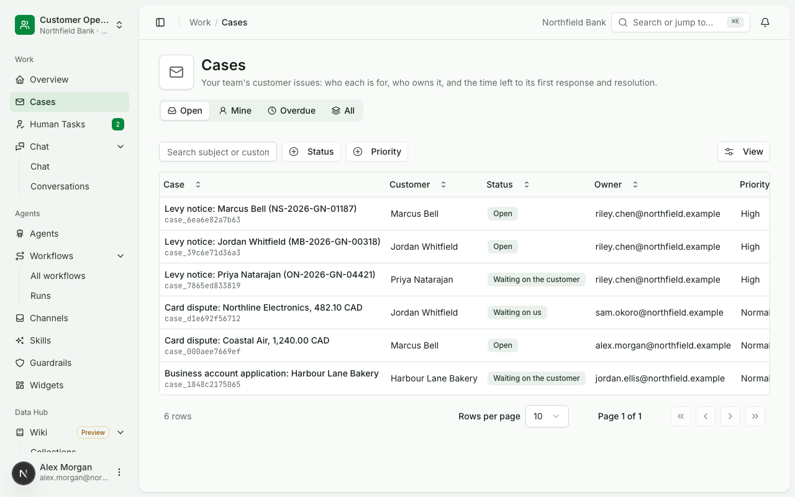
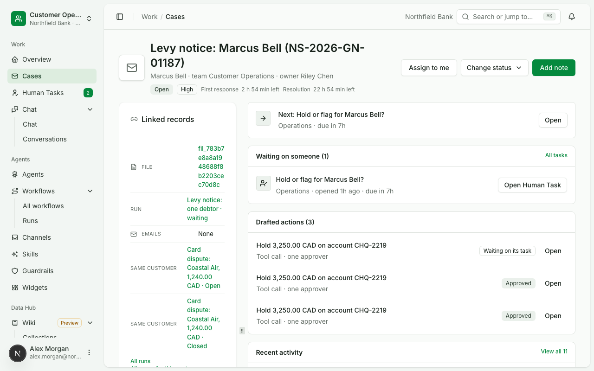
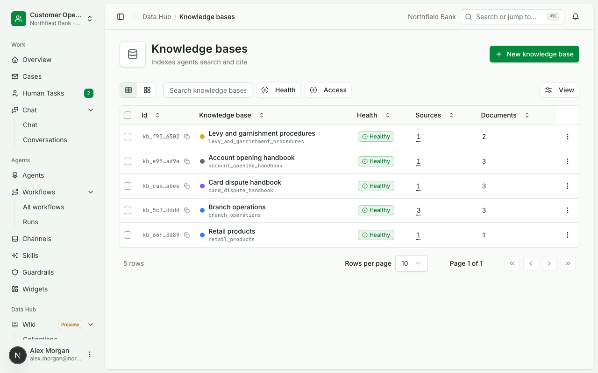
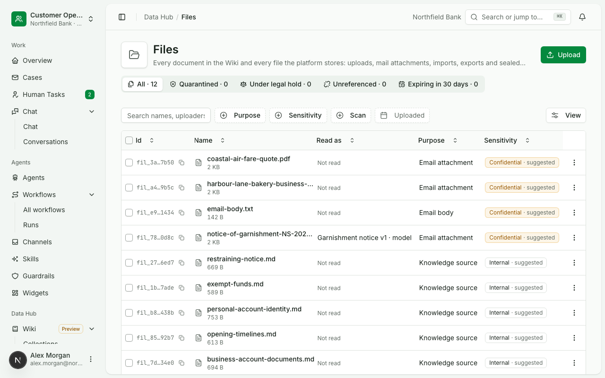
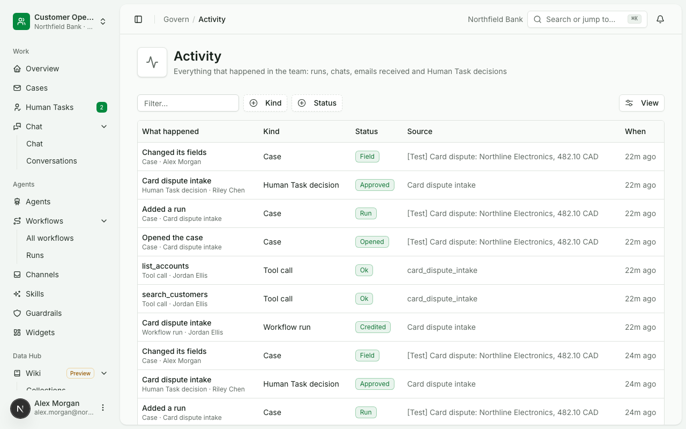
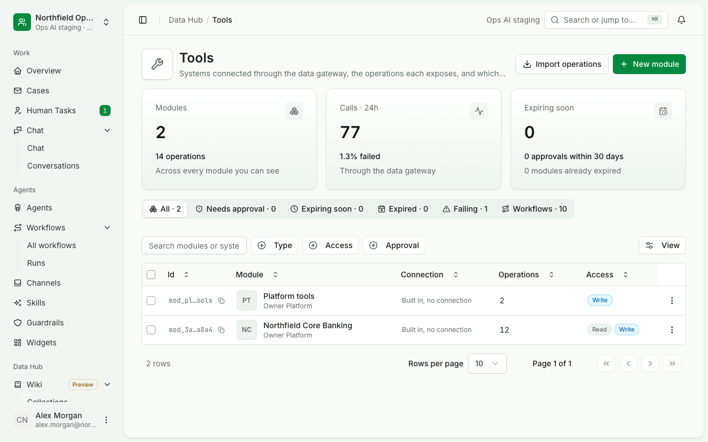

<p align="center">
  <picture>
    <source media="(prefers-color-scheme: dark)" srcset="docs/media/logo-dark.svg" />
    <source media="(prefers-color-scheme: light)" srcset="docs/media/logo-light.svg" />
    
  </picture>
</p>

<h1 align="center">Ops AI</h1>

<p align="center">
  <b>AI agents and workflows a bank can put in front of a risk review.</b><br />
  Every tool call and model call goes through a gateway, people approve what moves money, and every run leaves a record.
</p>

<p align="center">by <a href="https://chanl.ai">Chanl AI</a></p>

<p align="center">
  <a href="LICENSE"></a>
  <a href="pyproject.toml"></a>
  <a href="package.json"></a>
  <a href="apps/console"></a>
  <a href="docs/deploy/database.md"></a>
</p>

<p align="center">
  <a href="#quick-start">Quick start</a> &bull;
  <a href="#features">Features</a> &bull;
  <a href="docs/README.md">Docs</a> &bull;
  <a href="docs/deploy/client-install-guide.html">Install on your servers</a> &bull;
  <a href="#architecture">Architecture</a>
</p>

<p align="center">
  
</p>

---

## Why Ops AI?

Banks want AI to do operations work: read the court order notice, check the card dispute, answer the branch's question.
Most agent platforms stop at the answer; a bank's risk review asks who approved the write, which version ran and where the record is.
Ops AI makes those answers part of every run, so an agent can be put to work on real accounts.

```
Email, chat or API → workflow and agents → a person approves the write → tool gateway → case and record
```

Builders configure agents, knowledge, tools and workflows in a console; people decide the steps a policy reserves for
them in Human Tasks; cases collect the work for each customer. Seven Python services and a Next.js console run it on
PostgreSQL, on one machine or on Kubernetes.

- **Writes need a person.** A tool call that changes something runs only with an approval token bound to its exact
  input; money moves need a step-up sign-in and, where the policy says so, two approvers.
- **Use cases are configuration.** The court order notice, the card dispute and the account opening below are agents,
  workflows, document types and settings made through the public API, with no code written for any of them.
- **Every run is on the record.** Runs, decisions, tool calls and model calls are listed per team, with who did what.
- **Runs offline.** A fake model answers from committed rules, so the whole platform runs with no model key and no
  network.

The screenshots and clips come from a demo team, Customer Operations at a fictional bank, that
[`scripts/demo/seed_demo_team.py`](scripts/demo/seed_demo_team.py) creates through the public API and
[`docs/usecases/lib/capture_demo.mjs`](docs/usecases/lib/capture_demo.mjs) captures. Every person, customer and
company in them is made up, and every chat reply comes from the fake model's rules.

## Features

### Chat with agents that cite their sources and use the bank's tools

A person asks an agent in the console. The agent searches the knowledge bases it is granted, calls the tools it is
granted through the tool gateway, and answers with numbered citations to the handbook passages it used. Tool results
render as tables. A write the agent drafts waits for approval before it runs.

<p align="center"></p>

<p align="center"><picture><source media="(prefers-color-scheme: dark)" srcset="docs/media/chat-dark.png"></picture></p>

### Agent builder

An agent is a job description, instructions, a model alias, the tools it may call and the knowledge it may cite. Each
save is a version; publishing goes through the team's publish policy, which can require a second person's review. A
test panel runs the newest draft without counting the turn.

<p align="center"><picture><source media="(prefers-color-scheme: dark)" srcset="docs/media/agent-dark.png"></picture></p>

### Workflows

A workflow is a graph of typed steps: a trigger (a request, an email received), tool calls, matching, an agent step
that answers with a schema, a Human Task, opening a case, ending with an outcome. Definitions are data, saved as
versions and published through the same policy as agents. Runs pin the version they started on.

<p align="center"><picture><source media="(prefers-color-scheme: dark)" srcset="docs/media/workflow-dark.png"></picture></p>

Each run shows its steps as they happen, what passed, what waits and on whom:

<p align="center"></p>

<p align="center"><picture><source media="(prefers-color-scheme: dark)" srcset="docs/media/run-dark.png"></picture></p>

### Human Tasks

Every step a policy reserves for a person waits in Human Tasks with its deadline, risk and the facts the reviewer
needs. Approving a write sends the tool call with a token bound to the input the reviewer saw; a step that moves money
asks for a step-up sign-in first.

<p align="center"></p>

<p align="center"><picture><source media="(prefers-color-scheme: dark)" srcset="docs/media/human-tasks-dark.png"></picture></p>

### Email to a case

A team connects a mailbox on Channels > Email. A new email starts the workflow that watches it: attachments are stored
in Files, a document type reads each one with the quote and page for every field, a case opens per person the notice
names, and the acknowledgement goes back to the sender once a person approves it.

<p align="center"> Email, the run its court order notice started waiting at Hold or flag, the team's cases, and the court order case for Marcus Bell with the Human Task it waits on" width="850"></p>

### Cases

A case holds one customer's issue: its owner, status, response and resolution clocks, the runs and Human Tasks behind
it, the actions drafted for it and every note. Workflows open cases; people work them.

<p align="center"><picture><source media="(prefers-color-scheme: dark)" srcset="docs/media/cases-dark.png"></picture></p>

<p align="center"><picture><source media="(prefers-color-scheme: dark)" srcset="docs/media/case-dark.png"></picture></p>

### Knowledge

Knowledge bases index the documents a team uploads or syncs from a source, chunk them by section and serve them to
the agents granted each base. Retrieval today is PostgreSQL full-text search scored by how many of the question's
words a passage holds.

<p align="center"><picture><source media="(prefers-color-scheme: dark)" srcset="docs/media/knowledge-dark.png"></picture></p>

### Files and document types

Files stores every upload, mail attachment and knowledge source with its purpose, sensitivity, scan result, versions,
references and legal hold. A document type names the fields to read from a kind of document; the read keeps the quote
and page for each value.

<p align="center"><picture><source media="(prefers-color-scheme: dark)" srcset="docs/media/files-dark.png"></picture></p>

### Teams, roles and the activity record

People join a team by invitation with a role (admin, builder, approver, viewer); every permission is a cell in a
roles grid, and a refusal names the role that would allow it. Activity lists everything that happened in the team:
runs, chats, emails received, decisions, tool calls and case changes.

<p align="center"><picture><source media="(prefers-color-scheme: dark)" srcset="docs/media/activity-dark.png"></picture></p>

### Tools through the gateway

A bank system's API becomes a tool module with an operation per call; each operation has its access (read or write),
its credentials from Secrets and its approval policy. Every call goes through the gateway and lands in its call log.

<p align="center"><picture><source media="(prefers-color-scheme: dark)" srcset="docs/media/tools-dark.png"></picture></p>

### And more

- **Tools from an OpenAPI document.** Import a bank system's API as a tool module; each operation gets a policy,
  credentials from Secrets, mock answers for test, and a review before it is published.
- **Guardrails and skills.** Pinned to an agent's version and checked before and after each answer; a check fails
  closed.
- **Chat embed.** An agent's chat on the bank's own intranet pages, pinned to a published version, with allowed sites
  and keys per embed.
- **Model gateway.** Model aliases, provider connections, per-key budgets and a call log with cost; agents name an
  alias, never a provider.
- **SSO.** OIDC and SAML sign-in per email domain, step-up at the same provider, invitations and password reset.
- **One database seam.** Each service keeps its SQL in one store package, which runs on PostgreSQL and is being
  extended to SQL Server ([design](docs/design/data/sql-server.md)).

## What is not built yet

> [!NOTE]
> The table lists what a reader might expect from the screens and does not get yet, with where each is tracked.

| Not built | Today | Where |
|---|---|---|
| Semantic search in knowledge | Retrieval is PostgreSQL full-text; a question must share words with the passage | [`services/kb-service/src/ops_kb/retrieval.py`](services/kb-service/src/ops_kb/retrieval.py) |
| A generated SDK for TypeScript and Python | Scripts and the console call the HTTP API directly | [`docs/architecture/delivery.md`](docs/architecture/delivery.md) |
| Slack, Teams and MCP channels for agents | The console lists them as coming soon; email, chat embed and API are built. Tools are served over MCP per team in test | [`apps/console/src/lib/types/channels.ts`](apps/console/src/lib/types/channels.ts) |
| A mailbox on a real Microsoft 365 or Gmail tenant | Proven on a local IMAP server and a test provider | [`docs/architecture/delivery.md`](docs/architecture/delivery.md) |
| Retention and checkpoint pruning jobs | Files carry retention classes; nothing deletes on schedule yet | [`docs/architecture/data.md`](docs/architecture/data.md) |
| Attaching a file to a case by hand | A case shows files its runs carried | card c-400 |

Every architecture decision record in [`docs/architecture/decisions/`](docs/architecture/decisions/) is an option
until the owner confirms it.

## Architecture

The console is one Next.js app. Each backend service is named after the console section it serves and owns its own
tables; services call each other only through their public APIs, and every tool call and model call leaves through
its gateway.

```
ops-ai/
├── apps/
│   ├── console/          Next.js console: chat, agents, workflows, Human Tasks, cases, knowledge, files, settings
│   └── embed/            The chat embed a bank's intranet page loads
├── services/
│   ├── platform-service  Sign-in, SSO, teams, roles, invitations, API keys, audit; the only issuer of tokens
│   ├── agents-service    Agents, workflows and their runs, chat, Human Tasks, cases, channels
│   ├── tools-service     The tool gateway: modules, operations, connections, secrets, policy, approvals, MCP
│   ├── models-service    The model gateway: aliases, providers, budgets, call log; and the fake model
│   ├── kb-service        Knowledge bases, sources, indexing and retrieval
│   ├── files-service     File storage, scanning, versions, references, legal hold
│   └── documents-service Document types and reads with quotes
├── packages/             Libraries the services share: identity, settings, store, storage, policy, the agent kernel
├── deploy/               Compose, Kubernetes, the database, the release package
├── scripts/              Stack, checks and demo scripts
└── docs/                 Background, architecture, design, console, services, deploy and use cases
```

| Layer | Built with |
|---|---|
| Console | Next.js, React, TypeScript, shadcn/ui, React Flow |
| Services | Python 3.12, FastAPI, Pydantic, SQLAlchemy, Alembic |
| Agent turns and graphs | Pydantic AI, LangGraph with a PostgreSQL checkpointer of our own |
| Policy | Open Policy Agent for tool calls |
| Data | PostgreSQL 15 or newer; files on disk, S3 or Azure Blob |

[`docs/architecture/overview.md`](docs/architecture/overview.md) is the one-page picture;
[`docs/architecture/README.md`](docs/architecture/README.md) lists what is proven and by which test.

## Quick start

Runs every service, the console and the fake model on your machine. Needs:

- Python 3.12 and [uv](https://docs.astral.sh/uv/)
- Node 20 or newer and pnpm 10 (`corepack enable` provides it)
- Docker, for PostgreSQL, OPA and the test mail servers

No model key is needed: `DEMO_MODEL=fake` puts every model alias on the fake model.

```bash
git clone <this repository> ops-ai && cd ops-ai
make install                             # pnpm install and uv sync, once per clone
make up DEMO_MODEL=fake AUTH=platform    # PostgreSQL, OPA, every service and the console
make health                              # each service, its port and whether it answers
```

Open http://localhost:3016 and sign in as the workspace admin `w.kamau@harborpine.example` with the development
password `northfield-demo`. The development seed adds a few teams, agents and tools of its own; `make down KEEP_DB=1`
stops the stack and keeps the data. Every service's API reference is on one page at http://localhost:8799 (a
service that is not running shows its committed spec). These steps were run from a fresh clone on 2026-10-20: every service answered
`ok`, the console signed in, and a chat turn on the fake model answered with a citation.

To answer with a real model instead, put `OPENAI_API_KEY` in a `.env` file at the root (git ignores it) and run
`make up AUTH=platform`.

| Command | What it does |
|---|---|
| `make up` | Migrates the database in place, then starts or restarts whatever is out of date |
| `make health` | Each service's port, whether it answers and who started it |
| `make logs SVC=agents` | Follows one service's log |
| `make down KEEP_DB=1` | Stops the services and keeps the database |
| `make verify` | Everything a commit must pass, on the scripted model |
| `make usecase-test UC=uc-010` | Runs one end-to-end use case on its own stack |

## Run with Docker

The images build from [`deploy/fly/Dockerfile`](deploy/fly/Dockerfile) and run under Docker Compose behind one
origin, against a PostgreSQL you provide or the one in `deploy/compose/try.yaml`:

```bash
for t in platform agents tools models kb files documents opa proxy console; do
  docker build -f deploy/fly/Dockerfile --target $t -t ops-ai/$t:dev .
done
cp deploy/compose/app.env.example ~/ops-ai.env     # fill it in; never commit it
docker compose -p ops-ai -f deploy/compose/app.yaml --env-file ~/ops-ai.env up -d
```

[`docs/deploy/compose.md`](docs/deploy/compose.md) has every setting, connecting a model and the fake model, and what
was proven on one machine. Kubernetes, a single VM and the release package for a bank's own servers are in
[`docs/deploy/install-guide.md`](docs/deploy/install-guide.md).

## Load the demo team

The team in the screenshots, on any install, through its public API:

```bash
cp scripts/demo/demo.env.example .run/demo.env   # a workspace admin's email and password; .run/ is git-ignored
uv run python scripts/demo/seed_demo_team.py --origin http://localhost:3016 --admin-env .run/demo.env
node docs/usecases/lib/capture_demo.mjs --origin http://localhost:3016 --env .run/demo.env
```

The first command makes Customer Operations: four people, three handbooks, three agents, the card dispute and court order
workflows with runs that passed, failed and wait, decided Human Tasks, worked cases and finished chats. A second run
changes nothing. The second retakes every screenshot in `docs/media/`; `--clips` also records the clips.

## Documentation

| Doc | What is inside |
|---|---|
| [`docs/README.md`](docs/README.md) | The map of every document, with a reading order |
| [`docs/background/problem-statement.md`](docs/background/problem-statement.md) | Why bank AI workflows stall and what the platform needs |
| [`docs/architecture/README.md`](docs/architecture/README.md) | The system as built, what is proven and the decision records |
| [`docs/usecases/README.md`](docs/usecases/README.md) | The end-to-end checks behind each feature and how to run them |
| [`docs/deploy/install-guide.md`](docs/deploy/install-guide.md) | Installing and running Ops AI |

## Contributing

[`CONTRIBUTING.md`](CONTRIBUTING.md) covers the doc and code standards, verification and commit messages;
[`AGENTS.md`](AGENTS.md) holds the rules for coding agents. `make verify` must pass before a commit; the pre-commit
hook runs the console's checks on the staged content.

## Licence

Apache-2.0. See [`LICENSE`](LICENSE).
