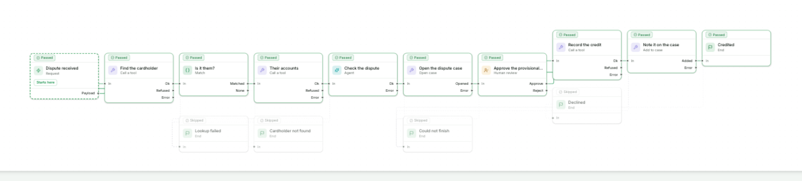

<p align="center">
  <picture>
    <source media="(prefers-color-scheme: dark)" srcset="docs/media/logo-dark.svg" />
    <source media="(prefers-color-scheme: light)" srcset="docs/media/logo-light.svg" />
    
  </picture>
</p>

<h1 align="center">Ops AI</h1>

<p align="center">
  <b>An open-source agent and workflow platform for regulated operations teams.</b><br />
  Build agents and workflows where every tool, data and model call goes through a gateway, a person approves the steps
  that matter, and every run leaves a record a reviewer can read.
</p>

<p align="center">
  <a href="LICENSE"></a>
  <a href="https://github.com/chanl-ai/ops-ai/actions/workflows/ci.yml"></a>
</p>

<p align="center"><picture><source media="(prefers-color-scheme: dark)" srcset="docs/media/run-dark.png"></picture></p>

## What you can do with it

Ops AI is for teams in banks, insurers and other regulated businesses that want AI to do operations work and must
show a risk review who approved what, which version ran and what data it reached. It runs on your own machines, and
the whole stack runs with no model key.

| You get | What it does | Status |
|---|---|---|
| Governed agents | Instructions, a model alias, tools and knowledge; every save is a version and publishing goes through review | Built |
| Workflows | A visual editor over 25 step types: fixed steps, AI steps, human tasks, tool calls and cases; a run keeps its version | Built |
| Tools with approvals | OpenAPI documents and MCP servers imported as tools; an approval is bound to the exact input; every call is logged | Built |
| Knowledge | Knowledge bases searched by meaning and keyword, with answers cited by page and section | Built |
| Evals | Test cases saved on an agent, with every run kept. The pass rate is reported on each publish request | Partial: the pass rate does not stop a publish yet |
| Console, SDKs and CLI | A Next.js console, Python and TypeScript SDKs and the `opsai` command on one public API | Built; the SDKs install from this repository |
| Databases | PostgreSQL 15 or newer. SQL Server scripts are ready for a DBA's review ([Azure SQL](docs/guide/azure-sql.md)) | PostgreSQL Built; SQL Server Partial: the services do not run on it yet |

[What's built today](docs/guide/whats-built-today.md) gives the status of each capability, and
[Card disputes](docs/guide/use-cases/card-disputes.md) walks the workflow in the picture from request to record.

## Quick start

This starts every service, the console and a built-in fake model on your machine. You need:

| Tool | Used for |
|---|---|
| [uv](https://docs.astral.sh/uv/) | The services and the `opsai` command, on Python 3.12, which uv downloads when it is missing |
| Node 22 or newer and pnpm 10 (`npm install -g pnpm@10`) | The console |
| Docker with Compose, running | PostgreSQL, OPA and two test mail servers |
| Optional: [Tesseract](https://tesseract-ocr.github.io/) | Reading scanned files; without it `make health` shows documents as `degraded` |

No model key is needed: with no `OPENAI_API_KEY` set, every model alias answers from the fake model. One stack runs
per machine, on ports 3016, 3017, 3020, 8700 to 8770, 8799, 8181, 5477, 3025, 3143, 1025 and 8025.

```bash
git clone https://github.com/chanl-ai/ops-ai.git && cd ops-ai
make install        # pnpm install and uv sync, once per clone
make up             # database, migrations, every service, the console, and a sample team on a new database
make health         # each service with its port and state
```

Open <http://localhost:3016> and sign in as `w.kamau@harborpine.example` with the development password
`northfield-demo`. The bank, its people and its customers are fictional sample data.

<http://localhost:3016> is the console and does not serve the API. Each service serves its own part of the API on its
own port: platform 8710, agents 8700, tools 8720, kb 8740, files 8750 and documents 8760, with one reference page for
all of them at <http://localhost:8799>. The SDKs and the CLI take those addresses as `services`; a deployed install
puts them behind one address, which is the SDK's `base_url`.

`make down KEEP_DB=1` stops the stack and keeps the data. To answer with a real model, put `OPENAI_API_KEY` in a
`.env` file at the root (git ignores it; [`.env.example`](.env.example) lists the settings) and run `make up` again.

## Three things to try

Each one runs against the stack from the quick start.

**1. Chat with an agent.** The answer streams to the terminal with the link to the same conversation in the console.
On the fake model the reply repeats what the agent retrieved, which shows the knowledge search and its citations.

```bash
make chat-agents AS=builder
make chat AS=builder AGENT='Branch Policy' SAY='What is the daily cash withdrawal limit at a branch?'
```

**2. Build and run a workflow from a folder.** `setup.py` signs in and writes a local profile into the folder; the
`opsai` command then validates the workflow file, saves it and starts a test run.

```bash
uv run python examples/workflows/01-normalize-a-request/setup.py
cd examples/workflows/01-normalize-a-request
OPS_CONFIG=.ops-profile.json uv run opsai workflows validate resources/workflow.yaml
OPS_CONFIG=.ops-profile.json uv run opsai workflows apply resources/workflow.yaml
OPS_CONFIG=.ops-profile.json uv run opsai workflows run normalize_support_request --input fixtures/valid.json --test --wait
cd ../../..
```

**3. Call the API from Python.** The profile from step 2 holds the service addresses, the team and a sign-in, so the
client needs no arguments; run `setup.py` again if the sign-in has expired. In your own install, pass `base_url`,
`api_key` and `team` instead
([Python SDK](docs/sdk/python.md), [TypeScript SDK](docs/sdk/typescript.md)).

```bash
OPS_CONFIG=$PWD/examples/workflows/01-normalize-a-request/.ops-profile.json uv run python -c "
from ops_ai import OpsAI
ops = OpsAI()
run = ops.workflows.run('normalize_support_request', mode='test', wait=True,
    input={'customerEmail': 'ada@example.test', 'subject': 'Card', 'message': 'Where is my refund?'})
print(run['status'], run.get('outcome'))
"
```

It prints `succeeded accepted`. The next examples add a model step, a tool call and a person's approval:
[`examples/`](examples/README.md) has one folder per idea, and
[`04-draft-and-approve-a-reply`](examples/workflows/04-draft-and-approve-a-reply/README.md) holds a reply until a
person approves it.

## Documentation

| Read | For |
|---|---|
| [Build with Ops AI](docs/guide/build-with-ops-ai.md) | The developer path, then the [agents](docs/guide/agents.md) and [workflows](docs/guide/workflows.md) manuals |
| [Security and governance](docs/guide/security-and-governance.md) | Approvals, roles, sign-in and audit |
| [Install](docs/guide/install.md) | Running it on a server: the install script, Docker Compose, Kubernetes |
| [Architecture](docs/architecture/README.md) | How the services, the gateways and the runtime fit together |
| [docs/README.md](docs/README.md) | The map of every document |

## Contributing

[`CONTRIBUTING.md`](CONTRIBUTING.md) covers the standards, the checks a change must pass (`make verify`) and commit
messages; [`AGENTS.md`](AGENTS.md) holds the rules for coding agents. Report a vulnerability as
[`SECURITY.md`](SECURITY.md) describes.

## Licence

Apache-2.0. See [`LICENSE`](LICENSE).
