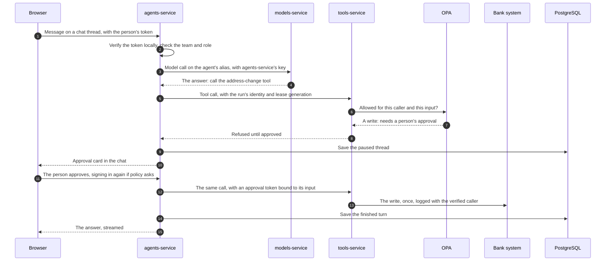

# Ops AI architecture

Status: current, updated 2026-11-18. The design behind it is [workflows and agents](../design/workflows/workflows-and-agents.md); the product or library each part is built on is in [platform choices](platform-choices.md).

Ops AI lets an enterprise's operations teams hand routine work to AI agents and workflows, with a person approving
any change to a system of record. It is a set of Python services behind one web console. Every run saves its state
in the database the enterprise provides, every tool call leaves through one data gateway and every model call through
one AI gateway. This page is the map: the services, one request from start to finish, and where to read next.

## The services

<!-- site: cards -->
| Service | Port | What it owns | Status |
|---|---|---|---|
| [platform-service](../services/platform-service/overview.md) | 8710 | Sign-in (password, OIDC, SAML), tenants, teams, roles, API keys, the audit log; the only service that issues identity tokens | partial |
| [agents-service](../services/agents-service/overview.md) | 8700 | Agents, workflows and their versions, chat, threads and runs, channels, Reviews and Cases; its worker process runs workflow steps | partial |
| [tools-service](../services/tools-service/overview.md) | 8720 | The data gateway: tool modules, credentials, policy checked by OPA, approval tokens, the call log, the MCP server per team | built |
| [models-service](../services/models-service/overview.md) | 8730 | The AI gateway: model aliases, provider keys, key budgets, the call log | partial |
| [kb-service](../services/kb-service/overview.md) | 8740 | Knowledge bases, their sources, search with cited passages | built |
| [files-service](../services/files-service/overview.md) | 8750 | File bytes: uploads, deduplication, versions, legal holds, storage targets | partial |
| [documents-service](../services/documents-service/overview.md) | 8760 | What is read from a file: extractions, corrections, document types | partial |
| [runner-service](../services/runner-service/overview.md) | 8770 | A code tool's Python function, run in a sandbox with no network and no secrets | partial |

The console runs on port 3016. One proxy gives every browser-facing service a path on one origin; models-service and
runner-service are reached only by other services. Each service owns its tables and migrations, reads no other
service's tables, and verifies every caller's token itself against platform-service's published keys. How the eight
run as containers is in [system components](../guide/system-components.md); boundaries, calls between services and
deployment targets are in the [service map](service-map.md).

## One request, start to finish

A person asks a chat agent to change a customer's address. The same path serves a workflow step started by an email:
only the channel that creates the run differs.

<!-- site: steps -->
1. **Find or create the thread.** A thread is one conversation or one case. It keeps the saved state and the version
   of the agent or workflow it started on, so a later publish never changes a run in flight.
2. **Run the graph on the input.** A chat agent is a graph with one agent node; a workflow is a larger graph. The run
   saves state after every step.
3. **Leave only through the gateways.** Model calls go to models-service and tool calls to tools-service, which hold the
   keys and credentials, check policy and log every call.
4. **Pause for a person.** A write that policy gates stops the run and releases its worker; the pause can last seconds
   in chat or days on a case.
5. **Resume once.** The decision resumes the same thread, and the approval token lets the gated call run exactly once.

The channel never reaches the graph: an adapter turns what arrives (a chat message, an email, an API call, a schedule)
into steps 1 and 2. The thread and run model is in [words and entities](words-and-entities.md) and
[inside the runtime](runtime.md); pauses in [human in the loop](human-in-the-loop.md).

## Where to read next

The full picture for an enterprise, with each part's status, is [system architecture](enterprise-architecture.md).
After that, by topic:

<!-- site: cards -->
| Topic | Pages | Read it to learn |
|---|---|---|
| Runtime | [Inside the runtime](runtime.md), [workflow runner](workflow-runner.md), [definitions and versions](definitions-and-versions.md), [durability, failure and audit](durability-failure-and-audit.md) | How a run executes, survives a crash and keeps its version |
| People in the loop | [Human in the loop](human-in-the-loop.md), [agent guardrails and skills](agent-guardrails.md), [workflows as agent tools](workflows-as-tools.md) | Pauses, approvals, step-up and what an agent is held to |
| Identity and access | [Identity and tenancy](identity-and-tenancy.md), [roles and permissions](roles-and-permissions.md), [SAML sign-in](saml-sign-in.md) | Who a run acts for, who may do what, how teams are kept apart |
| Tools and integrations | [Tool lifecycle](tool-lifecycle.md), [integrations in layers](integrations.md), [several accounts per app](app-accounts.md), [MCP](mcp.md), [templates](templates.md) | How an outside system is connected, called and governed |
| Knowledge and data | [Knowledge base](knowledge-base.md), [data](data.md), [data model](data-model.md), [logging and data writes](logging-and-data-writes.md) | What is stored where, for how long, and how it is searched |
| Channels and console | [Channels and deployments](channels-and-deployments.md), [embedded chat](embedded-chat.md), [chat widgets](chat-widgets.md), [console areas](console-areas.md) | How work arrives and how people see it |
| The API | [API conventions](api.md), the API reference tab | Call families, request rules and the event schema |
| Operate | [Operations](operations.md), [make](make.md), [dependencies](dependencies.md), [cloud boxes](cloud-boxes.md) | Running, watching and changing a stack |
| Proof and decisions | [Delivery](delivery.md), [platform choices](platform-choices.md), [decision records](decisions/README.md) | What is proven by which check, what is open, and why each choice was made |
| Standards | [Engineering standards](engineering-standards.md), [API changes in the standards migration](migration/api-changes.md) | The rules code is held to, each with its check; the migration onto them is finished, and the one page still read by the API-change checks is the API changes list |

## For a security review

Each row names where the claim is made and the check or code behind it. A part not yet built says so on its page.

| Concern | What holds today | Where to check |
|---|---|---|
| Tenancy and isolation | Row-level security per tenant and team on run, checkpoint, workflow and identity tables; a record in another tenant answers 404, in another team 403 | [Tenancy and access standards](standards/tenancy-and-access.md), [identity and tenancy](identity-and-tenancy.md) |
| Identity | platform-service alone signs tokens (Ed25519, published as JWKS); every service verifies them locally; company sign-in over OIDC or SAML | [Identity and tenancy](identity-and-tenancy.md), [SAML sign-in](saml-sign-in.md) |
| Access | Every write passes one permission check, `can()`; every exception to it is listed in a register that a check keeps current | [Roles and permissions](roles-and-permissions.md) |
| Egress | Tool calls only through tools-service, to allow-listed hosts, with credentials that never leave it; model calls only through models-service in every shipped layout | [System architecture: data gateway](enterprise-architecture.md#8-data-gateway), [security standards](standards/security.md) |
| Audit | A change to access writes its audit entry in the same transaction (no known breach; no automated check yet, rule `SC2`); every tool call and model call is logged with its verified caller | [Security standards: SC2](standards/security.md#sc2-a-change-to-access-leaves-an-audit-entry-in-the-same-transaction), [durability, failure and audit](durability-failure-and-audit.md) |
| Where data lives | All state in the database the enterprise runs; files on a target an admin chooses; model traffic only to the configured endpoint; the dependency lock makes no outbound call under a socket guard except one tokenizer download | [Data](data.md), [dependencies](dependencies.md) |
| Availability | A run killed mid-step is taken over by another process in about 5.5 seconds and resumes from its last saved step; a stale owner cannot write | [Durability, failure and audit](durability-failure-and-audit.md), [delivery](delivery.md#what-is-proven) |
| Upgrade and rollback | The install's upgrade backs up first and restores the old version on a failed check; migrations do not roll back by themselves | [Install guide](../deploy/install-guide.md), [database runbook](../deploy/database.md) |

> [!NOTE]
> Ops AI is pre-release. Each page marks every part built, partial or planned, and [delivery](delivery.md) lists the
> use case or experiment behind each claim.

## Conventions in this folder

| Convention | Meaning |
|---|---|
| Built | The behaviour exists in `services/` or `packages/` and a test or use case exercises it |
| Partial | Part of it is in code; the page says which part |
| Planned or designed | Written in a decision record, a spec or here, with no code yet |
| `path:line` | Given where a reader has to open the code to act |
| Specs and decisions | Hold the detail; these pages hold the decision and link to them |
