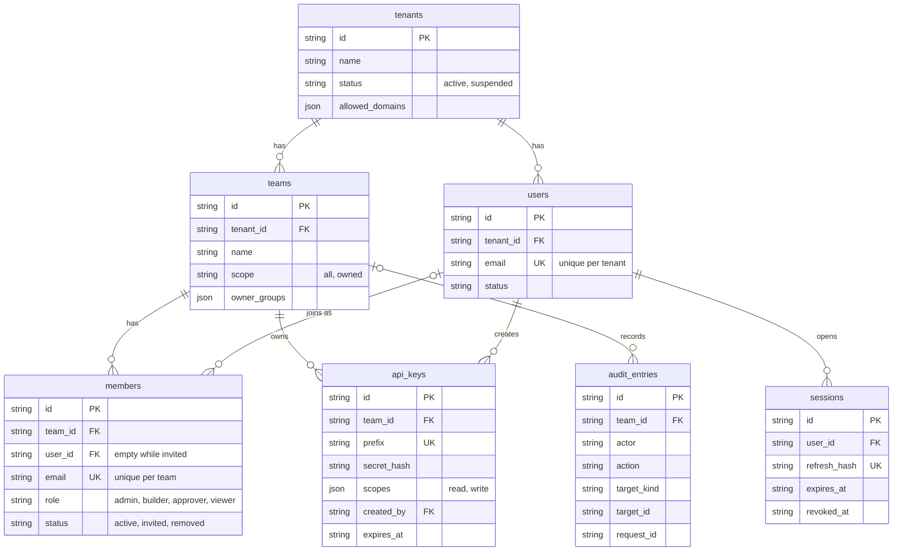
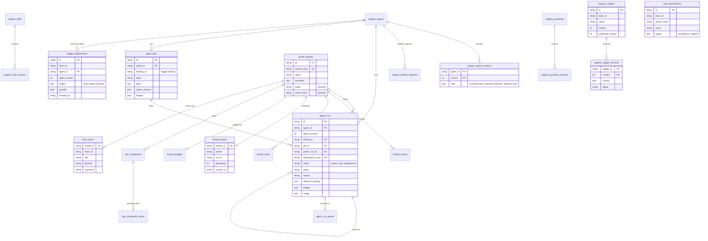
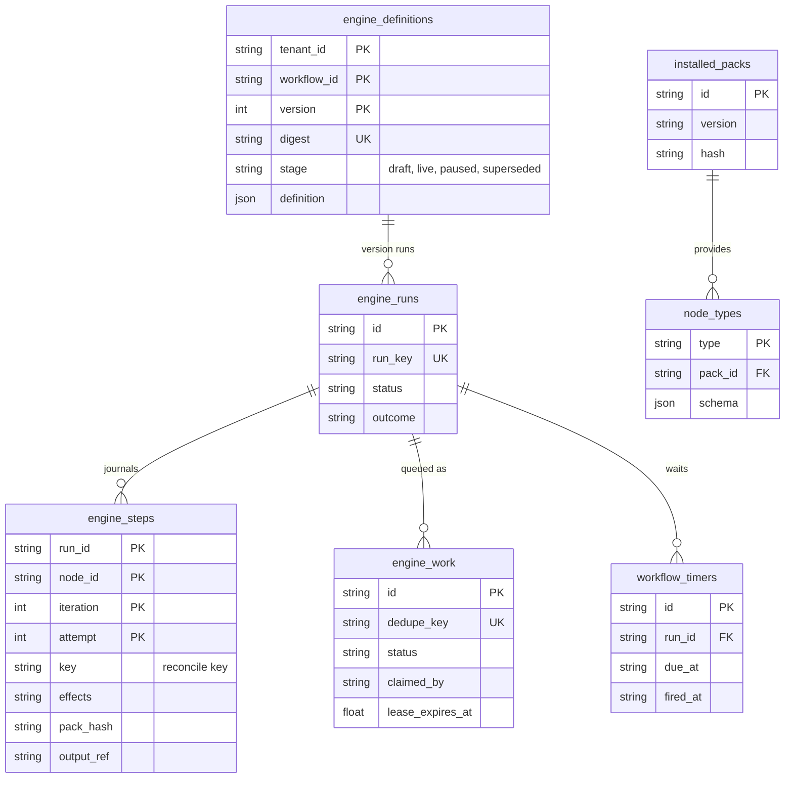
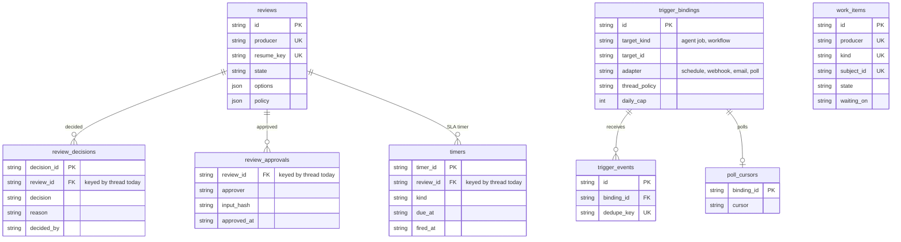
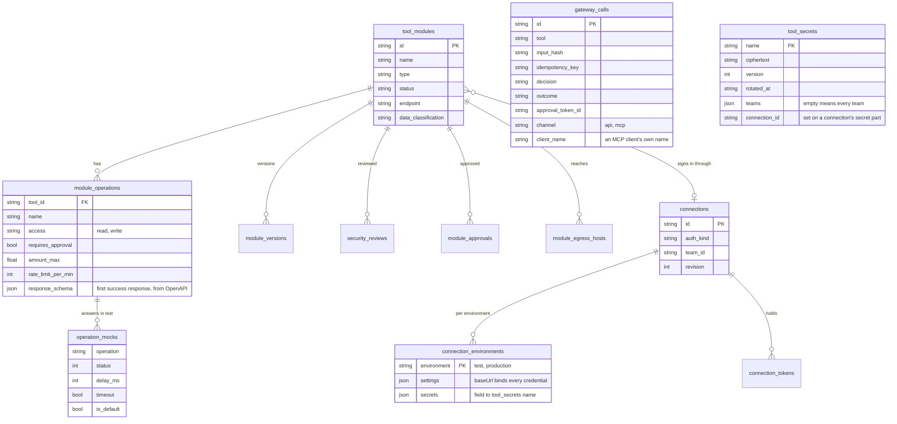
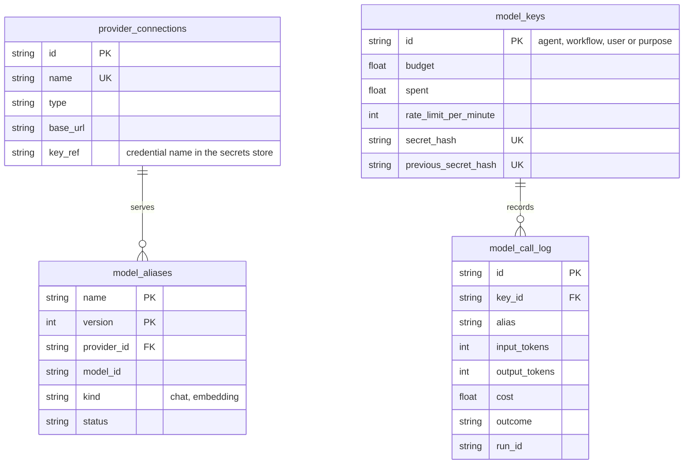
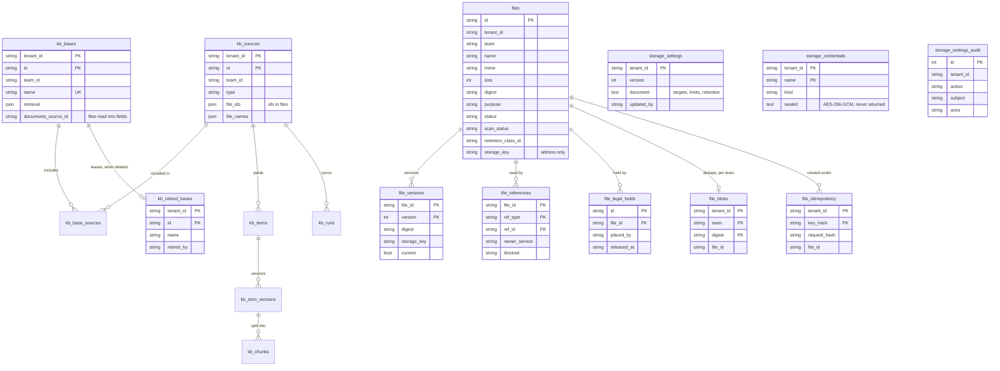
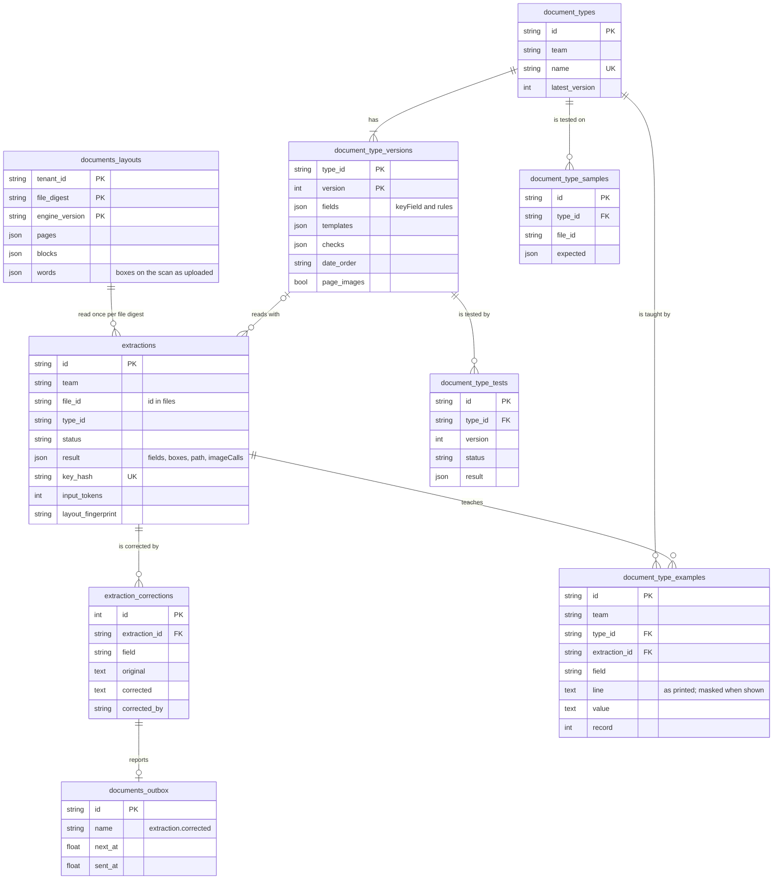

# Ops AI data model

Status: current. Every table Ops AI keeps, by the service that owns it.

Every table Ops AI keeps, grouped by the service that owns it, with its keys, its links and whether it is in code today. It is the companion to the [Ops AI architecture](enterprise-architecture.md) page, whose service map and database sections it expands.

Ops AI is pre-release. Status labels describe the code at the date in the status line; planned tables and their columns are proposals.

- **built**: in code and a migration today
- **planned**: designed, no code yet; dashed in the diagrams
- **partial (moving)**: in code today, moving to another service; blue in the diagrams
- **retiring**: in code today, removed when its replacement lands; listed in the tables only

## How to read the diagrams

<!-- site: cards -->
- **Notation**: PK primary key, FK key of another table, UK unique. `||--o{` one to many; `||--o|` one to at most one; `|o--o{` optional parent. Each box shows the key columns and the columns that explain the table; the full columns are in each service's migrations.
- **Columns every table has**: `tenant_id` on every table, which the store layer adds to every query. `team_id` on every team-owned record, pointing at the team in identity. Both are left out of the diagrams to save space.
- **Links across services**: Each service owns its tables and reads only its own. A link to another service's record is a stored key value, checked by that service's API. Foreign key constraints exist only inside one service.

> [!NOTE]
> **Why one section per service.** Each service owns its tables, so grouping by owner shows which service a change lands in, and answers the question a risk review asks of every table: which component can read this data.

## Identity and teams

Owned by `platform-service` partial

Tenants, the people in them, the teams they belong to and the role each person holds in each team. API keys belong to a team. Every other table in Ops AI carries the `tenant_id` and, for team-owned records, the `team_id` defined here.

> [!NOTE]
> **Why.** Access is granted per team, so the team is the unit every other service checks. Keeping identity in one service, the only one that issues tokens, means a change to who may do what happens in one place and every service sees it on the next token.

| Table | Holds | Status |
|---|---|---|
| `tenants` | An organisation using the platform, with the email domains allowed to sign in | built |
| `teams` | A group that owns agents, workflows, tools and knowledge | built |
| `users` | A person in a tenant | built |
| `members` | A person's role in one team; also holds pending invites. An invitation to an email that already has an account is accepted only by that person, signed in as themselves; the check runs inside the same transaction as the acceptance, and the unique email per organisation refuses a second account made at the same moment | built |
| `api_keys` | A team's key for system access, stored as a hash with read or write scope | built |
| `sessions` | A signed-in browser session and its refresh token hash | built |
| `audit_entries` | Who did what, to which record, with the request id | built |

## Agents and runs

Owned by `agents-service` partial

An agent is versioned; each version is what a publish review approved. Every use of an agent, from a chat message to a background job, is a run on a thread. A thread keeps the conversation, its events, its checkpoints and the lease that says which process is running it.

> [!NOTE]
> **Why.** Each run stores the settings it actually used (`effective_settings`), because callers may choose a model, temperature, tools or knowledge within the agent's limits. The agent version alone then no longer says what a run did, and the stored settings make every answer explainable. Overrides set on a thread apply to every run in it; a run may narrow them further.

| Table | Holds | Status |
|---|---|---|
| `registry_agents, registry_agent_versions` | An agent and its immutable versions. A version carries the limits a caller may override within, the on or off switch of each pinned guardrail and optional call caps per turn and per conversation. An empty per-turn model-call cap means 50, and an empty per-conversation cap means 200 model calls and a cost of 5.00 | built |
| `registry_publish_requests` | A request to publish a version, decided by a second person. Moves to the reviews package | partial (moving) |
| `registry_skills, registry_skill_versions` | Versioned procedures an agent loads when a request matches. A skill records who created it, once, so the right to delete it does not pass to whoever saved a draft last | built |
| `registry_guardrails, registry_guardrail_versions` | Versioned checks on the question and the answer | built |
| `graph_threads` | A conversation or job thread, with the overrides set for the thread. Its origin and owning team are planned `ix_graph_threads_team_updated` (tenant_id, team_id, updated_at) serves a team's thread list (0071, c-280). | partial |
| `chat_attachments` | A file attached to a chat message: who owns it, its type and size, and the text read from it, capped | built |
| `chat_search` | A thread's title, agent, last reply and questions as plain columns, so search works on every supported database | built |
| `registry_widgets, registry_widget_versions` | Widget templates an agent may show in chat, saved as versions and published through a review. The newest name is kept on the widget so a list searches and pages in the database | built |
| `widget_deployments` | A chat widget served to pages on other origins: the agent and published version it is pinned to, the exact origins allowed, a paused flag and the team its conversations belong to. Sessions are signed tokens that expire after 15 minutes and are not stored | built |
| `graph_versions` | The compiled graph a thread runs on | built |
| `thread_events` | The event stream of a thread: messages, tool calls, approvals `ix_thread_events_tenant_team_position` (tenant_id, team_id, position) serves the team event poll; it replaced `ix_thread_events_team_position`, which led with the team id alone (0071, c-280). | built |
| `thread_inbox` | Messages that arrive while a run is busy, delivered in order | built |
| `thread_leases` | Which process runs the thread now, with a generation number that fences out a stopped process | built |
| `thread_budgets` | The model-call, token and cost caps of a thread, checked against what it has spent. A chat conversation gets its caps from its agent when it starts. When they are spent the conversation pauses, and its owner continues or a team admin raises them. An answer names the pause it answers, so a screen showing an older pause is refused | built |
| `model_call_records` | Each model call a run made, for replay and cost | built |
| `ops_checkpoints, ops_checkpoint_writes, ops_checkpoint_fences` | Run state after each step, so a run resumes from its last step after a crash. Gain run and step columns `ix_ops_checkpoints_run` (tenant_id, team_id, (metadata->>'run_id')) serves the delete by run (migration 0071, c-280); like these tables it is raw SQL with no metadata until the checkpointer's SQL Server rewrite (c-337), so the diagram and the golden DDL do not show it. | built |
| `agent_runs` | One run of an agent: mode, status and reason, settings used, budget and usage | planned |
| `agent_run_queue` | Background runs waiting for a worker | planned |
| `agent_jobs` | A goal, a trigger and a budget; the agent works over many turns and ends with a report | planned |
| `graph_runs` | The current run record, replaced by agent_runs | retiring |

## Workflows and steps

Owned by `workflows engine (served by agents-service today)` built

A workflow definition is immutable once published and identified by workflow, version and digest. A run walks it step by step; every step attempt is a row in the journal, and the work queue hands steps to workers.

> [!NOTE]
> **Why.** The journal and the work queue are what let a workflow survive a crash without repeating a write: a restarted run reads which steps finished and reconciles each write by its key. Only the workflows engine writes these tables. Each journal row records the hash of the node pack that ran it, so every step can be traced to the exact code.

| Table | Holds | Status |
|---|---|---|
| `engine_definitions` | Workflow definitions by version. Each version has a stage: draft, live, paused or superseded. A draft goes live when its publish review is approved. `archived_at` and `archived_by` are set on every version of an archived workflow, which starts no run (migration 0070, c-274) `ix_engine_definitions_live` (tenant_id, workflow_id) WHERE stage = 'live', on PostgreSQL and SQL Server alike, serves service event listeners and the mailbox listener (0071, c-280). | built |
| `engine_runs` | One run of a workflow version, with status and outcome. A run another run's step started has `created_by` = `run:<parent id>`, which is how a parent finds the runs it waits on. Indexes: `ix_engine_runs_parent_status` (tenant_id, created_by, status) finds a parent's unfinished runs, `ix_engine_runs_team_created` (tenant_id, team_id, created_at) and `ix_engine_runs_team_status_created` (tenant_id, team_id, status, created_at) serve the runs list (migrations 0065 and 0066; 0066 replaced `ix_engine_runs_created_by`) `ix_engine_runs_workflow_created` (tenant_id, workflow_id, created_at) serves the runs list filtered by one workflow (migration 0071, c-280). | built |
| `engine_steps` | The step journal: one row per node, iteration and attempt. Gains pack id, version, hash and an output reference | built |
| `engine_work` | The work queue, claimed by workers under a lease Indexes: `ix_engine_work_due` (status, build, available_at) and `ix_engine_work_lease` (status, build, lease_expires_at), one per branch of the claim: due queued work, and claimed work whose lease lapsed (0071, c-280). | built |
| `workflow_timers` | Waits and deadlines inside a workflow run | planned |
| `installed_packs` | Node packs installed at deploy time from the allowlist, pinned by hash | planned |
| `node_types` | The node types each pack provides, written at start-up | planned |
| `task_types` | A Human Task type: the screen a review step or `POST /v1/tasks` names by id. Seeded types have no team; a team's own type is edited by that team. Holds the newest version and the published version, and where a copy came from. Row level security by tenant (migration 0063) | built |
| `task_type_versions` | Each saved version of a task type as a JSON record. A published version never changes, so a task keeps the screen it opened with (migration 0063) | built |
| `case_types` | The fields a case shows and their order, per tenant: a seeded type (owned by no team, copied to change) or a team's own, with its newest and newest published version (migration 0069, c-291) | built |
| `case_type_versions` | Each saved version of a case type: its fields, each with a key, label and type (the extraction field types, file or link). A case pins the published version it opened with (migration 0069) | built |
| `task_assists` | What task assist wrote for a typed task when its step paused, one row per review step (`step_id` = run:node:iteration). A second write for the same step is refused, so a task costs one model call (migration 0064) | built |
| `registry_workflows, registry_workflow_versions, registry_validations` | The first workflow registry, replaced by engine_definitions | retiring |
| `deployments, channel_messages, channel_cursors, channel_files` | The first mailbox channel, replaced by trigger bindings. A deployment records the team that owns it, so only a builder or administrator of that team can create, pause or poll it; deployments made before this existed have no owner until an administrator sets one | retiring |

Today these tables are migrated with agents-service; they move to the workflows engine's own migration chain.

## Reviews, triggers and work items

Owned by `reviews (ops_hitl) and triggers (ops_triggers)` partial

Reviews and triggers serve agents and workflows alike. A review is opened by any producer and resumed by its key; a decision mints an approval for that exact input. A trigger binding starts an agent job or a workflow run from a schedule, a webhook, an email or a poll. A work item is one entry in the shared work list.

> [!NOTE]
> **Why.** These tables belong to packages that neither agents nor workflows own, so a deployment with only one of them keeps reviews and triggers. `reviews.resume_key` and `work_items.subject_id` point at a run by its key, because the run lives in another service's tables.

| Table | Holds | Status |
|---|---|---|
| `reviews` | One open review: who produced it, how to resume it, the options and the approval policy | planned |
| `review_decisions` | Each decision on a review. Exists in agents-service today and moves, keyed to the review | partial (moving) |
| `review_approvals` | The approval minted for an exact input. Moves, keyed to the review | partial (moving) |
| `timers` | SLA timers that fire each outcome once. Moves with reviews | partial (moving) |
| `cases` | A case in agents-service. `fields` (JSON, nullable) keeps what an Open case or Add to case step read or worked out, by name (migration 0062); `type_id` and `type_version` name the case type version it was opened with (migration 0069) | built |
| `work_items` | One entry in the shared work list for agents and workflows | planned |
| `trigger_bindings` | What starts which agent job or workflow, with a daily cap | planned |
| `trigger_events` | Each arrival, with a dedupe key so a repeat starts nothing new | planned |
| `poll_cursors` | Where a polling trigger last read up to | planned |

## Tools and the data gateway

Owned by `tools-service` built

A tool module is one business system, imported from an OpenAPI description or an MCP server. It has operations, versions, a security review and approvals, and the hosts it may reach. Every call through the gateway is logged and fenced.

> [!NOTE]
> **Why.** Credentials, limits and the call log sit with the gateway, the only process that calls business systems. Agent workers hold no credentials, and a risk review of tool access examines one service's tables.

| Table | Holds | Status |
|---|---|---|
| `tool_modules` | A connected business system | built |
| `module_operations, module_versions` | Its operations and their versions, each with an approval policy. An operation imported from OpenAPI keeps the JSON Schema of its first success response, so a workflow step shows its output fields before it runs | built |
| `security_reviews, module_approvals` | The security team's review and approvals before publish | built |
| `module_egress_hosts, egress_hosts, egress_ranges, egress_audit` | The hosts and address ranges a module may reach, and each check made | built |
| `gateway_calls, gateway_fences` | Every call with its verified caller and outcome, the environment and connection it used, the route that took it (the API or MCP) and the name an MCP client gives itself, reconciled by key; fences reject stale approvals | built |
| `connections, connection_environments, connection_audit` | How the platform signs in to one system, per test and production, its credentials bound to the system's address; secret parts are rows of `tool_secrets` | built |
| `connection_tokens, oauth_states` | Encrypted OAuth tokens, stored against the rotation they replaced, and sign-ins in progress | built |
| `operation_mocks` | An operation's mock answers in test, which a test call gets before anything is sent | built |
| `tool_secrets, secret_audit` | Encrypted credentials and every read of them. Each secret also lists the teams whose modules may read it; none means every team | built |
| `operation_rate_windows` | Rate and amount limits held in the database, so they apply across every gateway process | built |

## Models and the AI gateway

Owned by `models-service` partial

Aliases such as `gpt-5.5` map to a provider connection and a model id. Gateway keys belong to an identity (an agent, a workflow, a person or a purpose), each with a budget and rotation. Every call is logged.

> [!NOTE]
> **Why.** Provider credentials and spend sit with one service, so changing a provider or capping a team's spend is a change in one place, and every model call is metered the same way.

| Table | Holds | Status |
|---|---|---|
| `provider_connections` | A model provider endpoint and the name of its credential | built |
| `model_aliases` | Versioned aliases with prices and the data sensitivity each is cleared for | built |
| `model_keys` | Gateway keys per identity, with budget, rate limit and rotation | built |
| `model_call_log` | Metadata for every call: alias, tokens, cost, latency, outcome | built |

## Knowledge and files

Owned by `kb-service and files-service` partial

A knowledge base groups sources; a source yields items, each item has versions, and each version is split into chunks that answers cite by page and section. Files hold document metadata; the bytes sit in object storage. The files service is built to its first slice plus storage settings: an admin chooses a local folder, S3 or Azure Blob for each kind of file, with a test before every save. The file list, with its search, filters and counts, and bulk delete are built. The retention and clean-up jobs, resumable large uploads, setting retention from the console and virus scanning (off for now) are planned.

> [!NOTE]
> **Why.** Versioned items let an answer cite the exact text it used, even after the source changes. Keeping file bytes in the enterprise's object store and only metadata in the database keeps the database small and lets retention and legal hold follow the storage the enterprise already governs.

| Table | Holds | Status |
|---|---|---|
| `kb_bases, kb_sources, kb_base_sources` | Knowledge bases and the sources each includes; a base keeps the id of the source its files read into fields go to (`documents_source_id`, kb 0009) | built |
| `kb_items, kb_item_versions, kb_chunks` | Documents, their versions and the passages retrieval returns | built |
| `kb_changes, kb_runs` | What changed on each sync, and each sync run | built |
| `kb_retired_bases` | The id of a deleted knowledge base, so a search that names it skips it and an agent keeps its other bases | built |
| `files` | One row per file: type, digest, purpose, scan result, sensitivity, retention class and storage location. The storage location is shown to admins of the file's team only. The file list searches name, uploader and digest, filters by upload date, purpose, scan result and sensitivity, and counts each view (quarantined, under legal hold, unused for 30 days, expiring within 30 days) and each filter value with grouped queries, so no page counts rows it did not load | built |
| `file_blobs` | One row per digest in a team, so two uploads of the same bytes share one stored file, even when they finish together | built |
| `file_versions, file_references, file_legal_holds` | Each version is its own stored object; a reference blocks deletion; a legal hold keeps its history after release | built |
| `file_idempotency` | The key of an upload request, so a retried upload returns the first file | built |
| `storage_settings` | One versioned document per organisation: where each kind of file is stored, its limits and retention class, and how long a download link lasts. A save names the version it was made from, so two admins cannot overwrite each other | built |
| `storage_credentials` | A storage credential by name, sealed with AES-256-GCM and never shown again; the settings document refers to it by name | built |
| `storage_settings_audit` | One row for every settings save and every credential set or deletion, written with the change; a credential is named and never valued | built |

## Documents

Owned by `documents-service` built

The documents service reads a file into checked fields, each tied to where it is printed. It never holds the bytes: it reads them through the files client and keeps the file's id and digest. A document type has immutable versions holding its fields, layout templates, checks across fields, date order and whether reads may show the model the page image. A read is an extraction; a person's correction keeps the original beside it and reports `extraction.corrected` through the outbox. Its columns, routes and sequences: [documents design](../services/documents-service/design.md).

> [!NOTE]
> **Why.** A version that never changes lets a workflow pin what it reads with, and lets a test run say which version scored what. Keeping the layout per file digest means the same bytes are parsed once, however many times they are read.

| Table | Holds | Status |
|---|---|---|
| `documents_layouts` | One file's layout per digest and layout engine version: pages, blocks, table cells and words with boxes | built |
| `extractions` | Each read: the fields with their boxes, the path (template or model), image calls, measured tokens and, for a model read, its layout fingerprint for template offers. Unique on the idempotency key | built |
| `extraction_corrections` | A person's correction of one field, with the original value and confidence kept | built |
| `document_types, document_type_versions` | A team's document types and their immutable versions: fields with rules and key fields, templates, checks, date order, page images | built |
| `document_type_samples, document_type_tests` | Files with the values a version should read, and priced test runs against them | built |
| `document_type_examples` | What corrections teach a type: the field, the line its value was printed on and the corrected value, one per read and field, per team. Later reads are given the newest few; a field keeps its newest 10, and a deleted file's examples go with its reads. People see the line and value masked as their team masks personal data | built |
| `documents_outbox` | Correction events written with the correction and relayed to agents-service; delivered and replaced rows are pruned after 7 days | built |
| examples | Confirmed corrections as few-shot examples for the type | planned (planned, c-297) |

## Databases

The platform connects to a SQL database the enterprise runs, usually a managed instance. Each service may use its own database or share a server. Development uses PostgreSQL in a local container; unit tests use SQLite.

| Database | Status | Tenant isolation |
|---|---|---|
| PostgreSQL 15 to 17 | built (runs today) | Tenant filter in the store layer, with row-level security as a second check. Today row-level security covers run, checkpoint, workflow, chat attachment, chat search, widget deployment and identity tables |
| Azure SQL, SQL Server 2022 | planned | Tenant filter in the store layer, with a row-level security policy on from the first release |
| MySQL 8.0 and 8.4 | planned | Tenant filter in the store layer |

| Rule | What it means for the schema |
|---|---|
| Store operations | Repositories call a small set of operations (current time, claim one row, upsert, lock a row, tenant and system transactions), each rendered per database |
| JSON columns | JSONB on PostgreSQL, JSON on MySQL, NVARCHAR(MAX) with a JSON check on Azure SQL. Queries filter on columns; a JSON field that needs filtering becomes a column |
| Keys | Bounded text with a binary collation, so `Msg-1` and `msg-1` stay distinct. Keys built from outside text are indexed through a SHA-256 column |
| Leases | Row locks with a generation number, which work on all three databases |
| Migrations | One portable baseline per service, with database-specific parts such as row-level security kept in one helper |

> [!NOTE]
> **Why three databases and a store-layer filter.** Banks run the database they already license, and adding a new engine to a bank's estate takes months of approval. Row-level security exists only on some engines, so the tenant filter that must hold everywhere lives in the store layer, and each database's own row-level checks stay on as a second line where they exist.
