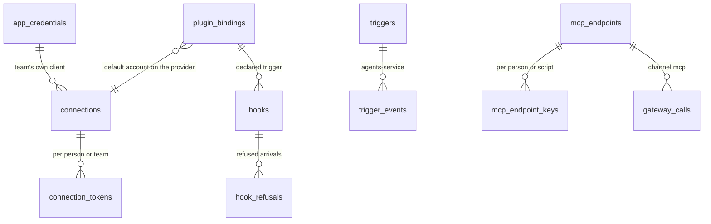

# Integrations in layers

Status: current design, 2026-11-11. Code cited at commit 81c9883a. This page covers how an outside app reaches Ops AI
in layers: the plugin that defines it, the sign-in provider several plugins share, the accounts, the one gateway every
call goes through, and the ways it is exposed and started (agents, workflows, MCP both ways, triggers and schedules).
Accounts in detail are in [several accounts per app](app-accounts.md); the path a tool takes from connect to call is
in [tool lifecycle](tool-lifecycle.md); the tool model is in [the tool system](../design/tools/tool-system.md) and the
MCP server design in [MCP server](../design/tools/mcp-server.md).

The rule that holds the layers together: a plugin may only do what the public API can do. Everything a plugin
installs into a team is a row the public API can write by hand, and the plugin installer is a script over those
routes.

## Status by layer

| Layer | Built | Where | Designed, not built yet |
|---|---|---|---|
| 1. Definition (plugin manifest) | Built: connection, settings, tools, knowledge sources, templates, egress; loaded at start; installed by `opsai plugin install` | `packages/ops_plugin_sdk/src/ops_plugin_sdk/manifest.py:116`, `:266`, `:377-409`; `packages/ops_plugin_sdk/src/ops_plugin_sdk/install.py:27` | `provider`, `triggers`, `document_types`, `depends_on` and an access block per capability; `GET /v1/plugins` |
| 2. Sign-in provider | Partly: a package app signs in through another plugin's account (`runs_on`) | `manifest.py:147`; `services/tools-service/src/ops_tools/plugins/host.py:955-958` | Provider plugins shared by several app plugins, with scopes as the union of what is on |
| 2b. Auth config | Built: a team's own OAuth client per app, sealed secret, scopes | `services/tools-service/src/ops_tools/store/connections.py:134`; `services/tools-service/src/ops_tools/apps.py:2104-2154` | `app_id` becomes the provider's id |
| 3. Accounts | Built: named, team or person owned, test or live, tokens with granted scopes | `store/connections.py:44`, `:163-175`; `plugins/host.py:919` | The account's app is the provider |
| 4. Execution (gateway) | Built: `POST /v1/calls`, approval tokens, one audit table | `services/tools-service/src/ops_tools/app.py:477`; `packages/ops_policy/src/ops_policy/approval.py:32`; `services/tools-service/src/ops_tools/store/calls.py:18` | `channel` value `trigger` |
| 5. Agents, workflows, SDK, CLI | Built: grantable operations, tool search above 20 tools | `app.py:364`; `packages/ops_agent_kernel/src/ops_agent_kernel/types.py:74` | Unchanged |
| 5b. MCP in (Ops AI as a server) | Slice 1: `/mcp` behind the `mcp_gateway` flag, read tools only, every call a test run | `services/tools-service/src/ops_tools/mcp_server.py:6-9`, `:101-116`; `app.py:338-340` | Curated endpoints, per-person tokens and keys, meta tools above 20, masking, held writes |
| 5c. MCP out (outside MCP servers) | Built: an outside server is a module of type `mcp`, imported by address or discovery | `services/tools-service/src/ops_tools/modules/schemas.py:18`; `services/tools-service/src/ops_tools/modules/routes.py:131` | Its sign-in may be a provider account |
| 6. Triggers | Partly: trigger nodes on the canvas; the email trigger; system event workflows | `packages/ops_engine/src/ops_engine/node_types.py:399`, `:427`, `:478`, `:522`; `services/agents-service/src/ops_agents/api/email_trigger.py:80` | A `triggers` record per team: webhook, poll, email, record change, cron schedule |
| 7. Knowledge sources | Built: a plugin's sources become knowledge sources with their own schedule | `services/kb-service/src/ops_kb/schedule.py:100`; `services/kb-service/src/ops_kb/app.py:453` | Console's Add source lists plugin sources |
| 8. Templates and document types | Built: templates of kind agent, skill, workflow, document type, copied per team | `manifest.py:377-378`; `services/agents-service/src/ops_agents/api/routers/templates.py:61`; `services/tools-service/src/ops_tools/plugins/templates.py:337` | `document_types` as its own manifest list |

## What already does each job

Every designed change lands in the owner below. No second sign-in path, account store, call path, event seam,
scheduler or audit table is added.

| Job | Owner | Designed change |
|---|---|---|
| Which account a call uses | `PluginHost.for_call`, `plugins/host.py:919` | A provider plugin is the `runs_on` target; nothing else picks |
| Scopes asked at sign-in | `services/tools-service/src/ops_tools/connections/service.py:822` (`operation_scopes` of the connection's own module) | Read every on plugin that `runs_on` the provider |
| Missing scope on a call | `insufficient_scope` not-linked reason, `services/tools-service/src/ops_tools/auth/__init__.py:40`, `:233` | Becomes `SCOPE_MISSING` with the account marked `needs_reconnect` (reason `scopes`) |
| Team switch for a plugin | `plugin_bindings` (`enabled`, `settings`, `tools_on`), `services/tools-service/src/ops_tools/store/plugin_bindings.py:22-41`; `PUT /v1/apps/{app}/team`, `apps.py:2198` | `tools_on` moves into one `capabilities` map |
| Who may do what | `ops_access.can()`; the existing `webhooks` area, `packages/ops_access/src/ops_access/catalogue.py:48-50` | Triggers and hooks use the `webhooks` area, shown on screen as Triggers |
| Events from a service to agents-service | `POST /v1/events`, `services/agents-service/src/ops_agents/api/routers/service_events.py:26`, `:56`; team from the token, `:73-74`; `EVENT_OWNERS`, `services/agents-service/src/ops_agents/api/service_events.py:125` | New owner prefix `app_event.` for tools-service |
| Delivery history and dedupe | `trigger_events` with outcomes, `services/agents-service/src/ops_agents/store/trigger_events.py:30-44`; `poll_cursors`, `services/agents-service/src/ops_agents/store/poll_cursors.py:23` | Add `trigger_id`; generic `source`; agent target |
| Timed starts | `arm_job` and the timer poller, `services/agents-service/src/ops_agents/api/timers.py:205`, `:427` | A schedule arms its next tick |
| One-shot delayed start | `after_seconds` on run start, `services/agents-service/src/ops_agents/api/routers/engine.py:778` | Unchanged |
| Ops AI's own OAuth clients | `OPS_PLUGIN_CLIENTS`, `packages/ops_service_kit/src/ops_service_kit/settings.py:167`; install locks `plugin_locked`, `:170` | Stay environment-only; shown read-only by `GET /v1/plugins` |
| Mailboxes | `/v1/channels/mailboxes`, `services/agents-service/src/ops_agents/api/routers/mailboxes.py:41` | An email trigger points at a mailbox |

## The layered rule

The proof of the rule is one use case: an admin installs a plugin by hand with SDK calls in one team, then the
installer installs it in a second team, and the rows differ only in ids and timestamps. The manifest itself is the
definition and is outside the rule, as a tool's JSON Schema is.

| Capability a plugin adds | Manual API | State |
|---|---|---|
| A tool module with operations | `POST /v1/tool-modules`, operations, import | Built, equal |
| How the app signs in | `POST /v1/apps` for a custom app (`apps.py:2098`) | Partly: a custom app cannot declare OAuth authorize and token URLs or scopes. Designed: add them to `POST /v1/apps` |
| A team's own OAuth client | `POST /v1/app-credentials` (`apps.py:2113`) | Built |
| Accounts | `POST /v1/apps/{app}/accounts`, sign-in routes | Built, equal |
| Turning the plugin on, picking tools | `PUT /v1/apps/{app}/team`, `POST /v1/apps/{app}/tools` (`apps.py:2198`, `:2167`) | Built. Designed: body gains `capabilities` |
| Knowledge sources | `GET /v1/sources/from-plugin`, `POST /v1/sources` | Built; console gap |
| Templates | `GET /v1/plugin-templates`, `POST /v1/resources` | Built |
| Document types | `POST /v1/document-types` | Built as a template kind. Designed: own manifest list |
| Host allow-list | `/v1/egress` | Built |
| Triggers, schedules | — | Designed, not built yet (see [Triggers and schedules](#triggers-and-schedules)) |
| Listing installed plugins | — | Designed, not built yet: `GET /v1/plugins` reads the plugin host in memory, no mirror table |
| Dry run of an install | — | Designed, not built yet: `POST /v1/apps/{app}/team/plan` returns the calls the installer would make and writes nothing |

Installing a plugin stays a deploy step (folder, CLI, `deploy/plugins.json`), since a plugin is code and code enters
through review. The API lists and turns on what is installed.

## Sign-in providers

Designed, not built yet. A provider is a plugin that owns the sign-in and the accounts: `opsai.microsoft`,
`opsai.atlassian`, `opsai.google`, `opsai.salesforce`. It declares `connection` as any plugin does and may ship no
tools. An app plugin on it declares `connection.runs_on: <provider>` and `connection.scopes`, and nothing else about
sign-in. An older plugin with no `runs_on` is its own provider, so Salesforce and GitHub keep their ids and accounts.

| Rule | Detail |
|---|---|
| Accounts live on the provider | A SharePoint plugin has no accounts; its tools run through the chosen Microsoft account. Every account surface lists providers, never apps on a provider. Naming a package app's account stays refused (`plugins/host.py:969-974`, built) |
| One auth config per provider | `app_credentials.app_id` is the provider's id; a team's own Microsoft app serves every plugin on it. The Google provider has no Ops AI client: each team brings its own Google app and is asked for it at first turn-on |
| Scopes are the union of what is on | Asked at sign-in: the provider's required scopes plus those of every plugin on it the team turned on |
| Incremental consent | When a team turns on a plugin whose scopes an account's token lacks (`connection_tokens.scopes`, built), the account shows "Needs more access: <plugin>" and that plugin's tools are refused `SCOPE_MISSING` until someone signs in again. The sign-in start already accepts extra scopes and stores the asked set (`oauth_states.scopes`, `store/connections.py:216`) |
| Scopes per sign-in kind | `connection.scopes` may be keyed by kind (Microsoft: named delegated scopes for a person, `.default` for the team's app-only sign-in); one list means every kind |
| Turning a plugin off | Does not revoke scopes already granted; the next sign-in asks for the smaller set; the provider page shows "granted but unused" |
| Settings the sign-in fills | Atlassian's `cloud_id`, Salesforce's `instance_url` live on the provider's account; a plugin reads them by name and cannot redefine them |

```mermaid
sequenceDiagram
  participant Admin
  participant Console
  participant Tools as tools-service
  participant IdP as Microsoft Entra
  Admin->>Console: Turn on the Outlook plugin (runs_on opsai.microsoft)
  Console->>Tools: PUT /v1/apps/opsai.outlook/team {capabilities}
  Tools->>Tools: needed = provider scopes + every on plugin's scopes
  alt token lacks a needed scope
    Tools-->>Console: binding on; account needs_reconnect (reason: scopes)
    Admin->>Console: Sign in again
    Console->>Tools: POST /v1/apps/opsai.microsoft/accounts/{id}/sign-in {scopes}
    Console->>IdP: redirect with the full scope set
    Console->>Tools: POST /v1/sign-ins/complete
    Note over Tools: connection_tokens.scopes updated, state connected
  else token holds them
    Tools-->>Console: binding on
  end
```

## Plugins as capability bundles

Designed, not built yet. A plugin is a bundle of six capabilities, each switched on per team in one `capabilities`
map on its binding. `capabilities.tools` keeps today's `tools_on` meaning: null means every tool is on
(`store/plugin_bindings.py:36-41`).

| Capability | Manifest list | Rows it installs | Access to turn it on |
|---|---|---|---|
| Tools | `tools` | The module and chosen operations | `connections.manage` |
| Knowledge sources | `knowledge_sources` | Knowledge sources of type tool, when added to a base | `knowledge.create` |
| Triggers | `triggers` (new) | `triggers` rows, paused until a target is set; a hook with its secret | `webhooks.create`, plus `workflows.run` or `agents.run` on the target |
| Templates | `templates` | Nothing until someone copies one | `agents.create` or `workflows.create` |
| Document types | `document_types` (new) | A copy per team in documents-service | `documents.edit` |
| Settings | `settings` | `plugin_bindings.settings`; locked ones read-only | `connections.manage` |

A manifest capability may name only an existing roles-grid area and action; it never adds a role or a rule.

| Rule | Detail |
|---|---|
| Dependencies | `depends_on: [plugin ids]` generalises `runs_on`. Turning a plugin on turns on what it depends on, with one confirmation listing them. Turning off a plugin others depend on is refused with their names. A cycle fails validation |
| Plugin update | New scopes put accounts into `needs_reconnect`; new triggers arrive paused and are never turned on by an update; a trigger whose event the update removed stays, marked "no longer declared", and starts nothing; capabilities the team had off stay off |
| Failed install | Every step is idempotent by name; the order is binding, tools, sources, template copies, then triggers, created paused; the console names the failed step and running the installer again converges |
| Locked setting | Changing an install-locked setting through `PUT /v1/apps/{app}/team` is refused 403 naming the setting, whatever the caller's role |

## Triggers and schedules

Designed, not built yet, except where marked. A trigger is a team record: when this happens, start that, with this
payload. Arrival and start are split. tools-service receives, verifies and dedupes what comes from outside, because the
secrets and the plugin's verification rules are there. agents-service decides what to start, because the run starter,
`trigger_events`, `poll_cursors` and timers are there. The seam is the existing `POST /v1/events` over each service's
outbox relay.

| Kind | Arrives how | Arrival owner | Dedupe key | Retries | Built today |
|---|---|---|---|---|---|
| Webhook | An outside app posts to `/v1/hooks/{id}`. The manifest names the signature rule and event id path; a hand-made hook uses HMAC-SHA256 over `{id}.{timestamp}.{body}` with a 5-minute window | tools-service | Hook id plus the provider's event id, else body hash | The sender retries on non-2xx; the outbox relay retries until acknowledged; a failed start is `start_failed` and the next delivery of the key tries again | No |
| Poll | The listener calls the plugin's changes or list tool through the gateway every N minutes with a team account, keeps a cursor, and emits one event per new item | agents-service, in the mail listener's loop | The item id | A failed poll keeps the cursor; after 3 failures the trigger shows "failing" | No |
| Email | A mailbox folder | agents-service | Message id | Set aside after 3 tries; run again by hand | Yes (`email_trigger.py:80`, `trigger_events.py:30-44`) |
| Record change | A platform service reports `file.`, `extraction.`, `task.`, `app_account.` events; team workflows may now listen | The reporting service | `(tenant, name, key)` | As today | System workflows only (`api/service_events.py:125`) |
| Schedule | A cron expression in a named time zone, with pause, resume and next tick shown, armed as a timer | agents-service timers | Trigger id plus tick time | A missed tick starts once at catch-up, marked late; a DST gap runs at the next valid minute; a repeated hour runs once | One due time only (`node_types.py:522`, `engine.py:778`) |

| Rule | Detail |
|---|---|
| What it starts | A workflow (pinned published version, or latest) or an agent (one turn with the payload as the message, the thread keyed by trigger id and delivery key, so a duplicate never adds a turn). Saving needs `workflows.run` or `agents.run` on the target, checked with `can()` |
| One start function | Every kind ends in `start_from_trigger` in agents-service: find the triggers, write the `trigger_events` row, start the run with the run key |
| Which account | A trigger has an `accounts` map like a step, merged over the agent's; `for_call` picks and checks. A trigger always runs live; "Send test delivery" starts a test run |
| Who it acts for | Nobody. Team accounts only; a tool that needs a person fails the run with a plain reason |
| Payload | Mapped with the expression language steps use; a filter expression drops events (`filtered`) |
| Paused | Arrivals are stored as `paused`; Resume replays nothing; Run again replays one, needs `webhooks.run`, and is audited |
| Daily cap | Default 1,000 starts per trigger per day; past it the trigger pauses itself, tells whoever manages it, and stores arrivals as `daily_cap` |
| Target missing | A target later unpublished or deleted makes each delivery `start_failed`, kept for Run again; the trigger shows "needs attention: target missing" |
| Account problems | A poll on an expired token fails visibly, keeps its cursor and does not advance. Changing a trigger's account, or resetting its cursor, starts nothing on the next poll |
| Tenancy | A hook id is 160 random bits and maps to one team. tools-service mints the event's service token for that team from the hook row, because agents-service accepts an event only when the token's team equals the body's. The payload carries the hook id, so only triggers naming it start |
| A person leaves | Their sign-ins and endpoint keys are revoked; team triggers keep running on team accounts; deleting a hook is refused while a trigger names it |
| Access | The `webhooks` area: view, create, edit, run (run again), delete, manage (secrets) |
| Audit | Create, edit, pause, resume, delete, secret rotation, run again, endpoint and key changes, and every refused arrival go through the one audit log |
| Background processes | No new loop: the receiver is a route, polling joins the mail listener, the schedule uses the timer poller |
| Where it appears | One list under Agents › Channels with views All, Webhooks, Schedules, Polls, Email. The canvas trigger node points at the record ("Starts from: webhook, GitHub issue opened"); an older `ops.trigger.*` node in a published version keeps working |

### The receiver route

`POST /v1/hooks/{id}` is the one route besides health and the OpenAPI document that carries no session; the signature
is its authentication.

| Limit | Value |
|---|---|
| Body | At most 1 MB |
| Rate | 60 arrivals a minute per hook, 600 per team, then 429 |
| Timestamp | Older than 5 minutes is stale |
| Unknown id, bad signature, stale timestamp, deleted hook | 401, one body and one timing for all |
| Accepted | 202 within 2 s |
| Secret | A `tool_secrets` row, shown once; rotation accepts both secrets for 24 hours |
| Unsigned hook | Only when an admin chooses "Unsigned" and sees the warning; the URL is then the only secret |

```mermaid
sequenceDiagram
  participant App as Outside app
  participant Tools as tools-service
  participant Agents as agents-service
  App->>Tools: POST /v1/hooks/{hook_id} (signed body)
  Tools->>Tools: find hook, read secret, verify per manifest rule
  alt bad signature, stale or unknown hook
    Tools-->>App: 401 (one answer for all); refusal counted
  else verified
    Tools-->>App: 202
    Tools->>Agents: POST /v1/events {app_event.<plugin>.<event>, key = hook_id + event id, team from hook row} via outbox
    Agents->>Agents: service_events unique key, then triggers naming this hook
    Agents->>Agents: start_from_trigger: paused → store; else trigger_events row + start_run (run key trigger:id:key)
  end
```

```mermaid
sequenceDiagram
  participant Admin
  participant Agents as agents-service
  participant Poller as timer poller
  Admin->>Agents: POST /v1/triggers {kind: schedule, cron, timezone, target}
  Agents->>Agents: triggers row, arm_job(key = trigger:id:tick)
  Poller->>Agents: timer due
  Agents->>Agents: paused? skip and arm next; else trigger_events row, start_run, arm next tick in the time zone
```

A schedule trigger owns one system thread, because `arm_job` keys timers by thread (`timers.py:205`).

## MCP, both ways

### Ops AI as an MCP server

Built (slice 1): `/mcp` mounted only with the `mcp_gateway` flag on, API key only, the team's read operations only,
every call a test run (`mcp_server.py:6-9`, `app.py:338-340`). Every call is one gateway call. The rest of this table
is designed, not built yet; the base design is in [MCP server](../design/tools/mcp-server.md).

| Part | Design |
|---|---|
| URLs | `/mcp/{env}/{team}` serves everything the caller may run; `/mcp/{env}/{team}/e/{slug}` one curated endpoint. The person is never in the URL; the token decides |
| Curated endpoints | An `mcp_endpoints` row: name, tools by name from grantable operations, accounts per app, who may use it (team or one person), environment |
| Tool search | Up to 20 tools the list is flat; above 20 the endpoint serves `search_tools`, `get_tool`, `run_tool` over the same set, the kernel's threshold (`types.py:74`). Search sees only the endpoint's set; an empty set denies all; an unknown app filter is ignored |
| Sign-in | OAuth 2.1 with platform-service as issuer, the token bound to the exact URL and the person; an API key as Bearer for scripts. An unsigned caller always gets 401 with protected resource metadata |
| Registration | Pre-registered clients and client ID metadata documents; dynamic registration off |
| Scopes | Read first; a write answers 403 `insufficient_scope` so the client steps up |
| Accounts | The endpoint's accounts map travels as `runContext.accounts`; `for_call` picks and checks. The model never picks the account |
| Audit | Every call is a `gateway_calls` row with `channel = mcp` (`store/calls.py:67`), client name, person, endpoint and account |
| Annotations | `readOnlyHint` from the access class, `destructiveHint` from the operation's approval policy, title always set |
| Rate limit | Per token, in the database |
| Personal data | Masked in everything an MCP client receives (`masked`, default true); turning it off needs `connections.manage` and is audited |
| Held writes | A pending result with a review link that lives 24 hours; approvers are the team's people with `reviews.decide`, never the requester; on approval the call runs once as the requesting person, endpoint and account; an expired hold never runs |
| API keys | Run reads only; a write answers 403 `insufficient_scope` and opens no hold |
| Paused endpoint, revoked key | 401 on the next call; held writes in flight are cancelled |
| Production | Test only for outside assistants; production comes through its own URL and token with every write waiting for a person |
| Single server | tools-service is the only MCP server; agents-service's `mcp` deployment channel becomes a pointer to a curated endpoint |

### Ops AI calling outside MCP servers

Built: an outside server is imported as a module of type `mcp` (`modules/schemas.py:18`), by address with
`POST /v1/apps` (`apps.py:2098`) or `POST /v1/tool-modules/discover` (`modules/routes.py:131`). Agents call it through
the gateway, which holds its own token per account. Designed: when the server's authorization server is one of the
providers, its sign-in is an account on that provider, and every call carries the same audit columns as a plugin tool.

## Data model

Designed, not built yet. tools-service tables unless marked.



| Table | Service | Fields | Why here |
|---|---|---|---|
| `plugin_bindings.capabilities` | tools | tools, knowledge_sources, triggers, templates, document_types, settings | The binding is the per-team switch; `tools_on` stays in responses for one release |
| `hooks` | tools | `id`, `team_id`, `plugin_id`, `event`, `secret_name` (previous kept 24 h), `dedupe`, `signing` | The secret and the verification rule are in tools-service; agents-service never sees a raw webhook |
| `hook_refusals` | tools | `hook_id`, `reason` (`bad_signature`, `stale`, `duplicate`, `too_large`, `rate`), `received_at` | Only what agents-service never sees; accepted arrivals live in `service_events` and `trigger_events` |
| `triggers` | agents | `id`, `team_id`, `kind`, `source` (hook id, cron and time zone, mailbox, event name, poll tool and interval), `target` (workflow or agent, version pin), `accounts`, `payload_map`, `paused`, `attention` (`none`, `target_missing`, `failing`, `capped`), `next_tick`, `thread_id` | Beside the run starter, `trigger_events`, `poll_cursors`, timers and mailboxes |
| `trigger_events` | agents | Adds `trigger_id` and an agent target; `workflow_id`, sender and subject optional; outcome adds `paused` | One delivery history for every kind; existing email rows get the trigger made for their mailbox |
| `gateway_calls.channel` | tools | Adds `trigger`; a trigger call acts for nobody as `trigger:<id>` | One audit table for every channel |
| `mcp_endpoints` | tools | `id`, `team_id`, `slug`, `environment`, `tool_names`, `accounts`, `who`, `masked` | The MCP server and the account picker are in tools-service |
| `mcp_endpoint_keys` | tools | `id`, `endpoint_id`, `person_id`, `key_hash`, `expires_at`, `revoked_at` | Long-lived keys on one endpoint; OAuth tokens stay platform-service's |

## API

Designed routes. Every new route is generated into the Python and TypeScript SDKs from OpenAPI; the CLI gains
`opsai triggers`, `opsai hooks` and `opsai mcp endpoints`. The MCP server stays out of OpenAPI.

| Route | Who | Service |
|---|---|---|
| `GET /v1/plugins`, `GET /v1/plugins/{id}` (version, capabilities, locked settings, dependencies) | `connections.view` | tools |
| `POST /v1/apps/{app}/team/plan` | `connections.manage` | tools |
| `PUT /v1/apps/{app}/team` with `{enabled, capabilities, settings}` | `connections.manage` | tools (route built, body grows) |
| `GET /v1/apps?kind=provider`; `GET /v1/apps/{provider}` lists its plugins | `connections.view` | tools (routes built, `apps.py:2078`, `:2162`) |
| `GET /v1/apps/{provider}/accounts/{id}/access` (granted vs needed scopes per plugin) | `connections.view` | tools |
| `GET`, `POST /v1/triggers`; `GET`, `PATCH`, `DELETE /v1/triggers/{id}`; `POST …/pause`, `/resume`, `/test`; `GET …/deliveries`; `POST …/deliveries/{key}/run-again` | `webhooks` view, create, edit, run, delete, plus run access on the target | agents |
| `POST /v1/hooks` (URL and secret shown once), `POST /v1/hooks/{id}/rotate-secret`, `DELETE /v1/hooks/{id}` (409 while a trigger names it), `GET /v1/hooks/{id}/refusals` | `webhooks.create`; `.manage` for rotate and delete | tools |
| `POST /v1/hooks/{id}` (receiver) | The outside app, by signature | tools |
| `GET`, `POST /v1/mcp-endpoints`; `/{id}`, `/{id}/pause`, `/{id}/keys`, `/{id}/connections`, `/{id}/calls` | `tools.run` for one's own key; `connections.manage` to curate, pause, unmask, disconnect others | tools |

## Errors and refusals

| Code | Status | When | Built |
|---|---|---|---|
| `SCOPE_MISSING` | 403 | A plugin's tool runs on an account whose token lacks its scopes | Designed, not built yet (today `insufficient_scope`, `auth/__init__.py:40`) |
| `insufficient_scope` | 403 | An MCP write over a read-scoped token or an API key | Designed for MCP |
| Hook refusal | 401 | Unknown, deleted, bad signature or stale | Designed, not built yet |
| Rate | 429 | Hook or team arrival rate exceeded | Designed, not built yet |
| Hook in use | 409 | Deleting a hook a trigger names | Designed, not built yet |
| Dependency in use | 409 | Turning off a plugin others depend on | Designed, not built yet |
| Locked setting | 403 | Changing an install-locked plugin setting | Designed, not built yet |
| Missing auth config | 4xx | Turning on a Google plugin with no team auth config; nothing is written | Designed, not built yet |

## Build order

| Slice | Lands | Depends on |
|---|---|---|
| 1 | `GET /v1/plugins`; the plan route; `capabilities` with tools and settings; the hand-install use case | — |
| 2 | Provider plugins; scope union; `SCOPE_MISSING`; `needs_reconnect` with reason; provider page | 1 |
| 3 | Triggers of kind schedule and webhook; hooks and the receiver; `app_event.` prefix; team event handlers; Triggers list | 1 |
| 4 | Poll kind; email listed as a trigger; deliveries page; Run again | 3 |
| 5 | MCP endpoints, keys, meta tools, annotations, database rate limit | 1, and the OAuth issuer from the MCP server design |
| 6 | Atlassian and Microsoft providers and their bundles | 2, 3 |

| Plugin | After |
|---|---|
| Salesforce, GitHub | Their own providers, ids unchanged. Package apps run on Salesforce; GitHub is the first webhook plugin (`X-Hub-Signature-256`, `X-GitHub-Delivery` as the event id) |
| SharePoint | `runs_on: opsai.microsoft` with its own scopes; knowledge stays a separate plugin from the Microsoft 365 bundle |
| Confluence, Jira | `opsai.atlassian` (sign-in, `cloud_id`, accounts) plus an `atlassian.cloud` bundle (tools, Confluence source, Jira webhooks, templates); the API-token kind stays on the provider |
| Microsoft | `opsai.microsoft` with both sign-in kinds, plus bundles that each add scopes; a person signs in once |
| Google | `opsai.google` with no Ops AI client; Gmail, Drive and Calendar bundles add scopes |
| Website crawler | A knowledge-only bundle (knowledge sources and settings) |
