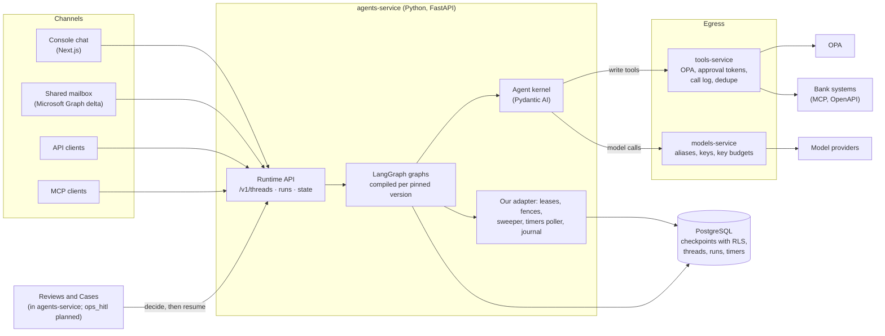

# Architecture overview

Status: current, updated 2026-10-16. The decided design is [workflows and agents](../design/workflows/workflows-and-agents.md); decision records it does not settle remain options.

## The rule

Everything is a graph, run on a thread, through one API. A chat agent is a graph with one agent node. A workflow is
a larger graph. A thread is one conversation or one case and holds the graph's saved state and the version it is
pinned to. A run executes the graph on the thread from an input until it finishes or pauses. Chat and an
email-to-case workflow use the same five steps:

| Step | Chat | Mailbox workflow |
|---|---|---|
| 1. Find or create the thread | The conversation | The case, keyed by deployment and Message-ID |
| 2. Run the graph with the input | The message | The email, attachments as file references |
| 3. Pause at an approval node | Approval widget in the chat | Review task with an SLA |
| 4. A person decides; the graph resumes | Seconds later | Hours or days later |
| 5. The thread keeps the state | Next message, same thread | The thread is the case record |

The graph never knows which channel woke it; a channel adapter turns what arrives into steps 1 and 2.

That is how the code runs today. In the decided design, Ops AI is one platform in which agents and workflows are two
ways of running work: agents on their own run API, workflows on the `ops_engine` runner, both using the same shared
services and the data and AI gateways ([workflows and agents](../design/workflows/workflows-and-agents.md)).

## The system

By default the kernel calls the model provider directly (OpenAI by default, Anthropic when the alias names a Claude
model); with `OPS_MODELS_URL` set, every graph model call goes through models-service. agents-service meters each graph
model call against the thread's budget. Reviews and Cases are served by agents-service.

## Six services

Each service is named for the console section it serves: platform, agents, tools, models, kb and files. Reviews, Cases
and work items move into the `ops_hitl` package and triggers into `ops_triggers`, both hosted by agents-service. Their
boundaries, the state of each service and package, deployment targets and the steps left are in
[service-map.md](service-map.md).

`ops-host`, a host that starts any set of services in one process, is planned as the first part of version 1. Every
service stores its data in one database: PostgreSQL runs today, and SQL Server 2025 (Azure SQL first in intent) is being added ([ADR-0017](decisions/database-support.md)).

## Three run kinds on one runtime

The graphs behind each kind are listed in [runtime.md](runtime.md#graphs).

| Kind | What starts it | How long a pause lasts | In code |
|---|---|---|---|
| Chat turn | A message on a chat thread | Seconds to minutes | The graph exists; the console chat still runs on `/chat/*` routes that call the kernel directly |
| Simple workflow | Any channel input | None | Yes |
| Complex workflow | A mailbox message, API call or schedule | Hours to days | Yes, mailbox on a fake source |

Spec 14 describes the same three kinds on one interpreter ([inside the runtime](runtime.md) §2). The
code runs them on LangGraph on PostgreSQL; workflows move to the `ops_engine` runner ([workflow-runner.md](workflow-runner.md)).

## What runs today and what is planned

| Area | Runs today | Planned |
|---|---|---|
| Runtime API | Threads with external keys, runs with SSE, state, run journal, migrate, route-to-people; agents and workflows as drafts that validate, test and publish with a second person's approval; pointers; `GET /v1/tools`; model aliases | Reviews in `ops_hitl`, cancel, event re-attach, webhooks ([api.md](api.md)) |
| Engine | LangGraph 1.2.14 called directly, `durability="sync"`; the 13-test conformance suite passes on it. `packages/ops_engine` slice 1: compiler to LangGraph, step journal, work queue, worker loop | The rest of the `ops_engine` runner: leases with generation fencing and reconcile-by-key for every workflow step |
| Durability | Leases with generations, sweeper, fences in checkpointer, journal, timers and tools-service | Work queue for enqueued input, stored event log with per-thread `seq` |
| Human steps | Interrupts naming the gated call, decide-then-resume from the console's Reviews, approvals minting HMAC tokens, verified step-up, SLA timers | Reviews in `ops_hitl`, decide as the only resume path, asymmetric tokens |
| Cost | A usage row per graph model call, thread and deployment budgets that pause the thread, `cost` and `budget` in state | Per-key ledger in models-service for every caller; metering for chat routes |
| Identity | platform-service issues Ed25519 session, refresh, API-key and service tokens with a JWKS endpoint; members, roles, invites, audit; agents-service and tools-service resolve every caller through the shared `ops_identity` dependency when `OPS_AUTH_MODE=platform`; forced row-level security per tenant. Dev auth (one fixed user) remains the default mode | models-service on the shared dependency (it still trusts a static service token); team isolation in the console; delegation tokens with `act` from an external IdP |
| Channels | Mailbox adapter on a fake Graph source; deployments table | Real mailbox tenant, API, MCP; schedule, webhook, email and poll triggers in `ops_triggers` |
| Egress | tools-service in front of every tool call: registry, REST executor, OpenAPI and MCP import, egress allow-list checked at connect time, AES-256-GCM secrets; models-service in front of every graph model call when `OPS_MODELS_URL` is set: aliases, refusals with codes, replay by task | Per-key budgets and rate limits in models-service |

## Where the detail lives

| Topic | Spec or decision |
|---|---|
| Runtime service and its dependencies | [inside the runtime](runtime.md) (written for Temporal, which was removed; the call shapes still apply) |
| One agent turn | [inside the runtime](runtime.md) |
| Node catalogue and human steps | [workflow nodes](../design/workflows/workflow-nodes.md) |
| Python layout, libraries, verify gate | [service map](service-map.md) |
| Sign-in and step-up | [sign-in library](../packages/ops_signin/overview.md) |
| Engine | [workflow-runner.md](workflow-runner.md); [ADR-0015](decisions/execution-engine-seam.md) and [ADR-0001](decisions/durable-execution-runtime.md), both superseded in part |
| Fencing and timers | [ADR-0016](decisions/fencing-and-timers.md) |
| Agent loop library | [ADR-0014](decisions/agent-loop-library.md) |
| Identity and approval tokens | [ADR-0005](decisions/identity-and-entitlement.md), [ADR-0013](decisions/auth-provider-seam.md) |
| Problem statement and the bank's open questions | [problem-statement](../background/problem-statement.md) |

## Evaluation criteria

The decision records score options against these weights, for a regulated bank. Scores run 1 to 5; the total is the
sum of weight × score divided by 100.

| Criterion | Weight | A 5 looks like |
|---|---|---|
| Durability and auditability | 13 | A crash at any point resumes from the last completed step with no lost or duplicated side effect |
| Determinism and replay | 8 | Past runs replay from recorded history to test a change |
| Human-in-the-loop waits of hours to days | 13 | A run waits days for a person at no compute cost, with a durable SLA timer |
| Versioning of running instances | 13 | Old runs finish on their version; new runs take the new one |
| Security and isolation | 9 | mTLS, per-tenant authorisation, payload encryption, SSO |
| Operability on-prem or private cloud | 9 | Runs on the bank's infrastructure with documented HA and no call home |
| Licence, vendor risk and cost | 9 | OSI licence, more than one source of support, predictable cost |
| Talent pool | 4 | Hireable in a normal cycle |
| Connector ecosystem | 4 | Large maintained catalogue |
| Fit for event-driven, per-item runs | 4 | A run per email in under a second, thousands concurrent |
| Marginal effort per new workflow | 14 | Workflow N is configuration on a template, published by its owner, with no engine code |

## Open questions

Questions for the bank. Specs and decision records cite them by number; a settled question is removed and its number
is not reused.

| # | Question | Blocks |
|---|---|---|
| 1 | Which Kubernetes platform and regions; is any public cloud allowed? | Engine choice, deployment |
| 2 | Is PostgreSQL an approved operational database? | Phase 1 |
| 3 | Who operates the runtime, the gateways and the registry, on what on-call model? | Phase 1 |
| 4 | Who owns retention and legal hold for mail, journals, gateway logs and evidence, and for how long? | First workflow |
| 5 | Which WORM storage product is used on-prem? | First workflow |
| 6 | Does the IdP support token exchange with an `act` claim; can systems of record log an actor? | First write action |
| 7 | Maximum case duration; is continue-as-new at a decision point acceptable to Audit? | Phase 2 |
| 8 | Which risk tier sits below the change board's pre-approval line? | Promotion design |
| 9 | Must an existing case system remain the record for operations cases? | Cases |
| 11 | Does the bank run n8n, Camel or an API gateway it wants reused as connector sources? | Tool modules |
| 12 | Which AWP specification is intended; is portability in a policy or contract? | Definition format |
| 13 | Which model providers and private endpoints are approved; does any forbid prompt retention? | Model aliases |
| 14 | Is the n8n Sustainable Use License acceptable for internal use? | Tool modules |
| 15 | May the AI gateway send configuration and usage metadata (no prompts) to a vendor? | Phase 1 |
| 16 | Can Exchange administration grant an application access to specific shared mailboxes on request, and how fast? | Workflow 2 onward |
| 17 | Who are the chat users; is another assistant the staff standard? | Phase 2 |
| 18 | Which risk tiers allow a user to approve their own drafted action in chat? | Chat writes |
| 19 | Does Security accept policy approval tokens for the write classes a gate policy names? | First workflow's approval rules |
| 20 | Does the network review allow Graph change notifications for mailboxes and SharePoint? | Phase 2 |
| 21 | Who names the Model Risk second-line approver group, and when? | First `high` workflow |
