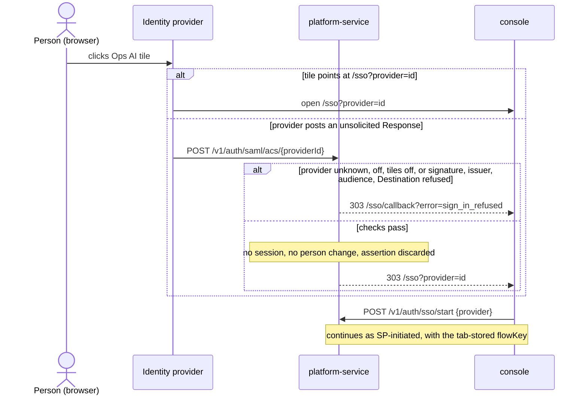
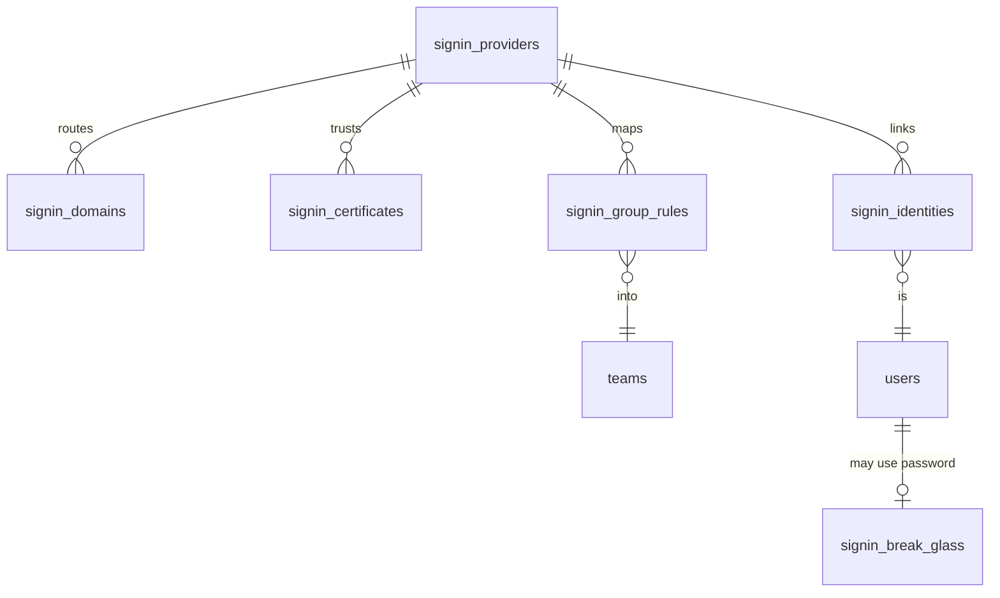

# SAML sign-in

Status: current design, 2026-11-11. Code cited at commit 81c9883a. This page covers how a company's people sign in to
Ops AI through their own identity provider over SAML (Entra ID, Okta, Google Workspace), how provider groups map to
teams and roles, and how admins set a provider up. The workspace, team and token model is in
[identity and tenancy](identity-and-tenancy.md); who may change sign-in settings is in
[roles and permissions](roles-and-permissions.md).

Sign-in lives in platform-service, the one token issuer. The protocol checks live in the `ops_signin` package on
signxml. A provider belongs to one workspace.

## Status by part

| Part | Built | Where |
|---|---|---|
| SP-initiated SAML round trip (redirect request, POST response, one-time handoff) | Built, tested against the local fake identity provider | `packages/ops_signin/src/ops_signin/saml.py:119`, `:149`; `services/platform-service/src/ops_platform/sso.py:161-217`, `:239`, `:302` |
| Signature, issuer, audience, recipient, time and replay checks | Built | `saml.py:168-208`, `:234-288` |
| Encrypted assertions and signed requests | Built | `saml.py:134-146`, `:210-232` |
| Our SP metadata | Built | `saml.py:330`; `services/platform-service/src/ops_platform/api/app.py:364` |
| Email domain proof by DNS TXT | Built | `services/platform-service/src/ops_platform/signin_settings.py:132`; `services/platform-service/src/ops_platform/store/signin.py:219` |
| First-sign-in accounts (JIT), never Admin | Built | `store/signin.py:573-664`; `signin_settings.py:30` |
| Group to team and role rules, add only, set through the API | Built | `signin_settings.py:179-194`; `store/signin.py:666-742` |
| Step-up at the provider (ForceAuthn, AuthnInstant) | Built | `saml.py:134`, `:271`; `sso.py:312-325` |
| Several signing certificates with expiry, refreshed from a metadata URL | Designed, not built yet | — |
| Reading the provider's metadata (URL or file) | Designed, not built yet | — |
| Test sign-in that changes nothing | Designed, not built yet | — |
| Group rules edited in the console, with removal at sign-in | Designed, not built yet | — |
| Sign-in started from the provider's app portal | Designed, not built yet | — |
| Company sign-in required, with break-glass accounts | Designed, not built yet | — |
| Three member-safe failure messages and provider-named copy | Designed, not built yet | — |
| Public-address guard for metadata and OIDC discovery fetches | Designed, not built yet | — |
| SCIM 2.0 provisioning | Designed, not built yet (later phase) | — |

## Sign-in flows

### SP-initiated

Built. The person types a work email; a verified domain routes them to its provider.

```mermaid
sequenceDiagram
  actor P as Person (browser)
  participant C as console
  participant PS as platform-service
  participant DB as platform database
  participant IdP as Identity provider
  P->>C: work email on /login
  C->>PS: POST /v1/auth/options {email}
  PS->>DB: verified domain → provider
  PS-->>C: {sso: {kind: saml, label}}
  C->>PS: POST /v1/auth/sso/start {email, next}
  PS->>DB: open flow (state hash, browser hash, AuthnRequest ID, 10 min)
  PS-->>C: {redirectUrl, flowKey}  (flowKey kept in this tab)
  C->>IdP: redirect with SAMLRequest + RelayState
  IdP->>PS: POST /v1/auth/saml/acs SAMLResponse + RelayState
  alt flow unknown or expired, provider off, or any check fails
    PS-->>C: 303 /sso/callback?error=sign_in_refused
  else ok
    PS->>DB: link or create person, apply group rules, mark flow answered once
    PS-->>C: 303 /sso/callback?code=handoff
    C->>PS: POST /v1/auth/sso/complete {code, flowKey}
    PS->>DB: take flow once; browser hash must match
    PS-->>C: session (authMethod saml)
  end
```

Routes: `POST /v1/auth/options`, `/v1/auth/sso/start`, `/v1/auth/saml/acs`, `/v1/auth/sso/complete`
(`app.py:342`, `:348`, `:377`, `:389`). Every failure today lands on `error=sign_in_refused` and the reason goes to the
log only (`sso.py:12`, `:291-292`).

### Started from the provider's app portal

Designed, not built yet. A person clicks the Ops AI tile in Entra My Apps, the Okta dashboard or the Google launcher.
The tile's sign-on URL is the console's `/sso?provider=<id>`, which runs the SP-initiated flow. A provider that posts
an unsolicited response anyway never signs anyone in: platform-service checks the response came from that provider,
discards the assertion and sends the browser to `/sso?provider=<id>` to start a fresh flow. Every sign-in therefore
answers a request Ops AI sent, so the replay and login-CSRF protections of the SP flow hold.

Each new provider gets its own consumer URL `/v1/auth/saml/acs/{providerId}` and metadata URL
`/v1/auth/saml/metadata/{providerId}`, so an unsolicited post names its provider in the path. An Issuer cannot be used
for the lookup, because one Entra tenant may serve two workspaces. Finding the provider before the workspace is known
is a pre-tenant lookup by provider id beside today's domain lookup (`store/signin.py:135`), returning only tenant,
kind, enabled and whether tiles are on. The shared `/v1/auth/saml/acs` keeps working for providers saved earlier.



## Data model

Platform-service tables. A workspace holds providers, domains and break-glass people; teams hold nothing new.



| Table | Fields | Built |
|---|---|---|
| `signin_providers` | Provider config, including `config.saml` (one PEM certificate) and `config.groups.map` | Built (`services/platform-service/src/ops_platform/store/tables.py:237`). Designed additions: `config.saml.metadataUrl`, `metadataReadAt`, `metadataError`, `tiles`, `groups.onMissing` (`keep` or `remove`), `noMatch` (`refuse` or `jit`) |
| `signin_domains`, `signin_identities` | Domain claims; provider subject to person links | Built (`tables.py:272`, `:301`), unchanged |
| `signin_flows` | One round trip | Built (`tables.py:325`). Designed: `purpose` gains `test`, plus `test_result` JSON (subject, email, name, groups, refusal reason) |
| `signin_certificates` | `tenant_id`, `provider_id`, `fingerprint` (SHA-256), `pem`, `not_before`, `not_after`, `source` (`metadata`, `upload`, `manual`), `added_at`, `added_by`, `removed_at`. Key `(provider_id, fingerprint)` | Designed, not built yet |
| `signin_group_rules` | `id`, `tenant_id`, `provider_id`, `group` (exact value sent), `team_id`, `role` (one of the JIT roles), `created_at`, `created_by`. Unique `(provider_id, group, team_id)`. Replaces `config.groups.map` | Designed, not built yet |
| `signin_grants` | `tenant_id`, `member_id`, `provider_id`, `rule_id` (null for JIT), `why` (`jit` or `group`), `granted_at`. Records where each membership came from, so removal touches only group-given ones | Designed, not built yet |
| `signin_break_glass` | `tenant_id`, `user_id`, `added_by`, `added_at`, `last_used_at` | Designed, not built yet |
| `policies` row `companySignInRequired` | Default off; changed by `settings.manage` in the Security team | Designed, not built yet |

Today a membership made at sign-in carries `granted_by=signin:<provider>` on the role row
(`store/signin.py:740`), and JIT and group memberships carry the same mark, which is why `signin_grants` is needed
before anything can be removed.

Migration (designed): one platform-service migration creates the four tables; backfills `signin_grants` from the
`member.jit` and `member.group` audit entries (a membership with no such entry is treated as hand-given and never
removed); copies `config.saml.certificate` into `signin_certificates` with source `manual` and `config.groups.map`
into `signin_group_rules`; and keeps both old keys readable for one release. Portable store code only (PostgreSQL and
SQL Server). Every table carries `tenant_id` under row-level security; the daily loop reads across tenants through a
named tenant-wide reason. For one release an older console's PUT with `saml.certificate` replaces the provider's
manual certificate (metadata ones stay) and its `groups.map` replaces the rules. When two rules map one person into
one team, the higher role wins (chat_user < viewer < builder < approver); today the first match wins
(`store/signin.py:666-704`).

## Security rules

| Rule | Statement | Built |
|---|---|---|
| Unsigned refused | An assertion no trusted signature covers signs nobody in | Built (`saml.py:188-208`, `:315-319`). Designed: trusted means any current `signin_certificates` row |
| Signature wrapping | Values are read only from the signed element; more than one assertion is refused | Built (`saml.py:168-177`) |
| Algorithms | RSA or ECDSA with SHA-256 or stronger; SHA-1 refused | Built (`saml.py:46-63`) |
| Issuer, audience | Issuer equals the provider's entity ID; our entity ID is in an AudienceRestriction | Built (`saml.py:236-244`) |
| Recipient, destination | The bearer confirmation names our ACS URL; a Destination, when present, is our ACS URL | Built (`saml.py:183-184`, `:250`). Designed: an unsolicited response must carry Destination |
| Replay | A response answers one flow once, taken once by the browser that started it | Built (`saml.py:181`, `:250`; `store/signin.py:531`, `:541`) |
| Clock skew | 120 s on NotBefore, NotOnOrAfter and bearer expiry | Built (`saml.py:117`, `:282-288`) |
| Flow lifetime | A round trip older than `OPS_SIGNIN_FLOW_SECONDS` (600) is refused | Built (`packages/ops_service_kit/src/ops_service_kit/settings.py:342`; `sso.py:256`) |
| Parser | No entities, no network, no huge trees; 256 KB cap | Built (`saml.py:49`, `:67-68`). Designed: same parser and cap for metadata |
| Encryption | An encrypted assertion counts only under a checked signature; a provider may require it | Built (`saml.py:104`, `:210-232`) |
| Domain ownership | Nobody is linked or created outside the provider's verified domains; the first workspace to verify a domain holds it | Built (`store/signin.py:219`, `:615-664`) |
| Admin never from the provider | JIT and group rules give chat_user, viewer, builder or approver only | Built (`signin_settings.py:30`, `:183-184`) |
| Expired certificate | A certificate past `not_after` is not trusted, on both verify paths; the reason is `certificate_expired` only when the signature verifies under an expired certificate | Designed, not built yet. Today signxml gets a bare certificate with `require_x509=False` (`saml.py:51`) |
| Metadata fetch | https only; the host resolves to a public address (no private, loopback, link-local or cloud metadata ranges); the connection goes to the checked address; at most 3 redirects, each checked; 256 KB; 5 s timeout. OIDC discovery moves behind the same guard, and the rule lives in one shared package that tools-service also uses | Designed, not built yet. Today OIDC discovery fetches through `sso.py:86` with no check |
| Metadata refresh | A daily refresh adds a certificate only when the entity ID is unchanged; it never changes entity ID or SSO URL without an admin save; every addition is audited and Security admins are told. A certificate the metadata stops listing stays trusted until it expires or an admin removes it | Designed, not built yet |
| Test flows | Start no session, link or create nobody, change no membership; run while the provider is off; the result is read only by the admin who started it | Designed, not built yet |
| Groups claim missing | A missing groups attribute, an empty one, or Entra's overage claim changes no membership; the provider row shows a warning. `VerifiedIdentity.groups` becomes `tuple | None` | Designed, not built yet. Today all read as `()` (`packages/ops_signin/src/ops_signin/identity.py:19`) |
| Admins linked by email | A first SSO sign-in never links by email to a person who holds Admin anywhere or is on the break-glass list; they link from My security after a password sign-in | Designed, not built yet |
| Email change at the provider | A returning person is found by subject; their email updates only to another verified domain of the same provider | Designed, not built yet. Today found by subject, email never updated |
| Break-glass | With company sign-in required, a password signs in only a break-glass person; each use is audited and notifies Security admins; the lockout applies (`store/signin.py:283-325`); losing the Security admin role removes a person from the list; at most three people, at least one before the policy turns on | Designed, not built yet. Today a password works for everyone while the password provider is on (`store/signin.py:154`, `services/platform-service/src/ops_platform/passwords.py:84`) |

## Admin setup

Built today: Settings → Security → Sign-in lists providers, and Add provider opens one dialog where an admin pastes the
entity ID, sign-in URL and PEM certificate and copies our metadata URL
(`apps/console/src/components/settings/sign-in-provider-dialog.tsx`, `apps/console/src/app/settings/security/sign-in/page.tsx`).
A group map set through the API is sent back unchanged by the dialog (`sign-in-provider-dialog.tsx:133`).

Designed, not built yet: the SAML branch of that dialog becomes a three-step wizard in the same dialog shell with the
shared stepper. OpenID Connect and password keep their single form.

| Step | The admin does | Ops AI does | Refusals shown |
|---|---|---|---|
| 1. Connect | Names the provider; copies our Entity ID, Reply URL and metadata URL into the provider; gives the provider's metadata URL, a file, or entity ID, sign-in URL and certificate by hand | Reads entity ID, redirect-binding SSO URL and every signing certificate with its dates; saves the provider off | Address not public; not SAML metadata; no signing certificate; every certificate expired; not https |
| 2. Test sign-in | Clicks Test sign-in and signs in as themself in a new tab | Runs a test flow and shows email, name and groups, or the check that failed and where to fix it | Wrong audience, wrong Reply URL, unsigned, expired certificate, no email, no groups claim |
| 3. Domains and groups | Lists email domains; maps each group value to a team and role; picks what happens to someone in no mapped group and to someone who leaves one; turns it on now or later | Saves domains as pending with their TXT records; saves rules; audits each | Domain taken by another workspace; team archived; no `access.create` on a team; Admin as a role |

| Provider | Setup | Groups |
|---|---|---|
| Microsoft Entra ID | Enterprise applications → Create your own → SAML. Identifier = our Entity ID; Reply URL = our ACS URL; Sign on URL = `/sso?provider=<id>`. App Federation Metadata Url goes in our metadata URL field; it lists old and new certificates during a rollover | Add a group claim. Object IDs by default. Above 150 groups the claim is left out (overage), so "Groups assigned to the application" is the setting to use |
| Okta | Create App Integration → SAML 2.0. SSO URL = our ACS URL; Audience URI = our Entity ID; Name ID = Email. The Sign On tab's metadata URL goes in our field | Group Attribute Statements with a filter; with no filter Okta sends an empty attribute. Sends names |
| Google Workspace | Apps → Web and mobile apps → Add custom SAML app. Google gives a metadata file, so the upload tab is used | Group membership mapping sends chosen groups' names. Certificates last five years and are rotated by uploading the new file |

## What members see

| Where | Built today | Designed |
|---|---|---|
| `/login`, email on a verified domain | "Continue with SSO", no password field (`apps/console/src/components/auth/login-form.tsx:17-18`) | "Continue with <provider name>"; "Continue with your company" before the email is known |
| Refused | One message for every failure | "Your company sign-in did not finish. Try again. If it happens again, tell your IT team the time: 14:32." |
| No access | — | "You are not set up in Ops AI yet. You signed in as …, but you are in none of the groups that give access. Ask your Ops AI admin." |
| Certificate expired | — | "Your company's sign-in needs an update. Your Ops AI admins have been told." with "Use a different email" |
| Provider not answering | 503 `sso_unavailable` (`sso.py:209`) | "Your company sign-in is not answering. Try again in a few minutes." |
| Password on an SSO domain with company sign-in required | — | No password field; a direct `POST /v1/auth/sign-in` gets the same refusal as a wrong password |
| Forgot password on an SSO domain | — | "Your password is managed by <provider>."; break-glass people get the reset link |
| Settings → Sign-in, member | "Sign-in is set by the Security team." | Adds "You sign in through <provider>." |

The "no access" and "certificate expired" messages reveal nothing about the workspace's people, because the provider
has already proved who the person is. Every check failure keeps the single "did not finish" message; the reason goes
to the log and to the admin's test result.

| Person | Signs in with | Lands in |
|---|---|---|
| Staff on a verified domain, in a mapped group | The company provider | The mapped team and role, plus any team they were invited to |
| Staff on a verified domain, in no mapped group | The company provider | Refused, or the JIT team, as the provider's `noMatch` says |
| Contractor or auditor on another domain | Password, by invite | The invite's team and role |
| Break-glass Security admin | Password, always | Their own teams; Security admins are told |
| Removed at the provider | Cannot start a new sign-in; an open session lasts until it ends | An admin removes them on Settings → Members to end it now |

Turning a provider off stops new sign-ins through it; memberships, open sessions and domain claims stay, and a test
still runs. It is refused `409 last_sign_in_method` while company sign-in is required and it is the only enabled
provider for a verified domain, unless break-glass is set (designed). Deleting a provider is built
(`store/signin.py:245`): flows, identity links and domain claims go, memberships stay; the designed tables for it go
with it, audited `signin.provider_deleted`.

## API

| Route | Does | Built |
|---|---|---|
| `GET`, `PUT`, `DELETE /v1/settings/sign-in/providers[/{id}]` | List, save, delete providers | Built (`app.py:668`, `:678`, `:830`). Designed: `saml` gains `metadataUrl`, `certificates[]`, `tiles`; body gains `groupRules[]`, `onMissingGroup`, `noMatch`; new errors `certificate_expired`, `group_role` |
| `POST /v1/settings/sign-in/domains/{domain}/verify` | Prove a domain by DNS TXT | Built (`app.py:741`) |
| `POST /v1/settings/sign-in/providers/metadata` | Read `{url}` or `{xml}` and return entity ID, SSO URL and certificates; saves nothing. 422 `metadata_unreadable`, `metadata_no_certificate`, `metadata_address`; 413 `metadata_too_large` | Designed, not built yet |
| `POST /v1/settings/sign-in/providers/{id}/test` → `{redirectUrl, flowId}` | Start a test flow, also while the provider is off | Designed, not built yet |
| `GET /v1/settings/sign-in/tests/{flowId}` | `{state: waiting, ok or refused, email, name, groups[], reason}`, for the admin who started it | Designed, not built yet |
| `POST /v1/settings/sign-in/providers/{id}/refresh` | Re-read the metadata URL now | Designed, not built yet |
| `GET`, `PUT`, `DELETE /v1/settings/sign-in/break-glass/{userId}` | Manage break-glass people; 409 `break_glass_last`, 422 `break_glass_not_security_admin` | Designed, not built yet |
| `POST /v1/auth/saml/acs/{providerId}`, `GET /v1/auth/saml/metadata/{providerId}` | Per-provider consumer and metadata URLs | Designed, not built yet (shared ones built, `app.py:364`, `:377`) |
| `POST /v1/auth/sso/start` with `{provider}` | Start from a portal tile | Designed, not built yet (`{email}` built, `app.py:348`) |

Settings routes need `settings.manage` in the Security team (view for reads), and each target team of a rule also
needs `access.create` (`signin_settings.py:185-192`).

## Settings and limits

| Setting | Default | Built |
|---|---|---|
| `OPS_SAML_SP_KEY`, `OPS_SAML_SP_CERTIFICATE` | Unset; needed for signed requests and encrypted assertions | Built (`settings.py:331-332`) |
| `OPS_SIGNIN_FLOW_SECONDS` | 600 | Built (`settings.py:342`) |
| Clock skew | 120 s | Built (`saml.py:117`) |
| Response size cap | 256 KB | Built (`saml.py:49`) |
| `OPS_SIGNIN_MAX_FAILURES`, `OPS_SIGNIN_FAILURE_WINDOW_SECONDS`, `OPS_SIGNIN_LOCKOUT_SECONDS` (password lockout) | 5 failures in 900 s locks for 900 s | Built (`settings.py:333-335`; `store/signin.py:283-325`) |
| `companySignInRequired` | Off | Designed, not built yet |
| `tiles` per provider | On | Designed, not built yet |
| `groups.onMissing` | `remove` for new providers; `keep` available | Designed, not built yet |
| Certificate warnings | 30 and 7 days before expiry, and on expiry, to Security admins | Designed, not built yet |
| Metadata refresh | Daily, in a new `signin_watch` background loop reporting on `/health/background` | Designed, not built yet |
| Scale | Up to 20 providers and 500 group rules per workspace; group values up to 256 characters; up to 200 groups read per assertion | Designed, not built yet |
| Latency added at the ACS | Under 150 ms, excluding the provider | Designed target |

Audit actions (designed): `signin.provider.saved`, `signin.certificate.added`, `signin.certificate.expired`,
`signin.test`, `member.group_removed`, `signin.break_glass.used`, `policy.companySignInRequired`. Built today:
`member.jit` and `member.group` (`store/signin.py:748`).

## SCIM, later phase

Designed, not built yet. JIT and group rules act only when a person signs in, so a person who never returns is not
removed and an open session lasts until it ends. SCIM 2.0 at `/v1/scim/v2/Users` and `/Groups` on platform-service,
with a bearer token per provider stored like sign-in secrets, deactivates a user (ending every session) and adds and
removes group members through the same `signin_group_rules`. Until then an admin removes a person on Settings →
Members.

Not in scope: Ops AI acting as an identity provider, SAML for API keys or service tokens, per-team providers, SAML
single logout, and accepting unsolicited assertions directly.
