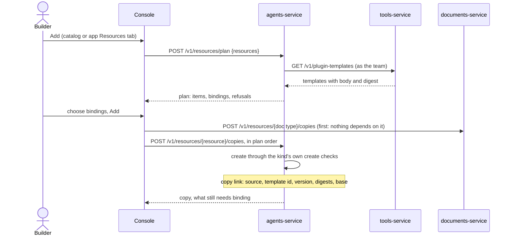
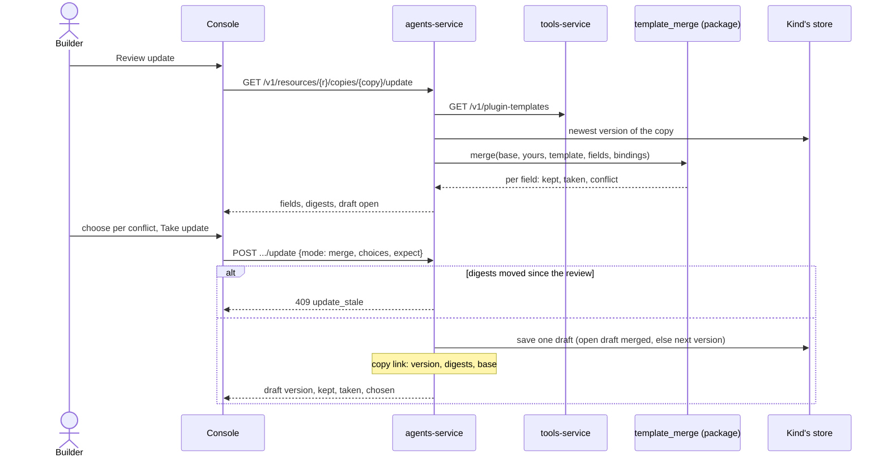

# Templates

Status: current design, 2026-11-11. Code cited at commit 81c9883a. This page covers how a team installs, keeps, edits
and later updates agents, skills, workflows, guardrails, case types, task types and document types from templates that
plugins ship, and what replaces the start-up seeds that write team content today.

Versions and publish review are in [definitions and versions](definitions-and-versions.md); who may act is in
[roles and permissions](roles-and-permissions.md). Plugin pins are described in the plugin guide
([plugins](../guide/plugins.md)).

## The rule

A team's copy remembers the template body it was made from. An update takes the template's changes only in fields
the team has not edited, keeps the team's edits, lists fields edited on both sides for a person to choose, and never
rewrites a published version. A copy changes only when a person acts; nothing updates on its own.

## Status by part

| Part | Built | Where |
|---|---|---|
| Template list per team, from plugins | Built | `services/tools-service/src/ops_tools/plugins/templates.py:337` (`GET /v1/plugin-templates`); `services/agents-service/src/ops_agents/api/routers/templates.py:319` (`GET /v1/templates`) |
| Install: plan, then copy | Built | `templates.py:686` (`POST /v1/resources/plan`), `templates.py:620-628` (`POST /v1/resources/{resource}/copies`) |
| Install for document types | Built | `services/documents-service/src/ops_documents/templates.py:172`, `:275`, `:375`, `:389` |
| Copy link with template digest and record digest | Built | `services/agents-service/src/ops_agents/store/template_copies.py:30-48` |
| States available, added, update available, removed upstream | Built | `templates.py:89`, `:280-283` |
| Update as a whole replacement, refused with `copy_edited` until confirmed | Built | `templates.py:840-844`, `:218` |
| Template kinds agent, skill, workflow, document type | Built | `packages/ops_plugin_sdk/src/ops_plugin_sdk/manifest.py:378`; agents-service kinds `templates.py:66` |
| Console Resources tab: state badge, add preview, update, remove | Built | `apps/console/src/components/connections/app-resources.tsx:62`, `:277`, `:419`, `:488` |
| Pinned plugins baked into the image | Built | `deploy/plugins.json`, `deploy/images/bake_plugins.py`, `scripts/plugins_sync.sh` |
| Field-by-field merge against a stored base | Designed, not built yet | `packages/ops_service_kit/src/ops_service_kit/template_merge.py` does not exist |
| `base`, `detached_at`, `detached_by` on the copy link | Designed, not built yet | |
| Detach, reset mode, conflict choices, stale check | Designed, not built yet | |
| Case type, task type and guardrail as template kinds | Designed, not built yet | |
| A plugin that ships only templates (no connection, egress or tools) | Designed, not built yet | `manifest.py:403`, `:407` require egress and tools today |
| Templates catalog page `/templates` | Designed, not built yet | `apps/console/src/app/templates/` does not exist |
| Core, starter and sample-team packs | Designed, not built yet | `deploy/plugins.json` pins github, salesforce, web, sharepoint and confluence only |
| Adoption of seeded records as copies | Designed, not built yet | |
| No team content written at start or on first read | Designed, not built yet | seed loaders still run: `services/agents-service/src/ops_agents/api/app.py:451`, `:457-459`; `store/typed_records.py:111` |
| Skill names unique per team | Designed, not built yet | the slug is unique across every team: `store/skills.py:31` |
| Core case and task types offered from an empty list | Designed, not built yet | |

## Domain model

| Entity | What it is | Fields that matter | Owner |
|---|---|---|---|
| Pack | A plugin whose manifest lists templates; it may bring no connection or tools | id (`opsai.core`), title, version, pinned commit | tools-service loads it |
| Template | One entry in a pack: a body the kind's create route accepts | kind, id, version, path, requires (tools, bindings, other templates of the pack), digest | tools-service serves it |
| Copy | An ordinary team record made from a template, with its own id, versions and publish state | as any record of its kind | the kind's service |
| Copy link (`template_copies`) | Where a copy came from and what it was made from | source, template id, version, template digest, record digest (built); base, detached at, detached by (designed) | the kind's service: agents-service and documents-service each keep their own |

Today's copy link (`store/template_copies.py:30-48`) holds the template digest and the record digest. A record whose
digest differs from the stored one was edited by the team. The live unique index is on tenant, team, source,
template id and version (`template_copies.py:51-61`).

### Kinds

| Kind | Service | Merged by | Fields the team always keeps (bindings) | Built as a template kind |
|---|---|---|---|---|
| Agent | agents | Field, over the agent store's field list | name, model, knowledge bases | Yes |
| Skill | agents | Field, over the skill store's field list | name, knowledge bases | Yes |
| Workflow | agents | Whole definition | name; steps point at the team's copies | Yes |
| Document type | documents | Field, and each extracted field by its key | name | Yes |
| Guardrail | agents | Field | name | No |
| Case type, task type | agents | Field, and each action or field definition by its key | name | No |
| Knowledge source | kb | Not merged: a source is added to a base the team chooses | the base | Not a template kind |

Tool modules and widgets are not template kinds.

### States of a copy

```
available --add--> added --pin moves--> update_available --take or reset--> added
added | update_available --pack drops it--> removed_upstream
added | update_available | removed_upstream --detach--> detached
detached: the template is offered as available again, for a fresh copy under another name
added --copy deleted--> available
```

The first four states are built (`templates.py:89`). `detached` is designed and shows on the copy's own page.

## The update rule

Designed, not built yet. For each field in the kind's store field list, compare three bodies: base (the template body
the copy was last made or merged against, binding fields left out), yours (the copy's newest version) and template
(the template's body now, with the team's bindings kept).

| Yours vs base | Template vs base | Outcome | Shown as |
|---|---|---|---|
| same | same | Nothing to do | not listed |
| same | changed | Take the template's value | From the template |
| changed | same | Keep yours | Your edits, kept |
| changed | changed, equal to yours | Nothing to do | not listed |
| changed | changed, different | Conflict: yours by default; the person may take the template's | Needs your choice |

The merge is one pure function in `ops_service_kit`, used by agents-service and documents-service. It compares fields
with each store's own field list. Today three per-store helpers list fields (`store/agent_registry.py:120`,
`store/skills.py:86`, `store/widgets.py:65`) and the templates router keeps its own lists (`templates.py:771-772`);
the router's lists are removed in the design.

### Guarantees

| # | Statement |
|---|---|
| 1 | An update never changes a published version or a version anything has pinned. Agents, skills, guardrails, case types, task types and workflows get one draft through the kind's own save, and what runs keeps running until that draft passes the kind's publish review |
| 2 | Document types have no draft. An update makes the next version at once; existing pins keep their version and a workflow saved after it pins the new one. The update dialog says so before the person takes it, and the answer carries `appliesNow: true` |
| 3 | A field the team edited is replaced only when the person chose the template's value for that field in that update |
| 4 | A field the team did not edit takes the template's value |
| 5 | Binding fields are the team's and are never part of an update |
| 6 | The base is the template body merged against, binding fields left out and no choices applied, written in the same insert or update as the copy link row. Saving over the draft does not change it. A conflict kept as yours is asked about again only when the template changes that field again |
| 7 | When the copy's newest version is an open draft, the update merges into it and every field the draft changed counts as yours. A draft that a publish request names is never rewritten: the update opens the next version |
| 8 | Taking an update names the template digest and record digest the person reviewed; if either moved, it is refused with 409 `update_stale` and nothing is saved |
| 9 | Reset makes a new draft from the template with bindings kept and drops the team's edits, after the person confirms the edits it lists |
| 10 | A detached copy is never offered an update or a reset |
| 11 | When a pack stops listing a template, the copy keeps running with its versions unchanged; the catalog shows it as no longer offered, with Detach and Remove |
| 12 | Two packs that ship the same template id and kind are two templates. A copy follows one, and every copy gets its own id in the team; the template id lives only on the copy link |
| 13 | Adding a template whose name the team already uses is refused with `name_taken` and a suggested name (built: `templates.py:435-438`) |
| 14 | A workflow update is whole-definition: an unedited workflow takes the new definition; an edited one shows one conflict, `definition`, with yours kept by default |
| 15 | A merged guardrail, or a merged approval setting on a type, is never less strict than the team's version: a topic the team added stays, and a conflict on a limit keeps the smaller one unless the person chooses otherwise |
| 16 | An update whose template needs a tool the team cannot call is refused with the missing tools named, by the same check an add runs, and nothing is saved |
| 17 | No service writes team content at start-up or on a team's first read |

## Install and update

Install exists today; the designed change is that the copy link also stores the base.





The merge is an in-process call; every other arrow is HTTP.

## Distribution

A pack is a plugin folder in the plugins repository, pinned to a full commit and a folder sha256 in
`deploy/plugins.json`. `scripts/plugins_sync.sh` places it on a laptop or box and `deploy/images/bake_plugins.py`
bakes it into the image, refusing a folder whose digest does not match its pin, so a running install needs no
network. Moving a pin is how a template update ships: on the next start each team's copies show "Update available".
The plugins folder is a setting (`plugins_dir`, `packages/ops_service_kit/src/ops_service_kit/settings.py:160`).
Any plugin can carry templates beside its tools.

| Pack | Holds | Turned on for | Built |
|---|---|---|---|
| `opsai.core` | General case types and task types; the Ops Assistant's body, for a team that wants a second, editable copy | Every team; a builder adds its types, first from an empty Cases or task types list | No |
| `opsai.starters` | Skills, guardrails, agents and workflows for several industries (banking complaints, insurance first notice of loss, telecom billing disputes, patient billing questions, retail returns) | Teams whose admin turns it on | No |
| `opsai.sample-team` | What `make sample-team` installs | Dev and self-hosted, never cloud production | No |
| Vendor plugins | Their own templates beside their tools | As any plugin | Yes, for the four built kinds |

A new team holds no team content. The core pack is on for every team, so an empty Cases or task types list offers
"Add the core case types" to a builder, which opens the add preview with the core types ticked; the copies are
published through the kind's own publish path. A member sees "Ask an admin".

## Records the platform owns

These stay in code and are not templates: the Platform tools module (one per workspace), each team's Ops Assistant
(made and published at team creation, kept current by `follow_declared`, `api/ops_tools.py:103`; looked up by
`ensure_ops_assistant`, `api/ops_tools.py:125`), and the system event workflows (`seed/event_workflows.json`).

## Seeds

| Seed | Today | Designed |
|---|---|---|
| Case types, task types | Written into each team on its first read and replaced when the file's version passes the team's (`store/typed_records.py:111`) | Core pack |
| Skills, guardrails | Written at start if missing, never updated (`api/app.py:457-458`) | Starter pack |
| Demo agents, workflows | Written at start in dev; followed until a person publishes (`api/agent_registry.py:291`, `api/workflow_registry.py:445`, `api/app.py:451`, `:459`) | Sample-team pack |
| Demo knowledge bases | Written at start in dev (`services/kb-service/src/ops_kb/__main__.py:22`) | Sample-team pack knowledge sources |
| People, roles, fake model provider, mailboxes, deployments, test fixtures | Dev fixtures | Unchanged |

Teams that were seeded keep their records and edits; the change runs over two releases. In the first, an adoption job in agents-service and
documents-service finds each record with seed provenance and the pack template with the same id, and writes a copy
link whose base is the record's own newest seed-saved version, with that body's digest, so a pack whose body differs
shows "Update available" at once. Team edits are later versions and count as yours. A record with no seed-saved
version left takes the pack's version 1 body as base, and every differing field is listed as a conflict kept as
yours. A record with no matching template stays the team's own and is logged. Every loader skips a record that has
a copy link, and the job is idempotent through the live unique index. In the second release the team-content
loaders, followers and seed files are deleted.

## API

| Operation | Request | Response | Errors | Built |
|---|---|---|---|---|
| `GET /v1/templates` (agents-service, documents-service) | kind, state, source, q | Templates with state; designed: `detached` state | 401, 403 | Yes, without `detached` |
| `POST /v1/resources/plan` | resources | items, bindings, refusals | `name_taken`, `template_version_not_found` | Yes |
| `POST /v1/resources/{resource}/copies` | version, name, knowledgeBases, modelAlias, copies | the copy and what it still needs; 200 when the team already holds it | `name_taken`, `template_version_not_found` | Yes; designed: also stores base |
| `GET /v1/resources/{r}/copies/{copy}/update` | | today: changes and edits; designed: `fields[]` {field, label, outcome, yours, template}, `draftOpen`, `expect` {digest, recordDigest} | 404 not the team's copy; designed: 409 `detached` | Partly |
| `POST /v1/resources/{r}/copies/{copy}/update` | today: `confirm`; designed: `mode` merge or reset (default merge), `choices` {field: yours or template}, `expect`, `confirm` | the draft made and what happened per field; document types add `appliesNow` | 409 `copy_edited`; designed: 409 `update_stale`, 409 `detached`, 422 missing tools | Partly: whole replace only |
| `POST /v1/resources/{r}/copies/{copy}/detach` | | the copy link with `detachedAt`; a second call returns the same row | 404; 400 `team_required` for a session acting in no team | No |

A body of `{confirm: true}` with no `mode` is read as a reset, which matches today's behaviour. A copy link written
before the base column existed uses the record's digest-matched version as base when one exists, and otherwise lists
every changed field as a conflict kept as yours.

## Console

| Screen | Calls | Built from | Built |
|---|---|---|---|
| Templates catalog `/templates`, one kind per view, filtered by pack and state | `GET /v1/templates` on the one service that owns the chosen kind | PageLayout, DataTable toolbar, Badge, EmptyState, Skeleton, QueryError, AskAnAdmin | No |
| Add | plan, then copy | AddPreviewDialog (`app-resources.tsx:277`) | Yes |
| Review update: sections in the order kept, taken, choices | update review, then take | UpdateDialog (`app-resources.tsx:419`) | Whole replace only |
| Choices | same | RadioGroup per field, Collapsible showing both texts | No |
| Detach, Reset to template | detach; update with reset | ConfirmActionDialog (reset with a Checkbox) | No |
| No longer offered | list | Badge, Detach, RemoveDialog (`app-resources.tsx:488`) | Badge and Remove |

The resources list becomes one shared component used by an app's Resources tab and the catalog page.

## Access and audit

| Operation | Who | Logged as |
|---|---|---|
| See the catalog and a copy's state | Any team member (the kind's view) | nothing |
| Add a template | The kind's create cell | the copy's first version note "Added from <pack>, template version N"; the copy link |
| Review an update | The kind's edit | nothing |
| Take an update, reset, detach | The kind's edit | the draft's version note lists kept, taken and chosen; detach writes `detached_by` and a team activity event |
| Publish the draft | The kind's publish review | the publish review |
| Remove a copy | The kind's delete cell | as today |
| Turn a pack on for a team | Connections manage, as any plugin | as today |

Every route acts in the caller's team and refuses a call that names none. A template never holds a secret value; it
names a binding.

## Non-functional

| Item | Target |
|---|---|
| Update review | One read of the template list and one of the copy's newest version; under 300 ms at the 95th percentile |
| Storage | One body per copy link (a few kilobytes) |
| Adoption job | Linear in seeded records; runs once; safe to interrupt and rerun |
| Databases | PostgreSQL and SQL Server through portable store code |
| Network at run time | None; packs are baked at build or synced locally |

## Tooling

`make sample-team` today installs a manifest through public routes and falls back to the seeded types
(`scripts/sample_team.py`). Designed: it makes the team, people and fakes, turns on `opsai.sample-team`, plans and
adds its templates through the real routes and prints MADE or FOUND per copy, so a second run makes nothing;
`UPDATE=1` takes pack updates and prints KEPT, TAKEN and CONFLICT per field. The use-case harness gains a helper
that installs named templates into the run's own team through the plan and copy routes, so a use case proves the
install path a customer uses.
