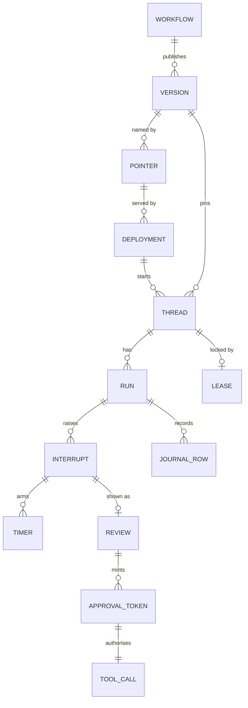

# Words and entities

Status: current, updated 2026-10-11 against HEAD; every decision is an option until the owner confirms it.

## Glossary

| Word | Meaning | In code |
|---|---|---|
| Graph | What runs: nodes and edges. An agent is a graph with one agent node and an approval node; a workflow is a larger graph. Both compile from what a builder saves in the console | `ops_agents/graphs/`; the list is in [runtime.md](runtime.md#graphs) |
| Definition | The JSON a builder saves: `{name, version, entry, nodes[{id, kind, config}], edges[{source, target}]}`. Node kinds today: agent, extract, collect, draft, grade, condition, human, tool, end | `graphs/definition.py` |
| Plan | What publish produces from a definition: engine-neutral JSON with a digest. Each engine builds its graph from it | Designed; today the stored definition is the plan |
| Digest | SHA-256 of the canonical definition JSON without its version number. Names one definition forever | `WorkflowDefinition.digest()` |
| Version | An immutable published definition: `(name, version, digest)` | `graph_versions` |
| Pointer | A name such as `wf_d@production` for one version. Deployments name pointers; moving the pointer is how a version goes live and how it rolls back | Designed; today a new thread takes the latest version or the one it names |
| Thread | One conversation or one case. Holds the graph's saved state and is pinned to one version and digest until it ends or is migrated | `graph_threads` |
| External key | The channel's own id for a thread: `deployment id:Message-ID`, an event id, a conversation id. The same key finds the same thread | `graph_threads.external_key`, unique |
| Run | One execution of a graph on a thread, from an input or a resume until it finishes, pauses or fails. One active run per thread | `graph_runs`, kinds `input`, `resume`, `recovery`, plus `sla` and `lease` journal rows |
| Node | One step of a graph. LangGraph saves state between nodes, never inside one, so a node killed mid-way runs again from its start | LangGraph node |
| Interrupt | The graph stops and asks a person. State is saved; nothing runs while it waits. A gating interrupt carries `call = {tool, input, step}`, the exact call it gates | `langgraph.types.interrupt` |
| Resume | The person's answer goes back in and the graph continues from the interrupt. Designed to go only through reviews decide; today both `POST /reviews/{threadId}/decision` and `POST /v1/threads/{id}/runs/stream` with `resume` do it | `Command(resume=...)` |
| Review | The people side of a pause: what is needed, who may decide, by when. Also used for publish requests and manual handling | Designed for hitl-service; today `api/hitl_facade.py` serves runtime pauses as the console's Reviews, with `review_decisions` and `review_approvals` |
| Approval token | A signed token bound to `{thread, step, tool, inputHash, approvers, exp}`. Covers exactly one call | HS256 today, signed by `packages/ops_policy`; facts in [identity-and-tenancy.md](identity-and-tenancy.md#approval-and-step-up-token-facts) |
| Step-up | A re-authentication by the approver in the last 5 minutes. Authenticates the approver; approves nothing by itself | `POST /v1/auth/step-up`; verified for signature, subject and age on every money decision |
| Deployment | One row: a graph pointer on a channel with settings (mailbox address, allowed domains, multitask default, paused) | `deployments` |
| Journal | The record of every run and step: who, which version, which node, which tool call, the outcome. Kept after checkpoints are pruned | `graph_runs` rows today; designed as an append-only table |
| Checkpoint | LangGraph's saved state after a superstep | `ops_checkpoints`, `ops_checkpoint_writes` |
| Lease | The per-thread lock a run holds: owner, run id, heartbeat, expiry, generation | `thread_leases` |
| Generation | A counter on the lease that rises on every acquire or takeover and never restarts | `thread_leases.generation` |
| Fence | The highest generation a receiver has seen for a thread. A write with a lower generation is refused | `ops_checkpoint_fences`, `gateway_fences` |
| Sweeper | A background task that takes over expired leases and continues the thread from its last checkpoint | `ops_agents/api/sweeper.py` |
| Timer | A row with a due time for an SLA warn, breach or maximum wait. Fired only through `fire(thread, timer)` | `timers`, `ops_agents/api/timers.py` |
| Process principal | A non-human identity owned by a team, used as `sub` for runs nobody started in person (a mailbox, a schedule) | Designed |
| Delegation token | A short-lived token with `sub` (who the work is for) and `act` (who does it: the graph version) | Designed; today `runContext.sub` is asserted by the caller |
| Side-effect class | `none`, `read`, `write` idempotent, `write` not idempotent, `money`. Sets retries and whether a token is needed | Access class in the tools registry: `read`, `write`, `money_movement` |
| Manual handling | Where a failed or stuck run lands for a person. No run ends silently | Reached by route-to-people (built-in `manual_handling` step); from retries and the recursion limit, designed |
| Budget | Caps on a thread's model calls, tokens and cost. A spent budget pauses the thread for a person | `thread_budgets`; usage per call in `usage_records` |

## Entities and how they relate

| Entity | Belongs to | Has | Key rule |
|---|---|---|---|
| Agent | Team | Draft, versions | Deploys as a one-node graph; same pointer and review rules as a workflow |
| Workflow | Team | Draft, versions | A version is immutable once published |
| Version | Agent or workflow | Definition, digest, plan | Pins every agent, tool and review policy it uses |
| Pointer | Agent or workflow | One version per environment | The only call that changes which version new threads get |
| Deployment | Team | One pointer, one channel, settings | Pausing it stops new threads; open threads finish |
| Thread | Deployment (or none, for direct API use) | Version and digest, state, external key, parent thread | One active run at a time; keeps its version until it ends or is migrated |
| Run | Thread | Input or decision, events, status, owner, generation | Holds the thread's lease while it runs |
| Interrupt | Run, at one node | Payload, gated call, SLA block | Resumes once per decision |
| Review | Interrupt, publish request or manual-handling item | Needs, eligible approvers, due time, decisions | The requester cannot decide |
| Approval token | Review decision | Binding to one call's input hash | Expires in 15 minutes; any edit to the input invalidates it |
| Timer | Interrupt and round | Kind, due time, claim | Fires at most once per interrupt and round |
| Tool call | Run and step | Input hash, decision, reasons, outcome | One effect per `(thread, step, tool, inputHash)` |
| Journal row | Run | Who, version, node, call ids, outcome | Kept for the tenant's retention; never edited |

