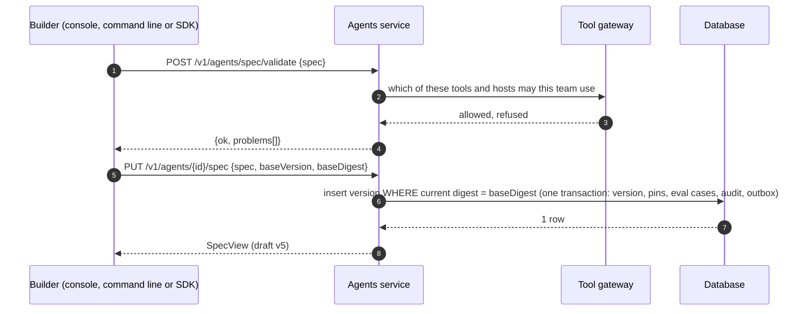
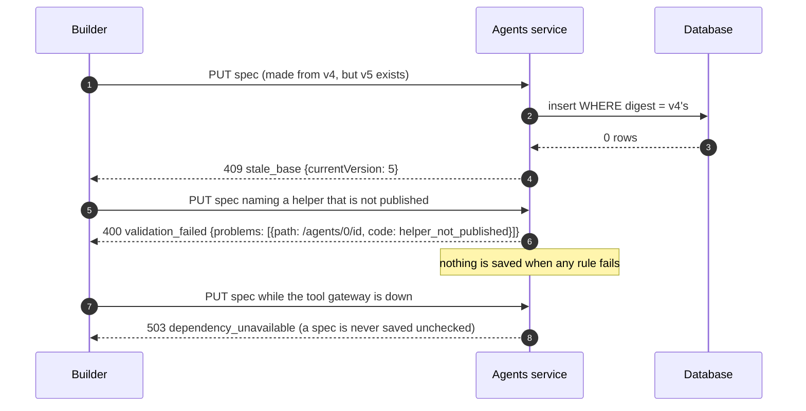

# Agent spec file

Status: proposed design, written 2026-11-26. Nothing on this page is built. Release 1.4.0; the sandbox block is read in
1.4.0 and takes effect in 1.5.0.

An agent is described by one document. The console edits it, the command line applies it, the two client libraries
send it, and the chat builder drafts it. Nobody writes a program to make an agent: everything that differs between one
agent and another is a field in this document, and the only code a builder ever writes is a tool. This page fixes the
document's fields, how it is stored as versions, and how it is checked.

## Purpose

| Goal | Measure |
|---|---|
| One document, read and written by every surface | An agent built in the console exports to a file that applies to an empty team and produces an equal spec |
| Declarative and versioned | Every save is a new draft version with a digest; publishing pins a version |
| Checked before it is saved | A spec that names an unknown tool, an unpublished helper or a host off the egress list is refused with the field's path |

## What it owns and what it must not own

| Owns | Must not own |
|---|---|
| The document's shape: [agent-spec-schema.yaml](agent-spec-schema.yaml), JSON Schema draft 2020-12 | The records it names. Tools, knowledge bases, skills, guardrails, hook policies and helper agents are separate records with their own versions and reviews |
| Whole-document read, save, compare and check | Publishing. The publish check, the evals gate and the reviewer's approval are unchanged |
| The mapping between the document and today's stored agent version | Access. Who may edit or publish is decided by `can()` as today |

## The fields

`State` compares with the fields the update route accepts today (`services/agents-service/src/ops_agents/api/routers/agents.py:152`).

| Field | Holds | State | Stored today as |
|---|---|---|---|
| `apiVersion` | `ops.ai/v2`. A file without it is read as today's format and converted | New | none |
| `id` | The agent's id; left out when creating | Today | `Agent.id` |
| `name`, `role` | What the agent is called and what it is for | Today | same |
| `instructions`, `brief`, `promptMode` | What the agent is told, as one text or as headed sections | Today | same; `patterns` stays a console-only field and is not in the file |
| `model`, `modelSettings` | A model alias and its settings. `modelSettings.fallback` names a second alias | Today; `fallback` is new | `model`, `model_settings` |
| `channels` | Where it can be reached | Today | same |
| `toolIds`, `collections`, `allTeamKnowledgeBases`, `accounts`, `skillMenu` | What it may use | Today | same |
| `skills` | Attached skills, with an optional pinned version | Changed: in the file, where today a separate route attaches them | skill pins |
| `guardrails` | Guardrail records by id | Changed | `guardrail_pins` (`agents.py:172`) |
| `privacy.maskPersonalData`, `whenUnsure` | Masking, and what to do when unsure | Changed: moved out of the old `guardrails` object | `Guardrails.redact_pii`, `when_unsure` (`agents.py:114`) |
| `memory` | What it remembers about a person | Today | `MemorySettings` |
| `widgets` | Pinned rich-result templates | Today, regrouped | `widget_pins`, `widgets` |
| `limits` | Budget per conversation, the models and temperature callers may choose | Today | `AgentLimits` (`services/agents-service/src/ops_agents/activities/agent_limits.py:38`) |
| `loop` | How the agent works. Left out, it is automatic | New | none |
| `agents` | Helper agents and how each is used | New | none; today a team's default agent asks specialists (`api/agent_calls.py:72`) |
| `sandbox` | The workspace: image, size, hosts, secrets, approvals, files | New | none |
| `hooks` | Named policies per moment | New | none |
| `output` | A schema the answer must match, and a quality bar | New for chat; a workflow agent step has `outputSchema` today | `AgentRequest.output_schema` (`packages/ops_engine/src/ops_engine/ports.py:155`) |
| `evals` | Test cases and the pass rate the publish gate needs | Changed: in the file; the cases and gate exist | eval cases (`api/routers/assurance.py:172`) |

Fields removed from the old `guardrails` object, and where each goes:

| Old field (`agents.py:114`) | Goes to | Reason |
|---|---|---|
| `max_tool_calls_per_turn`, `max_model_calls_per_turn` | `loop.maxToolCalls`, `loop.maxSteps` | They are loop limits |
| `max_model_calls_per_conversation`, `max_cost_per_conversation` | `limits.budget` | One budget, enforced at the model gateway |
| `blocked_topics` | A guardrail record listed under `guardrails` | An inline list had no version and no review |

The two worked examples use every field: [a loan operations agent](agent-spec-loan-ops.yaml) with one agent in charge
and two helpers, and [an IT helpdesk agent](agent-spec-it-helpdesk.yaml) that hands the conversation to the right desk
and has a workspace for log files. Both are validated against the schema by the check described under acceptance.

A spec on the default path needs four fields and no `loop`:

```yaml
apiVersion: ops.ai/v2
name: Clinic scheduling desk
role: Books, moves and cancels outpatient appointments for clinic staff.
model: balanced
toolIds: [scheduling.find_slots, scheduling.book_slot]
limits: { budget: { ceilingUsd: 1.00 } }
```

## Rules a spec must meet

Each rule is a check of `POST /v1/agents/spec/validate` and of every save. A failure answers 400 `validation_failed`
with `details.problems: [{path, code, message}]`; `path` is a JSON pointer into the document.

| # | Rule | `code` |
|---|---|---|
| 1 | The document matches the schema; unknown fields are refused | `schema` |
| 2 | `instructions` and `brief` are not both set | `instructions_and_brief` |
| 3 | Every `toolIds` entry is a tool the agent's team may use | `tool_unknown` |
| 4 | Every `collections`, `skills`, `guardrails`, `hooks` entry exists in the tenant and, for skills, guardrails and hooks, has a published version | `record_unknown`, `record_not_published` |
| 5 | Every `agents` entry is a published agent of the same team, is not this agent, and does not list this agent as its own helper | `helper_unknown`, `helper_not_published`, `helper_other_team`, `helper_cycle` |
| 6 | `use: handoff` appears only when `loop.kind` is `swarm`; `use: tool` only when it is left out, `auto` or `supervisor` | `helper_use_mismatch` |
| 7 | `loop.kind: workflow` names a published workflow of the same team | `workflow_unknown` |
| 8 | `loop.kind: long_running` requires `sandbox` | `sandbox_required` |
| 9 | Every `sandbox.network.allow` host is on the tenant's egress list | `host_not_listed` |
| 10 | Every `sandbox.secrets` name is a secret of the team, and each of its hosts is in `network.allow` | `secret_unknown`, `secret_host_not_allowed` |
| 11 | `sandbox.image` and `size` are offered by this install, and each limit is at or below the install's cap | `image_unknown`, `limit_over_cap` |
| 12 | `output.schema` is a valid JSON Schema of type object, at most 32 KiB | `output_schema_invalid` |
| 13 | `limits.budget.defaultUsd` is at most `ceilingUsd`, and `ceilingUsd` is at most the team's policy cap | `budget_over_ceiling`, `budget_over_policy` |
| 14 | `model` and `modelSettings.fallback` are aliases the team may use, and differ | `alias_unknown`, `fallback_same` |
| 15 | Every eval case's `expect.calls`, `notCalls` and `handoff` name a tool or helper in this spec; `expect.mode` names only modes the spec makes available | `eval_names_unknown`, `eval_mode_unavailable` |

## Interfaces

Routes are in the [API](api.md) page and the [OpenAPI draft](openapi-draft.yaml). Their models:

```python
class AgentSpec(In):                   # extra="forbid"; generated JSON Schema equals agent-spec-schema.yaml
    api_version: Literal["ops.ai/v2"]
    ...                                # one field per row of the table above

class SpecSave(In):
    spec: AgentSpec
    base_version: int | None = None    # required when the agent exists; with base_digest it refuses a stale save
    base_digest: str | None = None
    note: str | None = None

class SpecView(Out):
    agent_id: str
    version: int
    digest: str                        # SHA-256 over the canonical JSON of `spec`
    status: Literal["draft", "published"]
    spec: AgentSpec
    can_edit: bool

class SpecProblem(Out):
    path: str                          # JSON pointer, for example /agents/1/id
    code: str
    message: str

class SpecCheck(Out):
    ok: bool
    problems: list[SpecProblem]
    summary: SpecSummary               # loop kind, counts of tools, helpers, eval cases

class SpecDiff(Out):
    against: Literal["draft", "live"]
    changes: list[SpecChange]          # {op: "add"|"remove"|"replace", path, before, after}
```

A save made from an older copy answers 409 `stale_base`, as today's update does
(`sdk/python/src/ops_ai/_agents.py:52`).

### Events

| Event (outbox) | When | Payload |
|---|---|---|
| `agent.spec_saved` | A whole-document save commits | `{agentId, version, digest, by}` |

The audit entry for a save is written in the same transaction (SC2), because `hooks`, `sandbox.network` and
`limits` change what the agent can do.

## Data model

Decision: the spec document is the stored form of an agent version. The agents service already stores a version's
fields as one JSON document (`default_limits(spec: Json)` reads it at
`services/agents-service/src/ops_agents/activities/agent_limits.py:65`), so no table is added.

| Item | Change | Tenant scope | Retention |
|---|---|---|---|
| Agent version rows | The stored document becomes the v2 spec. Versions saved before are converted on read by one function, `spec_from_stored`, and written back as v2 on the next save | Tenant and team, as today | With the agent |
| Eval cases | Saving a spec replaces the agent's saved cases with `evals.cases` in the same transaction; reading a spec fills `evals.cases` from them | As today | As today |
| Skill pins, guardrail pins, widget pins | Written from the spec in the same transaction as the version | As today | As today |
| `sandbox.files[].from` | Never stored. The command line uploads the local file to the team's Files and sends `fileId` | | |

| Database | Note |
|---|---|
| PostgreSQL and SQL Server | No new statement kind. The document is the existing JSON column. Digest comparison is a string equality in the `WHERE` of the save (DA12) |

Because Ops AI is not in production, stored versions in the old shape are not migrated in place; seeded workspaces are
reseeded with v2 specs. `spec_from_stored` exists so that an install which did save agents can still open them, and is
deleted one release later.

## Flows



Failure paths:



## Settings

| Setting | Default | Meaning |
|---|---|---|
| `OPS_AGENTS_SPEC_MAX_BYTES` | `262144` | Largest spec document accepted |
| `OPS_AGENTS_MAX_HELPERS` | `12` | Largest `agents` list |
| `OPS_AGENTS_MAX_EVAL_CASES` | `200` | Largest `evals.cases` list |

## Security, cost and limits

| Concern | Rule |
|---|---|
| A spec cannot widen what a team may do | Rules 3, 9, 10 and 13 are checked on save and again at run time by the gateways. A spec that passed and whose host was later removed from the egress list is refused at the exit gate |
| Hooks are records, not code | A spec lists policy ids. A policy's body is written by a person with the security permission and has its own versions |
| Secrets | A spec names secrets; it never holds a value. Export never prints one |
| Review | Any change to `hooks`, `sandbox`, `agents`, `limits` or `guardrails` is shown first in the reviewer's compare view, which reads `POST /v1/agents/{id}/spec/diff` |
| Cost | Validate is one call to the tool gateway and at most six indexed reads |

## Acceptance criteria

| # | Failure mode | Test proves |
|---|---|---|
| 1 | A spec with an unknown field is saved and the field is silently dropped | 400 with the field's path; no version row is added |
| 2 | A save made from an older copy overwrites a newer one | 409 `stale_base`; the newer version is unchanged |
| 3 | Export then apply changes the agent | Export of a seeded agent applied to an empty team yields a spec with the same digest once ids are mapped |
| 4 | A helper cycle is saved | Two agents naming each other: the second save answers `helper_cycle` |
| 5 | A sandbox host off the tenant's list is saved | `host_not_listed` at `/sandbox/network/allow/0` |
| 6 | Saving a spec leaves eval cases from the previous version behind | After a save with two cases, the saved cases are exactly those two |
| 7 | The schema file and the service model drift | A check generates the JSON Schema from `AgentSpec` and fails when it differs from the committed file; both examples validate |
| 8 | A spec saved while the tool gateway is down skips its checks | 503 and no version row |

## Use cases per layer

| Use case | api | sdk | cli | ui |
|---|---|---|---|---|
| Apply a file, read it back equal | `PUT` then `GET /v1/agents/{id}/spec` | `ops.agents.apply`, `ops.agents.spec` | `opsai agents apply`, `opsai agents export` | View as file on the agent page |
| A bad spec is refused with the field's path | `POST /v1/agents/spec/validate` | `ops.agents.validate` | `opsai agents validate` | Field errors on the Loop, Sandbox and Agents tabs |
| See what applying would change | `POST /v1/agents/{id}/spec/diff` | `ops.agents.plan` | `opsai agents plan` | Reviewer's compare view |

## Files to add, change and delete

| Package | Add | Change | Delete |
|---|---|---|---|
| `services/agents-service` | `domain/agent_spec.py` (the pure rules 2, 6, 8, 12, 13), `app/agent_spec.py` (validate, save, diff, `spec_from_stored`), `api/routers/agent_spec.py`, `api/agent_spec_schemas.py` | `api/routers/agents.py` (`AgentPatch` accepts `loop`, `sandbox`, `agents`, `hooks`, `output`), `activities/catalog.py` (`AgentDefinition` reads the new fields), `store/agent_registry.py` (save in one transaction), `openapi.json` | The inline `Guardrails` model once the console no longer sends it |
| `docs/design/agents-v2` | | `agent-spec-schema.yaml` becomes generated | |
| `scripts` | `check_agent_spec_schema.py` (rule 7 of the acceptance table) | `make/checks.mk` adds it to the check list | |

## Open points

| # | Open point | Settled by |
|---|---|---|
| 1 | Whether `patterns` (the console's writing patterns) belong in the file | Owner decision; it is left out here because it shapes drafting, not the agent |
| 2 | Whether a spec may pin a helper agent's version, or always uses the helper's live version | Decided here as: optional `version`, live when left out. Revisit after the first team uses helpers |
| 3 | Whether `evals.cases` over the size limit should move to a second file beside the spec | Usage, after the builder ships |
