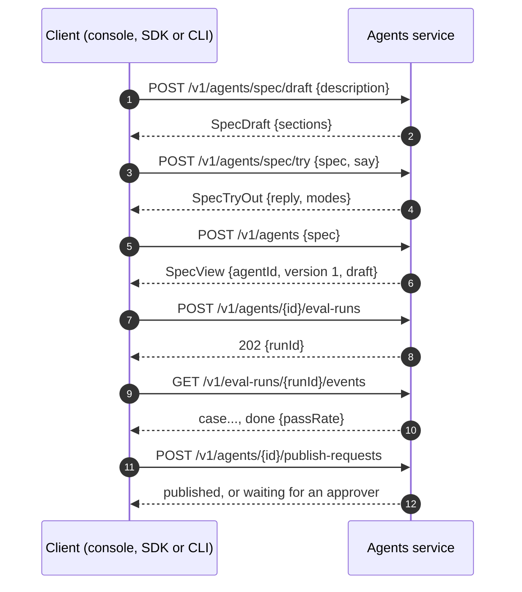
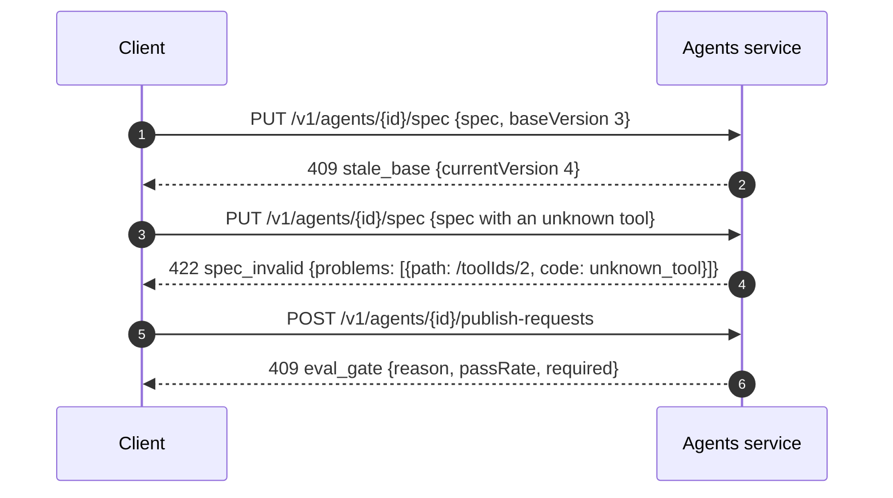

# API for agents version 2

Status: proposed design, written 2026-11-26. Nothing on this page is built. Routes are marked with the release that adds
them: 1.4.0, 1.5.0 or 1.6.0.

This page is the one list of every route the three releases add, change or remove, with the page that specifies each.
The request and response shapes of the new public routes are in the [OpenAPI draft](openapi-draft.yaml), which a
builder copies from when writing the route and its models. The committed document of each service stays the contract:
the draft is a design input and is deleted when the last route in it ships.

## Purpose

| Goal | Measure |
|---|---|
| One place to see the API change | Every route named on any page of this folder is in the tables below |
| The SDKs and the console are generated from the same contract | Each route's models are named, so the generated layer in both SDKs has typed operations |
| No compatibility layer | A removed or changed route has no alias. The product is not in production, so tenants are reseeded |

## What it owns and what it must not own

| Owns | Must not own |
|---|---|
| The list of routes and which service serves each | A route's behaviour: its component page |
| Conventions every new route follows | The services' committed documents, which are generated from code by `make openapi` |

## Conventions

These restate the standards for routes; a new route that breaks one fails an existing check.

| Convention | Rule | Standard |
|---|---|---|
| Envelope | Success is `{success: true, data}`. An error is `{success: false, error: {code, message, status, requestId, kind, retryable}}` (`packages/ops_service_kit/src/ops_service_kit/http.py:84`, `:356`) | CF |
| Request models | Every body is a model with unknown fields refused. No route takes a bare dictionary | LY |
| Lists | Return `{data, pagination, facets}` (`http.py:179`), filter, sort and page in SQL, and take `page`, `pageSize`, `sort`, `q` | DA5 |
| Errors | A stable `code` per failure, declared on the route so both SDKs get a typed error | EV |
| Idempotency | A POST that creates or acts takes `Idempotency-Key`; a repeat returns the first answer | DL |
| Permissions | Each route names the action and resource it checks with `can()`. Lists are filtered by the same rule | SC |
| Public marker | A route meant for the SDK's hand-written layer carries the public marker so `make sdk` includes it | |
| Streams | Server-sent events, each frame a typed model with a `type` field; the frame union is in the contracts package | EV |
| Field names | JSON is camelCase; Python is snake_case with aliases generated | |

## Routes

### Agents service

| Method | Path | Release | Change | Models | Specified in |
|---|---|---|---|---|---|
| GET | `/v1/agents/{agent_id}/spec` | 1.4.0 | New. Query `version`, `format=json\|yaml` | `SpecView` | [Agent spec file](agent-spec-file.md) |
| PUT | `/v1/agents/{agent_id}/spec` | 1.4.0 | New. Saves a draft version from a spec | `SpecSave` → `SpecView` | same |
| POST | `/v1/agents` | 1.4.0 | Changed. Accepts `{spec}`; the field-by-field create body is removed | `SpecSave` → `SpecView` | same |
| PATCH | `/v1/agents/{agent_id}` | 1.4.0 | Changed. Only name, description, owner team and archive state. Behaviour fields are refused with `use_spec` | | same |
| POST | `/v1/agents/spec/validate` | 1.4.0 | New | `{spec}` → `SpecCheck` | same |
| POST | `/v1/agents/{agent_id}/spec/diff` | 1.4.0 | New. Against the draft or the live version | `{spec, against}` → `SpecDiff` | same |
| POST | `/v1/agents/spec/draft` | 1.4.0 | New. The chat builder | `SpecDraftIn` → `SpecDraft` | [Chat builder](chat-builder.md) |
| POST | `/v1/agents/spec/try` | 1.4.0 | New. One test turn of an unsaved spec | `SpecTryIn` → `SpecTryOut` | same |
| POST | `/v1/agents/{agent_id}/brief-draft` | 1.4.0 | Removed; the chat builder replaces it (`services/agents-service/src/ops_agents/api/routers/agents.py:803`) | | same |
| GET | `/v1/agents/loops` | 1.4.0 | New. The loop kinds with their settings forms | `list[LoopKindOut]` | [Automatic mode and loop kinds](automatic-mode-and-loop-kinds.md) |
| POST | `/v1/threads/{thread_id}/runs/stream` | 1.4.0 | Changed. New frames `mode`, `plan`, `agent_asked`, `handoff`, `interrupt`; 1.5.0 adds `sandbox_command` | `ChatStreamEvent` | [Runtime contract](runtime-contract-and-strands-loop.md) |
| POST | `/v1/threads/{thread_id}/runs/{run_id}/cancel` | 1.4.0 | New. Stops a running turn at the next step | 202 | same |
| GET | `/v1/threads/{thread_id}/runs/{run_id}/trace` | 1.4.0 | New. The turn's steps: model calls, tool calls, modes, pauses; 1.5.0 adds commands and network requests | `RunTrace` | same |
| POST | `/v1/threads/{thread_id}/approvals` | 1.4.0 | Changed. Also answers `question` and `plan_review` interrupts (`services/agents-service/src/ops_agents/api/routers/reviews.py:63`) | `InterruptAnswer` | same |
| GET, PUT, POST | `/v1/agents/{agent_id}/eval-cases` | 1.4.0 | Changed. New check types | `EvalCaseIn` | [Evals](evals.md) |
| POST | `/v1/agents/{agent_id}/eval-runs` | 1.4.0 | Changed. 202 with a background run; `caseNames`, `repeat`, `version` | `EvalRunStart` → `EvalRunRef` | same |
| GET | `/v1/eval-runs/{run_id}` | 1.4.0 | Changed. Per-case modes, tools, cost, trace | `EvalRunRecord` | same |
| GET | `/v1/eval-runs/{run_id}/events` | 1.4.0 | New. Stream | `EvalRunEvent` | same |
| GET | `/v1/threads/{thread_id}/sandbox` | 1.5.0 | New. State, size, usage; 404 `no_sandbox` when the conversation never used one | `ThreadSandbox` | [Sandbox service](sandbox-service.md) |
| GET | `/v1/threads/{thread_id}/sandbox/files` | 1.5.0 | New. List | `ListResult[SandboxFile]` | same |
| GET | `/v1/threads/{thread_id}/sandbox/files/{path}` | 1.5.0 | New. Download, streamed | bytes | same |
| PUT | `/v1/threads/{thread_id}/sandbox/files/{path}` | 1.5.0 | New. Upload into the inbox | `SandboxFile` | same |
| DELETE | `/v1/threads/{thread_id}/sandbox/files/{path}` | 1.5.0 | New. A person deletes a file | 204 | same |
| POST | `/v1/threads/{thread_id}/sandbox/files/{path}/save` | 1.5.0 | New. Copy to the team's Files or a knowledge base | `SaveFileIn` → `SavedFile` | same |
| GET | `/v1/threads/{thread_id}/sandbox/commands` | 1.5.0 | New. Commands and network requests in order | `ListResult[SandboxActivity]` | same |
| GET | `/v1/sandbox/options` | 1.5.0 | New. Images, sizes and caps this install offers | `SandboxOptions` | same |
| POST | `/v1/workflows/definitions`, `/validate` | 1.6.0 | Changed. Groups, connection kinds, member settings, budget, undo | `WorkflowDefinition` | [Teams and human tasks](workflow-teams-and-human-tasks.md) |
| GET | `/v1/workflows/option-sources` | 1.6.0 | Changed. New source `roles` | | same |
| GET | `/v1/workflows/team-layouts` | 1.6.0 | New | `list[TeamLayout]` | same |
| GET | `/v1/runs/{run_id}` | 1.6.0 | Changed. `spend`, `budget`, `waitingOn`, group usage | `RunView` | [Workflow durability](workflow-durability.md) |
| GET | `/v1/runs/{run_id}/turns` | 1.6.0 | New | `ListResult[TurnRow]` | Teams and human tasks |
| GET | `/v1/runs/{run_id}/notes` | 1.6.0 | New | `ListResult[NoteRow]` | same |
| POST | `/v1/runs/{run_id}/cancel` | 1.6.0 | Changed. `undo` | `RunCancel` | same |
| GET | `/v1/tasks` | 1.6.0 | New on this prefix. The inbox list | `ListResult[TaskRow]` | same |
| POST | `/v1/tasks/{task_id}/decision` | 1.6.0 | Unchanged shape; now also decides an agent step's approval | `TaskDecision` | same |
| POST | `/v1/tasks/{task_id}/answer` | 1.6.0 | New | `TaskAnswer` | same |
| POST | `/v1/tasks/{task_id}/take-over`, `/return` | 1.6.0 | New | `TaskReturn` | same |
| POST | `/v1/channels/teams/actions` | 1.6.0 | New. Called by Teams, verified by signature; not in the SDK | | same |
| GET, PUT | `/v1/workflows/{workflow_id}/tests` | 1.6.0 | New | `list[TeamTest]` | [Evals](evals.md) |
| POST | `/v1/workflows/{workflow_id}/test-runs` | 1.6.0 | New. 202 | `TestRunRef` | same |
| GET | `/v1/workflow-test-runs/{run_id}` | 1.6.0 | New | `TeamTestRun` | same |

### Model gateway

| Method | Path | Release | Change | Specified in |
|---|---|---|---|---|
| POST | `/v1/models/chat/completions` | 1.4.0 | Changed. Headers `X-Budget-Id`, `X-Replay-Key`, `X-Call-Purpose`; cached token counts in usage; new refusal codes | [Model gateway](model-gateway.md) |
| PUT, GET | `/v1/models/budgets/{budget_id}` | 1.4.0 | New | same |
| POST | `/v1/models/budgets/query` | 1.4.0 | New | same |
| DELETE | `/v1/models/replays` | 1.4.0 | New | same |
| GET | `/v1/models/calls` | 1.4.0 | Changed. Filters by budget and purpose; cached tokens | same |

### Tool gateway

| Method | Path | Release | Change | Specified in |
|---|---|---|---|---|
| POST | `/v1/calls` | 1.5.0 | Changed. Outcome may carry `needsPerson` and `sources`; `sandbox.*` and `web.*` tools; new error codes | [Tool gateway](tool-gateway.md) |
| GET, PUT | `/v1/web-tools` | 1.5.0 | New | same |
| POST | `/v1/code-runs/calls` | 1.5.0 | Changed. Accepts a sandbox's token | [Sandbox service](sandbox-service.md) |
| GET, POST | `/v1/sandbox-grants`, `/v1/sandbox-grants/{id}/decision` | 1.5.0 | New. Network grants waiting for approval; shown in the inbox | same |

### Sandbox service

Internal only: service tokens, no public route, not in the SDK. Listed in full on the
[sandbox service](sandbox-service.md) page.

### Removed with the old runtime

| Item | Release | Replacement |
|---|---|---|
| The function runner service's routes (`POST /v1/runs` on its own port) | 1.5.0 | `POST /v1/function-runs` on the sandbox service |
| Behaviour fields on agent create and update bodies (`services/agents-service/src/ops_agents/api/routers/agents.py:152`) | 1.4.0 | The spec routes |

## Streams

The chat stream's frames, after 1.5.0. Frames that exist today are in
`packages/contracts/src/ops_contracts/chat.py:703`.

| Frame `type` | Fields | State |
|---|---|---|
| `start`, `status`, `text`, `replace`, `tool_start`, `tool_end`, `widget`, `part`, `citations`, `done`, `error` | As today | Today |
| `mode` | `mode`, `reason`, `fixed` | 1.4.0 |
| `plan` | `steps: [{id, text, status}]`, `revision` | 1.4.0 |
| `agent_asked` | `agent`, `agentName`, `question`, `status: started\|finished`, `summary?` | 1.4.0 |
| `handoff` | `to`, `toName`, `message` | 1.4.0 |
| `interrupt` | `id`, `kind: approval\|question\|plan_review`, `title`, `body`, `tool?`, `schema?` | 1.4.0 |
| `sandbox_command` | `callId`, `command`, `status: started\|finished`, `exitCode?`, `stoppedBy?`, `filesChanged?` | 1.5.0 |
| `done` | Gains `modes`, `costUsd`, `cachedTokens` | 1.4.0 |

## Error codes added

| `code` | Status | Route | Meaning |
|---|---|---|---|
| `spec_invalid` | 422 | Spec routes | `details.problems` lists each problem with its path |
| `stale_base` | 409 | `PUT …/spec` | The draft changed since it was read |
| `use_spec` | 422 | `PATCH /v1/agents/{id}` | A behaviour field was sent |
| `eval_gate` | 409 | Publish | No run for this draft, or below the pass rate |
| `budget_reached`, `check_cap_reached`, `budget_not_found`, `budget_header_invalid`, `budget_required` | 429, 429, 404, 422, 422 | Completions | See the model gateway page |
| `no_sandbox` | 404 | Thread sandbox routes | The conversation has no sandbox |
| `sandbox_unavailable` | 503 | Thread sandbox routes | The sandbox service or its backend is down; retryable |
| `host_not_allowed`, `web_search_not_set_up`, `page_too_large`, `tool_result_invalid` | 403, 409, 413, 422 | `POST /v1/calls` | See the tool gateway page |
| `connection_kind_source`, `connection_kind_target`, `member_not_in_team`, `cycle_outside_group`, `ask_target_has_next`, `when_missing`, `group_limits_missing`, `group_exit_missing`, `step_in_two_groups` | 422 | Definition routes | See the teams page |
| `not_assignee` | 403 | Task routes | The caller is not one of the task's people |
| `task_closed` | 409 | Task routes | Already answered, withdrawn or expired |
| `run_budget_reached` | step error | Run events | The run's budget is spent |

## Data model

This page adds no table. Each component page lists its own.

## Flows

The order a client calls the 1.4.0 routes in, from a description to a published agent:

Failure paths:

## Settings

None of its own.

## Security, cost and limits

| Concern | Rule |
|---|---|
| Who may call | Each route's permission is on its component page. No new route is open to an unauthenticated caller except the Teams action endpoint, which verifies the Teams signature and then maps the Teams user to a member |
| Rate limits | The draft and try routes spend model budget and are limited per person (`OPS_AGENTS_DRAFTS_PER_HOUR`); the rest use the service's defaults |
| Body sizes | A spec is at most 256 KB; a sandbox upload at most the sandbox's file limit, streamed |

## Acceptance criteria

| # | Failure mode | Check |
|---|---|---|
| 1 | A route ships without a request or response model | The route-contract check fails the build |
| 2 | The SDKs drift from the services | `make sdk-verify` fails when the generated layer differs from the committed documents |
| 3 | A new list pages in Python | The list-routes check fails |
| 4 | A removed route still answers | The use case for the old route is deleted and a request answers 404 |
| 5 | The draft and the built routes disagree silently | Each route's pull request quotes the draft's operation; the draft file is deleted in the last one |

## Use cases per layer

The use cases are on each component page. The `api` layer of each is a script under
`docs/usecases/<area>/scripts/test-uc-<number>-api.py` run with `make usecase-test UC=<id> LAYER=api`.

## Files to add, change and delete

| Package | Change |
|---|---|
| `services/agents-service/openapi.json`, `services/models-service/openapi.json`, `services/tools-service/openapi.json` | Regenerated by `make openapi` in each lane's pull request |
| `services/sandbox-service/openapi.json` | New |
| `packages/contracts/src/ops_contracts/chat.py` | The new stream frames |
| `docs/design/agents-v2/openapi-draft.yaml` | Deleted when the last route ships |

## Open points

| # | Open point | Settled by |
|---|---|---|
| 1 | Whether `GET …/spec?format=yaml` is worth serving, or the SDK and CLI convert | Owner; the CLI converts either way |
| 2 | Whether sandbox grants appear as tasks in `/v1/tasks` or stay a separate list in 1.5.0, since the tasks prefix is new in 1.6.0 | Decide when the 1.5.0 lane starts: in 1.5.0 they appear in the existing reviews list |
