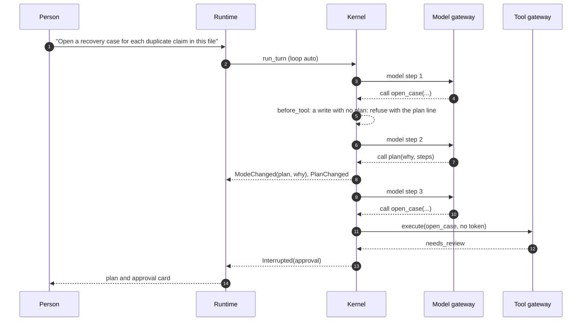
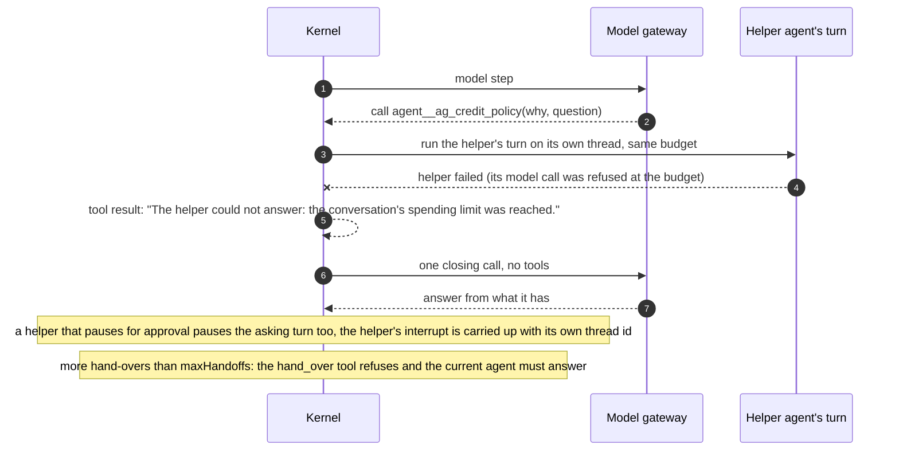

# Automatic mode and the loop kinds

Status: proposed design, written 2026-11-26. Nothing on this page is built. Release 1.4.0; the sandbox mode switches on
in 1.5.0.

Most builders should never choose how an agent works. By default the agent decides for each request: answer directly,
write a plan and work through it, ask a helper agent, or open its workspace. A builder who needs the same way of working
on every request can fix one of seven kinds instead. This page says how the automatic choice is made, named and
recorded, how each fixed kind runs, and how neither can go past what the agent's spec allows.

## Purpose

| Goal | Measure |
|---|---|
| A simple question costs one model call | The `direct` eval case of each seeded agent uses one model request and no plan |
| A change always shows its plan and waits | No write tool runs in a turn without a plan and an approval, on the scripted model and in the gateway's log |
| The choice is visible and testable | Every turn's trace opens with a mode step; an eval case can require or forbid a mode |
| Fixed kinds are data | The console's picker and the command line read `GET /v1/agents/loops`; a new kind needs no console change |

## What it owns and what it must not own

| Owns | Must not own |
|---|---|
| Which kernel tools a turn is given for its loop kind | Tool access, budgets, approvals, network rules: the gateways |
| Naming the mode from what the agent did, and recording the reason | A router or classifier before the turn. There is none |
| The plan-before-write rule inside a turn | The approval itself, which is the tool gateway's |
| The catalogue of loop kinds and their settings schemas | Workflow execution. The `workflow` kind starts a run on the workflow engine |

## Automatic mode

One agent runs one loop. It holds the plan tool, its helper agents and its workspace as tools, beside the tools from the
spec. The model decides as it goes which of them a request needs. The runtime names the mode from the first use of each.

| Mode | Named when | Reason comes from | Available when |
|---|---|---|---|
| `direct` | The turn's first model step ends and none of the three below has been used | Fixed text: "Answered without a plan, a helper or the workspace." | Always |
| `plan` | The `plan` tool accepts a plan | The plan tool's required `why` argument | Always |
| `helpers` | A helper tool (`agent__<id>`) is first called | That call's required `why` argument | The spec lists helper agents with `use: tool` |
| `sandbox` | A workspace tool is first called | That call's required `why` argument | The spec has a sandbox; release 1.5.0 |

A turn can use several modes; each first use emits one `ModeChanged` event and adds one mode step to the trace. The
`why` argument is at most 200 characters, is required by the tool's input schema, and is never shown to the next model
step as an instruction. It is masked like any shown text.

### Rules automatic mode can never break

| Rule | Enforced where | How |
|---|---|---|
| Only what the spec grants | Kernel | A turn's tool list is built from the spec alone. With no sandbox in the spec there is no workspace tool; the agent is told "This agent has no workspace" in the tool search result, and the trace records `wanted: sandbox` |
| A change runs as a plan | Kernel, `before_tool` seam | A call to a tool whose access is not `read` is refused with a model-visible line when the turn has no accepted plan: "Write the plan first with the plan tool, then call this again." It is counted once per turn in `TurnResult.plan_required` |
| A change waits for a person | Tool gateway | Unchanged: a write with no approval token bound to its input hash is refused (`services/tools-service/src/ops_tools/gateway_calls.py:397`) |
| The budget | Model gateway | Every model call of every mode names the conversation's budget. A helper spends from the same budget (`services/agents-service/src/ops_agents/api/agent_calls.py:1`) |
| Network rules | Exit gate | Only for the sandbox mode; see [sandbox service](sandbox-service.md) |
| Never a swarm or a fixed flow | Kernel | Automatic mode is given no hand-over tool and no workflow tool. Those are decisions about the whole agent |

The plan-before-write rule does not depend on the model remembering it: the refusal is code, and the approval is the
gateway's. A model that calls the write first loses one step and is told what to do.

### The quality bar

`output.rubric` is not a mode. When set, the kernel scores the final answer with the judge
(`packages/ops_agent_kernel/src/ops_agent_kernel/judge.py:61`) and, on a fail, sends the judge's reason back to the
agent for another try, at most `output.maxRounds` times. Each round is a step in the trace. This is today's end check
(`kernel.py:1110`) with a loop around it.

## The seven fixed kinds

| Kind | The turn is given | Never given | Runs on | Settings (beside `maxSteps`, `maxToolCalls`, `parallelReads`) |
|---|---|---|---|---|
| `auto` (default) | Spec tools, `plan`, helper tools, workspace tools | Hand-over, workflow | One Strands agent | `replans` |
| `single` | Spec tools. A write pauses for approval at `before_tool` like any write; there is no plan to check it against | `plan`, helpers, workspace | One Strands agent | none |
| `plan_execute` | Spec tools, `plan`; the first step must be the plan | Helpers unless listed | One Strands agent; the plan is ours (`plan.py`) | `replans`, `showPlan`, `reviewPlan` |
| `supervisor` | Spec tools, `plan`, helper tools | Hand-over | One Strands agent; each helper is a tool that runs the helper's own turn on its own thread | none |
| `swarm` | Spec tools, one `hand_over` tool whose options are the spec's `use: handoff` agents, `add_note`, and the workspace tools when the spec has a sandbox | Helper-as-tool, `plan` | See [Hand-overs](#hand-overs) | `maxHandoffs` |
| `workflow` | Nothing: the message starts a run of the named workflow and the run's result is the reply | Everything | The workflow engine, with Strands running each agent step | `workflow`, `input` |
| `evaluator` | As `auto`, with the quality bar required | | One Strands agent plus the judge | `rubric`, `judge`, `maxRounds` |
| `long_running` (release 1.5.0) | As `auto`, with the workspace required; the turn runs as a background job and the stream can be re-attached | | One Strands agent, run by a worker from the `background_turns` table below | `maxMinutes`, `background` |

`single` is not the same as the `direct` mode: `direct` is what an automatic agent happened to do for one request, and
`single` means the agent can never do more.

### Hand-overs

Decision: a hand-over is carried out by our runtime, not by a Strands swarm object, in chat and in workflows alike.

| Option | Verdict | Reason |
|---|---|---|
| A. The runtime hands over | Decided on 2026-11-26 | The `hand_over` tool ends the current agent's turn with a hand-over result. The runtime records it, switches the conversation's active agent, and starts that agent's turn with the notes and the message. Each turn is an ordinary turn, so pause, resume, budget and trace need nothing new. It is the same mechanism the workflow canvas uses for a hand-over connection ([workflow teams](workflow-teams-and-human-tasks.md)) |
| B. A Strands `Swarm` holds the agents | Not built. Trial 4 records what it can do, for information only | Strands documents swarm pause and resume through its older session managers, with no code on the page read ([multi-agent interrupts](https://strandsagents.com/docs/user-guide/sdk/multi-agent/interrupts-multi-agent/)). It would be a second place where a pause is stored |

Hand-over rules: at most `maxHandoffs` per turn of the person; an agent cannot hand to itself or back to the agent that
handed to it in the same turn unless the person spoke in between; the receiving agent gets the conversation's shared
notes and the hand-over message, not the previous agent's full exchange; the hand-over is shown in chat as one line.

This narrows the design input, which named a Strands swarm for this kind. It was decided on 2026-11-26.

Each agent in a conversation keeps its own loop state. Thread state holds `loop_states` keyed by agent id, so the agent
handed to starts from its own history, or from none, and the first agent's history is intact if the conversation comes
back to it. Shared notes are how facts cross a hand-over, so the `add_note` tool and `notes.py` are built in 1.4.0 with
this kind; teams reuse them in 1.6.0.

### Questions and plan reviews

| Pause | Starts when | What the person sees | Resume |
|---|---|---|---|
| `question` | The agent calls the kernel tool `ask_person(question, options?)`, or a tool server asks for a value (1.5.0). `before_tool` returns `pause` | A card with the question and a text box or choices | `POST /v1/threads/{id}/approvals` with `kind: question` and `answer`; `before_tool` returns `answered` with the reply and the turn continues |
| `plan_review` | `reviewPlan` is true and the `plan` tool is first called. `before_tool` returns `pause` with the plan | The plan with Accept and Change | Accept continues; Change sends the person's note to the model, which plans again, within `replans` |

Both use the one seam described in the [runtime contract](runtime-contract-and-strands-loop.md#the-approval-pause-starts-at-one-seam).

## Interfaces

```python
@dataclass(frozen=True)
class LoopSettings:
    kind: Literal["auto", "single", "plan_execute", "supervisor", "swarm", "workflow", "evaluator", "long_running"] = "auto"
    max_steps: int = 12
    max_tool_calls: int | None = 12
    parallel_reads: bool = True
    replans: int = 2
    show_plan: bool = True
    review_plan: bool = False
    max_handoffs: int = 4
    workflow: str | None = None
    workflow_input: Mapping[str, str] = field(default_factory=dict)
    rubric: str | None = None
    judge_alias: str = "judge"
    max_rounds: int = 2
    max_minutes: int = 60
    background: bool = False           # release 1.5.0

@dataclass(frozen=True)
class ModeStep:
    mode: Literal["direct", "plan", "helpers", "sandbox"]
    reason: str
    at_step: int                       # the model step it was named on
    fixed: bool                        # True when loop.kind is not auto: the mode was set by the builder

class LoopKindOut(Out):                # GET /v1/agents/loops
    kind: str
    name: str                          # "Plan, then carry out"
    description: str
    when_to_use: str
    settings_schema: dict[str, JsonValue]   # JSON Schema of the kind's own settings; the console draws the form from it
    requires: list[Literal["agents", "sandbox", "workflow", "rubric"]]
    available: bool                    # false when the install lacks what it requires (no sandbox service)
    unavailable_reason: str | None
```

The wire frames for `mode`, `plan`, `agent_asked`, `handoff` and `interrupt`, with their fields, are listed once on the
[API page](api.md#streams).

## Data model

No new table in 1.4.0. Modes and plans are part of the run's event log (`thread_events`, written by `emit` at
`services/agents-service/src/ops_agents/graphs/common.py:325`) and are read back by the trace route.

| Item | Where | Retention |
|---|---|---|
| `mode`, `plan`, `agent_asked`, `handoff` events | The thread's event log | With the conversation |
| The conversation's active agent after a hand-over | Thread state in the checkpoint, key `active_agent` | With the conversation |
| Each agent's loop state | Thread state, key `loop_states`, a map from agent id to `LoopState` | With the conversation |
| `background_turns` (new table, release 1.5.0) | Agents service: `id`; `tenant_id`, `team_id`; `thread_id` unique while active; `run_id`; `status` (`queued`, `running`, `waiting`, `done`, `failed`, `cancelled`); `lease_owner`, `lease_until`; `deadline_at`; `created_at`, `updated_at`. Claimed with `ops_store.dialect.claim` | With the conversation; finished rows are swept after 30 days |
| Shared notes of a chat swarm | Thread state, key `notes`, at most 200 entries of 2,000 characters | With the conversation |

Both databases store these in existing JSON columns.

## Flows



Failure paths:



## Settings

| Setting | Default | Meaning |
|---|---|---|
| `OPS_AGENTS_LOOP_KINDS` | all eight | The kinds this install offers. `long_running` is listed as unavailable in 1.4.0 and on an install without the sandbox service |
| `OPS_AGENTS_HELPER_DEPTH` | `1` | How deep a chain of helpers may go; today's value (`packages/contracts/src/ops_contracts/chain.py:18`) |
| `OPS_AGENTS_BACKGROUND_MAX_MINUTES` | `720` | Cap on `loop.maxMinutes` |

## Security, cost and limits

| Concern | Rule |
|---|---|
| A helper cannot widen access | A helper runs as its own published agent with its own tools, acting for the same person. It cannot use the asking agent's tools |
| A helper's cost | Counted on the asking conversation's budget; the trace shows cost per helper call |
| Prompt injection asking for a mode | A mode is a consequence of a tool call, and each tool is still granted or refused by the spec and the gateways. A document that says "open the sandbox" can at most cause a call the spec already allows |
| A plan that hides a write | The plan is shown to the person, but the approval is tied to the exact call, not to the plan text |
| Long-running turns (1.5.0) | Bounded by `maxMinutes`, the budget and the step limit. A worker claims the job's row with the dialect's claim and a lease, and renews it with a heartbeat; a lapsed lease lets another worker resume from the last saved loop state |

## Acceptance criteria

| # | Failure mode | Test proves |
|---|---|---|
| 1 | A write runs in a turn that never showed a plan | Scripted model calls a write first: the call is refused, no gateway call is made, and the next step's plan is emitted before the pause |
| 2 | A lookup is answered with a plan and three model calls | The seeded lookup case reports mode `direct` and one model request |
| 3 | Automatic mode opens a sandbox the spec does not have | With no `sandbox` in the spec, the turn's tool list holds no workspace tool |
| 4 | `single` plans anyway | A `single` agent's tool list holds no `plan` tool and no helper tool |
| 5 | A hand-over loses the thread | After a hand-over the receiving agent's first model request contains the notes and the message and none of the previous agent's tool results |
| 6 | Hand-overs ping-pong forever | The fifth hand-over in one turn with `maxHandoffs: 4` is refused |
| 7 | A helper's pause is lost | A helper asked as a tool tries a write. The helper's turn runs inside `before_tool`, so the asking turn returns one interrupt with `nested` set; approving it in a fresh process resumes the helper, then the asker. No tool body pauses |
| 8 | The mode shown differs from what ran | The trace's mode steps equal the `ModeChanged` events of the stream for the same run |
| 9 | The quality bar loops without end | A judge that always fails stops after `maxRounds` and the answer is returned marked as not meeting the bar |

## Use cases per layer

| Use case | api | sdk | cli | ui |
|---|---|---|---|---|
| The trace names the mode and why | `GET /v1/threads/{id}/runs/{run}/trace` | `ops.chat.trace` | `opsai agents trace THREAD RUN` | Run trace, mode step |
| A builder fixes the loop kind | `PUT /v1/agents/{id}/spec` with `loop` | `ops.agents.apply` | `opsai agents loops`, `opsai agents apply` | Agent, Loop tab |
| An eval case fails when a lookup starts planning | `POST /v1/agents/{id}/eval-runs` | `ops.agents.eval` | `opsai agents eval` | Evals tab |

## Files to add, change and delete

| Package | Add | Change | Delete |
|---|---|---|---|
| `packages/ops_agent_kernel` | `modes.py` (naming, the plan-before-write rule), `loop_kinds.py` (the catalogue and each kind's tool set), `handover.py` (the `hand_over` tool and its result) | `kernel.py` (tool set per kind, the quality-bar rounds), `plan.py` (`why` argument), `types.py`, `events.py` | |
| `services/agents-service` | `api/routers/agent_loops.py` (`GET /v1/agents/loops`), `app/handovers.py` (switch the active agent, start the next turn), `app/background_turns.py` and `store/background_turns.py` (release 1.5.0) | `graphs/agent_wrapper.py` (helper grants from `agents`, hand-over node), `api/agent_calls.py` (helpers for any agent, not only the team default), `graphs/common.py` | |
| `packages/contracts` | `loops.py` (`LoopKind`, mode names: one source for the service, SDK and console) | `chat.py` (new stream events) | |

## Open points

Settled on 2026-11-26: hand-overs are carried out by the runtime and the workflow engine, not a Strands swarm
(decided), and the seven explicit kinds stay (default).

| # | Open point | Settled by |
|---|---|---|
| 3 | Whether the model reliably supplies a useful `why` | Trial 3, part d: 20 scripted and 20 real requests; a reason is useful when a reviewer can tell the mode from it without the transcript |
| 4 | Whether a plan should also wait for the person (`reviewPlan`) by default for agents with write tools | Owner decision; default here is to show the plan and wait at the write |
