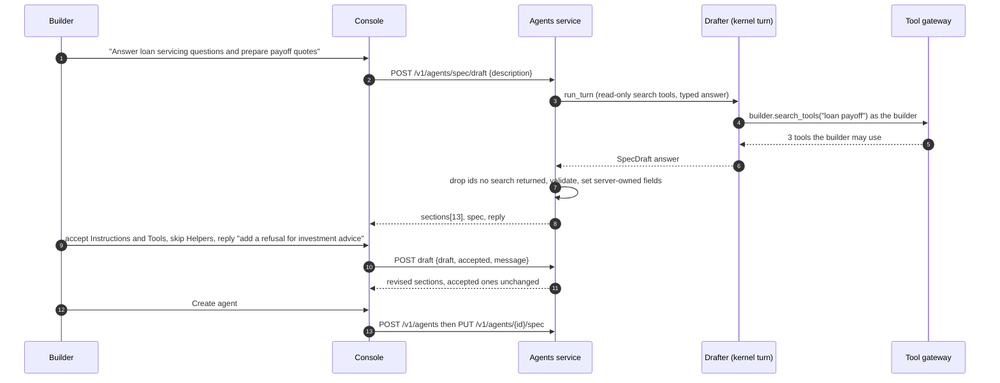
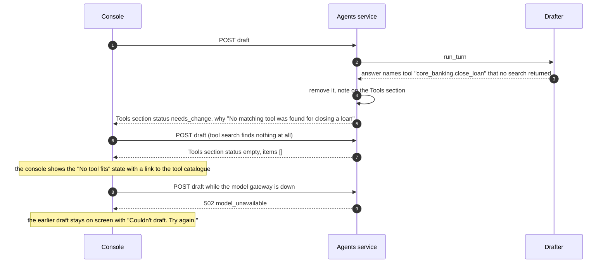

# Chat builder

Status: proposed design, written 2026-11-26. Nothing on this page is built. Release 1.4.0.

A builder describes a job in their own words and the system drafts the whole agent: instructions, the tools and
knowledge that fit, guardrails and test cases. Each part appears as a section the builder accepts, skips or asks to
change by replying. Nothing is saved until they accept, and what is saved is an ordinary draft that still has to pass
its tests and a reviewer before it goes live. This page fixes how the draft is produced, what the builder approves, and
what the drafter is never allowed to do.

## Purpose

| Goal | Measure |
|---|---|
| A non-engineer gets a working draft from a description | From a 2-sentence description, the draft passes spec validation with no edits in at least 9 of 10 seeded descriptions |
| Suggestions are real | Every suggested tool, knowledge base and guardrail is one the builder may use, found by search, never invented |
| The person stays in charge | No section reaches the saved spec without an accept; the save is the normal whole-spec save |

## What it owns and what it must not own

| Owns | Must not own |
|---|---|
| Turning a description and follow-up messages into a draft spec with a reason per section | Saving. The console saves the accepted spec through the spec route |
| Searching the catalogues the builder may use | Granting anything. A suggested tool the builder cannot use is never shown |
| Drafting eval cases, including cases that check the mode | Publishing, the evals gate, the reviewer |

It replaces what exists, and the earlier route is removed: the Draft button on an agent's instructions proposes text per heading from a description
(`services/agents-service/src/ops_agents/app/brief_draft.py`, route at
`services/agents-service/src/ops_agents/api/routers/agents.py:803`).

## How a draft is made

The drafter is a fixed internal agent that runs on the same runtime as every other agent, with read-only tools and no
workspace. It is not a published agent and has no spec a tenant can edit.

| Step | What happens | Tool the drafter uses |
|---|---|---|
| 1 | Reads the description and any earlier draft | none |
| 2 | Searches tools the builder may use | `builder.search_tools(query)`: the tool catalogue list, filtered by the builder's own access |
| 3 | Searches knowledge bases, skills and guardrail records | `builder.search_knowledge`, `builder.search_skills`, `builder.search_guardrails` |
| 4 | Searches published agents of the team for helpers | `builder.search_agents` |
| 5 | Returns the draft as a typed answer | The kernel's `answer` tool with the `SpecDraft` schema |

Every search tool runs as the builder (acting-for), so its results are exactly what the builder would see on the
matching console page. The drafter has no write tool, so a draft can change nothing.

Rules the server applies to the drafter's answer before returning it:

| Rule | What happens when broken |
|---|---|
| Every id in the draft was returned by one of this turn's searches | The id is removed and the section gets a note: "No matching tool was found for: …" |
| The draft validates against the spec rules ([agent spec file](agent-spec-file.md)) | Problems are attached to their sections; the section is shown with the problem and cannot be accepted until changed |
| `limits.budget.ceilingUsd` is at most the team's policy cap; when the drafter leaves it out, the team default is used | Set by the server, never by the model |
| `hooks` and `sandbox.network`, `sandbox.secrets` are never drafted | Those sections are always returned empty with the note "Set by a security admin" or "Add hosts on the Sandbox tab" |
| `loop` is left out unless the description asks for a fixed way of working | The draft is automatic by default |
| At least four eval cases: one lookup that must stay `direct`, one change that must pause for approval when the draft has a write tool, one refusal when it has a guardrail, one typical request | Missing kinds are listed in the Tests section as "not drafted" |

## Interfaces

`POST /v1/agents/spec/draft`. It saves nothing and is safe to repeat.

```python
class SpecDraftIn(In):                 # extra="forbid"
    description: str = Field(min_length=1, max_length=8000)
    draft: AgentSpec | None = None     # the current draft, when revising
    accepted: list[SectionName] = []   # sections the person already accepted: the drafter leaves them unchanged
    message: str | None = Field(default=None, max_length=4000)   # the follow-up, when revising
    agent_id: str | None = None        # set when drafting changes to an existing agent

SectionName = Literal[
    "basics", "instructions", "tools", "knowledge", "skills", "helpers",
    "guardrails", "output", "limits", "tests", "loop", "sandbox", "hooks",
]

class DraftSection(Out):
    name: SectionName
    title: str                         # "Tools"
    status: Literal["proposed", "unchanged", "empty", "needs_change"]
    why: str                           # one or two sentences shown under the section
    patch: dict[str, JsonValue]        # the spec fields this section would set, for example {"toolIds": [...]}
    items: list[DraftItem]             # what the card lists: {id, name, description, kind, access?}
    problems: list[SpecProblem]

class SpecDraft(Out):
    spec: AgentSpec                    # accepted sections plus every proposed one
    sections: list[DraftSection]       # always all 13, in the order above
    reply: str                         # what the builder reads in the chat, at most 600 characters
    usage: DraftUsage                  # model calls and cost of this draft
```

The response is an ordinary envelope. A streamed variant is not built in 1.4.0: a draft is one request of a few seconds
and the console shows a drafting state.

`POST /v1/agents/spec/try` runs one test turn on an unsaved spec, so a builder can try the draft before accepting it:

```python
class SpecTryIn(In):
    spec: AgentSpec
    say: str = Field(min_length=1, max_length=8000)
    thread_id: str | None = None       # continue an earlier try

class SpecTryOut(Out):
    thread_id: str                     # a test thread; test accounts and mocked writes, as the Test panel today
    events: list[dict[str, JsonValue]] # the same events the chat stream carries
    reply: str
    modes: list[ModeStepOut]
```

A try runs on a test thread with test accounts, exactly as the agent page's Test panel does today
(`services/agents-service/src/ops_agents/api/agent_test.py:73`), so a write in a try reaches no live system.

### Errors

| Status | `code` | When |
|---|---|---|
| 422 | `validation_failed` | The body is malformed |
| 403 | `forbidden` | The caller may not create agents in the team |
| 429 | `drafts_limit` | More than `OPS_AGENTS_DRAFTS_PER_HOUR` drafts by one person |
| 502 | `model_unavailable` | The drafter's model call failed after retries; the earlier draft is unchanged |

## Data model

No table. A draft lives in the browser until it is saved as a spec. The drafter's model calls are in the model
gateway's call log under a model key of kind `purpose` (`purpose:builder`). Each draft or try request creates a budget of
kind `draft` (`draft:<draft id>`, `OPS_AGENTS_BUILDER_BUDGET_USD`) at the model gateway and sends its id, so the
gateway refuses the drafter's calls past it. The per-person hourly limit counts requests in the agents service.

| Item | Where | Retention |
|---|---|---|
| Draft in progress | The console's page state; lost on reload, by design, with a "Leave without saving?" prompt | none |
| Test threads from `spec/try` | Threads marked `test`, as today | Deleted by the test-thread sweep |
| Usage | Model gateway call log, key purpose `builder` | As the call log |

## Flows



Failure paths:



## Settings

| Setting | Default | Meaning |
|---|---|---|
| `OPS_AGENTS_BUILDER_ALIAS` | `builder` | The model alias the drafter runs on; falls back to the default alias when the install has none |
| `OPS_AGENTS_DRAFTS_PER_HOUR` | `30` | Drafts one person may ask for in an hour |
| `OPS_AGENTS_BUILDER_BUDGET_USD` | `0.25` | Budget of one draft request |
| `OPS_AGENTS_BUILDER_MAX_STEPS` | `8` | Step limit of the drafter's turn |

## Security, cost and limits

| Concern | Rule |
|---|---|
| The description is untrusted text | It is placed in a labelled data block like any other untrusted content (`packages/ops_agent_kernel/src/ops_agent_kernel/context.py:1`). The drafter has only read-only search tools, so an instruction hidden in a description can at most change the text of the draft, which a person reviews section by section |
| A drafted agent with too much power | The server, not the model, sets the budget ceiling; hooks, hosts and secrets are never drafted; every id must come from a search made as the builder |
| Cost | One draft is bounded by its own budget and step limit; the per-person rate limit bounds the total |
| Review | Unchanged: the evals gate and a reviewer's approval of the publish request |
| Personal data | A description is sent to the model like a chat message and is not stored by the agents service |

## Acceptance criteria

| # | Failure mode | Test proves |
|---|---|---|
| 1 | The draft names a tool the builder cannot use | A scripted drafter answer with an id no search returned: the response's spec lacks it and the Tools section carries the note |
| 2 | An accepted section changes on a revise | A revise with `accepted: ["instructions"]` returns that section `unchanged` with an identical patch, even when the scripted drafter rewrote it |
| 3 | The drafter sets its own budget ceiling above policy | A scripted answer with `ceilingUsd: 500` returns the team's cap |
| 4 | Hooks or sandbox hosts are drafted | A scripted answer with `hooks` and `sandbox.network.allow` returns both sections `empty` |
| 5 | A draft is saved without an accept | The draft route writes no agent, version or eval-case row |
| 6 | A viewer drafts agents | 403 for a caller who may not create agents |
| 7 | A try run reaches a live system | A `spec/try` turn that calls a write tool produces a gateway call in the test environment only |
| 8 | The drafted tests do not check the mode | A draft with a write tool and a guardrail contains the four kinds of case, or lists the missing kind |

## Use cases per layer

| Use case | api | sdk | cli | ui |
|---|---|---|---|---|
| Draft an agent from a description, accept some sections, create it | `POST /v1/agents/spec/draft`, `POST /v1/agents`, `PUT /v1/agents/{id}/spec` | `ops.agents.draft`, `ops.agents.apply` | `opsai agents draft "<job>" -o file.yaml`, `opsai agents apply` | New agent, chat builder |
| Try a draft before saving | `POST /v1/agents/spec/try` | `ops.agents.try_spec` | `opsai agents try -f FILE "MESSAGE"` | Try it panel beside the draft |

## Files to add, change and delete

| Package | Add | Change | Delete |
|---|---|---|---|
| `services/agents-service` | `app/spec_draft.py` (run the drafter, apply the server rules), `app/builder_tools.py` (the five search tools as kernel tools over existing list routes), `api/routers/agent_spec.py` gains `draft` and `try` | `app/brief_draft.py` (reuses the section-by-section accept shape; the instructions-only route stays and calls the same drafter with one section) | |
| `services/models-service` | Seed: alias `builder`, model key `purpose:builder` of kind `purpose` | | |
| `apps/console` | See [console screens](console-screens.md) | `components/agents/draft-brief-dialog.tsx` becomes the Instructions section card | |

## Open points

| # | Open point | Settled by |
|---|---|---|
| 1 | Which model alias drafts well enough to meet the 9-of-10 measure, and at what cost per draft | Trial 3, part f: the ten seeded descriptions on two aliases, counted by validation passes and by accepted sections |
| 2 | Whether the builder should also draft hook policies for a security admin to review | Later release; a hook policy is a security record and has its own review |
| 3 | Whether a draft in progress should survive a reload | After the first builders use it; a server-side draft would need a table and a retention rule |
