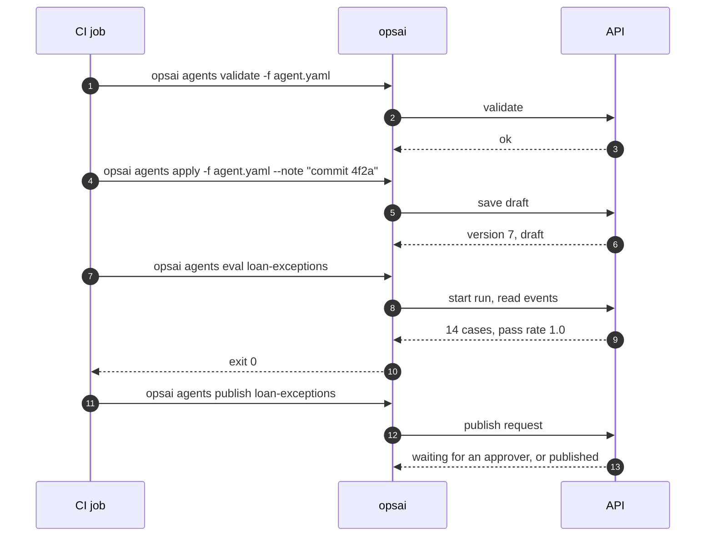
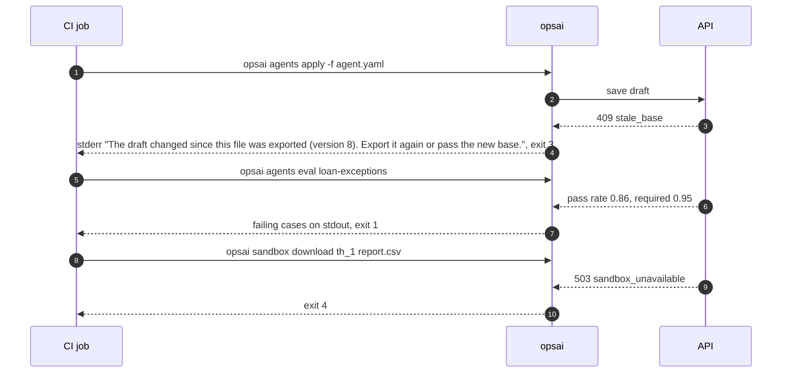

# CLI changes for agents version 2

Status: proposed design, written 2026-11-26. Nothing on this page is built. Each command is marked with its release.

The command line is how a developer keeps agents in a repository and how a continuous-integration job checks them. This
page lists the commands the three releases add: applying and exporting an agent's spec file, drafting one from a
description, running evals as a gate, inspecting a turn, working with a conversation's sandbox files, testing a team and
answering tasks. Every command is a thin layer over the Python SDK and prints either a table or JSON.

## Purpose

| Goal | Measure |
|---|---|
| An agent is a file in a repository | `opsai agents apply -f agent.yaml` in CI saves a draft, runs its evals and exits non-zero below the gate |
| Output a script can read | Every command takes `--json` and prints one JSON document on stdout; messages go to stderr |
| Exit codes mean one thing each | The table below; a refusal is never exit 0 |

## What it owns and what it must not own

| Owns | Must not own |
|---|---|
| Command names, flags, table columns, exit codes | Any HTTP call: each command calls one or two SDK methods (`sdk/python/src/ops_ai/_cli/`) |
| Reading a spec from a file or stdin, writing one to a file or stdout | Validation: the server's answer is printed |

## Today

| Fact | Where |
|---|---|
| The command is `opsai` | `sdk/python/pyproject.toml:18` |
| `opsai agents` has list, export, publish, chat, run, test, trace, publish-check and evals | `sdk/python/src/ops_ai/_cli/agents.py:17` |
| An error kind maps to an exit status | `sdk/python/src/ops_ai/_cli/common.py:236` |

## Commands

### Agents (1.4.0)

| Command | Does | SDK call |
|---|---|---|
| `opsai agents apply -f FILE [--note TEXT] [--dry-run]` | Saves a draft from a spec file; `-f -` reads stdin. `--dry-run` validates and prints the diff against the live version, saving nothing | `agents.apply`, or `agents.validate` and `agents.spec_diff` |
| `opsai agents export ID_OR_NAME [-o FILE] [--format yaml\|json] [--version N]` | Prints or writes the spec | `agents.export` |
| `opsai agents validate -f FILE` | Prints each problem as `path: message`; exit 2 when any | `agents.validate` |
| `opsai agents diff ID_OR_NAME -f FILE [--against draft\|live]` | Prints added, removed and changed fields; exit 0 when equal, 1 when different | `agents.spec_diff` |
| `opsai agents draft "DESCRIPTION" [-o FILE] [--revise FILE --message TEXT]` | Drafts a spec and prints each section with its reason; writes the spec when `-o` is given | `agents.draft` |
| `opsai agents try -f FILE "MESSAGE"` | One test turn of an unsaved spec; prints the reply and the modes | `agents.try_spec` |
| `opsai agents loops` | Lists the loop kinds | `agents.loops` |
| `opsai agents eval ID_OR_NAME [--case NAME]... [--repeat N] [--wait/--no-wait]` | Runs evals and prints one line per case as it finishes; exit 0 at or above the gate, 1 below | `agents.eval` |
| `opsai agents publish ID_OR_NAME [--note TEXT]` | As today; exit 3 with the gate's reason on `eval_gate` | `agents.publish` |
| `opsai agents trace THREAD RUN` | Prints the turn's steps: model calls with tokens and cost, tools, modes, pauses, and from 1.5.0 commands and network requests | `chat.trace` |

Removed: `opsai agents grant-tools`, `add-reference` and the definition form of `apply`. A spec file replaces them.

### Chat (1.4.0)

| Command | Does |
|---|---|
| `opsai chat say THREAD "TEXT"` | Streams the reply. Prints `mode:` and `plan:` lines to stderr with `--verbose`; stops at a pause and prints the interrupt id and what is asked |
| `opsai chat approve THREAD INTERRUPT [--note TEXT]`, `opsai chat reject …` | Answers an approval or a plan review |
| `opsai chat answer THREAD INTERRUPT --text TEXT \| --field k=v…` | Answers a question |
| `opsai chat cancel THREAD RUN` | Stops a running turn |

### Sandbox (1.5.0)

| Command | Does |
|---|---|
| `opsai sandbox show THREAD` | State, size, disk used, limits, allowed hosts |
| `opsai sandbox ls THREAD [--origin person\|agent\|builder]` | Lists files |
| `opsai sandbox download THREAD PATH [-o FILE]` | Writes a file; `-o -` writes to stdout |
| `opsai sandbox upload THREAD FILE [--name NAME]` | Puts a file in the inbox |
| `opsai sandbox rm THREAD PATH` | Deletes a file |
| `opsai sandbox save THREAD PATH --to files\|knowledge [--folder ID] [--collection ID]` | Copies a file out |
| `opsai sandbox log THREAD [--refused] [--kind command\|request]` | Commands and network requests, oldest first |
| `opsai sandbox options` | Images and sizes this install offers |
| `opsai tools web [--search on\|off] [--fetch on\|off] [--connection ID]` | Shows or changes the web tools settings |

### Workflows, runs and tasks (1.6.0)

| Command | Does |
|---|---|
| `opsai workflows validate -f FILE` | As today; reports the new connection and group problems |
| `opsai workflows test ID [--name NAME]... ` | Runs team tests; one line per test; exit 1 when any fails |
| `opsai runs turns RUN [--group ID]` | Each member's turn in order: member, kind, summary, cost, waited |
| `opsai runs notes RUN` | The shared notes |
| `opsai runs cancel RUN [--undo]` | Cancels; `--undo` runs undo steps |
| `opsai tasks list [--kind approve\|answer\|take_over] [--role ROLE] [--view mine\|team\|all]` | The inbox |
| `opsai tasks answer TASK --text TEXT \| --field k=v…` | Answers a question |
| `opsai tasks take TASK`, `opsai tasks return TASK --note TEXT [--unfinished]` | Takes a job over and hands it back |
| `opsai tasks approve TASK`, `opsai tasks reject TASK` | As today |

## Interfaces

Flags every command takes: `--json`, `--profile`, `--team`, `--quiet`. With `--json` the output is the SDK method's
return value as one JSON document.

Exit codes. The map from an error's kind to an exit status exists today and is unchanged
(`sdk/python/src/ops_ai/errors.py:13`); this page only says which new outcomes fall under each.

| Code | Meaning | New outcomes |
|---|---|---|
| 0 | Done | |
| 1 | A check did not pass | `agents diff` found changes; `agents eval` below the pass rate; a failed team test |
| 2 | The input was refused (`input`) | `spec_invalid`, an unreadable file, `use_spec` |
| 3 | The server refused the action (`refused`) | `eval_gate` on publish, `stale_base`, `not_assignee`, `task_closed`, a permission |
| 4 | Something the server depends on failed (`upstream`) | `sandbox_unavailable`, a model provider error |
| 5 | Timed out (`timeout`) | A `--wait` that outlived its limit |
| 6 | An internal error (`internal`) | |

Table output for `opsai agents eval`:

```text
CASE                                     STATUS   MODES        COST    SECONDS
Second loan over the policy limit        passed   plan         $0.04   6.1
A lookup stays a lookup                  passed   direct       $0.01   1.8
Refuses investment advice                failed   direct       $0.01   1.2
  refuses: the reply answered the question
pass rate 0.67, required 0.95
```

## Data model

None.

## Flows

A continuous-integration job for an agent kept in a repository:



Failure paths:



## Settings

No new setting. `OPSAI_PROFILE` and the profile file are unchanged.

## Security, cost and limits

| Concern | Rule |
|---|---|
| A token in CI | The job uses a service account's token with the builder role for one team; publish still needs an approver when the team's policy says so |
| Secrets in output | Trace and sandbox log output is masked by the server; the CLI adds nothing |
| Cost in CI | `agents eval` prints the run's cost; the server's eval budget bounds it |

## Acceptance criteria

| # | Failure mode | Test proves |
|---|---|---|
| 1 | A failed gate exits 0 | `agents eval` below the pass rate exits 1; `agents publish` on `eval_gate` exits 3 |
| 2 | `--json` output is not parseable | Every new command's `--json` output parses as one document with nothing else on stdout |
| 3 | `apply --dry-run` saves | After a dry run the agent's version is unchanged |
| 4 | An export cannot be applied | `export` piped to `apply -f -` creates no new version |
| 5 | A command calls the API directly | The CLI's import check allows only the SDK |

## Use cases per layer

The `cli` layer of each component's use cases runs these commands:
`docs/usecases/<area>/scripts/test-uc-<number>-cli.py`, with `make usecase-test UC=<id> LAYER=cli`.

| Use case | Commands |
|---|---|
| Keep an agent in a file | `agents export`, edit, `agents diff`, `agents apply`, `agents eval`, `agents publish` |
| Draft and try before saving | `agents draft -o`, `agents try -f` |
| Follow a paused turn | `chat say`, `chat approve`, `agents trace` |
| Work with sandbox files | `sandbox upload`, `chat say`, `sandbox ls`, `sandbox download`, `sandbox log --refused` |
| Run and answer a team | `runs start`, `tasks list --kind answer`, `tasks answer`, `runs turns` |

## Files to add, change and delete

| Package | Add | Change | Delete |
|---|---|---|---|
| `sdk/python/src/ops_ai/_cli` | `sandbox.py`, `tasks.py` (answer, take, return) | `agents.py`, `chat.py`, `runs.py`, `workflows.py`, `tools.py`, `common.py` | The grant and reference verbs in `agents.py` |
| `sdk/python/src/ops_ai` | | `errors.py` (the new typed errors), `cli.py` (register the sandbox noun) | |
| `docs` | The CLI reference page gains the commands, generated from the parsers | | |

## Open points

| # | Open point | Settled by |
|---|---|---|
| 1 | Whether `agents apply` should run evals and publish in one command with a flag | Owner; three commands keep each exit code's meaning clear |
| 2 | Whether exit 1 for a failed eval run suits CI systems that treat 1 as a crash | Owner; today's eval verb already separates a blocked run from a failed one (`sdk/python/src/ops_ai/_cli/common.py:236`) |
