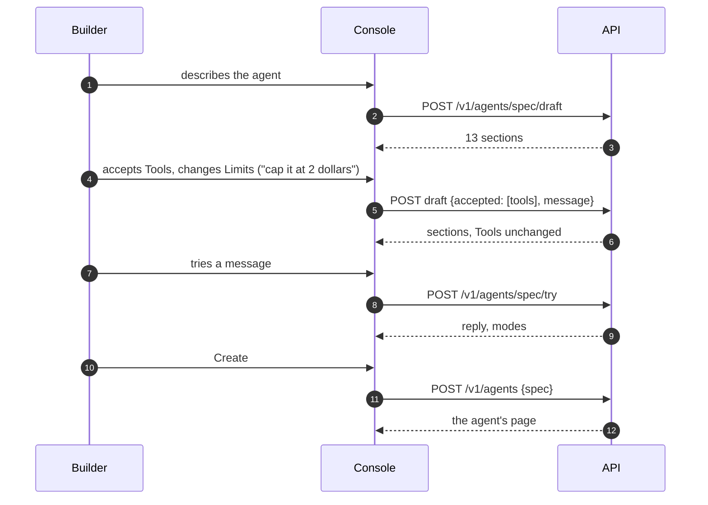
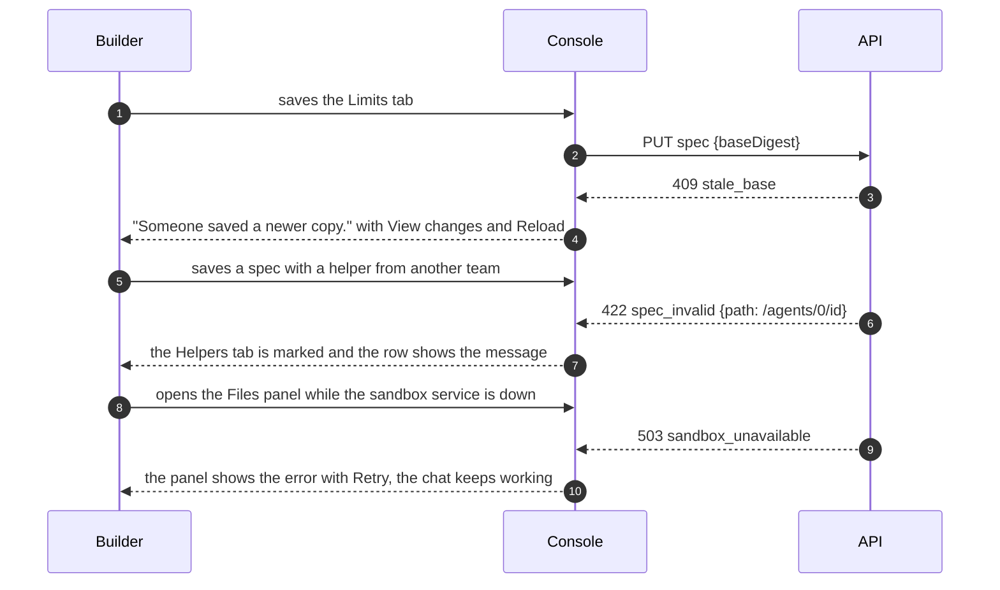

# Console screens for agents version 2

Status: proposed design, written 2026-11-26. Nothing on this page is built. Each screen is marked with its release.

This page lists every console screen the three releases add or change, the states each must draw and the existing
component each region is built from. Nine screens were drawn as mocks: six for the agent builder's experience and three
for teams. The mocks are kept with the product plans, outside this repository, so this page names each mock by its
screen and repeats what a builder needs from it. Three of the team mocks were drawn before the team design moved onto
the canvas and need redrawing; that is the first open point.

## Purpose

| Goal | Measure |
|---|---|
| Every screen is assembled from components the console already has | The component column below names a file for each region; a new shared component is listed as new, with its reason |
| Every screen draws every state | Loading, empty, error, no permission and read-only are listed per screen and walked at 1440 and 390 wide |
| One kind of thing per page | Related records appear as a count or a link, not a nested list |
| No client-side joins | Each screen's data comes from one route that returns it already joined |

## What it owns and what it must not own

| Owns | Must not own |
|---|---|
| Which screens exist, their regions, states and components | Data shapes: the generated SDK types |
| The routes under `apps/console/src/app` each screen lives at | Anything in `components/ui`, which is never edited; wrappers go in `components/shared` |

## Rules every screen follows

| Rule | Detail |
|---|---|
| Data | Through the generated SDK and its hooks. No `fetch` in a component. No list filtered, sorted or joined in the browser |
| Lists | `DataTable` with server paging (`components/shared/server-pagination.ts`); search, filters and sort are query parameters |
| States | `PageSkeleton` while loading; `QueryError` and `ListEmpty` from `components/shared/query-states.tsx`; `DisabledReason` or `LockedReason` when an action is not allowed, with the reason in words |
| Pickers | `EntityPicker` or `SearchSelect`, always searching their source; no hard-coded option list |
| Forms from a schema | `SchemaForm` (`components/shared/schema-form.tsx`), as for loop kind settings and task answers |
| Detail without leaving the page | `DetailSheet` (`components/shared/detail-sheet.tsx`) |
| Approvals | `ApprovalCard` (`components/shared/approval-card.tsx`) everywhere a person decides |
| Responsive | Flex and `minmax` tracks; no fixed widths; every screen usable at 390 wide |
| Text | Plain sentences. A refusal says what was refused and who can change it |

## Screens

### 1. Agent, as tabs (1.4.0)

Route: `apps/console/src/app/build/agents/[id]/` (exists; tabs today include settings, evals, versions, limits, usage
and channels).

| Region | Component | Data |
|---|---|---|
| Tabs: Overview, Instructions, Tools and knowledge, Helpers, Loop, Sandbox (1.5.0), Guardrails, Output, Limits, Evals, Versions, Spec | `RouteTabs` (`components/shared/route-tabs.tsx`) | `GET /v1/agents/{id}/spec` |
| Each tab's form | `SettingsSection`, `FormField`, `EntityPicker`, `TagInput` | The tab edits one part of the spec and saves the whole spec with the base digest |
| Save bar | `PageSaveActions`, `SaveState`, `SaveProblem` | `PUT /v1/agents/{id}/spec`; a `spec_invalid` problem is shown on the field its path names |
| A newer copy exists | `NewerCopyNotice` | `stale_base` |
| Spec tab | `JsonBlock` in YAML mode with copy and download; an upload button that runs validate, then shows the diff | `POST /v1/agents/spec/validate`, `/spec/diff` |
| Publish | `PublishDialog` showing the eval gate | `eval_gate` |

| State | What is drawn |
|---|---|
| Loading | `RecordSkeleton` |
| No permission to edit | Every field read-only with `LockedReason` |
| Published version, no draft | Read-only with "Edit" that creates a draft |
| Install without a sandbox service | The Sandbox tab shows `DisabledReason`: "This install has no sandbox service." |

### 2. Loop tab (1.4.0)

| Region | Component | Data |
|---|---|---|
| The choice: Automatic, or one named kind | A radio group of cards, one per kind, with name, description and when to use it | `GET /v1/agents/loops` |
| The chosen kind's settings | `SchemaForm` from the kind's `settingsSchema` | |
| What automatic may use | Three read-only lines: plan, helpers (count and link to the Helpers tab), sandbox (on or off, link) | The spec |
| A kind that is unavailable | Its card disabled with `unavailableReason` | |

States: loading; a kind that requires helpers when none are set shows a link to add them; read-only.

### 3. Chat builder (1.4.0)

Route: `apps/console/src/app/build/agents/new/` and "Revise with chat" on an agent.

| Region | Component | Data |
|---|---|---|
| The conversation | The chat message list and composer the chat page uses (`components/shared/chat-blocks.tsx`) | `POST /v1/agents/spec/draft` |
| The draft, as 13 section cards | A list of cards, each with title, the drafter's reason, its items, and Accept, Change, Skip | `SpecDraft.sections` |
| An item in a card | `ListItem` with name, description and a read or write badge | |
| A section with problems | `SaveProblem` inside the card | `DraftSection.problems` |
| Try it | A panel with a composer and the reply, showing modes | `POST /v1/agents/spec/try` |
| Create | `LoadingButton`, enabled when no section has a problem | `POST /v1/agents` |

| State | What is drawn |
|---|---|
| Drafting | The cards as skeletons, the reply area with a status line |
| The drafter could not find a tool it wanted | The Tools card lists what it searched for and a link to add an app |
| Hooks, hosts and secrets | Their cards are always "empty" with a line saying a builder sets these by hand, and a link to the tab |
| Draft limit reached | The composer disabled with the time it frees |
| Leaving with an unsaved draft | `LeaveGuard` |

### 4. Chat, with modes, plan, helpers and pauses (1.4.0; files in 1.5.0)

Route: `apps/console/src/app/chat/` (exists).

| Region | Component | Data |
|---|---|---|
| Mode line under a reply in progress | A status line: "Planning: three systems to compare" | `mode` frames |
| Plan | A checklist block inside the message, updating in place | `plan` frames |
| A helper being asked | A collapsible block: the helper's name, the question, then its summary | `agent_asked` frames |
| A hand-over | A divider naming the new agent | `handoff` frame |
| A pause | `ApprovalCard` for an approval or a plan review; `SchemaForm` in a card for a question | `interrupt` frame, `POST /v1/threads/{id}/approvals` |
| A command (1.5.0) | A collapsible block with the command, exit status and changed files | `sandbox_command` frames |
| Files button and panel (1.5.0) | `DetailSheet` holding a `DataTable` of files with upload (`FileUpload`), download, delete (`DeleteDialog`) and "Save to Files" | `GET /v1/threads/{id}/sandbox/files` |
| A limit was hit (1.5.0) | An alert under the reply with the sentence from the sandbox page's limits table | `sandbox_command.stoppedBy` |
| Stop | The composer's stop button | `POST …/runs/{run}/cancel` |

| State | What is drawn |
|---|---|
| The asker cannot approve | The card read-only with "Waiting for an approver. You asked for this change, so someone else decides." |
| Reconnecting | The stream re-attaches and the blocks already drawn stay |
| No sandbox yet | The Files button is hidden until the conversation has one |
| Sandbox asleep | The panel lists files from the saved copy, with a line "The workspace is asleep; files are kept." |
| Sandbox unavailable | `QueryError` in the panel with retry; the chat still works |

### 5. Run trace (1.4.0; commands and requests in 1.5.0)

Route: opened from a message's menu and from an agent's usage tab.

| Region | Component | Data |
|---|---|---|
| Header: agent and version, loop, modes with reasons, cost against budget, stop reason | `StatCard` row | `GET /v1/threads/{id}/runs/{run}/trace` |
| Steps | `StepsTable` with one row per step: kind, title, status, duration, cost | `RunTrace.steps` |
| A step's detail | `StepSheet` with `JsonBlock` for input and output, masked | `TraceStep.detail` |
| Filter by kind | `SavedViewTabs`: All, Model, Tools, Commands, Network, Pauses | Query parameter |
| A refused network request (1.5.0) | A row with the host, the rule that refused it and who can allow it | |
| A replayed step | A badge "replayed", so a resumed turn is readable | `status: replayed` |

States: loading; a run still in progress polls; no permission to see inputs shows the rows without detail.

### 6. Sandbox tab on an agent (1.5.0)

| Region | Component | Data |
|---|---|---|
| On or off, image, size | `SettingsSection` with `SearchSelect` | `GET /v1/sandbox/options` |
| Limits, with the install's caps shown beside each | `FormField` rows | Options |
| Allowed hosts | `TagInput` that only accepts hosts from the tenant's list, searched; a host not on it shows who can add it | `SandboxOptions.tenantHosts` |
| Secrets a host may use | `SecretPicker` per host | |
| What needs approval | Checkboxes for the four kinds | |
| Starting files | `FileRefsField` | |
| The wall this install uses | A read-only line: the backend and isolation level | Options |

States: sandbox service absent; tenant list empty ("No host is allowed for this workspace yet").

### 7. Workflow canvas with a team (1.6.0)

Route: `apps/console/src/app/build/workflows/[id]/` (exists). The canvas, its menus and the sidebar stay as they are;
this adds line kinds, groups and member settings.

| Region | Component | Data |
|---|---|---|
| Line kinds | The canvas's edge renderer gains three styles: dashed with a label for a hand-over, dotted with a return arrow for a question, a loop mark for a check. A legend sits in the canvas toolbar | Connection `kind` |
| Drawing a line from an agent step | The step shows three source handles: next, hand over, ask. Dropping a hand-over or ask line opens the line's sheet | |
| A line's sheet | `DetailSheet`: kind, "when" text, what to pass (the existing mapping field), and for a check the standard and rounds | Connection fields |
| A group | A frame node with a title bar: name, member count, limits. A fold button turns it into one card and back | `groups` |
| A group's sheet | `DetailSheet` with `SettingsSection`: goal, limits, shared notes, and the line from "needs a person" | |
| Add a team | The add menu gains "Team" with the three starter layouts | `GET /v1/workflows/team-layouts` |
| A role as a member | The Ask and Review steps' sheets gain "Assigned to" (`EntityPicker` over roles), deadline, "Then ask" and what happens if nobody answers | `GET /v1/workflows/option-sources?source=roles` |
| Problems | The existing checks panel lists the new codes on the step or line they name | Validate route |
| Tests | A panel listing team tests with run and results | Tests routes |

| State | What is drawn |
|---|---|
| A cycle outside a group | The lines in the cycle marked, with "Put these steps in a team to let work go round" |
| A hand-over line with no "when" | The line marked with the problem |
| A folded group | One card with member avatars, limits and its lines; double-click unfolds |
| Read-only (a published version) | No handles; sheets read-only |
| 390 wide | The canvas is view-only with pan and zoom; editing shows "Open on a larger screen to edit" |

### 8. Run page with a team (1.6.0)

Route: `apps/console/src/app/build/runs/[runId]/` (exists).

| Region | Component | Data |
|---|---|---|
| Budget and waiting line | `StatCard`: spent against budget; "Waiting for senior underwriters since 10:40" | `GET /v1/runs/{id}` |
| Timeline | The existing steps table; rows of a group are indented under the group's row, one row per turn with member, kind, summary, cost and waited time | `GET /v1/runs/{id}/turns` |
| A turn's detail | `StepSheet`, with a link to the turn's trace | |
| Notes | A tab with the shared notes as a list: who, when, text, sources | `GET /v1/runs/{id}/notes` |
| Cancel | `ConfirmActionDialog` with "Undo changes already made" | `POST /v1/runs/{id}/cancel` |
| Undo results | Rows titled "Undo: …" with their status | Steps |

States: a run rebuilt after an upgrade shows a one-line notice; a run stopped at its budget shows the limit and who can
raise it; an incomplete undo lists what did not finish.

### 9. Human tasks inbox and a task (1.6.0)

Routes: `apps/console/src/app/work/tasks/` and `work/tasks/[id]/` (exist).

| Region | Component | Data |
|---|---|---|
| Views: Mine, My roles, All | `DataTableWithViews` | `GET /v1/tasks` |
| Columns: task, kind, asked by, assigned to, due, status | `DataTable`; due shows time left and turns red past the deadline | |
| Filters: kind, role | Facets from the list result | |
| An approval | `ApprovalCard` with the change, its inputs (editable when allowed) and the notes | `POST /v1/tasks/{id}/decision` |
| A question | The question, the notes so far, and a text box or `SchemaForm` | `POST /v1/tasks/{id}/answer` |
| A take-over | The goal, the notes, what the team tried, "Take this job", then "Hand back" with a note and an optional result | `POST …/take-over`, `…/return` |
| Who else was asked | A line: "First asked: first on call, 15 minutes ago. Now also: second on call." | `Task.thenAsk`, `roleStep` |

| State | What is drawn |
|---|---|
| Empty | `ListEmpty`: "Nothing is waiting for you." |
| Not one of the task's people | The task read-only with the reason |
| Already answered by someone else | "Answered by Priya Raman at 11:02", read-only |
| Opened from an email link | The confirm page: the same card after sign-in; nothing is decided by opening the link |
| 390 wide | The table becomes a list of cards; the task page stacks |

## Interfaces

No route of its own. New shared components, each wrapping primitives:

| Component | File | Why it is new |
|---|---|---|
| `SectionCard` | `components/shared/section-card.tsx` | The chat builder's accept, change and skip card; nothing existing has the three actions |
| `ModeLine`, `PlanBlock`, `HelperBlock`, `CommandBlock` | Added to `components/shared/chat-blocks.tsx` | New kinds of chat block |
| `TurnRows` | `components/shared/turn-rows.tsx` | Indented turn rows under a group row in the steps table |
| Edge styles and the group frame | The workflow canvas's own folder | Canvas elements, not shared components |

## Data model

None.

## Flows

Failure paths:

## Settings

None.

## Security, cost and limits

| Concern | Rule |
|---|---|
| What a person may see | Every screen relies on the API's permission and masking; the console hides nothing itself and shows nothing the API did not return |
| Approving your own request | The card is read-only for the asker on every screen, from the API's `canAct` |
| Untrusted content | Fetched pages, tool results and file names are rendered as text, never as HTML |

## Acceptance criteria

| # | Failure mode | Check |
|---|---|---|
| 1 | A screen joins or filters lists in the browser | The console's lint rule for client-side aggregation passes; each screen's network log shows one data request per region |
| 2 | A state is missing | The walk at 1440 and 390 wide, as an admin and as a member, shows loading, empty, error and no-permission for every screen |
| 3 | A screen overflows at 390 | The walk's overflow check |
| 4 | A folded group and its unfolded form save differently | Folding changes only `folded`; the definition's digest without it is equal |
| 5 | A pause is answered twice | Pressing Approve twice sends one decision (the idempotency key) and the card becomes read-only |
| 6 | A hand-made component duplicates a shared one | Review against the component column of this page |

## Use cases per layer

The `ui` layer of each component's use cases is a Playwright script under
`docs/usecases/<area>/scripts/test-uc-<number>-ui.spec.ts`, run with `make usecase-test UC=<id> LAYER=ui`.

| Use case | Screens |
|---|---|
| Build an agent by chat, try it, create it, publish it | 3, 1 |
| Chat until an approval, approve as another person, open the trace | 4, 5 |
| Upload a file, get a result file, save it to Files | 4, 6 |
| Draw a team, run it, answer its question, read the turns | 7, 9, 8 |

## Files to add, change and delete

| Package | Add | Change |
|---|---|---|
| `apps/console/src/app/build/agents` | `new/page.tsx` (chat builder), `[id]/loop/page.tsx`, `[id]/sandbox/page.tsx`, `[id]/helpers/page.tsx`, `[id]/spec/page.tsx` | The existing tab pages save through the spec route |
| `apps/console/src/app/chat` | | The stream reducer and message blocks; the Files panel |
| `apps/console/src/app/build/workflows`, `build/runs`, `work/tasks` | | Canvas line kinds and groups; turn rows and notes; task kinds |
| `apps/console/src/components/shared` | The components listed above | `chat-blocks.tsx`, `approval-card.tsx` (a question variant) |
| `apps/console/src/lib/api` | | Hooks for the new routes, from the generated SDK |

## Open points

| # | Open point | Settled by |
|---|---|---|
| 1 | The three team mocks show a member list inside one step's sheet. They need redrawing with members as steps, three line kinds and a foldable group | Owner, before the 1.6.0 console lane starts |
| 2 | The mocks are outside this repository, so a contributor cannot open them. Either copies are added under `docs/` here or this page stays the reference | Owner |
| 3 | Whether the agent's tabs should be reduced: twelve tabs is many for one record | A mock review; candidates are merging Output into Instructions and Limits into Guardrails |
| 4 | Whether canvas editing at 390 wide is needed | Owner; this page assumes view-only |
