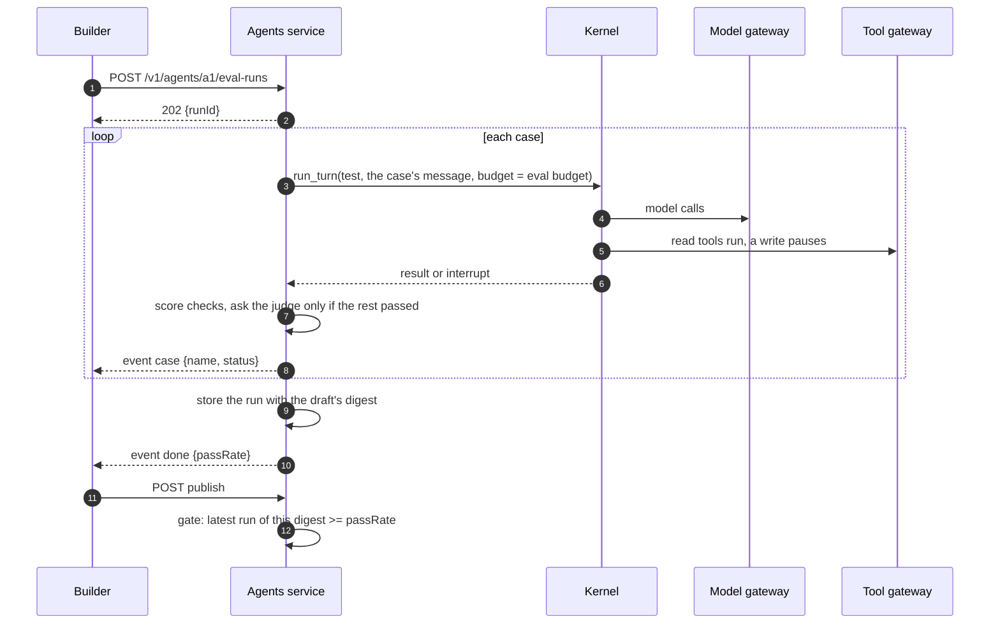
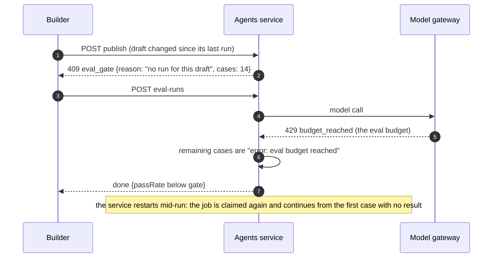

# Evals for agents and teams

Status: proposed design, written 2026-11-26. Nothing on this page is built. Agent evals ship in release 1.4.0, sandbox
checks in 1.5.0 and team tests in 1.6.0.

An eval is a saved example of what an agent should do with a message: which tools it should call, what it should say or
refuse, and what its typed answer should contain. A builder keeps a set of them with each agent, runs them before
publishing, and a version that falls below the set's pass rate cannot be published. This page extends the examples that
exist today to cover the new behaviour (typed answers, automatic mode, hand-overs, pauses, sandbox work) and adds the
same idea for a team drawn on the workflow canvas.

## Purpose

| Goal | Measure |
|---|---|
| Examples live with the agent | The spec file's `evals` section is the saved set; exporting an agent exports its examples |
| New behaviour is checkable | A case can assert the mode chosen, a hand-over, a pause for approval, a typed answer's fields and a file produced in the sandbox |
| A bad version cannot be published | Publishing is refused while the latest run of the draft is below `evals.gate.passRate` |
| A team has tests | A workflow with a group has saved cases that run the whole team against scripted or real members |
| Runs are honest | A case runs the real turn through both gateways; writes never leave the install |

## What it owns and what it must not own

| Owns | Must not own |
|---|---|
| Case and check shapes, scoring, the publish gate | Running a turn: the kernel runs it as any turn, with `test: true` |
| Eval runs and their results | The judge model's choice: a model alias, resolved by the model gateway |
| Team cases and runs | Production monitoring of live conversations, which is not in these releases |

## Today

| Fact | Where |
|---|---|
| A case is a name, an input and checks; four check types exist: `calls_tool`, `reply_contains`, `refuses`, `judge` | `services/agents-service/src/ops_agents/domain/evals.py:62`, `:70` |
| A case is scored from the reply, the tool names, a blocked topic and latency | `domain/evals.py:78`, `:129` |
| Cases are saved per agent and per skill; runs are listed and read | `services/agents-service/src/ops_agents/api/routers/assurance.py:172`, `:213`, `:222` |
| A run is started from the agent | `services/agents-service/src/ops_agents/api/routers/agents.py:943` |

## Checks

A case in the spec file is `{name, say, context?, expect}`, as the [spec schema](agent-spec-schema.yaml) defines it. Each key of `expect` is one check. The table maps the spec's
keys to check types; the first four exist today.

| `expect` key | Check type | Passes when | Scored from |
|---|---|---|---|
| `calls: [tool]` | `calls_tool` (one per tool) | The turn called the tool | Tool events |
| `contains: [text]` | `reply_contains` | The reply contains the text, ignoring case | The reply |
| `refuses: true` | `refuses` | The turn was stopped by a blocked-topic check, or the reply declines | Guardrail events, the reply |
| `rubric: text` | `judge` | A judge model says the reply meets the rubric | A structured call with purpose `judge` |
| `notCalls: [tool]` | `not_calls_tool` (new) | The turn did not call the tool | Tool events |
| `output: {field: value}` | `output_matches` (new) | The typed answer has each listed field equal to the value; a value of `{"$exists": true}` checks presence | The typed answer |
| `mode: [direct, plan, helpers, sandbox]` | `mode_in` (new) | Every mode the turn used is in the list. `[direct]` passes only when the turn used no other mode | `ModeChanged` events |
| `handoff: agent id` | `hands_to` (new) | The turn ended by handing over to that agent | The turn's result |
| `pausesFor: approval \| question \| plan_review` | `pauses_for` (new) | The turn paused with an interrupt of that kind | The interrupt |
| `pausesOn: [tool]` | `pauses_on` (new) | The turn paused for approval of a call to that tool, and sent nothing | The interrupt |
| `files: [{path, contains?}]` | `file_made` (new, 1.5.0) | The sandbox workspace has the file after the turn; `contains` checks text inside it | The sandbox's file list |
| `maxCostUsd`, `maxSeconds` | `within` (new) | The turn's cost and time are within the values | The turn's result |

Rules:

| Rule | Detail |
|---|---|
| Unknown keys | Refused when the spec is saved, with the key named (`unknown_check`) |
| A case with no check | Refused (`case_without_check`) |
| `rubric` with no judge model | The run is refused with the existing message naming the missing setting (`domain/evals.py:159`) |
| Order | Checks that need no model are scored first; a judge is asked only when the others passed, to save cost |
| Writes during a run | The turn runs with `test: true`: a write pauses for approval as usual and the run answers the pause with "rejected", so nothing is sent. `pausesOn` asserts the pause happened |
| The sandbox in a run | A test sandbox, deleted when the run ends |
| Hand-overs in a run | The case stops at the hand-over. The receiving agent's turn is not run; it has its own cases |
| Repeats | `evals.repeat` (1 to 5, default 1) runs each case that many times; a case passes when every repeat passes |

## Scoring and the gate

| Item | Rule |
|---|---|
| Case status | `passed`, `failed`, or `error` (the turn could not run). An error counts as a failure in the pass rate |
| Pass rate | Passed cases over all cases (`domain/evals.py:53`) |
| Gate | `evals.gate.passRate` in the spec, default 1.0 when the set has under 10 cases and 0.9 otherwise. Publish is refused with `eval_gate` when the latest run of this draft's digest is missing or below the gate |
| A draft with no cases | Publishable, with a warning in the publish check. A tenant setting can require at least `OPS_AGENTS_EVAL_MIN_CASES` |
| What a run records | Per case: status, each check's status and reason, the reply, modes, tools called, cost, time, and the trace id |
| Comparing | A run's view shows each case beside the same case in the published version's last run |

## Team tests

A team test belongs to a workflow that has a group.

```yaml
# stored with the workflow definition, under `tests`
- name: Exception over the income rule goes to a senior underwriter
  start: { applicationId: "A-7781", amount: 240000 }
  members:                       # optional: script a member instead of running it
    income: { reply: { verifiedIncome: 61000, source: "payslips" } }
  people:                        # how a role answers when asked
    senior_underwriters: { answer: "Decline: debt to income is over the limit." }
  expect:
    turns: [lead, income, lead, senior_underwriters, lead]
    notes: { contains: ["61000"] }
    leavesBy: ok
    output: { decision: decline }
    maxTurns: 8
    maxCostUsd: 2.00
```

| `expect` key | Passes when |
|---|---|
| `turns` | The members that took turns, in order, equal the list. `turnsInclude` checks a subsequence |
| `handoffs: [[from, to]]` | Each listed hand-over happened |
| `asks: [[from, to]]` | Each listed question was asked |
| `notes.contains` | Some note contains each text |
| `leavesBy` | The group left by that port (`ok`, `needsPerson`) |
| `output` | The run's output has the fields |
| `tasks: [{role, kind}]` | A task of that kind was opened for the role |
| `maxTurns`, `maxCostUsd` | The group stayed within them |

| Rule | Detail |
|---|---|
| Scripted members | A member listed under `members` returns the given reply without a model call. This is how a team's wiring is tested quickly and at no cost |
| Real members | A member not listed runs its published agent, in test mode |
| People | A role listed under `people` answers at once with the given answer or decision. A role not listed leaves its task open and the case fails as `waiting` |
| Deadlines | `advance: {minutes: n}` moves the test run's clock past a deadline, to test moving a task to the next role |
| Writes | As in agent evals: nothing is sent |
| Where a test run lives | An ordinary run marked `test`, hidden from the runs list by default and deleted with the test results' retention |

## Interfaces

Routes; exact shapes are in the [OpenAPI draft](openapi-draft.yaml).

| Method | Path | Change |
|---|---|---|
| GET, PUT, POST | `/v1/agents/{agent_id}/eval-cases` | The case shape gains the new check types. A PUT of the spec's `evals` section and a PUT here write the same rows |
| POST | `/v1/agents/{agent_id}/eval-runs` | Body gains `caseNames?` (run a subset), `repeat?`, `version?` (default the draft). Returns 202 with the run's id; the run is a background job |
| GET | `/v1/eval-runs/{run_id}` | Adds per case: `modes`, `tools`, `costUsd`, `seconds`, `traceId`, and `baseline` |
| GET | `/v1/eval-runs/{run_id}/events` | New. Server-sent events as cases finish: `case` and `done` |
| GET, PUT | `/v1/workflows/{workflow_id}/tests` | New. A workflow's team tests |
| POST | `/v1/workflows/{workflow_id}/test-runs` | New. Runs the tests; 202 with an id |
| GET | `/v1/workflow-test-runs/{run_id}` | New. Per test: status, each check, the run id to open its timeline |

```python
class EvalCheckIn(In):
    type: Literal["calls_tool", "not_calls_tool", "reply_contains", "refuses", "judge", "output_matches",
                  "mode_in", "hands_to", "pauses_for", "pauses_on", "file_made", "within"]
    tool: str | None = None
    text: str | None = None
    rubric: str | None = None
    fields: dict[str, JsonValue] | None = None     # output_matches
    modes: list[Literal["direct", "plan", "helpers", "sandbox"]] | None = None   # mode_in
    kind: Literal["approval", "question", "plan_review"] | None = None       # pauses_for
    agent: str | None = None                       # hands_to
    path: str | None = None                        # file_made
    max_cost_usd: Decimal | None = None
    max_seconds: float | None = None

class EvalCaseIn(In):
    name: str = Field(min_length=1, max_length=80)
    input: str = Field(min_length=1, max_length=8000)
    checks: list[EvalCheckIn] = Field(min_length=1, max_length=12)
    collections: list[str] = []

class EvalCaseResult(Out):
    name: str
    status: Literal["passed", "failed", "error"]
    checks: list[CheckResultOut]       # label, status, reason
    reply: str
    modes: list[str]
    tools: list[str]
    cost_usd: Decimal
    seconds: float
    trace_id: str | None
    baseline: Literal["passed", "failed", "error"] | None
```

`TurnView` (`domain/evals.py:78`) gains `output`, `modes`, `handoff`, `interrupt_tool`, `files`, `cost` and `seconds`, all
read from the turn's result and events. Scoring stays a pure function in the domain layer.

## Data model

| Table | Change |
|---|---|
| Eval cases (existing) | The checks column holds the new types; no new column. Unique on agent and case name |
| Eval runs (existing) | Gains `spec_digest` (string 64, indexed with the agent id) so the gate can find the latest run of a draft, `repeat`, `cost` |
| Eval case results (existing) | Gains `modes`, `tools`, `cost`, `seconds`, `trace_id` |
| `workflow_tests` (new) | `id`; `tenant_id`, `team_id`; `workflow_id` indexed; `name`; `body` JSON; `updated_by`, `updated_at`. Unique `(workflow_id, name)` |
| `workflow_test_runs`, `workflow_test_results` (new) | A run per start; a result per test with status, checks JSON and the engine run id |

| Table | Retention |
|---|---|
| Runs and results | `OPS_AGENTS_EVAL_RETENTION_DAYS`, default 90; the latest run of each published version is kept while the version exists |

| Database | Note |
|---|---|
| PostgreSQL and SQL Server | JSON columns through the store's JSON type; lists page in SQL; no dialect-specific statement |

## Flows



Failure paths:



## Settings

| Setting | Default | Meaning |
|---|---|---|
| `OPS_AGENTS_EVAL_BUDGET_USD` | `5` | Budget of one eval run, created at the model gateway |
| `OPS_AGENTS_EVAL_PARALLEL` | `4` | Cases run at once |
| `OPS_AGENTS_MAX_EVAL_CASES` | `200` | Cases per agent |
| `OPS_AGENTS_EVAL_MIN_CASES` | `0` | A tenant can require cases before publish |
| `OPS_AGENTS_EVAL_RETENTION_DAYS` | `90` | |

## Security, cost and limits

| Concern | Rule |
|---|---|
| An eval changes a real system | Writes pause and are rejected by the run. Read tools do run against real systems, as the acting builder, so the builder's own access applies |
| Personal data in cases | Cases are tenant scoped and team owned, masked in views like run data |
| Cost | One budget per run at the model gateway; the run's cost is shown before a repeat |
| A judge that is wrong | A judge's verdict carries its reason; a case can pin `contains` or `output` checks beside the rubric so the gate does not rest on a judge alone |

## Acceptance criteria

| # | Failure mode | Test proves |
|---|---|---|
| 1 | A version below its gate is published | Publish answers 409 `eval_gate` until a run of the same digest meets the pass rate |
| 2 | A run of an older draft satisfies the gate | After the draft changes, the old run no longer counts |
| 3 | An eval sends a write | A case whose turn calls a write tool leaves the scripted system untouched and the case can assert `pausesOn` |
| 4 | `mode: [direct]` passes when the turn planned | A scripted turn that entered plan mode fails the check |
| 5 | A judge call is made for a case that already failed | The scripted judge sees no request for that case |
| 6 | A team test waits forever on a person | A role with no scripted answer fails the case as `waiting` within the run's time limit |
| 7 | A scripted member spends money | No model call is recorded for a scripted member |
| 8 | A run dies with the service | The run finishes after a restart with one result per case |

## Use cases per layer

| Use case | api | sdk | cli | ui |
|---|---|---|---|---|
| Save cases, run them, publish only when they pass | `PUT /v1/agents/{id}/spec`, `POST /v1/agents/{id}/eval-runs`, `POST /v1/agents/{id}/publish-requests` | `ops.agents.apply`, `ops.agents.eval`, `ops.agents.publish` | `opsai agents apply`, `opsai agents eval --wait`, `opsai agents publish` | Agent, Evals tab; the publish dialog shows the gate |
| A team test with scripted members | `PUT /v1/workflows/{id}/tests`, `POST /v1/workflows/{id}/test-runs` | `ops.workflows.test` | `opsai workflows test` | Workflow, Tests panel |

## Files to add, change and delete

| Package | Add | Change |
|---|---|---|
| `services/agents-service` | `domain/team_tests.py`, `app/team_tests.py`, `api/routers/workflow_tests.py`, `store/workflow_tests.py`, a migration | `domain/evals.py` (new check types, `TurnView`), `app/evals.py` (background run, events, gate by digest), `api/routers/assurance.py`, `api/routers/agents.py`, `openapi.json` |
| `packages/ops_engine` | | `ports.py`: a test run's member and people stand-ins are passed as ports, so the engine has no test branch |
| `sdk`, `apps/console` | See [SDK](sdk.md), [CLI](cli.md) and [console screens](console-screens.md) | |

## Open points

| # | Open point | Settled by |
|---|---|---|
| 1 | The default gate for small sets (1.0 under 10 cases) may block publishing on one flaky judge | Owner, after the first agents are moved to version 2 |
| 2 | Whether eval runs should run on a schedule against the published version to catch a model's drift | Later release; the run and result shapes already allow it |
| 3 | How well a model keeps to `mode` on real requests, so that `mode_in` is a stable check | Trial 3, part d |
