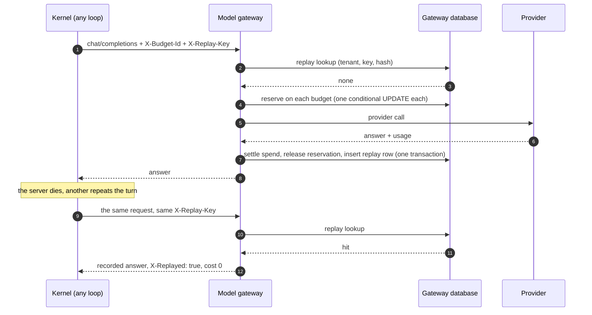
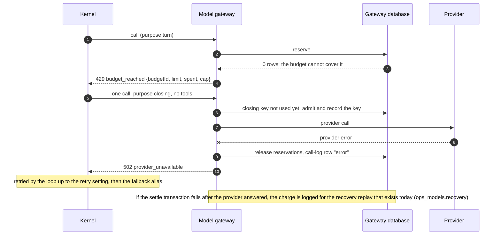

# Model gateway: budget and call record

Status: proposed design, written 2026-11-26. Nothing on this page is built. Release 1.4.0, first build step.

Every model call already passes through one gateway of ours. Two protections still sit in front of it, inside the
service that runs agents: the check that a conversation has money left, and the record that lets a crashed reply be
repeated without paying again. This page moves both into the gateway, so they hold whichever agent loop is running, and
adds a count of cached tokens.

## Purpose

| Goal | Measure |
|---|---|
| The budget is enforced where the call leaves | With the check removed from the agents service, the existing crash and budget tests still pass |
| A repeated request is answered from the record | The same request under the same replay key is served once by a provider |
| Cached tokens are counted and priced | A call's row carries cached input tokens, and cost uses the cached price |

## What it owns and what it must not own

| Owns | Must not own |
|---|---|
| Budgets: caps, spend, reservations, for a conversation, a workflow run, a step, a team group, an eval run and a builder draft | The budget's amounts. The agents service sets them from the agent's spec and a person's answer to a budget card |
| The replay record: the provider's answer for a request under a replay key | Conversation history. The record is a crash aid with a short life, not a transcript |
| The call log, which stays metadata only (`services/models-service/CLAUDE.md`) | Prompt or completion text in the call log |
| Retry-safe settlement of spend | Retries and fallback order. The loop asks again; the gateway serves each ask |

## Today, and what moves

| Behaviour today | Where | After |
|---|---|---|
| Reserve a call against the thread's budget before the provider is called; hold it while the provider answers; replace it with the record; release it on failure | `services/agents-service/src/ops_agents/api/model_ledger.py:1` to `:22`, `store/model_calls.py:162`, `:194` | Same behaviour, in the gateway |
| A specialist's thread spends from the budget its chain started on | `api/model_ledger.py:4` | The caller sends the chain root's budget id |
| At a spent budget, the thread the chain started on may make one closing call with no tools | `packages/ops_agent_kernel/src/ops_agent_kernel/ports.py:42` (`BudgetReachedError.closing`), `kernel.py:446` | The gateway admits one call with purpose `closing` per replay key |
| Checks of an answer already written are let through at the budget | `ports.py:52` (`_FINISHING`) | Purpose `check` and `judge` are admitted, capped per turn |
| A replayed request is never refused | `api/model_ledger.py:10` | Same: the replay lookup runs before admission |
| The record key is the chat turn's task or the workflow step's id, with a hash of the request that leaves out volatile fields | `api/model_ledger.py:47` to `:66` | The caller sends the key; the gateway computes the hash |
| A per-run spend cap on a model key | `services/models-service/src/ops_models/app.py:1400` (`X-Run-Spend-Cap`), `:1332` | Kept in 1.4.0 and 1.5.0. Removed in 1.6.0, when every run has a run budget and two caps on one run would disagree |

## Interfaces

### Request headers on `POST /v1/models/chat/completions` and `/v1/models/embeddings`

Existing headers are read at `services/models-service/src/ops_models/app.py:1394` to `:1400`.

| Header | State | Meaning |
|---|---|---|
| `Authorization: Bearer <model key>` | Today | The caller's model key |
| `X-Tenant-Id`, `X-Thread-Id`, `X-Run-Id`, `X-Step-Id`, `X-Data-Sensitivity` | Today | As today |
| `X-Run-Spend-Cap` | Today | Kept in 1.4.0 and 1.5.0; removed in 1.6.0 |
| `X-Request-Hash` | Today, changed | Still logged. No longer used for replay: the gateway computes its own hash |
| `X-Budget-Id` | New | One to four budget ids, comma separated, innermost first, for example `step:wfrun_7c2:review,group:wfrun_7c2:underwriting,run:wfrun_7c2`. Every listed budget must cover the call. Four covers the deepest case: a step in a group in a run started by a team test's eval budget. Required for model keys of kind `agent`, `workflow` and `purpose` |
| `X-Replay-Key` | New | The key a re-run repeats: `turn:<thread>:<task>` for chat, `run:<run>:<node>:<iteration>[:<turn>]` for a workflow step. With it the answer is recorded and a repeat is replayed. Required whenever `X-Budget-Id` is sent, because the closing-call and check-call caps are counted per replay key |
| `X-Call-Purpose` | New | `turn` (default), `closing`, `check`, `judge`, `summary` |

Rules, in the order the gate applies them (extending the order at `app.py:1299`):

1. Authenticate the model key. Unchanged.
2. If `X-Replay-Key` is set, look up `(tenant, replay key, request hash)`. A hit returns the recorded answer with the
   header `X-Replayed: true`, writes a call-log row with outcome `replayed` and cost 0, and skips every later check.
3. Key budget, tenant share, daily cap, run cap, rate limit, alias, sensitivity, images, provider key. Unchanged.
4. Header rules: a key of kind `agent`, `workflow` or `purpose` with no `X-Budget-Id` is refused, and a request with
   `X-Budget-Id` and no `X-Replay-Key` is refused. Only a `user` key, a developer calling the gateway directly, may
   omit both; it stays under its own key budget.
5. For each id in `X-Budget-Id`: reserve an estimate of cost, one call and the request's token ceiling in one statement
   that names the state it expects (DA12). The reservation is made before the provider is called. If any budget cannot
   cover it, release the ones taken and refuse.
6. Call the provider. On success settle each reservation with the actual usage and write the replay row in the same
   transaction as the spend. On failure release the reservations.

The request hash is SHA-256 over the canonical JSON of the request body with `stream`, `user` and `metadata` removed and
keys sorted. A re-run must send the same bytes for the hash to match. Today's ledger strips five fields because the
current library adds volatile ids (`services/agents-service/src/ops_agents/api/model_ledger.py:49`). Whether Strands
adds any is checked in trial 1, which resumes a turn twice and compares hashes at the stub. If it does, the gateway
keeps a strip list in `OPS_MODELS_REPLAY_STRIP_FIELDS` and the hash leaves those fields out.

### Refusals

| Status | `code` | When | What the kernel does |
|---|---|---|---|
| 429 | `budget_reached` | A listed budget cannot cover the estimate, purpose is `turn` or `summary` | Ends the reply; makes one `closing` call if this is the chain's first thread |
| 429 | `budget_reached` | Purpose `closing` and this replay key already used its closing call, or the request carries tools | Ends the reply with the text it has |
| 429 | `check_cap_reached` | More than `OPS_MODELS_CHECK_CALLS_PER_KEY` calls of purpose `check` or `judge` under one replay key | The check fails closed |
| 404 | `budget_not_found` | An id in `X-Budget-Id` does not exist in the caller's tenant | The turn fails with `error`; the runtime creates budgets before a turn |
| 422 | `budget_header_invalid` | More than four ids, or an id over 200 characters | The turn fails |
| 422 | `budget_required` | A key of kind `agent`, `workflow` or `purpose` sent no `X-Budget-Id` | The turn fails; this is a bug in the caller |
| 422 | `replay_key_required` | `X-Budget-Id` was sent without `X-Replay-Key` | Same |

A refusal body adds `details: {budgetId, limit: "cost"|"calls"|"tokens", spent, cap}` so the chat's budget card can
say which limit was reached.

### Budget routes (service token, scope `models:budgets`)

| Method | Path | Body | Returns | Idempotency |
|---|---|---|---|---|
| PUT | `/v1/models/budgets/{budget_id}` | `BudgetIn` | `Envelope[BudgetOut]` | The id is the natural key; a repeat with the same caps changes nothing. Caps may rise or fall; spend never changes |
| GET | `/v1/models/budgets/{budget_id}` | none | `Envelope[BudgetOut]` | read |
| POST | `/v1/models/budgets/query` | `{ids: [str]}`, at most 200 | `Envelope[list[BudgetOut]]` | read; one statement (DA4) |
| DELETE | `/v1/models/replays` | query `prefix=<replay key prefix>` | 204 | Deletes a finished run's replay rows |

```python
BudgetKind = Literal["thread", "run", "step", "group", "eval", "draft"]

class BudgetIn(In):                    # extra="forbid"
    kind: BudgetKind
    parent_id: str | None = None       # a step or group budget names its run budget
    team_id: str
    created_by: str                    # the creating module, from the table below
    max_cost_usd: Decimal | None = None
    max_calls: int | None = Field(default=None, ge=1)
    max_tokens: int | None = Field(default=None, ge=1)
    expires_at: datetime | None = None

class BudgetOut(Out):
    id: str
    kind: BudgetKind
    parent_id: str | None
    team_id: str
    created_by: str
    max_cost_usd: Decimal | None
    max_calls: int | None
    max_tokens: int | None
    spent_cost_usd: Decimal
    spent_calls: int
    spent_tokens: int
    reserved_cost_usd: Decimal
    reserved_tokens: int
    exhausted: Literal["cost", "calls", "tokens"] | None
    updated_at: datetime
```

These two shapes are the ones in the [OpenAPI draft](openapi-draft.yaml). Every budget has a kind, an id in a fixed
form and one creator:

| Kind | Id | Created by | When | Sent by |
|---|---|---|---|---|
| `thread` | `thread:<thread id>` | Agents service, `api/budgets.py` | Before a conversation's first turn, from the spec's `limits.budget` | Every chat turn, and every helper in its chain |
| `run` | `run:<run id>` | Agents service, `app/run_budgets.py` | When a workflow run starts (1.6.0); before that a run's agent steps use `step` budgets only | Every model call of the run |
| `step` | `step:<run id>:<node id>` | Agents service, `api/engine_agents.py` | Before an agent step's turn | That step's calls |
| `group` | `group:<run id>:<group id>` | Agents service, `app/run_budgets.py` | When a run with a group starts (1.6.0) | Calls of the group's members |
| `eval` | `eval:<eval run id>` | Agents service, `app/evals.py` and `app/team_tests.py` | When an eval run or a team test run starts | Every call of the run, outermost |
| `draft` | `draft:<draft id>` | Agents service, `app/spec_draft.py` | Per draft or try request of the chat builder | The drafter's calls |

The three caps are the ones `ops_metering.Budget` has today (`packages/ops_metering/src/ops_metering/__init__.py:98`).

### Usage in the response

The response's `usage` gains `prompt_tokens_details: {cached_tokens: int}`, in the OpenAI shape, filled from the
provider adapter. The call-log row gains `cached_input_tokens`. Cost is
`(input - cached) * input price + cached * cached price + output * output price`, with the cached price a new field on
an alias version that defaults to the input price.

### Events

| Event (outbox) | When | Payload | Reader |
|---|---|---|---|
| `models.budget_exhausted` | A reservation is refused for a budget for the first time since its caps last changed | `{budgetId, kind, tenantId, teamId, limit, spent, cap}` | The agents service, to show the budget card and to mark a run |

## Data model

All three tables are in the model gateway's own migration chain.

### `model_budgets`

| Column | Type | Notes |
|---|---|---|
| `tenant_id` | string(64), not null | Tenant scoped; row-level policy under the gateway's tenant role. Primary key `(tenant_id, id)`, so two tenants can never share or collide on an id |
| `id` | string(200) | In the form the kinds table gives |
| `team_id` | string(64), not null | For the usage pages; not an access filter here |
| `kind` | string(8) | `thread`, `run`, `step`, `group`, `eval`, `draft` |
| `created_by` | string(80), not null | The creating module |
| `expires_at` | timestamp with time zone, null | Set for `eval` and `draft` budgets |
| `parent_id` | string(200), null, indexed | A step's run budget. Spend is counted on each listed budget by the request, not rolled up by a trigger |
| `max_cost`, `max_calls`, `max_tokens` | numeric(18,6), int, bigint, null | A null cap is no cap |
| `spent_cost`, `spent_calls`, `spent_tokens` | numeric(18,6), int, bigint, default 0 | |
| `reserved_cost`, `reserved_calls`, `reserved_tokens` | numeric(18,6), int, bigint, default 0 | Sum of live reservations |
| `closing_keys` | JSON, default `[]` | The last 20 replay keys that used their closing call |
| `check_calls` | JSON, default `{}` | Count of `check` and `judge` calls per replay key, for the last 20 keys |
| `created_at`, `updated_at` | timestamp with time zone | |

### `model_budget_reservations`

| Column | Type | Notes |
|---|---|---|
| `id` | string(64), primary key | |
| `budget_id` | string(200), indexed | |
| `tenant_id` | string(64) | Tenant scoped |
| `cost`, `calls`, `tokens` | numeric(18,6), int, bigint | The estimate held |
| `expires_at` | timestamp with time zone, indexed | A sweep releases reservations whose call never settled, after `OPS_MODELS_RESERVATION_SECONDS` |

### `model_replays`

| Column | Type | Notes |
|---|---|---|
| `tenant_id` | string(64) | Tenant scoped. Primary key `(tenant_id, replay_key, request_hash)` |
| `replay_key` | string(240) | |
| `request_hash` | string(64) | |
| `response` | text | The provider's final answer as one JSON document: content, tool calls, finish reason, usage. This is completion text |
| `call_id` | string(64) | The call-log row it belongs to |
| `created_at`, `expires_at` | timestamp with time zone, `expires_at` indexed | |

Decision: the replay record is a separate table from the call log, with its own short retention. The call log keeps its
rule of holding no prompt or completion text. Completion text is kept only because a crash cannot be repeated for free
without it, and only until the run that made it finishes or the row expires.

| Table | Retention | Sweep |
|---|---|---|
| `model_budgets` | With the conversation or run it belongs to; the agents service deletes it when it deletes the thread or run | A weekly sweep removes budgets whose owner no longer exists, found by one query per kind |
| `model_budget_reservations` | Until settled or expired | The existing spend sweep loop (`app.py:524`) gains this pass; it writes nothing when there is nothing to release (DA13) |
| `model_replays` | `OPS_MODELS_REPLAY_HOURS` after creation, default 168; deleted sooner by `DELETE /v1/models/replays` when a run ends | Same loop |

| Database | Note |
|---|---|
| PostgreSQL | The reserve statement is `UPDATE model_budgets SET reserved_cost = reserved_cost + :c, reserved_calls = reserved_calls + 1, reserved_tokens = reserved_tokens + :k WHERE tenant_id = :t AND id = :id AND (max_cost IS NULL OR spent_cost + reserved_cost + :c <= max_cost) AND (max_calls IS NULL OR spent_calls + reserved_calls + 1 <= max_calls) AND (max_tokens IS NULL OR spent_tokens + reserved_tokens + :k <= max_tokens)`, where `:k` is the prompt's token count plus the request's `max_tokens`, built with Core; `rowcount == 0` is the refusal |
| SQL Server | The same statement runs unchanged. `response` is `nvarchar(max)`. The replay insert uses `ops_store.dialect.insert_ignore` (`packages/ops_store/src/ops_store/dialect.py:123`), so two servers finishing the same request write one row |
| Both | Budgets in one request are reserved in id order, so two requests naming the same pair cannot deadlock |

## Flows



Failure paths:



## Settings

| Setting | Default | Meaning |
|---|---|---|
| `OPS_MODELS_REPLAY_HOURS` | `168` | Life of a replay row (default, 2026-11-26). A retry after expiry pays for the call again; nothing is sent twice |
| `OPS_MODELS_REPLAY_STRIP_FIELDS` | empty | Extra request fields left out of the replay hash, filled only if trial 1 shows the loop library's resumed request differs from the first |
| `OPS_MODELS_RESERVATION_SECONDS` | `300` | Life of an unsettled reservation |
| `OPS_MODELS_RESERVE_OUTPUT_TOKENS` | `1024` | Output tokens assumed when the request sets no `max_tokens` |
| `OPS_MODELS_CHECK_CALLS_PER_KEY` | `6` | Calls of purpose `check` or `judge` admitted past a spent budget per replay key |
| `OPS_MODELS_CLOSING_MAX_TOKENS` | `600` | `max_tokens` forced on a `closing` call |

## Security, cost and limits

| Concern | Rule |
|---|---|
| Tenant isolation | All three tables are tenant scoped and read under the gateway's tenant role (`services/models-service/src/ops_models/store/provider_keys.py:25`). A budget id from another tenant answers 404 |
| Who may set a budget | Only a service token with scope `models:budgets`. A person changes a budget through the agents service, which decides with `can()` |
| Completion text at rest | Only in `model_replays`, tenant scoped, short lived, never returned by a list route and never logged |
| A caller that omits the headers | The key's `kind` column decides (`services/models-service/src/ops_models/store/tables.py:94`): `agent`, `workflow` and `purpose` keys, which cover agents, workflow steps, evals and builder drafts, are refused with 422 `budget_required` without a budget id and 422 `replay_key_required` without a replay key. Only a `user` key may omit them. This is what makes the budget hold whatever the loop does |
| How far a budget can be passed | Each admitted call is reserved first, so concurrent calls cannot pass a cap together. What can pass it: the difference between a call's estimate and its actual cost; one `closing` call of at most `OPS_MODELS_CLOSING_MAX_TOKENS` per replay key; and at most `OPS_MODELS_CHECK_CALLS_PER_KEY` check calls per replay key. All three are bounded and recorded on the budget |
| Cost of the feature | One indexed read and one conditional update per budget per call, and one insert per recorded call |

## Acceptance criteria

| # | Failure mode | Test proves |
|---|---|---|
| 1 | Two calls sent at the same moment both pass a budget that covers one | Two concurrent requests against a budget with room for one: one is served, one answers 429. Run on PostgreSQL and SQL Server |
| 2 | A repeated request is charged twice | The same body under the same replay key reaches the scripted provider once; the second call-log row has outcome `replayed` and cost 0 |
| 3 | A changed request is answered from an old record | A body with one changed message under the same replay key reaches the provider |
| 4 | A failed provider call keeps its reservation | After a provider error, `reserved_cost` returns to its earlier value |
| 5 | A specialist spends past its chain's budget | A call naming the chain root's budget is refused when that budget is spent, though the specialist's own thread has spent nothing |
| 6 | The closing call is used to keep working | A second `closing` call under the same replay key, and a `closing` call that carries tools, both answer 429 |
| 7 | One tenant reads or spends another's budget | A request naming another tenant's budget id answers 404 and reserves nothing |
| 8 | Completion text leaks into the call log | No call-log column holds the scripted reply's text after a recorded call |
| 9 | A key of kind agent, workflow or purpose is used with no budget header, or with a budget and no replay key | 422 `budget_required`; 422 `replay_key_required`. One case per key kind |
| 11 | A token cap is passed by two concurrent calls | Two concurrent requests against a budget with tokens for one: one is served |
| 12 | A group, eval or draft budget is not enforced | A fourth id in the header that is spent refuses the call, though the first three have room |
| 10 | Cached tokens are billed at the full price | A call with cached tokens costs less than the same call without, by the configured difference |

Proof for the move, taken from the design's build order: the crash test that exists today
(`services/agents-service/tests/engine/test_model_replay.py`) passes with the ledger removed from the agents service.

## Use cases per layer

| Use case | api | sdk | cli | ui |
|---|---|---|---|---|
| A conversation reaches its spending limit and a manager raises it | Chat stream ends with the budget card; the budget answer route; the next turn is served | `ops.chat.say`, `ops.chat.answer` | `opsai chat say` prints the limit reached | The budget card that exists today |
| The usage page shows cached tokens | `GET /v1/models/calls` (service token) through the agents service's usage route | `ops.raw.agents` usage operation | `opsai agents trace THREAD RUN` | Usage table |

## Files to add, change and delete

| Package | Add | Change | Delete |
|---|---|---|---|
| `services/models-service` | `src/ops_models/store/budgets.py`, `store/replays.py`, `budgets.py` (reserve, settle, release as `app` functions), a migration for the three tables and the `cached_input_tokens` column | `app.py` (headers, gate order, budget routes), `schemas.py` (`BudgetIn`, `BudgetOut`, usage details), `providers.py` (cached tokens per adapter), `store/tables.py`, `store/calls.py`, `openapi.json` | |
| `packages/ops_metering` | | `Usage` and `cost` gain cached input tokens (`__init__.py:53`, `:65`) | |
| `services/agents-service` | `api/budgets.py` (creates and updates budgets through the gateway) | `api/chat_budget.py` (reads spend from the gateway), `graphs/metering.py` (keeps `call_site`; drops `reserve`, `record`) | `api/model_ledger.py`, `store/model_calls.py`, the `model_call_records` tables by migration |
| `packages/ops_agent_kernel` | | `ports.py`: `BudgetReachedError` and `finishing()` go; purpose is a header | |

Because Ops AI is not in production, the old ledger tables are dropped in the same release and existing spend is not
copied; workspaces are reseeded.

## Open points

| # | Open point | Settled by |
|---|---|---|
| 1 | Whether a streamed answer can be recorded and replayed as a stream without the loop noticing a difference | Trial 3, part b: replay a streamed call and compare the loop's events |
| 3 | Whether per-tenant model-key shares (`app.py:1310`) and budgets should be shown as one figure on the usage page | Console design, not a trial |
