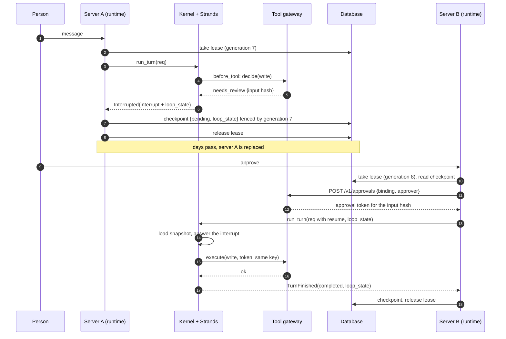
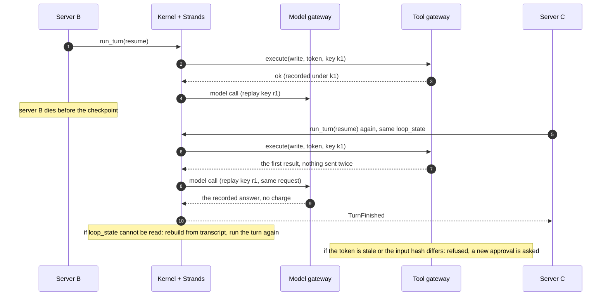

# Runtime contract and the Strands loop

Status: proposed design, written 2026-11-26. Nothing on this page is built. Release 1.4.0.

An agent answers by asking a model what to do next, doing it, and repeating. Today a published library runs that
repetition and our own code wraps it with the rules for one reply. This page replaces the library with Strands, keeps
every rule we wrote, and fixes the boundary between the two so that the library can be swapped again without touching
the rest of the product. It also says how a reply that stops for an approval is saved and picked up days later on a
different server.

## Purpose

| Goal | Measure |
|---|---|
| One contract between the runtime and any agent loop | No module outside one subpackage imports the loop library; a lint contract fails if one does |
| Every protection and kernel feature we have today works on Strands | The ported kernel suite passes on the scripted model with Pydantic AI removed from the lock file |
| A paused reply resumes on another server | Experiment 1 in [experiments](experiments.md), then the acceptance test `pause-other-server` below |
| New loop features switch on | Stop a reply, retry and fall back, hooks, large-result offload, images, traces |

## What it owns and what it must not own

| Owns | Must not own |
|---|---|
| The turn contract: `TurnRequest` in, a stream of `KernelEvent` out, `TurnResult` last | Any database table. The kernel has no database, as today (`packages/ops_agent_kernel/CLAUDE.md`) |
| The Strands adapter, in one subpackage | Model keys, provider choice, budgets, the model-call record: [model gateway](model-gateway.md) |
| Context assembly, tool wrapping, the approval pause, skills, step procedures, guardrails, masking, plan, citations, rich results | Who may call a tool, approval tokens, the call log: the tool gateway |
| The opaque loop state returned at the end of a turn | Where that state is stored. The runtime stores it in the conversation's checkpoint |
| Mapping Strands events onto kernel events | The wire protocol. The runtime maps kernel events onto its two streams, as today (`services/agents-service/src/ops_agents/graphs/common.py:358`) |

## Where today's contract leaks the library

The contract a second loop would sit behind exists today, but four parts of it carry Pydantic AI types. Each is closed by
this spec.

| Leak today | Where | Change |
|---|---|---|
| The model port returns a library model object | `packages/ops_agent_kernel/src/ops_agent_kernel/ports.py:70` (`ModelSource.model_for`), `:88` (`KernelPorts.model`) | `ModelSource.endpoint_for(alias)` returns a `ModelEndpoint`: a URL, a key and headers |
| A pause carries the library's serialised message history | `packages/ops_agent_kernel/src/ops_agent_kernel/types.py:282` (`Interrupt.history: bytes`) | `Interrupt.loop_state: LoopState`, opaque bytes with the loop's name and schema version |
| The tool gateway imports a kernel type | `services/tools-service/src/ops_tools/code_runs.py:20` imports `ToolOutcome` from the kernel | `ToolOutcome` moves to the shared contracts package so that two services share a shape through contracts (LY4). This does not keep the loop library out of the tool gateway: it also imports the agents service's `Catalog` and `LocalToolExecutor` (`services/tools-service/src/ops_tools/registry.py:15`, `tools.py:11`), and that dependency is outside these releases |
| The scripted model used by tests is a library class | `services/agents-service/src/ops_agents/api/model_ledger.py:39` (`FunctionModel`), and about fifty test files | A scripted model at the HTTP edge, described under [The scripted model](#the-scripted-model) |

## Interfaces

All types are Python dataclasses in `ops_agent_kernel`, frozen unless marked. Field names are exact.

### The public entry point (unchanged signature)

```python
async def run_turn(req: TurnRequest, ports: KernelPorts) -> AsyncIterator[KernelEvent]: ...
```

`run_turn` always ends with one `TurnFinished`. It never raises for a model, tool or guardrail failure; those end the
turn with `TurnResult.status == "failed"` and a `stop_reason`.

### Ports the caller supplies

```python
@dataclass(frozen=True)
class ModelEndpoint:
    base_url: str                      # the model gateway, never a provider
    api_key: str                       # the caller's model key secret
    headers: Mapping[str, str]         # X-Tenant-Id, X-Thread-Id, X-Run-Id, X-Step-Id, X-Budget-Id, X-Replay-Key
    http_client: httpx.AsyncClient | None = None   # tests inject the scripted transport here

class ModelSource(Protocol):
    def endpoint_for(self, alias: str, purpose: CallPurpose = "turn") -> ModelEndpoint: ...

CallPurpose = Literal["turn", "closing", "check", "summary", "judge"]

class StructuredCalls(Protocol):
    async def ask(
        self, alias: str, *, system: str, prompt: str, schema: Json, purpose: CallPurpose
    ) -> StructuredAnswer: ...

@dataclass(frozen=True)
class StructuredAnswer:
    value: Json                        # validated against `schema`
    usage: TokenUsage
    model_name: str

class ToolExecutor(Protocol):          # ports.py:36, plus `decide`
    async def decide(self, tool: str, arguments: Json, *, key: str) -> ToolDecision: ...
    async def execute(self, tool: str, arguments: Json, *, key: str, approval_token: str | None) -> ToolOutcome: ...

@dataclass(frozen=True)
class ToolDecision:                    # the tool gateway's answer before anything runs
    verdict: Literal["allow", "needs_review", "refuse"]
    reason: str = ""                   # shown to the model on refuse, to the approver on needs_review
    input_hash: str = ""               # what an approval will be bound to
    approvers_needed: int = 1
    editable: bool = False             # whether the approver may correct the input

class KnowledgePort(Protocol):         # unchanged (ports.py:80)
    async def search(self, query: str, kb_ids: list[str]) -> list[Passage]: ...

class HookPolicies(Protocol):
    async def load(self, ids: Sequence[str]) -> list[HookPolicy]: ...

class Cancel(Protocol):                # backed by a flag on the run's row, read at each step; see "Stopping a turn"
    def is_set(self) -> bool: ...

@dataclass(frozen=True)
class KernelPorts:
    models: ModelSource
    structured: StructuredCalls
    tools: ToolExecutor
    knowledge: KnowledgePort
    hooks: HookPolicies
    tool_caches: ToolCaches | None = None
    cancel: Cancel | None = None
    loop: str = "strands"              # the registered loop driver to use
```

`StructuredCalls` replaces every one-shot library call we make outside a turn: the guardrail check
(`guard.py:74`), the judge (`judge.py:61`), the workflow model helpers (`services/agents-service/src/ops_agents/graphs/models.py:56`)
and memory extraction. Its one implementation sends an OpenAI-shaped request with a single forced function to the model
gateway and validates the arguments with `jsonschema`. It imports no agent library.

`ToolExecutor.decide` calls a new route of the tool gateway, `POST /v1/calls/decide`, which runs the same policy,
schema and approval checks as `POST /v1/calls` and sends nothing. It is what lets the pause start before a tool runs.

### Request, result and pause (changed fields only)

```python
@dataclass(frozen=True)
class LoopState:
    loop: str                          # "strands"
    schema: int                        # the adapter's own version, bumped when it changes what it stores
    data: bytes                        # opaque to every caller

@dataclass(frozen=True)
class TurnRequest:                     # types.py:319, plus:
    loop_state: LoopState | None = None        # from the previous TurnResult or Interrupt; None on a first turn
    loop: LoopSettings = LoopSettings()        # from the spec, see automatic-mode-and-loop-kinds.md
    helpers: list[HelperGrant] = ()            # helper agents the runtime may ask or hand to
    sandbox: SandboxGrant | None = None        # release 1.5.0
    hook_ids: HookIds = HookIds()              # policy ids per moment
    answers: dict[str, Json] = {}              # interrupt id -> a person's answer, on resume
    agent_states: dict[str, LoopState] = {}    # loop state per agent id, for a conversation with hand-overs or helpers
    notes: NotesGrant | None = None            # shared notes: a swarm conversation in 1.4.0, a team in 1.6.0
    budget_ids: list[str] = ()                 # sent in X-Budget-Id, innermost first
    replay_key: str = ""                       # sent in X-Replay-Key; required when budget_ids is set

@dataclass(frozen=True)
class Interrupt:                       # types.py:276, changed:
    interrupt_id: str
    kind: Literal["approval", "question", "plan_review"]
    needed: str
    pending_call: PendingCall | None   # set for approval
    question: Question | None          # set for question: text and up to 6 options
    loop_state: LoopState              # replaces `history: bytes`
    loaded_skills: list[LoadedSkill]
    plan: Plan | None
    run: SkillRunState | None
    held: dict[str, list[str]]
    nested: NestedPause | None = None  # set when the pause belongs to a helper asked during this turn

@dataclass
class TurnResult:                      # types.py:397, plus:
    loop_state: LoopState | None       # None only when the turn failed before the loop started
    agent_states: dict[str, LoopState] # updated states of helpers and of agents handed to
    modes: list[ModeStep]              # the modes used, in order, each with its reason
    usage: TokenUsage                  # gains cached_input_tokens
    handoff: HandoffChoice | None = None
    notes_added: list[str] = ()
```

The types named above, with every field. `Plan`, `LoadedSkill` and `TokenUsage` exist
today in the kernel's `types.py` (`:28`, `:35`, `:387`), `ToolCaches` in `tool_cache.py:63` and `SkillRunState` in the
contracts package, all unchanged; `ModeStep` and `LoopSettings` are on the
[automatic mode](automatic-mode-and-loop-kinds.md#interfaces) page; `ToolOutcome` moves to the contracts package.

```python
@dataclass(frozen=True)
class HelperGrant:
    agent_id: str
    version: int
    name: str
    does: str                          # one line shown to the model as the tool's description
    use: Literal["tool", "handoff"]
    request: TurnRequest               # the helper's own request, built by the runtime from its published spec

@dataclass(frozen=True)
class SandboxGrant:                    # release 1.5.0
    sandbox_id: str                    # sbx_<thread id>, or sbx_run_<run id> for a workflow step
    image: str
    size: Literal["small", "standard", "large"]
    command_seconds: int
    approve: list[Literal["delete_files", "install_packages", "network_read"]]   # extra approvals the spec asks for

@dataclass(frozen=True)
class HookIds:
    before_model: list[str] = ()
    after_model: list[str] = ()
    before_tool: list[str] = ()
    after_tool: list[str] = ()

@dataclass(frozen=True)
class PendingCall:
    call_id: str
    tool: str
    arguments: Json
    key: str                           # the idempotency key the resumed call repeats
    input_hash: str
    reason: str
    approvers_needed: int
    editable: bool

@dataclass(frozen=True)
class Question:
    text: str
    options: list[str] = ()            # at most 6; empty means free text
    schema: Json | None = None         # set when a tool server asked for typed fields
    to: str | None = None              # a member id, when a team member asks another (1.6.0)

@dataclass(frozen=True)
class NestedPause:
    agent_id: str                      # the helper that paused
    call_id: str                       # the outer tool call that asked it
    interrupt: Interrupt               # the helper's own interrupt, with its loop state

@dataclass(frozen=True)
class HandoffChoice:
    to: str
    message: str
    why: str

@dataclass(frozen=True)
class MemberOption:
    id: str
    name: str
    does: str
    when: str = ""

@dataclass(frozen=True)
class Note:
    by: str                            # an agent id or a user id
    by_kind: Literal["agent", "person"]
    by_name: str
    at: datetime
    text: str                          # at most 2,000 characters

@dataclass(frozen=True)
class NotesGrant:
    notes: list[Note]                  # what the agent reads
    may_write: bool
```

`stop_reason` gains `cancelled` and `hook_denied`; every existing value keeps its meaning (`types.py:400`).

Release 1.6.0 adds two request fields for a team member's turn, `handoff_targets` and `ask_targets`, both lists of
`MemberOption`. They are described in
[teams and human tasks](workflow-teams-and-human-tasks.md#how-a-members-turn-reaches-the-runtime) and change nothing
for a turn that does not use them.

### The loop driver contract

This is the one contract a loop plugs into. It is internal: our engineers add a driver, customers do not.

```python
class LoopDriver(Protocol):
    name: str
    schema: int

    def run(self, job: LoopJob, seams: LoopSeams) -> AsyncIterator[LoopSignal]: ...
    def rebuild(self, transcript: Sequence[TranscriptMessage]) -> LoopState: ...

@dataclass(frozen=True)
class LoopJob:
    system_stable: str                 # the stable part of the prompt, identical across turns
    user_turn: str | None
    resume: Mapping[str, Json]         # interrupt id -> response
    state: LoopState | None
    tools: Sequence[LoopTool]          # every tool the turn may call, kernel built-ins included
    endpoint: ModelEndpoint
    fallback: ModelEndpoint | None
    limits: LoopLimits                 # steps, deadline_seconds
    model_settings: Mapping[str, float | int | str]
    trace: Mapping[str, str]           # attributes stamped on every span: tenant, team, thread, run, agent, version

@dataclass(frozen=True)
class LoopTool:
    name: str
    description: str
    input_schema: Json
    call: Callable[[Json, ToolCallContext], Awaitable[ToolReply]]

class LoopSeams(Protocol):
    async def before_model(self, view: ModelCallView) -> ModelCallEdit: ...   # volatile prompt tail, offered tools
    async def after_model(self, view: ModelReplyView) -> ModelVerdict: ...    # proceed | guide(text) | retry
    async def before_tool(self, call: ToolCallView) -> ToolVerdict: ...       # proceed | refuse(text) | pause(Interrupt fields)
    async def after_tool(self, call: ToolCallView, reply: ToolReply) -> ToolReply: ...
    def cancelled(self) -> bool: ...

LoopSignal = TextChunk | ModelStarted | ModelEnded | Throttled | Paused | Ended

@dataclass(frozen=True)
class LoopLimits:
    steps: int
    deadline_seconds: float

@dataclass(frozen=True)
class TranscriptMessage:               # our own message record, used by `rebuild`
    role: Literal["user", "assistant", "tool"]
    text: str
    tool_calls: list[ToolCallView] = ()
    tool_call_id: str | None = None

@dataclass(frozen=True)
class ToolCallContext:
    call_id: str
    step: int
    emit: Callable[[str], None]        # a tool's progress line

@dataclass(frozen=True)
class ToolReply:
    ok: bool
    for_model: str                     # what the model reads
    output: Json = None                # what the record and the widget get

@dataclass(frozen=True)
class ToolCallView:
    call_id: str
    tool: str
    arguments: Json
    step: int

@dataclass(frozen=True)
class ToolVerdict:
    action: Literal["proceed", "refuse", "pause", "answered"]
    text: str = ""                     # refuse: what the model is told
    interrupt: Interrupt | None = None # pause
    reply: ToolReply | None = None     # answered: the result is already known; the tool's body is not run

@dataclass(frozen=True)
class ModelCallView:
    step: int
    messages_count: int
    tool_names: list[str]

@dataclass(frozen=True)
class ModelCallEdit:
    tail: str                          # the volatile end of the prompt for this call; never saved to history
    offer_tools: list[str] | None      # None offers every registered tool

@dataclass(frozen=True)
class ModelReplyView:
    step: int
    text: str
    tool_calls: list[ToolCallView]

@dataclass(frozen=True)
class ModelVerdict:
    action: Literal["proceed", "guide", "retry"]
    text: str = ""                     # guide: appended for the next call

@dataclass(frozen=True)
class TextChunk:
    text: str

@dataclass(frozen=True)
class ModelStarted:
    step: int

@dataclass(frozen=True)
class ModelEnded:
    step: int
    usage: TokenUsage
    model_name: str
    replayed: bool

@dataclass(frozen=True)
class Throttled:
    seconds: float

@dataclass(frozen=True)
class Paused:
    interrupt_ids: list[str]
    state: LoopState

@dataclass(frozen=True)
class Ended:
    reason: Literal["end_turn", "limit_turns", "cancelled", "error", "budget_reached"]
    state: LoopState | None
    error: str = ""
```

The kernel implements `LoopSeams` once, in loop-neutral code. The driver's only job is to call the seams at the right
moments and report signals. Tool start and end events are emitted by the kernel's own tool wrapper inside `LoopTool.call`,
so a tool record never depends on how a library reports tool use.

### The approval pause starts at one seam

A turn pauses in exactly one place: `before_tool`, before the tool's body runs. A tool's body never pauses.

| Case | What `before_tool` does |
|---|---|
| Any gateway tool | Calls `ToolExecutor.decide`. `allow`: proceed. `refuse`: the model is told why. `needs_review`: return `pause` with a `PendingCall`. A grant marked `requires_approval` pauses without asking |
| The resumed call | The interrupt's answer carries an approval token. `before_tool` returns `proceed` and the body calls `execute` with the token and the same key. A rejection returns `refuse` with the approver's note |
| A sandbox tool (1.5.0) | The tool and its input map to one `sandbox.<operation>` call, which is decided the same way before the body runs |
| A helper asked as a tool | The kernel runs the helper's turn inside `before_tool`, as a nested `run_turn` on `HelperGrant.request`. If the helper finishes, the verdict is `answered` with its reply and the tool's body does nothing. If the helper pauses, the verdict is `pause` with `Interrupt.nested` holding the helper's interrupt and state. On resume `before_tool` runs again for the same call and continues the helper from that state |
| A question to a person, a plan review | The `ask_person` and `plan` kernel tools are intercepted the same way: `pause` with kind `question` or `plan_review`, then `answered` with the person's reply |

Because the decision is asked before the body, the gateway's `needs_review` is known when the pause is raised. `execute`
still refuses a write with no valid token, so a driver that skipped the seam could not send one.

### Stopping a turn

`POST /v1/threads/{thread_id}/runs/{run_id}/cancel` sets `cancel_requested_at` on the run's row in the agents service.
The server running the turn reads that flag through `Cancel.is_set()` at each model step and before each tool, with
one indexed read cached for one second, so the request can land on any server. The turn ends as `cancelled` with the
text so far. A turn that is not running answers 409 `run_not_running`.

### Hook policies

A hook policy is a named, reviewed rule a security admin writes once and a builder attaches to an agent by id. It runs
in the kernel's seams. It is declarative: a policy has no code. This section is the one definition; other pages refer
to it.

```python
@dataclass(frozen=True)
class HookPolicy:
    id: str                            # ^[a-z][a-z0-9_]{0,63}$
    version: int
    name: str
    moment: Literal["before_model", "after_model", "before_tool", "after_tool"]
    when: str                          # an expression in the kernel's expression language (`packages/ops_agent_kernel/src/ops_agent_kernel/expr.py`); "" always matches
    action: Literal["refuse_tool", "require_approval", "mask_result", "guide", "retry_answer"]
    text: str = ""                     # refuse_tool, guide, retry_answer: what the model is told
    fields: list[str] = ()             # mask_result: JSON paths in the tool's result to mask
```

| Action | Allowed at | Effect | What `when` can read |
|---|---|---|---|
| `refuse_tool` | `before_tool` | The call is refused with `text` | `tool`, `args`, `step` |
| `require_approval` | `before_tool` | The call pauses even when the gateway would allow it. A policy can add an approval and can never remove one | `tool`, `args` |
| `mask_result` | `after_tool` | The listed fields are replaced before the model or the person sees the result | `tool`, `result` |
| `guide` | `before_model` | `text` is added to the prompt's tail for this call | `step`, `tools` |
| `retry_answer` | `after_model` | The answer is discarded and the model is asked again with `text`, twice at most | `text`, `tool_calls` |

| Item | Rule |
|---|---|
| Fails closed | A policy whose expression errors refuses the call or ends the turn with `hook_denied` |
| Order | Policies of a moment run in the order the spec lists them; the first refusal wins |
| What it cannot do | Call a network, read a secret, change a tool's input, or lift an approval |
| Storage | Table `hook_policies` in the agents service: primary key `(tenant_id, id, version)`; `team_id` (null for a tenant-wide policy); `name`, `moment`, `when_expr`, `action`, `text`, `fields` JSON; `status` (`draft`, `published`); `created_by`, `created_at`. Tenant scoped. Kept while any agent version names it |
| Routes | `GET /v1/hook-policies` (list, paged), `POST /v1/hook-policies`, `GET` and `PUT /v1/hook-policies/{id}`, `POST /v1/hook-policies/{id}/publish`, `POST /v1/hook-policies/check` (runs a policy against a sample call and returns the verdict) |
| Permission | Managing policies is the same permission as managing guardrail records. Attaching a published policy to an agent needs the builder's edit permission on the agent. A change writes an audit entry in the same transaction (SC2) |
| Console | A "Policies" tab beside the guardrail records, built from the same list and form components |
| In the spec | `hooks.beforeModel`, `afterModel`, `beforeTool`, `afterTool` are lists of policy ids; an id at the wrong moment is refused when the spec is saved |
| The port | `HookPolicies.load(ids)` returns the published version of each; an unknown id fails the turn before the loop starts |

### Mapping Strands onto the contract

Strands names below are as read on its user guide on 2026-11-26; each is confirmed by an experiment before code depends on it.

| Contract moment | Strands mechanism | Source | Confirmed by |
|---|---|---|---|
| Build one agent per turn | `Agent(model=..., tools=..., system_prompt=..., hooks=..., conversation_manager=..., retry_strategy=..., trace_attributes=...)`; the docs recommend one agent per task | [agent loop](https://strandsagents.com/docs/user-guide/sdk/agents/agent-loop/) | Experiment 1 |
| Reach the model | Its OpenAI-compatible provider pointed at `ModelEndpoint.base_url` with our headers. Constructor argument names are **unverified** | [model providers](https://strandsagents.com/docs/user-guide/sdk/model-providers/) | Experiment 3 |
| `before_tool`, refuse | `BeforeToolCallEvent` with `cancel_tool` | [hooks](https://strandsagents.com/docs/user-guide/sdk/agents/hooks/) | Experiment 2 |
| `before_tool`, pause | An interrupt raised from the hook; the run returns with stop reason `interrupt` and `result.interrupts` | [interrupts](https://strandsagents.com/docs/user-guide/sdk/interrupts/) | Experiment 1 |
| `before_tool`, answered | The hook cancels the tool and supplies the result. Whether a cancelled tool can carry a successful result is **unverified** | hooks page | Experiment 2, part a |
| `after_tool` | `AfterToolCallEvent`, whose `result` can be replaced | hooks page | Experiment 2 |
| `before_model`: the volatile tail and the offered tool list | Middleware on the model stage, input phase, replacing the context. Whether the tool list can be narrowed per call is **unverified** | [middleware](https://strandsagents.com/docs/user-guide/sdk/agents/middleware/) | Experiment 2 |
| `after_model`: guide or retry | `AfterModelCallEvent` with `retry`, or an intervention returning `Guide` | [interventions](https://strandsagents.com/docs/user-guide/sdk/agents/interventions/) | Experiment 2 |
| Steps limit | `limits={"turns": n}`; stop reason `limit_turns`. It is checked at the top of each loop step, so one step can overshoot | agent loop page | Experiment 3 |
| Stop a reply | `cancel_signal` passed to the call, polled about every 50 ms; stop reason `cancelled`; a cancelled run cannot resume | [lifecycle controls](https://strandsagents.com/docs/user-guide/sdk/agents/lifecycle-controls/) | Experiment 3 |
| Retry a failed model call | `ModelRetryStrategy` with a custom `is_retryable` | [retry strategies](https://strandsagents.com/docs/user-guide/sdk/agents/retry-strategies/) | Experiment 3 |
| Fall back to a second model | `ModelRouter` with `FallbackStrategy` and `max_switches=1`, both candidates on our gateway | [model routing](https://strandsagents.com/docs/user-guide/sdk/model-providers/model-routing/) | Experiment 3 |
| Save and load state | `agent.take_snapshot(preset="session")`, `Snapshot.to_dict()`, `agent.load_snapshot(...)` | [snapshots](https://strandsagents.com/docs/user-guide/sdk/agents/snapshots/) | Experiment 1 |
| Long conversations | `SummarizingConversationManager`; its summary calls go through the same endpoint with purpose `summary` | [conversation management](https://strandsagents.com/docs/user-guide/sdk/agents/conversation-management/) | Experiment 3 |
| Traces | OpenTelemetry spans per agent, cycle, model call and tool, stamped from `trace_attributes` | [traces](https://strandsagents.com/docs/user-guide/sdk/observability-evaluation/traces/) | Experiment 3 |

Strands features we switch off, each because it would bypass a gateway or a store of ours:

| Feature | Why it stays off |
|---|---|
| Its MCP client | It would hold credentials inside the loop. Tool servers are reached through the tool gateway |
| Loading tools from a directory | `load_tools_from_directory` stays false; the tool list is the spec's grants |
| Its file and S3 storage, and its session managers, for single agents | The pause has one owner, our checkpoint. See [Persisting a pause](#persisting-a-pause-and-resuming-on-another-server) |
| Its human-in-the-loop classifier and trust grants | Whether a call needs a person is the tool gateway's decision, not a model's |
| Bedrock guardrails | Our blocked-topic checks and masking are provider-neutral |
| Running tools without a sandbox object | No shell, file or Python tool is registered unless the spec has a sandbox |

## Porting each kernel feature

The 13 features the design counts, with where each attaches. "Ours" means the code stays in loop-neutral modules and
Strands sees only a tool or a seam call.

| Feature | Today | On Strands | Kept as ours because |
|---|---|---|---|
| Typed final answer | `TurnRequest.output_schema`, validated with `jsonschema` (`types.py:358`) | A kernel tool `answer` whose input schema is the spec's schema. The turn ends when it is called with valid input; invalid input returns the errors to the model, twice at most, then `schema_error` | The spec carries JSON Schema; Strands' structured output takes a Pydantic model class ([structured output](https://strandsagents.com/docs/user-guide/sdk/agents/structured-output/)) |
| Run limits with a named stop reason | `max_steps`, `max_tool_calls`, `max_builtin_calls` (`types.py:152` to `:160`) | Steps through Strands `limits`; tool-call and built-in caps counted in `before_tool`, which is exact | The caps are counted per tool class, which Strands does not do |
| Stable-first prompt order | `context.py`, `prompt_writer.head` and `tail` | `system_stable` is the head; the tail is added in `before_model` and never saved to history | Cache hits depend on the head being byte-identical across turns |
| Tool search | `search.search` and a threshold (`types.py:166`) | A kernel tool `search_tools`; `before_model` offers the found tools. If narrowing per call fails experiment 2, every granted tool is registered and search only ranks | Search must find only granted tools |
| Skills | `skills.py`, `load_skill` | Unchanged: an index in the prompt and the `load_skill` kernel tool | Ours have reviewed versions, parts and per-turn caps; Strands' skills plugin loads from a file path |
| Step-by-step procedures | `steps.py`, `step_tools.py`, `expr.py` | `steps.barred` is asked in `before_tool`; the rule check runs in `after_tool`; holds are taken there | No library has steps with a check after each |
| Rich results | `present.py`, `kinds.py`, `layout.py` | Unchanged: the `present` kernel tool | Ours only |
| Citations | Numbered passages, `CitationsReady` (`events.py:45`) | Unchanged: numbering happens in the knowledge tool wrapper | Ours only |
| The approval pause | A gated write ends the turn as an `Interrupt` (`kernel.py:1005`) | `before_tool` asks the gateway to decide and returns `pause`; the driver raises a Strands interrupt; the kernel builds our `Interrupt` from it and the snapshot. See [the one seam](#the-approval-pause-starts-at-one-seam) | The decision to pause is the gateway's `needs_review` or the grant's `requires_approval` |
| Blocked-topic checks | `guard.check` before and after the answer | Unchanged, through `StructuredCalls`. A guarded answer is buffered and released after its check, as today (`events.py:13`) | Fails closed on our terms |
| Data masking | `pii.py` over what is shown and returned | Unchanged: applied to events and the result, never to what the model sees | Ours only |
| The judge | `judge.verdict` | Unchanged, through `StructuredCalls` with purpose `judge` | Fails closed; shared with evals |
| The plan | `plan.py`, the `plan` kernel tool | Unchanged. Strands' to-do plugin is not used | The plan must survive a pause in our own record, and the plugin's page was not read (**unverified**) |

Deleted with Pydantic AI: `models.py` (model construction inside the loop), `aliases.py`, the library halves of `kernel.py`
(`_TurnState` plumbing for deferred tool requests, usage-limit exception classes at `kernel.py:472` to `:482`), and in
the agents service `api/model_ledger.py`, `api/chat_history.py` and the library use in `graphs/models.py`.

## Mapping the event stream

Strands' Python stream yields dictionaries. The driver turns them into `LoopSignal`; the kernel turns signals and its
own tool wrappers into `KernelEvent`; the runtime maps those onto the two wire streams. The wire frames and their
fields are listed once, on the [API page](api.md#streams); this page gives only the mapping.

| Strands stream event | LoopSignal | KernelEvent | Wire frame `type` (thread run stream at `services/agents-service/src/ops_agents/api/routers/graphs.py:336`; chat stream at `ops_contracts/chat.py:703`) |
|---|---|---|---|
| `init_event_loop`, `start_event_loop` | `ModelStarted` | `StatusChanged("thinking")` | `status` |
| `data` (text delta) | `TextChunk` | `TextDelta`, or buffered when the answer is guarded | `text` |
| `reasoning` | dropped | none | none |
| `current_tool_use`, `tool_stream_event` | dropped: the kernel's tool wrapper reports calls | `ToolInputAvailable`, `ToolOutput` | `tool_start`, `tool_end`; the chat stream also `widget`, `part` |
| `event_loop_throttled_delay` | `Throttled(seconds)` | `StatusChanged("thinking")` and a log line | `status` |
| `message` | `ModelEnded(usage)` | none; usage is summed for the result | none |
| `force_stop` | `Ended(error)` | `TurnFinished(status="failed", stop_reason="error")` | `turn` on the thread stream, `error` on chat |
| `result` with stop reason `interrupt` | `Paused(interrupt_ids, state)` | `Interrupted` then `TurnFinished(status="interrupted")` | `interrupt`, then `turn` or `done` |
| `result`, any other stop reason | `Ended(reason, state)` | `CitationsReady`, `TurnFinished` | `citation` or `citations`, then `turn` or `done` |
| `multiagent_*` | not used | | |

New kernel events, each a frozen dataclass in `events.py`. Their wire fields are on the API page.

| KernelEvent | Fields | Wire `type` | Emitted when |
|---|---|---|---|
| `ModeChanged` | `mode: Literal["direct","plan","helpers","sandbox"]`, `reason: str`, `fixed: bool` | `mode` | First model step of a turn, and each time the agent first writes a plan, asks a helper or opens the sandbox |
| `PlanChanged` | `plan: Plan`, `revision: int` | `plan` | The `plan` tool accepts a plan or ticks a step |
| `HelperAsked` | `agent_id`, `name`, `question`, `status: Literal["started","finished"]`, `summary: str` | `agent_asked` | A helper's turn starts and ends |
| `HandedOver` | `to_agent`, `to_name`, `message` | `handoff` | A hand-over is accepted |
| `SandboxCommand` | `call_id`, `command`, `status`, `exit_code`, `stopped_by`, `files_changed: list[str]` | `sandbox_command` | Release 1.5.0 |
| `Interrupted` | `interrupt: Interrupt` (exists) | `interrupt` | Every pause, whatever caused it |

Stop reason mapping:

| Strands stop reason | `TurnResult.stop_reason` | `status` |
|---|---|---|
| `end_turn` | `final`, or `no_output` when a schema was asked and `answer` was not called | completed / failed |
| `interrupt` | `interrupt` | interrupted |
| `limit_turns` | `max_steps` | completed, after one closing call with no tools, as today (`kernel.py:446`) |
| `cancelled` | `cancelled` | completed, with the text so far |
| `max_tokens`, `content_filtered`, `guardrail_intervened`, any exception | `error` | failed |
| gateway answered 429 `budget_reached` | `budget_reached` | completed, after the one closing call the gateway admits |

## Persisting a pause and resuming on another server

Decision: a saved pause has one owner, the conversation's checkpoint that the runtime already writes under its lease
(`packages/ops_checkpointer/src/ops_checkpointer/saver.py:87`). Strands' state travels inside it as `LoopState`. We do
not attach a Strands session manager to a single agent.

| Option | Verdict | Reason |
|---|---|---|
| A. `LoopState` inside our checkpoint (chosen) | Chosen | One store and one writer. The lease's fencing number already rejects a stale writer. Tenant isolation is the checkpoint table's |
| B. A Strands session manager on a custom storage backend in our database | Fallback if `load_snapshot` cannot restore a pending interrupt (experiment 1) | A second store beside the checkpoint that must be kept in step with it. Strands documents no lock and one writer per session ([session management](https://strandsagents.com/docs/user-guide/sdk/agents/session-management/)) |

What `LoopState.data` holds: the dictionary from `Snapshot.to_dict()` (messages, agent state, conversation manager
state, interrupt state), serialised as JSON and compressed. Rules:

| Rule | Detail |
|---|---|
| Returned on every turn | `TurnResult.loop_state` carries the conversation between turns, so Strands' summaries persist. The runtime stores it in thread state beside `carried_run` and `carried_plan` |
| One state per agent | A conversation with helpers or hand-overs has several agents, each with its own history. Thread state holds `loop_states: {agent id: LoopState}`; the request's `loop_state` is the active agent's and `agent_states` carries the rest. The size cap applies to each |
| At rest | Stored as every checkpoint is today: a tenant-scoped row under row-level security. The checkpointer adds no encryption of its own and this design does not add one; disk encryption is the install's |
| Size cap | `OPS_AGENTS_LOOP_STATE_MAX_BYTES`, default 2 MiB compressed. Over the cap the turn ends with `error` and code `loop_state_too_large`. Large tool results are offloaded before they reach history (open point 2) |
| Trusted input | Strands treats history as trusted and will run a trailing tool-use block on the next call ([trusted message history](https://strandsagents.com/docs/user-guide/sdk/safety-security/trusted-message-history/)). `LoopState` is only ever read from our checkpoint, never from a request body. On load the adapter drops any trailing tool-use block that does not belong to a pending interrupt |
| Unreadable state | A `schema` or library version the adapter cannot read is rebuilt with `LoopDriver.rebuild(transcript)` from our own message record. For a turn that was waiting at an approval, the turn runs again from the transcript; the approval still applies only if the model asks for the same call with the same input hash |
| No secrets | The adapter never puts a header, key or approval token into agent state |



Failure paths:



The approval token is minted by the tool gateway. Today the agents service mints it with a key it holds
(`services/agents-service/src/ops_agents/api/routers/reviews.py:115`, `api/engine_host.py:90`); that process will also
run the loop library, so the key moves. The agents service records who decided, then asks the tool gateway's
`POST /v1/approvals` for a token, and the gateway checks the approver against the approval policy before it signs. The
review key setting is removed from the agents service. The route is on the [tool gateway](tool-gateway.md) page.

## The scripted model

Tests and use cases run on a scripted model with model keys removed (`docs/architecture/standards/testing.md`, TS6).
Today that model is a Pydantic AI class, so the tests that prove the port are tied to the library being deleted.

| Step | What changes |
|---|---|
| 1. New seam | `ops_agent_kernel.testing.ScriptedModel`: an `httpx` transport that answers the OpenAI chat-completions route from a Python function `(messages, tools) -> reply`. It is injected as `ModelEndpoint.http_client`. The model gateway keeps its own `scripted` adapter (`services/models-service/src/ops_models/providers.py:183`) for use cases |
| 2. Port the scripts first | The scripted replies in `services/agents-service/tests/conftest.py` are rewritten against `ScriptedModel` while Pydantic AI is still the loop; its OpenAI model class is pointed at the same transport. The suite must stay green. This proves the tests no longer depend on the library |
| 3. Swap the loop | `KernelPorts.loop` selects the driver. Both drivers run under the same suite until Strands passes all of it |
| 4. Delete | The Pydantic AI driver, the dependency, and the `pydantic_ai` rows in the dependency register |

The mock sits at the edge named by the test standard (the model), and no test asserts Strands' own behaviour.

## Data model

The kernel has no tables. The runtime's storage of `LoopState` is one new key in the existing checkpointed thread state.

| Item | Where | Tenant scope | Retention | PostgreSQL and SQL Server |
|---|---|---|---|---|
| `loop_state` in thread state | The checkpoint blob (`ops_checkpointer`), under the thread's tenant and team | Row-level, as every checkpoint | With the conversation's history | No new statement; the saver already runs on both |
| `pending.loop_state` in a pause | The same checkpoint, in the `pending` key (`graphs/common.py:480`) | Same | Same | Same |
| Workflow agent step pause (1.6.0) | The state is a row of `engine_turn_states`; `engine_runs.waiting` (`packages/ops_engine/src/ops_engine/store/tables.py:118`) holds a reference to it. See [workflow durability](workflow-durability.md) | Row-level | Until the step ends | Binary column on both |
| `hook_policies` | The agents service; see [Hook policies](#hook-policies) | Tenant scoped | While any agent version names it | JSON column for `fields` |
| `cancel_requested_at` on the run row | The agents service's run table | Tenant scoped | With the run | Timestamp on both |

## Settings

| Setting | Default | Meaning |
|---|---|---|
| `OPS_AGENTS_LOOP` | `strands` | The loop driver. `pydantic_ai` exists only during the side-by-side period and is removed with it |
| `OPS_AGENTS_LOOP_STATE_MAX_BYTES` | `2097152` | Cap on compressed loop state |
| `OPS_AGENTS_MODEL_RETRY_ATTEMPTS` | `3` | Retries of a model call the gateway answered with 502, 503 or 504. A 429 from the gateway is never retried, as today (`models.py:55`) |
| `OPS_AGENTS_MODEL_RETRY_MAX_SECONDS` | `20` | Longest wait between retries |
| `OPS_AGENTS_TURN_DEADLINE_SECONDS` | `120` | Wall-clock deadline enforced outside the loop by setting the cancel signal (`TurnRequest.deadline_seconds`, `types.py:355`) |
| `OTEL_EXPORTER_OTLP_ENDPOINT` | unset | When set, the service's own telemetry exporter sends spans to the install's collector, Strands' spans among them. Unset, no span leaves the process |

## Security, cost and limits

| Concern | Rule | Enforced by |
|---|---|---|
| Secrets out of the loop | The loop holds a model key for our gateway only, and no provider key or tool credential | `ModelEndpoint` is the only credential type in `LoopJob`; an import contract bars provider SDK clients in the kernel |
| Approval on every change | The kernel pauses at `before_tool`, but the refusal of an unapproved write is the gateway's, and the gateway mints the token | `services/tools-service/src/ops_tools/gateway_calls.py:397` |
| Tenant isolation | One agent object per turn; identity never enters model-visible text (`context.py:1`) | A test that two concurrent turns of different tenants share no object |
| Cost | No money check in the kernel. A 429 `budget_reached` from the gateway ends the turn | [model gateway](model-gateway.md) |
| Telemetry | No span or log carries prompt or completion text by default | A span processor that drops content attributes unless `OPS_TRACE_CONTENT=1` |
| Library reach | The loop library opens no connection other than to `ModelEndpoint.base_url`. Spans, when exported, are sent by the service's exporter to the install's own collector | The scripted-model suite runs with egress blocked (SC6) |

## Acceptance criteria

Failure modes first. Each is one test through `run_turn` on the scripted model unless a layer is named.

| # | Failure mode | Test proves |
|---|---|---|
| 1 | A paused reply cannot resume on a server that never saw it | `pause-other-server`: process A returns an `Interrupt`; a fresh process B, given only the checkpoint row, resumes and the write runs once |
| 2 | A crash after an approved write sends the write twice | The resumed turn is run twice with the same loop state; the scripted gateway sees one call per idempotency key |
| 3 | A check that failed does not hold the later steps of a procedure | The ported `test_skill_steps_holds` suite passes unchanged in meaning |
| 4 | A write is sent without a pause when the model calls two tools in one step | A read and a write in one model step: the read finishes, the write pauses, and the resumed turn skips the model call |
| 5 | A guarded answer is shown before its check | No `TextDelta` is emitted for a guarded answer before the after-answer check passes |
| 6 | Loop state from another loop version is loaded blindly | A state with an unknown `schema` is rebuilt from the transcript and the turn completes |
| 7 | A forged trailing tool call in loop state runs a tool | A state with a trailing tool-use block and no pending interrupt runs no tool |
| 8 | A stopped reply keeps calling tools | After `cancel` is set, no further `ToolInputAvailable` is emitted and the result is `cancelled` |
| 9 | A hook policy that errors lets the call through | A policy that raises ends the call as refused, with `hook_denied` |
| 10 | The loop library is imported outside its subpackage | The import contract fails on a planted import |
| 11 | A tool's body runs before the gateway decided | For a write, the scripted gateway sees `decide` and no `execute` until an approval exists |
| 12 | A helper's pause is lost | A helper asked as a tool tries a write: the outer turn returns an interrupt with `nested` set; a fresh process resumes it, the helper's write runs once and the outer turn gets the helper's reply |
| 13 | A stop request reaches only the server that got it | Cancel is requested through a second process; the turn running in the first ends as `cancelled` |
| 14 | A hook policy lifts an approval | A `require_approval` policy pauses an allowed read; no policy action makes a write that needs review proceed |

## Use cases per layer

| Use case | api | sdk | cli | ui |
|---|---|---|---|---|
| A reply pauses for approval and resumes after a restart of the service | `POST /v1/threads/{id}/runs/stream`, restart, `POST /v1/threads/{id}/approvals` | `ops.chat.say`, `ops.chat.answer` | `opsai chat say`, `opsai chat approve` | Chat approval card |
| A reply is stopped part-way | `POST /v1/threads/{id}/runs/{run}/cancel` | `ops.chat.cancel` | `opsai chat cancel` | Stop button in the composer |
| A typed answer matches its schema | An agent step with an output schema | `ops.agents.try_spec` | `opsai agents try` | Test panel |

## Files to add, change and delete

| Package | Add | Change | Delete |
|---|---|---|---|
| `packages/ops_agent_kernel` | `contract.py` (`LoopDriver`, `LoopJob`, `LoopSeams`, signals), `seams.py` (the kernel's `LoopSeams`), `strands_loop/` (`driver.py`, `state.py`, `signals.py`, `telemetry.py`), `structured.py`, `hooks.py` (policy evaluation), `helpers.py` (a helper's nested turn in `before_tool`), `notes.py`, `modes.py`, `testing.py` | `kernel.py` (rebuilt on the contract), `ports.py`, `types.py`, `events.py`, `guard.py`, `judge.py`, `search.py`, `context.py`, `pyproject.toml` (`strands-agents` in, `pydantic-ai-slim` out) | `models.py`, `aliases.py` |
| `packages/contracts` | `tools.py` (`ToolOutcome`) | | |
| `services/agents-service` | `api/model_endpoints.py` (the `ModelSource` and `StructuredCalls` implementations), `store/hook_policies.py`, `api/routers/hook_policies.py`, `app/hook_policies.py`, `store/run_cancel.py`, a migration | `api/app.py:327`, `api/routers/reviews.py` and `api/engine_host.py` (ask the tool gateway for the token; the review key setting goes), `graphs/common.py` (new events, `loop_state` in `pending`), `graphs/agent_wrapper.py`, `graphs/models.py`, `api/engine_agents.py`, `api/agent_test.py`, `tests/conftest.py` | `api/model_ledger.py`, `api/chat_history.py`, `store/model_calls.py` (after the gateway holds the record) |
| `services/tools-service` | `approvals.py` and the routes `POST /v1/approvals` and `POST /v1/calls/decide` | `code_runs.py:20` and every other import of `ToolOutcome`; `gateway_calls.py` (the decide path shares the checks of the call path) | |
| Root | `.importlinter` contract `strands-only-in-its-adapter` | `docs/architecture/dependencies.md` through `make sbom` | |

## Open points

| # | Open point | Experiment that settles it |
|---|---|---|
| 1 | Whether `load_snapshot` on a fresh agent restores a pending interrupt so that an `interruptResponse` resumes it | Experiment 1 |
| 2 | Whether Strands' context offloader can store large tool results through a storage object of ours, or whether the kernel's 200-row shaping (`services/agents-service/src/ops_agents/activities/shaper.py:30`) stays | Experiment 3, part c |
| 3 | Whether the tool list offered to the model can be narrowed per model call | Experiment 2, part d |
| 4 | The exact constructor arguments of Strands' OpenAI-compatible provider for a base URL, headers and an injected HTTP client | Experiment 3, part a |
| 5 | Whether images can be passed to the model through the gateway, which records an image count today (`services/models-service/src/ops_models/store/tables.py:157`) | Experiment 3, part e |
