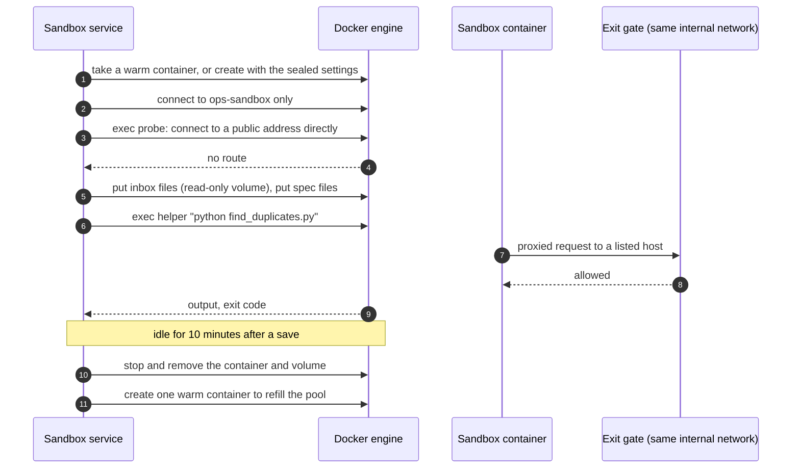
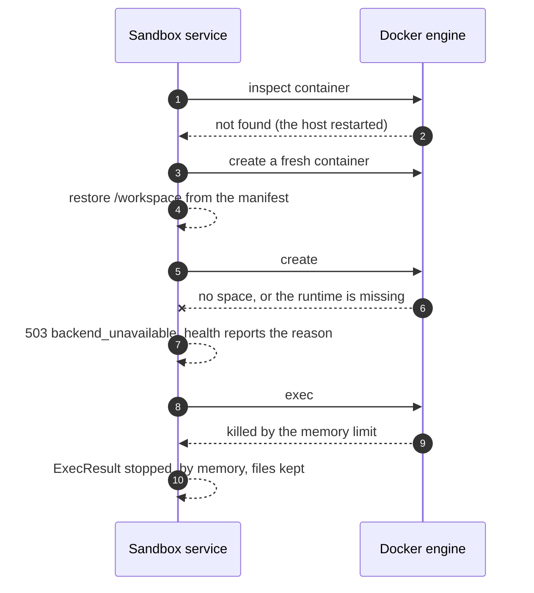

# Sandbox backend: Docker

Status: proposed design, written 2026-11-26. Nothing on this page is built. Release 1.5.0.

A small install runs everything with Docker Compose on one or a few hosts. This page says how the sandbox service runs
each conversation's sandbox as a container there: how the container is sealed, what it may reach, and what an install
without a stronger isolation layer is and is not suitable for. It is also the backend that continuous integration and a
developer's laptop use.

## Purpose

| Goal | Measure |
|---|---|
| A sandbox per conversation as a container the service creates, limits and removes | The shared acceptance suite in [sandbox service](sandbox-service.md) passes in CI |
| A container that cannot reach the host, other containers or the network | Rows 1 and 2 of that suite, and trial 8 |
| An honest statement of the wall's strength | The service reports its isolation level, and a shared install refuses to start on the weak one |

## What it owns and what it must not own

| Owns | Must not own |
|---|---|
| Creating, starting, stopping and removing sandbox containers through the Docker engine API | The host's other containers. It touches only containers it labelled |
| The sandbox network and the warm pool | File persistence. A container's disk is disposable; the service-level copy is the truth |
| Choosing the runtime: gVisor when the host has it, otherwise a locked-down container | Building images at run time. Images are built by the release and pulled |

## Interfaces

| Port method | On Docker |
|---|---|
| `create(box)` | Take a warm container if one matches the image and size, else create one. Labels: `ops.sandbox`, tenant, team, conversation. Return the container id |
| `wake(ref)` | Inspect the container. Missing or exited raises `BoxGone`; the service then creates a fresh one and restores the workspace |
| `exec(ref, run)` | An exec in the container running the in-box helper, as the unprivileged user, attached for streamed output |
| `read`, `write`, `remove` | Archive get and put on `/workspace`, with paths checked by the service before the call |
| `set_network(ref, gate_host)` | Attach the container to the internal sandbox network only. That network has no route out; the exit gate is the one other member |
| `stop(ref)` | Stop and remove the container and its workspace volume |
| `destroy(ref)` | The same, and remove any warm container reserved for it |
| `health()` | The engine's ping, and whether the configured runtime exists |

How every sandbox container is created:

| Setting | Value | Why |
|---|---|---|
| Runtime | `runsc` (gVisor) when `OPS_SANDBOX_DOCKER__RUNTIME=runsc`; the engine's default otherwise | A second kernel boundary |
| User | A fixed unprivileged user and group; never root | |
| Capabilities | All dropped | |
| New privileges | Disabled | |
| Root filesystem | Read-only; `/tmp` a size-limited memory filesystem | Nothing persists outside the workspace |
| `/workspace` | A volume per sandbox with the size's disk limit where the storage driver supports one; otherwise the helper's check | |
| `/workspace/inbox` | A second volume mounted read-only into the container; the service writes it through a short-lived helper container | A person's uploads cannot be deleted by a command |
| Memory, processor, process count | The size's limits, and no swap | |
| Network | The internal sandbox network only | |
| Environment | The proxy's address only. The gate token is set in each command's environment by the exec call, so a warm container holds none; the gate also checks the container's address on the internal network | |
| Devices, host mounts, the engine socket | None | |

```python
class DockerSettings(BaseModel):
    host: str = "unix:///var/run/docker.sock"   # OPS_SANDBOX_DOCKER__HOST; a dedicated sandbox host is recommended
    runtime: Literal["runsc", "default"] = "default"
    network: str = "ops-sandbox"
    image_prefix: str                  # the registry path of the sandbox images
    shared_install: bool = False       # OPS_SANDBOX_SHARED: true when more than one tenant is served

capabilities = BackendCapabilities(
    keeps_files_across_stop=False, native_idle_sleep=False,
    isolation="gvisor" or "container", max_cpu=<host>, max_memory_bytes=<host>,
)
```

## The two isolation levels

| Level | When | Suitable for | Enforced |
|---|---|---|---|
| gVisor | The host has the `runsc` runtime | Any install | Default for a shared install |
| Locked-down container | No gVisor | A single firm's own install, where every user of the sandbox belongs to that firm | With `shared_install` true and no gVisor the service refuses to start, naming the setting (CF3, CF5) |

gVisor is Apache-2.0 and its `runsc` runtime integrates with Docker, per its
[repository](https://github.com/google/gvisor) (read 2026-11-26). How a rootless engine and volume size limits behave
per storage driver was not read from a source for this page and is **unverified** until trial 8.

Anthropic's sandbox-runtime is a candidate inner wall for the second level: it limits files and network per command
with bubblewrap. It needs unprivileged user namespaces inside the container, which the locked-down settings above may
not allow. Trial 8 settles whether it is added.

## Data model

No table of its own. `sandboxes.backend_ref` holds the container id. The warm pool is in memory and rebuilt at start
from containers labelled `ops.sandbox.warm`.

| Item | Retention |
|---|---|
| Sandbox containers and volumes | Removed at sleep. A reconcile at start and hourly removes labelled containers and volumes with no row |
| Images | Kept per release; the previous release's are pruned by the deploy |

PostgreSQL and SQL Server: nothing backend-specific.

## Flows



Failure paths:



## Settings

| Setting | Default | Meaning |
|---|---|---|
| `OPS_SANDBOX_DOCKER__HOST` | `unix:///var/run/docker.sock` | The engine to drive |
| `OPS_SANDBOX_DOCKER__RUNTIME` | `default` | `runsc` to require gVisor; the service checks it exists at start |
| `OPS_SANDBOX_DOCKER__NETWORK` | `ops-sandbox` | Created as an internal network by the compose file |
| `OPS_SANDBOX_DOCKER__IMAGE_PREFIX` | none; required | |
| `OPS_SANDBOX_SHARED` | `false` | True refuses the locked-down level |

## Security, cost and limits

| Concern | Rule |
|---|---|
| The engine socket is root on its host | The sandbox service is the only holder. The recommended layout runs sandboxes on a dedicated host or a rootless engine, so a fault in the service cannot reach the rest of the install's containers. The compose file ships this as a separate profile |
| Container escape | gVisor where present. Without it, the level is stated as weaker and refused for a shared install |
| Reaching the host's metadata address or other containers | The internal network has no gateway; the probe at creation proves it |
| Disk filling the host | Volume size limits where supported; otherwise the helper's check after each command plus a per-install cap on running sandboxes |
| Cost | The host's capacity. The warm pool holds `OPS_SANDBOX_WARM_POOL` idle containers at their memory reservation, not their limit |

## Acceptance criteria

The shared suite, plus:

| # | Failure mode | Test proves |
|---|---|---|
| 1 | A sandbox container can reach the engine or the host | No socket or host path is mounted; a connection to the host's addresses fails |
| 2 | A shared install runs on the weak level | With `OPS_SANDBOX_SHARED=true` and the default runtime, the service exits at start naming the setting |
| 3 | A warm container is reused | After use, the container is removed and a new one created; the pool never hands out a container twice |
| 4 | Containers leak after a crash of the service | The reconcile removes labelled containers with no row |
| 5 | The inbox can be written from inside | A write to `/workspace/inbox` fails as read-only |

## Use cases per layer

The sandbox service's use cases run against this backend in CI and on a developer's stack.

## Files to add, change and delete

| Package | Add | Change |
|---|---|---|
| `services/sandbox-service` | `src/ops_sandbox/backends/docker.py`, `backends/warm_pool.py` | Settings |
| `deploy` | `images/sandbox/python-data/Dockerfile`, `images/sandbox/python-ops/Dockerfile`, `images/sandbox/opsbox` (the in-box helper), a compose profile `sandbox` with the internal network, the service and the gate | `deploy/compose/compose.yaml`, `deploy/compose/README.md` |
| `scripts` | `stack.sh` starts the sandbox service and the internal network on a developer's stack | |

## Open points

| # | Open point | Trial |
|---|---|---|
| 1 | Whether a rootless engine or a dedicated host is the default layout in the compose file. Trial 8 gates the Docker default in lane A | Trial 8, with the install guide's owner |
| 2 | Whether sandbox-runtime works inside the locked-down container and is worth its added moving parts | Trial 8 |
| 3 | The slowdown of file-heavy work under gVisor | Trial 8: a slow file-heavy job must finish within twice its normal time |
