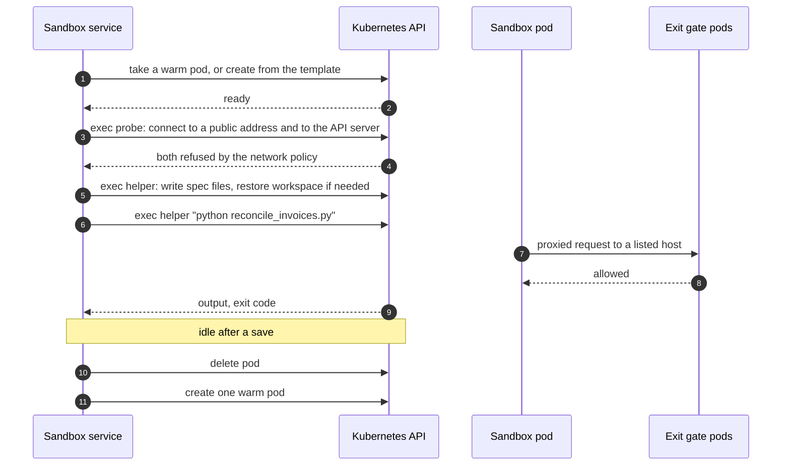
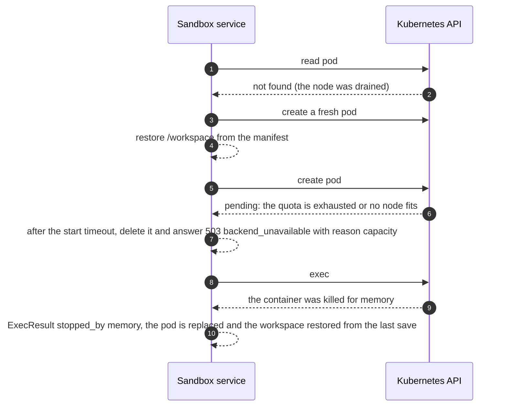

# Sandbox backend: Kubernetes

Status: proposed design, written 2026-11-26. Nothing on this page is built. Release 1.5.0.

An enterprise runs Ops AI in its own cloud on Kubernetes. This page says how the sandbox service runs each
conversation's sandbox as a pod there: which isolation layer seals it, which network rule limits it to the exit gate,
and which permissions the service itself needs. Nothing leaves the firm's cluster.

## Purpose

| Goal | Measure |
|---|---|
| A sandbox per conversation as a pod the service creates and deletes | The shared acceptance suite in [sandbox service](sandbox-service.md) passes on a test cluster |
| The isolation layer is a setting | The same manifests run with gVisor or with small virtual machines by changing one value |
| The service's own permissions are narrow | It can act only on pods in the sandbox namespace |

## What it owns and what it must not own

| Owns | Must not own |
|---|---|
| Pods, and the per-install network policy, in one dedicated namespace | Any other namespace. Its role is namespaced |
| The warm pool of ready pods | File persistence. A pod's disk is disposable; the service-level copy is the truth |
| Choosing the runtime class | Installing the runtime. A cluster admin installs gVisor or Kata Containers and names the class |

## Interfaces

| Port method | On Kubernetes |
|---|---|
| `create(box)` | Take a warm pod matching image and size, else create one from the template below. Label it with tenant, team and conversation. Wait until ready |
| `wake(ref)` | Read the pod. Missing or not running raises `BoxGone` |
| `exec(ref, run)` | The exec subresource over WebSocket, running the in-box helper |
| `read`, `write`, `remove` | Exec of the helper's file commands with streamed bytes; paths checked by the service first |
| `set_network(ref, gate_host)` | Nothing per pod. The namespace's policy already denies all egress except to the exit gate; the probe at creation proves it for this pod |
| `stop(ref)`, `destroy(ref)` | Delete the pod with a short grace period |
| `health()` | The API server is reachable, the runtime class exists, and the network policy is present |

The pod template, as the service fills it:

| Field | Value |
|---|---|
| `runtimeClassName` | `OPS_SANDBOX_K8S__RUNTIME_CLASS`: `gvisor` by default; `kata` where nodes support small virtual machines |
| `automountServiceAccountToken` | `false` |
| `securityContext` | Run as a fixed unprivileged user and group, `runAsNonRoot`, no privilege escalation, all capabilities dropped, read-only root filesystem, the default seccomp profile |
| Volumes | `workspace`: an `emptyDir` with the size's `sizeLimit`; `inbox`: an `emptyDir` filled by an init container and mounted read-only in the main container; `tmp`: a small memory-backed `emptyDir` |
| Resources | Requests and limits from the size, including `ephemeral-storage` |
| Environment | The proxy variables for the exit gate and the gate token, from the ensure call. No secret of ours is mounted |
| `enableServiceLinks`, host network, host paths | `false`, none, none |
| Node placement | An optional node selector and toleration, so sandboxes can run on their own node pool |
| `activeDeadlineSeconds` | A ceiling above the longest allowed life, so a forgotten pod ends |

Objects the install creates once (in `deploy/k8s`):

| Object | Purpose |
|---|---|
| Namespace `ops-sandboxes` | Holds only sandbox pods; labelled for the restricted pod security standard |
| `NetworkPolicy` default deny, ingress and egress | Nothing in or out |
| `NetworkPolicy` allow egress to the exit gate's pods on its port, and DNS only for the gate's name | The one way out |
| `ResourceQuota` and `LimitRange` | A cluster-level ceiling beside the service's own caps |
| `Role` and `RoleBinding` for the sandbox service's account | `pods`: create, get, list, watch, delete; `pods/exec`: create; in this namespace only |

```python
class KubernetesSettings(BaseModel):
    namespace: str = "ops-sandboxes"
    runtime_class: str = "gvisor"
    image_prefix: str
    node_selector: dict[str, str] = {}
    tolerations: list[dict[str, str]] = []
    in_cluster: bool = True            # false reads a kubeconfig path, for the proof script

capabilities = BackendCapabilities(
    keeps_files_across_stop=False, native_idle_sleep=False,
    isolation="gvisor" or "microvm", max_cpu=<quota>, max_memory_bytes=<quota>,
)
```

## Isolation layer

| Layer | Works on | Trade-off | Source |
|---|---|---|---|
| gVisor (default) | Ordinary cloud virtual machines, with no nested virtualisation | File-heavy work is slower (**unverified**; measured in trial 8) | Apache-2.0, and its `runsc` runtime integrates with Docker and Kubernetes, per its [repository](https://github.com/google/gvisor) (read 2026-11-26) |
| Kata Containers | Nodes with nested virtualisation or bare metal | A virtual machine per pod. More memory per sandbox and a slower start are expected (**unverified**; measured in trial 8) | Apache-2.0, described as lightweight virtual machines that feel like containers, per its [repository](https://github.com/kata-containers/kata-containers) (read 2026-11-26) |

Which managed clusters allow each runtime class, and the exact fields of the restricted pod security standard, were
not read from a source for this page and are **unverified** until trial 8.

An install with neither runs no sandbox on Kubernetes: the service refuses to start when the runtime class is missing.
There is no locked-down-container level here, because a Kubernetes install is assumed to be able to add a runtime class.

## Data model

No table of its own. `sandboxes.backend_ref` holds the pod name. The warm pool is the set of pods labelled
`ops.sandbox/warm=true`.

| Item | Retention |
|---|---|
| Sandbox pods | Deleted at sleep. A reconcile at start and hourly deletes labelled pods with no row |

PostgreSQL and SQL Server: nothing backend-specific.

## Flows



Failure paths:



## Settings

| Setting | Default | Meaning |
|---|---|---|
| `OPS_SANDBOX_K8S__NAMESPACE` | `ops-sandboxes` | |
| `OPS_SANDBOX_K8S__RUNTIME_CLASS` | `gvisor` | Checked at start |
| `OPS_SANDBOX_K8S__IMAGE_PREFIX` | none; required | |
| `OPS_SANDBOX_K8S__NODE_SELECTOR`, `__TOLERATIONS` | empty | A separate node pool for sandboxes |
| `OPS_SANDBOX_K8S__START_TIMEOUT_SECONDS` | `60` | How long a new pod may take to be ready |

## Security, cost and limits

| Concern | Rule |
|---|---|
| A pod reaching the API server or other namespaces | No service account token is mounted, and the default-deny policy blocks the API server's address; the probe checks both |
| A cluster whose network plugin does not enforce policies | The probe at creation fails and no command runs. `health()` reports it so the install guide's check catches it before use |
| The service's role | Namespaced, with no access to secrets, config maps or nodes |
| A memory kill loses the pod's disk | The workspace returns to the last saved copy. The result says which files were lost so the agent can redo the step |
| Cost | Pods run only while a conversation is active. Kata adds memory overhead per pod; the size table is the request, and the overhead is the cluster's |

## Acceptance criteria

The shared suite, plus:

| # | Failure mode | Test proves |
|---|---|---|
| 1 | A pod can call the Kubernetes API | No token is mounted and a request to the API server's address is refused |
| 2 | The cluster does not enforce network policy | The probe fails and the sandbox is `failed` with code `network_not_sealed` |
| 3 | The service can act outside its namespace | Its role cannot list pods in another namespace |
| 4 | A pod outlives its conversation | The reconcile deletes it; `activeDeadlineSeconds` ends it even if the service is down |
| 5 | The runtime class is missing | The service exits at start naming the setting |

## Use cases per layer

The sandbox service's use cases run against this backend in the Kubernetes proof (`deploy/k8s/proof.sh`).

## Files to add, change and delete

| Package | Add | Change |
|---|---|---|
| `services/sandbox-service` | `src/ops_sandbox/backends/kubernetes.py`, tests against a fake API server | Settings |
| `deploy/k8s` | `base/sandbox/` (namespace, policies, quota, role, the service and the gate), an overlay value for the runtime class | `deploy/k8s/generate.py`, `deploy/k8s/proof.sh`, `deploy/k8s/README.md` |

## Open points

| # | Open point | Trial |
|---|---|---|
| 1 | gVisor or Kata as the documented default for Azure and for on-premises clusters | Trial 8 |
| 2 | Whether the workspace should be a persistent volume so a memory kill keeps files | After trial 10; the service-level copy already bounds the loss to one turn |
| 3 | Whether the Kubernetes project's own sandbox resource is mature enough to replace the hand-written pod template | A review of that project's status and licence in trial 0 (**unverified** today) |
