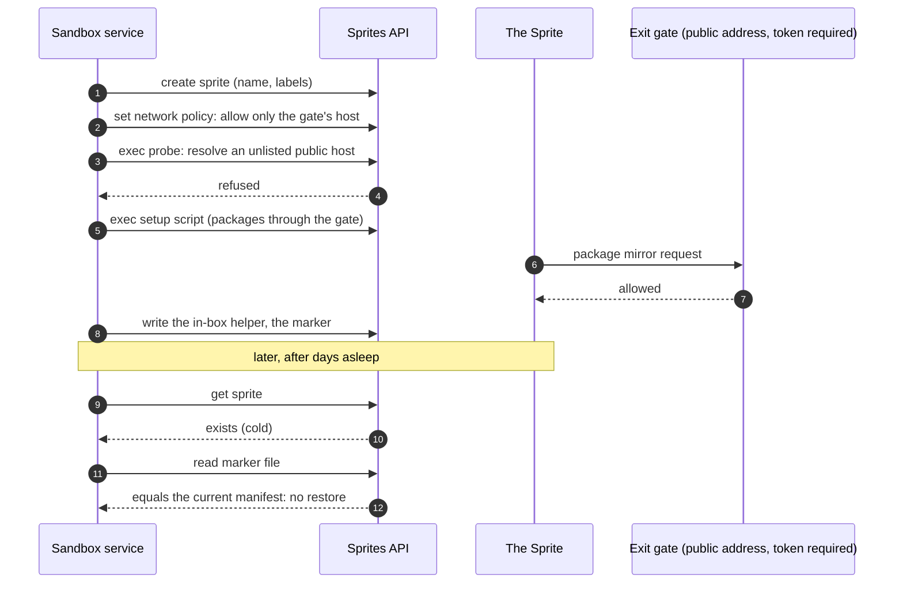
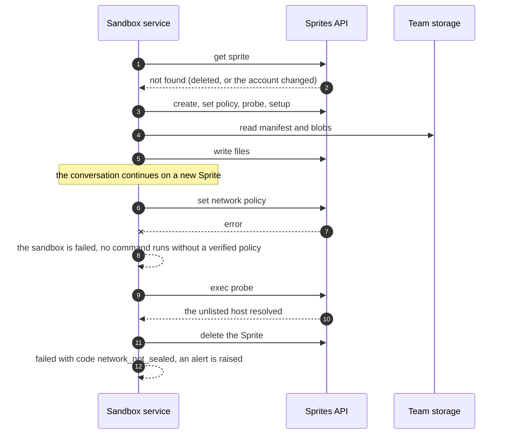

# Sandbox backend: Fly Sprites

Status: proposed design, written 2026-11-26. Nothing on this page is built. Release 1.5.0. Facts about Sprites are from
its public documentation read on 2026-11-26; anything not on a page read is marked unverified and has a trial.

Our hosted service runs each conversation's sandbox on a Fly Sprite: a small virtual machine with its own disk that
sleeps when idle and wakes in about a second. This page says how the sandbox service drives one, what Sprites gives us
for free, and where its defaults are the opposite of what we need. The owner decided on Sprites for hosted tenants; an
earlier design page ruled hosted sandboxes out, and this decision replaces that line.

## Purpose

| Goal | Measure |
|---|---|
| One Sprite per conversation, used only through the sandbox service | The backend passes the shared acceptance suite in [sandbox service](sandbox-service.md) |
| No network except our exit gate | Trial 5, part a |
| Files restored after a long sleep, and after the Sprite is gone | Trial 5, part b, and trial 10, step 3 |

## What it owns and what it must not own

| Owns | Must not own |
|---|---|
| Calls to the Sprites API: create, exec, files, network policy, delete | The canonical copy of files. That is the service-level copy in the team's storage |
| Mapping our sizes and limits onto a Sprite | Credentials for other systems. Sprites has its own credential gateway, called connectors; it is not used, because credentials are added at our exit gate |
| Naming and labelling Sprites so one can be traced to a tenant and conversation | Any Sprite of the development boxes this repository already runs (`docs/architecture/cloud-boxes.md`) |

## What Sprites provides

| Fact | Source | Effect on the design |
|---|---|---|
| Each Sprite is a hardware-isolated, dedicated virtual machine with a persistent ext4 disk backed by object storage and synced continuously | [overview](https://docs.fly.io/sprites), [lifecycle](https://docs.fly.io/sprites/concepts/lifecycle.md) | The strongest wall of the three backends. The disk is the fast path for files |
| It goes warm about 30 seconds after it becomes idle, with memory frozen, and later cold, with memory dropped. The state cannot be chosen | lifecycle page | `capabilities.native_idle_sleep` is true. Our idle timer only marks the row `asleep`; there is nothing to stop |
| Warm wake takes about 100 to 500 ms; cold wake about 1 to 2 s. Files survive both; processes survive warm only | lifecycle page | No warm pool. The agent is told after a wake that programs do not survive |
| 8 virtual CPUs fixed, memory managed by the platform, 100 GB of disk | lifecycle page | Our smaller sizes must be enforced inside the Sprite; see Limits |
| Outbound network is unrestricted by default. A policy is a list of allow and deny rules by domain, set from outside through the API and read-only inside. An empty rule list means unrestricted. Under a policy, connections to raw addresses are blocked unless the address came from an allowed domain, and private addresses are always blocked | [networking](https://docs.fly.io/sprites/concepts/networking.md) | The default is the opposite of ours. A policy allowing only the exit gate's host is set at creation and checked by a probe before any command |
| A checkpoint captures the filesystem only; whether one can be restored into another Sprite is not stated | [checkpoints](https://docs.fly.io/sprites/concepts/checkpoints.md) | Checkpoints are not the save mechanism. They are used only as a rollback point before a risky command, if at all |
| An HTTP API covers Sprites, exec, exec over WebSocket, filesystem, network policy, resources policy and services | [documentation index](https://docs.fly.io/llms.txt), [OpenAPI document](https://docs.fly.io/sprites/api/openapi.json) | The backend uses the HTTP API with one organisation token. Paths and bodies are **unverified** until the OpenAPI document is read in trial 5 |
| A TCP port, including SSH, is reachable through the command-line proxy or a WebSocket proxy | networking page | Relevant to trial 6 only |

## Interfaces

The backend implements `SandboxBackend` from the sandbox service page. Its mapping:

| Port method | On Sprites |
|---|---|
| `create(box)` | Create a Sprite named `ops-<environment>-<hash of tenant and conversation>` with labels for tenant, team and conversation. Set the network policy. Run the image's setup step. Write the in-box helper. Return its name as `BoxRef` |
| `wake(ref)` | Get the Sprite. Missing raises `BoxGone`. Read the network policy back and compare; a mismatch sets it again and fails the wake if it cannot be set |
| `exec(ref, run)` | The exec endpoint over WebSocket, running the in-box helper with the command, limits and the proxy environment. Output frames become `ExecChunk`; the helper's last line becomes `ExecResult` |
| `read`, `write`, `remove` | The filesystem endpoints, streamed |
| `set_network(ref, gate_host)` | Set the policy to exactly `{"rules": [{"domain": "<gate host>", "action": "allow"}]}`, then run the probe: resolving a public host that is not the gate must be refused |
| `stop(ref)` | No call. The platform sleeps it |
| `destroy(ref)` | Delete the Sprite |
| `health()` | One cheap API read with a timeout |

```python
class SpritesSettings(BaseModel):
    api_url: str                       # OPS_SANDBOX_SPRITES__API_URL
    token: SecretStr                   # OPS_SANDBOX_SPRITES__TOKEN, from the secret store
    organisation: str
    name_prefix: str = "ops"
    setup_timeout_seconds: int = 180

capabilities = BackendCapabilities(
    keeps_files_across_stop=True, native_idle_sleep=True, isolation="microvm",
    max_cpu=8, max_memory_bytes=None,
)
```

### Images

A Sprite does not start from a container image of ours. An image name maps to a setup script
(`deploy/images/sandbox/<image>/sprite-setup.sh`) that installs the same package set the Docker image has, from the
tenant-independent package mirror, through the exit gate. Setup runs once per Sprite and its end is recorded in the
Sprite's disk as a marker with the image's version. How long setup takes, and whether a prepared Sprite can be cloned
to skip it, is trial 5, part d.

### Limits

| Our limit | How it is held on a Sprite | Status |
|---|---|---|
| Command time | The in-box helper stops the command | Ours |
| Memory and processor per size | The helper runs each command in a control group with the size's limits. Whether a Sprite's user may create one, and whether the resources policy endpoint can do it from outside, are **unverified** | Trial 5, part c |
| Disk | The helper refuses a save when `/workspace` exceeds the size's disk limit and reports usage after every command | Ours; a soft limit between commands |
| Idle | The platform's own idle sleep | Platform |

## Data model

No table of its own. `sandboxes.backend_ref` holds the Sprite's name. Labels on the Sprite repeat tenant, team and
conversation ids so an operator can match a Sprite to a row; they hold no personal data.

| Item | Retention |
|---|---|
| The Sprite and its disk | Deleted when the conversation is deleted. A weekly reconcile lists Sprites by name prefix and deletes any with no row |
| The service-level copy | As on every backend |

PostgreSQL and SQL Server: nothing backend-specific.

## Flows



Failure paths:



## Settings

| Setting | Default | Meaning |
|---|---|---|
| `OPS_SANDBOX_SPRITES__API_URL` | none; required when the backend is `sprites` | The API's address (CF3: missing stops the service at start) |
| `OPS_SANDBOX_SPRITES__TOKEN` | none; required | An organisation token, from the secret store |
| `OPS_SANDBOX_SPRITES__ORGANISATION` | none; required | |
| `OPS_SANDBOX_SPRITES__NAME_PREFIX` | `ops` | |
| `OPS_SANDBOX_SPRITES__SETUP_TIMEOUT_SECONDS` | `180` | |

## Security, cost and limits

| Concern | Rule |
|---|---|
| The exit gate must be reachable from a Sprite | Private addresses are always blocked under a policy, so the gate listens on a public address. It answers only requests carrying a valid gate token, and the token is bound to one sandbox |
| A tool that ignores the proxy settings | It cannot resolve any host but the gate's, so it fails. Nothing leaves |
| The allow-list is by domain name | Whether a connection to the gate's host name can be turned toward another address is covered by the probe in trial 5; the gate's own token check is the second wall |
| The organisation token | Held only by the sandbox service. It can create and delete Sprites, so the service's own access is limited to that token's organisation, which holds nothing else |
| Data location | A Sprite's disk is in the provider's storage. Hosted tenants accept that; an enterprise install uses Docker or Kubernetes in its own cloud |
| Cost | Compute while active; storage for bytes written. A paused conversation costs its bytes in the Sprite and in our copy. The reconcile deletes orphans |
| Sprite's own credential gateway | Off. No connector is created |

## Acceptance criteria

The shared suite, plus:

| # | Failure mode | Test proves |
|---|---|---|
| 1 | A Sprite is created and a command runs before the policy is set | No exec other than the probe is sent until the probe has been refused |
| 2 | The policy is lost across a sleep | After a cold wake the policy read back equals the one set; when it differs the wake fails |
| 3 | A Sprite outlives its conversation | The reconcile deletes a Sprite with no row |
| 4 | Our smaller size is not enforced | A command allocating 3 GB in a `standard` sandbox is stopped |
| 5 | The development boxes are touched | The backend lists and deletes only names with its own prefix and environment |

## Use cases per layer

The use cases are the sandbox service's. They run against this backend in the hosted staging environment only, because
they need a provider account; CI runs them against Docker.

## Files to add, change and delete

| Package | Add | Change |
|---|---|---|
| `services/sandbox-service` | `src/ops_sandbox/backends/sprites.py`, `backends/sprites_api.py` (a typed client for the endpoints used), tests on a recorded fake of the API | Settings |
| `deploy` | `images/sandbox/<image>/sprite-setup.sh`, the hosted environment's secrets entry | `deploy/fly` adds the sandbox service process and the gate's public listener |

## Open points

| # | Open point | Trial |
|---|---|---|
| 1 | Whether an allow-only rule list denies everything else, and whether the policy survives sleep | Trial 5, parts a and b |
| 2 | How to hold memory and processor per size | Trial 5, part c |
| 3 | Setup time for an image, and whether a prepared Sprite or a checkpoint can seed a new one | Trial 5, part d |
| 4 | Whether Strands' SSH sandbox can drive a Sprite, and whether that is worth using | Trial 6 |
| 5 | The provider's terms for running tenants' code, and regions | Owner, with the provider |
