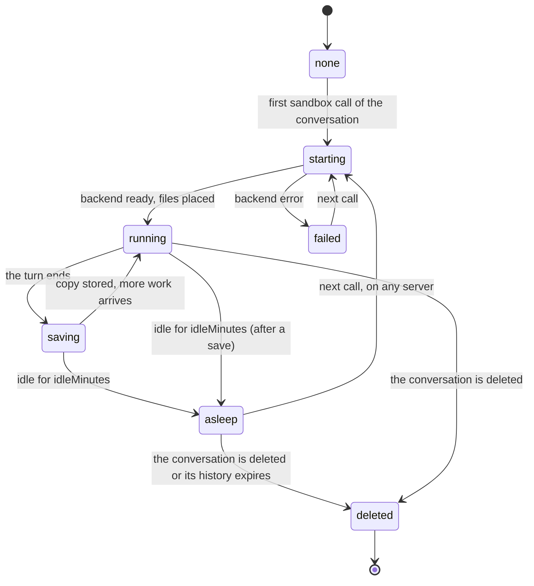
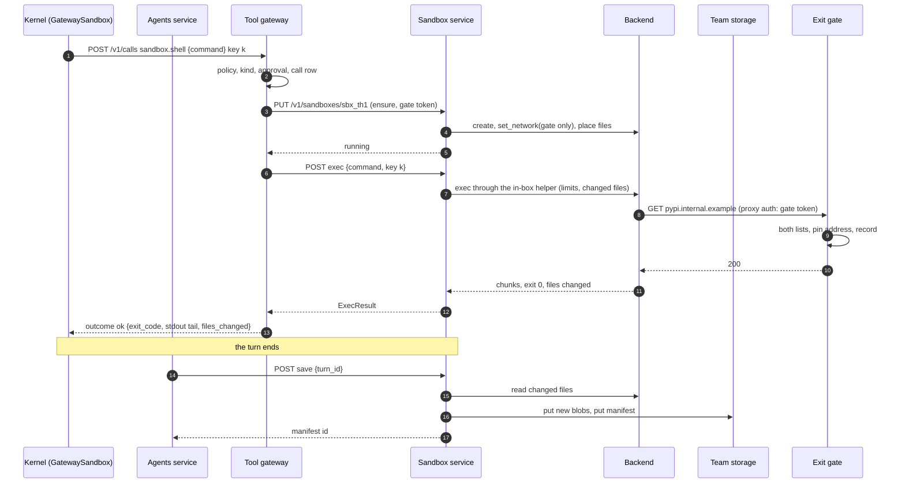
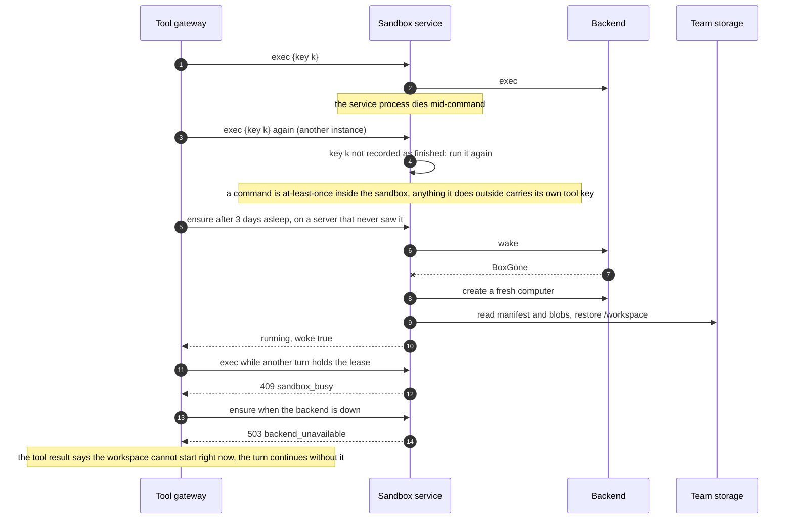

# Sandbox service

Status: proposed design, written 2026-11-26. Nothing on this page is built. Release 1.5.0.

A sandbox is a sealed computer that belongs to one conversation. Inside it an agent runs commands, runs Python and
keeps files, which is how it cleans a spreadsheet, compares two exports or reads a log. It sees no other customer, no
other conversation, no network and no password unless a builder allowed it. This page specifies the service that
starts, wakes, saves and stops those computers, the gate every outgoing request passes, and how the agent's loop reaches
a sandbox without ever holding a connection to it. Each place a sandbox can run has its own page:
[Fly Sprites](sandbox-backend-sprites.md), [Docker](sandbox-backend-docker.md) and
[Kubernetes](sandbox-backend-kubernetes.md).

## Purpose

| Goal | Measure |
|---|---|
| One sandbox per conversation, started on first use | A conversation that never runs code creates no sandbox row and no computer |
| Files live as long as the conversation and follow it to any server | After a pause and a restart of every process, the next command sees the same files; the crash test passes on all three backends |
| No network by default; two lists must allow a host | A request to an unlisted host is refused and recorded; trial 5 proves it on Sprites |
| Secrets never enter the sandbox | A script calls a system with a placeholder; the real value appears nowhere inside, in the model's input or in logs |
| Every command is a logged tool call | The run trace lists commands and network requests in order with the agent's other calls |
| Backends are swappable | The same acceptance suite runs against Sprites, Docker and Kubernetes |

## What it owns and what it must not own

| Owns | Must not own |
|---|---|
| The life of a sandbox: create, wake, sleep, delete; its state row; its lease | Deciding whether a command may run. The tool gateway decides and holds approvals |
| The workspace copy in the team's storage: save after a turn, restore on wake | The audit list. Commands and requests are rows in the tool gateway's call log |
| Limits: size, command time, idle time, disk | The exit gate. It is a listener of the tool gateway, which already owns the host list and the secrets |
| The backend port and its three implementations | Any public route. It answers service tokens only; people reach files through the agents service |
| One-shot runs of a builder's short function (today's function runner) | Tool grants for a function: the call token names them, as today |

It replaces the function runner service. That service's routes, port and deploy entries are removed at the end of
1.5.0, once its functions pass the same tests here.

## How the agent's loop reaches a sandbox

The owner decision is that the sandbox sits behind Strands' sandbox interface. That interface has six operations:
run a command, run code, read, write, remove and list files
([sandbox](https://strandsagents.com/docs/user-guide/sdk/sandbox/)). Strands states that the default, with no sandbox
object, runs commands on the host and is for trusted local development only, so no shell, file or Python tool is
registered unless the spec has a sandbox.

| Layer | What it is | Where |
|---|---|---|
| Strands tools | `sandbox_shell`, `sandbox_file_editor` and `python_repl`, bound to a sandbox object. Each is wrapped as a kernel `LoopTool`, so the kernel's seams and tool events apply | The Strands adapter in the kernel |
| `GatewaySandbox` | Our implementation of Strands' six operations. Each operation is one call to `ToolExecutor.execute("sandbox.<op>", ...)` with an idempotency key. It holds no address and no credential | The Strands adapter in the kernel |
| Tool gateway | Decides the call, holds it for approval when its kind needs one, logs it, then calls the sandbox service | Module `sandbox` |
| Sandbox service | Finds or wakes the conversation's sandbox and runs the operation on its backend | This page |
| Backend | Sprites, Docker or Kubernetes | The three backend pages |

The agent's process never talks to a sandbox directly. This keeps the five protections where they already are.

## Parts evaluated for inside and around the box

| Part | Licence and status, with source | Verdict |
|---|---|---|
| Strands sandbox interface and its shell, file editor and Python tools | The Python SDK repository states Apache-2.0 ([repository](https://github.com/strands-agents/sdk-python), read 2026-11-26). Whether the three tools ship in the same package is **unverified** | Adopted, as the plug the owner decided on |
| Strands SSH sandbox | Same repository. It spawns a new `ssh` process per command, needs key authentication, and its option allow-list blocks `ProxyCommand` unless an unsafe flag is set ([available sandboxes](https://strandsagents.com/docs/user-guide/sdk/sandbox/available-sandboxes/)) | Not in the request path: it would put a key in the agent's process and skip the gateway. Trial 6 checks whether it is useful inside the Sprites backend |
| Strands Docker sandbox | Runs `docker exec` into a container someone else started (same page) | Not used directly; our Docker backend owns creation, limits and removal, which that class does not |
| OpenHands agent server | The OpenHands repository states MIT and says the agent server lives in a separate SDK repository ([repository](https://github.com/OpenHands/OpenHands), read 2026-11-26). That second repository's licence is **unverified** | Not adopted in 1.5.0. It is a second agent-facing API inside the box; our six operations already cover what the Strands tools need. Re-evaluated if a coding agent is added later |
| Anthropic sandbox-runtime | Apache-2.0, described by its authors as a beta research preview; restricts files and network per process with bubblewrap on Linux ([repository](https://github.com/anthropics/sandbox-runtime), read 2026-11-26) | Candidate second wall inside the plain Docker mode, where no gVisor exists. Trial 8 decides. Not relied on as the only wall |
| A small tool-server process inside the box | Ours | Adopted as a thin client: the `ops` library in each image calls the tool gateway's code-run route with the box's token, as functions do today. A tool-server wrapper over it is added when an in-box agent needs one |
| Community forks under AGPL | One archived sandbox product has an AGPL-3.0 community fork | Ruled out: no AGPL code |

Licences marked unverified are checked in trial 0 before a dependency is added (SC4).

## The life of a sandbox



| Moment | What happens | Guarantee |
|---|---|---|
| First call | A row is inserted with a unique key on tenant and conversation; the backend creates a computer; network is set to deny all but the exit gate before any command runs; spec files and attached files are placed | Two servers racing create one sandbox |
| Every call | The caller takes the sandbox's lease (one writer), runs the operation, releases | Two turns never write one workspace at once |
| End of a turn | The agents service calls `save`. Changed files are copied to the team's storage and a new manifest becomes current | The copy, not the computer, is the truth |
| Idle | After `idleMinutes` with no call and a current save, the computer is stopped or left to sleep | A wait of days costs storage only |
| Wake | If the backend still has the files and its marker equals the current manifest, nothing is copied. Otherwise the workspace is restored from the manifest | Resume works on another server and another backend |
| Crash in a turn | The repeated turn starts from the last saved manifest. Commands that ran after it are run again by the agent; changes outside the sandbox are not repeated because every tool call carries its key | Nothing outside is done twice |
| Delete | The computer is destroyed, the manifest and blobs are deleted, the row is removed | Files live exactly as long as the conversation |

Two things do not survive a sleep: programs still running, and anything written outside the workspace folder. The first
tool result after a wake says so in one line, so the agent re-runs what it needs.

## Files

Decision: the copy in the team's storage is the canonical state on every backend. A backend's own persistence, such as
a Sprite's disk, is a fast path that skips the restore when it matches.

| Reason | Detail |
|---|---|
| Resume on another server must work on all three backends | Docker and Kubernetes computers are disposable; only a copy outside them survives |
| One retention and deletion rule | Storage keys sit under the tenant's and team's prefix, with the tenant's key, as other files do |
| A tenant can move between backends | The manifest is backend-neutral |

| Item | Design |
|---|---|
| Workspace folder | `/workspace`. `/workspace/inbox` holds files a person attached and files mounted from the team's Files; it is read-only to the agent |
| Manifest | One JSON object per save: `[{path, sha256, size, mode, origin: "person"\|"agent"\|"builder", by, at}]`, stored compressed as one object |
| Blobs | Content-addressed by SHA-256 under `tenants/<tenant>/teams/<team>/sandboxes/<sandbox>/blobs/`. A save uploads only blobs it has not stored |
| What a save reads | The in-box helper lists files changed since the last save marker with size and hash; the service streams those files out through the backend |
| In, from a person | An attachment in chat is scanned by the Files service as any upload, then written to `inbox/` |
| In, from the builder | `sandbox.files` in the spec: each `fileId` is read from Files and written at `path` when a workspace is created |
| Out, to chat | The agent calls `sandbox.present_file(path)`; the reply shows a file card |
| Out, to Files or a knowledge base | `sandbox.save_file`, a write, so it waits for approval. A person can do the same from the Files panel without the agent |
| Limits | Disk per size; one file at most `OPS_SANDBOX_MAX_FILE_BYTES`; at most `OPS_SANDBOX_MAX_FILES` files per workspace |

## Network and secrets

A sandbox's only way out is the exit gate, a forward proxy the tool gateway runs. The backend's own network rules allow
the gate's address and nothing else.

| Rule | Detail |
|---|---|
| Two lists | A host must be on the tenant's egress list and in the agent's `sandbox.network.allow`. The agent's list can only narrow the tenant's |
| Pinned address | The gate resolves the host once and connects to that address, as tool calls do today (`services/tools-service/src/ops_tools/egress.py:231`) |
| Identity | Each sandbox gets a short-lived gate token, minted by the tool gateway's signer (`services/tools-service/src/ops_tools/code_runs.py:61`) and sent as proxy authorization. It names tenant, team, conversation, agent version and the allowed hosts and secrets |
| Two ways a host is handled | `tunnel`: the gate allows or refuses the connection by host and sees no content. `inspect`: the gate ends the encrypted connection with a certificate the image trusts, so it can add secrets, read the method and scrub answers |
| When `inspect` is used | For a host a secret is tied to, and for every host when `approve` lists `network_write` or `install_packages` |
| Secrets | A script writes a placeholder such as `$claims_api_token`. On an `inspect` host the secret is tied to, the gate replaces the placeholder in headers and query values, and scrubs the value from the answer. Elsewhere the placeholder is sent as written |
| Every request is recorded | One call-log row per request: host, method, path, status, bytes, allowed or refused, and which rule decided |
| A refusal | The request fails fast with a body naming the host and who can allow it; the tool result repeats it for the agent |

## Approvals for risky actions

Decision: approvals are enforced at points the sandbox cannot avoid, not by reading command text. A shell command can
delete a file or install a package in more ways than a text rule can list, so a rule on text would look safe and not be.
This departs from the design page, which tied an approval to the command's exact text.

| Kind in `sandbox.approve` | Enforced where | What the approver sees |
|---|---|---|
| `delete_files` | The `sandbox.remove_file` tool and the Files panel's delete. Files a person uploaded sit in the read-only inbox, so no command can remove them | The file's name, who made it and its size |
| `install_packages` | The exit gate: a host the tenant tagged as a package source is reachable only under an approved grant | The host and the package names the request carried |
| `network_write` | The exit gate: a request that is not a read (`GET`, `HEAD`, `OPTIONS`) needs an approved grant | Host, method and path prefix |
| `save_files` | The `sandbox.save_file` tool, a write at the tool gateway | The file and where it goes |

A grant is asked for with the tool `sandbox.request_access {kind, host, method?, pathPrefix?, why}`. It is a write, so it
pauses the turn like any other approval; the person who asked cannot approve it. An approved grant is a row the gate
honours for that sandbox until the turn ends plus `OPS_TOOLS_SANDBOX_GRANT_MINUTES`. Deleting an agent-made file with a
shell command is not held: nothing outside the sandbox changes, and the last saved copy still has the file.

## Limits

| Limit | `small` | `standard` | `large` | When hit | What the person sees |
|---|---|---|---|---|---|
| Processor | 0.5 CPU | 1 CPU | 2 CPU | Work slows | The reply takes longer; the trace marks the command as held back |
| Memory | 1 GB | 2 GB | 4 GB | The command is stopped; files kept | "The script ran out of memory (2 GB). Ask the agent to work on a smaller part, or ask a builder for a larger size." |
| One command | 2 min | 5 min | 15 min | The command is stopped; files kept | "The script was stopped after 5 minutes." |
| Disk | 1 GB | 5 GB | 20 GB | The write fails | "The workspace is full (5 GB). Delete files you no longer need in the Files panel." |
| Idle | 10 min | 10 min | 10 min | The computer stops; files kept | Nothing |
| Output returned to the model | 200 lines or 20,000 characters | same | same | The rest is written to a file in the workspace and named in the result | A link to the full output in the trace |

Each value is the lower of the spec's and the install's cap, as the function runner holds limits today
(`services/runner-service/src/ops_runner/app.py:98`). The agent also gets the reason as the tool's result.

## Interfaces

All routes take a service token and the headers naming tenant and team. Only the tool gateway and the agents service
call them.

| Method | Path | Caller | Purpose |
|---|---|---|---|
| PUT | `/v1/sandboxes/{sandbox_id}` | Tool gateway | Ensure: create or wake. Body `EnsureIn`. Idempotent on the id |
| GET | `/v1/sandboxes/{sandbox_id}` | Agents service | State, size, limits, usage |
| POST | `/v1/sandboxes/{sandbox_id}/exec` | Tool gateway | Run one command. Streams newline-delimited JSON |
| POST | `/v1/sandboxes/{sandbox_id}/code` | Tool gateway | Run code in an interpreter |
| GET | `/v1/sandboxes/{sandbox_id}/files` | Both | List, paged, from the current manifest when asleep |
| GET, PUT, DELETE | `/v1/sandboxes/{sandbox_id}/files/{path}` | Both | Read, write, remove one file |
| POST | `/v1/sandboxes/{sandbox_id}/save` | Agents service | Copy changes to storage; returns the manifest id. Idempotent on `turn_id` |
| POST | `/v1/sandboxes/{sandbox_id}/sleep` | Agents service | Stop the computer now, after a save |
| DELETE | `/v1/sandboxes/{sandbox_id}` | Agents service | Delete the computer, the copies and the row |
| POST | `/v1/function-runs` | Tool gateway | One short function, no workspace; the function runner's request and response shapes, unchanged |
| GET | `/v1/sandbox/images` | Agents service | The images and sizes this install offers |
| GET | `/health`, `/ready`, `/health/background` | Platform | As every service |

`sandbox_id` is `sbx_` followed by the conversation id, so every caller derives it and none needs a lookup.

```python
class EnsureIn(In):                    # extra="forbid"
    thread_id: str
    agent_id: str
    agent_version: int
    image: str
    size: Literal["small", "standard", "large"] = "standard"
    limits: SandboxLimits              # command_seconds, idle_seconds
    network: NetworkIn                 # allow: list[str]; gate_url: str; gate_token: str
    files: list[PlacedFile] = []       # {path, file_id}
    test: bool = False                 # a test conversation: its files are deleted by the test sweep

class SandboxOut(Out):
    id: str
    state: Literal["starting", "running", "saving", "asleep", "failed"]
    backend: Literal["sprites", "docker", "kubernetes"]
    image: str
    size: str
    limits: SandboxLimits
    file_count: int
    disk_bytes: int
    manifest_id: str | None
    last_active_at: datetime
    woke: bool                         # true when this ensure started a fresh computer

class ExecIn(In):
    command: str = Field(min_length=1, max_length=32000)
    cwd: str = "/workspace"
    env: dict[str, str] = {}           # at most 50 names; names starting OPS_ are refused
    timeout_seconds: float | None = None
    call_id: str                       # the tool gateway's call id, for the trace
    key: str                           # idempotency key

class ExecChunk(Out):                  # one JSON line
    stream: Literal["stdout", "stderr"]
    data: str

class ExecResult(Out):                 # the last JSON line
    exit_code: int
    duration_ms: int
    files_changed: list[str]           # at most 200 paths, then a count
    stopped_by: Literal["time", "memory", "disk", "cancel"] | None
    cpu_throttled_ms: int
    peak_memory_bytes: int
    output_file: str | None            # set when output was cut
    replayed: bool                     # true when `key` was already run in this computer's life
```

The backend port every backend implements:

```python
class SandboxBackend(Protocol):
    name: str
    capabilities: BackendCapabilities   # keeps_files_across_stop, native_idle_sleep, isolation, max_cpu, max_memory_bytes

    async def create(self, box: BoxSpec) -> BoxRef: ...
    async def wake(self, ref: BoxRef) -> BoxRef: ...           # raises BoxGone when the computer no longer exists
    def exec(self, ref: BoxRef, run: ExecSpec) -> AsyncIterator[ExecChunk | ExecResult]: ...
    def read(self, ref: BoxRef, path: str) -> AsyncIterator[bytes]: ...
    async def write(self, ref: BoxRef, path: str, chunks: AsyncIterable[bytes], *, mode: int) -> None: ...
    async def remove(self, ref: BoxRef, path: str) -> None: ...
    async def set_network(self, ref: BoxRef, gate_host: str) -> None: ...   # deny all but the gate; verified by a probe
    async def stop(self, ref: BoxRef) -> None: ...             # the computer stops; files may be lost
    async def destroy(self, ref: BoxRef) -> None: ...
    async def health(self) -> BackendHealth: ...
```

Errors, each an `ApiError` subclass with a stable code:

| Status | `code` | When |
|---|---|---|
| 409 | `sandbox_busy` | Another call holds the lease; `details.retryAfterMs` |
| 409 | `sandbox_not_saved` | `sleep` before a current save |
| 413 | `file_too_large`, `workspace_full` | A write over the limits |
| 422 | `path_outside_workspace` | A path that leaves `/workspace` after normalising, or writes under `inbox/` |
| 503 | `backend_unavailable` | The backend cannot create or wake; retryable |
| 422 | `image_unknown` | The image is not offered by this install |

### Events

| Event (outbox) | When | Payload |
|---|---|---|
| `sandbox.state_changed` | Each state change | `{sandboxId, threadId, tenantId, teamId, from, to, at}` |
| `sandbox.limit_hit` | A command is stopped by a limit | `{sandboxId, threadId, limit, value, callId}` |

The agents service turns `sandbox.limit_hit` into the chat alert and reads `state_changed` for the conversation's Files
button.

## Data model

One migration chain for the service, version table `alembic_version_sandbox`.

### `sandboxes`

| Column | Type | Notes |
|---|---|---|
| `id` | string(80), primary key | `sbx_<thread id>` |
| `tenant_id`, `team_id` | string(64), not null | Tenant scoped and team owned; unique `(tenant_id, thread_id)` |
| `thread_id` | string(64), not null | |
| `agent_id`, `agent_version` | string(64), int | |
| `backend`, `backend_ref` | string(16), string(200) | The backend's own id for the computer; null when none exists |
| `state` | string(12), indexed | |
| `image`, `size` | string(63), string(12) | |
| `limits`, `network` | JSON | As asked at the last ensure. `network` holds host names, never a token |
| `manifest_id` | string(64), null | The current saved manifest |
| `saved_marker` | string(64), null | The marker written in the computer at the last save |
| `file_count`, `disk_bytes` | int, bigint | From the last save |
| `lease_owner`, `lease_until` | string(64), timestamp | One writer |
| `test` | boolean | |
| `last_active_at`, `created_at`, `updated_at` | timestamp with time zone; `last_active_at` indexed | |

### `sandbox_manifests`

| Column | Type | Notes |
|---|---|---|
| `id` | string(64), primary key | |
| `sandbox_id` | string(80), indexed | |
| `tenant_id` | string(64) | Tenant scoped |
| `turn_id` | string(200) | Unique with `sandbox_id`: a repeated save for a turn returns the first |
| `object_key` | string(400) | The manifest object in storage |
| `file_count`, `total_bytes` | int, bigint | |
| `created_at` | timestamp with time zone | |

### `sandbox_exec_keys`

| Column | Type | Notes |
|---|---|---|
| `sandbox_id`, `key` | primary key together | An idempotency key that has run since the last wake, with its result summary; cleared on wake |
| `tenant_id` | string(64) | Tenant scoped |
| `result` | JSON | `ExecResult` without output |
| `created_at` | timestamp with time zone | |

| Table | Retention | Sweep |
|---|---|---|
| `sandboxes` | With the conversation | Deleted by the agents service's delete call; a weekly reconcile finds sandboxes whose conversation is gone |
| `sandbox_manifests` | The current one and the two before it per sandbox | Pruned at each save; unreferenced blobs are deleted in the same pass |
| `sandbox_exec_keys` | Until the next wake, at most 24 hours | The idle loop |

| Database | Note |
|---|---|
| PostgreSQL | The lease is taken with one conditional update. The idle loop claims rows with `ops_store.dialect.claim` (`packages/ops_store/src/ops_store/dialect.py:63`) |
| SQL Server | The same statements through the dialect module; JSON columns are `nvarchar(max)` checked as JSON; no partial index is used |
| Both | Blobs and manifests are in object storage through `ops_storage`'s streaming port (`packages/ops_storage/src/ops_storage/base.py:117`), never in the database |

## Flows



Failure paths:



## Settings

| Setting | Default | Meaning |
|---|---|---|
| `OPS_SANDBOX_BACKEND` | `docker` | `sprites`, `docker` or `kubernetes` |
| `OPS_SANDBOX_IMAGES` | `python-data,python-ops` | Images offered |
| `OPS_SANDBOX_SIZE_CAPS__<size>__{cpu,memory_mb,disk_mb,command_seconds}` | The table above | The install's caps |
| `OPS_SANDBOX_IDLE_SECONDS` | `600` | Idle time before sleep |
| `OPS_SANDBOX_MAX_FILE_BYTES` | `524288000` | Largest single file |
| `OPS_SANDBOX_MAX_FILES` | `20000` | Files per workspace |
| `OPS_SANDBOX_WARM_POOL` | `2` | Computers kept ready; `0` on Sprites |
| `OPS_SANDBOX_MAX_RUNNING` | `50` | Running computers per install; a further ensure answers 503 with `details.reason: "capacity"` |
| `OPS_SANDBOX_MAX_RUNNING_PER_TENANT` | `10` | Running computers per tenant |
| `OPS_SANDBOX_URL` | unset | Where the tool gateway and agents service reach the service. Unset, an agent with a sandbox is refused at publish with "This install has no sandbox service" |
| `OPS_TOOLS_EXIT_GATE_LISTEN` | `0.0.0.0:8721` | The exit gate's listener in the tool gateway |
| `OPS_TOOLS_EXIT_GATE_INSPECT_CA` | from the secret store | The certificate authority images trust for `inspect` hosts |
| `OPS_TOOLS_SANDBOX_GRANT_MINUTES` | `30` | Life of an approved network grant after its turn |

## Security, cost and limits

| Concern | Rule |
|---|---|
| Tenant isolation | One sandbox belongs to one conversation of one tenant. A computer is never reused: a warm one is assigned once and destroyed after. Storage keys carry the tenant and team prefix. Every table is tenant scoped |
| The wall around a computer | Per backend: a hardware-isolated virtual machine on Sprites; gVisor or a small virtual machine on Kubernetes; gVisor, or a locked-down container for a single firm's own install, on Docker |
| What the image must not contain | No credential, no service token, no route to any service of ours except the exit gate |
| The gate token | Lives at most `idle + command` time, names its hosts and secrets, and is useless outside the gate |
| Content inspection | Only on hosts where a secret or an approval requires it; a tenant sees per host which way it is handled |
| Cost | Compute only while running. Storage for the workspace copy. The usage page shows running minutes and stored bytes per team, from `sandbox.state_changed` and the manifest sizes |
| Abuse | Per-install and per-tenant caps on running computers; command time, output and file caps; no inbound network |

## Acceptance criteria

Run against each backend; a backend that cannot pass a row is not offered for a shared install.

| # | Failure mode | Test proves |
|---|---|---|
| 1 | A sandbox reads another conversation's files | A script in sandbox A listing every path it can reach finds nothing of sandbox B's, and nothing of the host's outside its image |
| 2 | A request reaches an unlisted host | A command fetching an unlisted host fails; the gate logged a refusal; a direct connection that skips the proxy also fails |
| 3 | A secret is readable inside | With a secret tied to a host, the process environment, the request as the script built it, and the answer the script reads contain only the placeholder |
| 4 | Files are lost across a sleep on another server | Write a file, save, destroy the computer, ensure from a second service instance: the file is there with the same hash |
| 5 | A crash repeats a change outside the sandbox | A turn that ran a command calling a write tool is repeated after a kill: the tool gateway shows one write |
| 6 | Two servers create two computers for one conversation | Two concurrent ensures for a new id leave one row and one computer |
| 7 | A command runs past its time or memory | The command is stopped at the limit, files written before are kept, and the result names the limit |
| 8 | A warm computer carries a previous tenant's data | A warm computer assigned to tenant B has an empty workspace and no process from before |
| 9 | A person's upload is deleted by a command | `rm -rf /workspace/inbox` fails; the file is still listed |
| 10 | A package install or a write request passes without approval | With `approve` listing both, the gate refuses the request until a grant is approved, and the approver cannot be the asker |
| 11 | A deleted conversation leaves files behind | After delete, the storage prefix is empty and the backend has no computer |
| 12 | The functions that run today break | The function runner's own test suite passes against `POST /v1/function-runs` |

## Use cases per layer

| Use case | api | sdk | cli | ui |
|---|---|---|---|---|
| An agent analyses an uploaded file and returns a result file | Chat stream with `sandbox_command` events; `GET /v1/threads/{id}/sandbox/files` | `ops.sandbox.files`, `ops.sandbox.read` | `opsai sandbox ls`, `opsai sandbox download` | Chat Files panel |
| Files survive an approval that takes days | Stream, stop every service, approve, stream | `ops.chat.act` | `opsai chat approve` | Approval card, then Files panel |
| A refused host is shown with who can allow it | `GET /v1/threads/{id}/sandbox/commands` | `ops.sandbox.commands` | `opsai sandbox log` | Run trace, refused request row |
| A builder turns the sandbox on | `PUT /v1/agents/{id}/spec` | `ops.agents.apply` | `opsai agents apply` | Agent, Sandbox tab |

## Files to add, change and delete

| Package | Add | Change | Delete |
|---|---|---|---|
| `services/sandbox-service` (new, `ops_sandbox`, port 8780) | `api/` (routes), `app/` (`lifecycle.py`, `files.py`, `function_runs.py`, `idle.py`), `domain/` (`paths.py`, `limits.py`, `manifest.py`), `store/`, `backends/` (`port.py`, `sprites.py`, `docker.py`, `kubernetes.py`, `wasm.py`), `migrations/`, `openapi.json`, `CLAUDE.md`, `README.md` | | |
| `services/tools-service` | `src/ops_tools/sandbox_tools.py` (the `sandbox` module), `exit_gate/` (`proxy.py`, `inspect.py`, `grants.py`), `store/sandbox_grants.py`, a migration | `egress.py` (a host tag `packages`; a narrower list per call), `code_runs.py` (accept a sandbox token; point function runs at the sandbox service), `app.py` | |
| `packages/ops_agent_kernel` | `strands_loop/gateway_sandbox.py` | `strands_loop/driver.py` binds the three tools when the request has a sandbox grant | |
| `services/agents-service` | `api/routers/thread_sandbox.py` (the public routes), `app/thread_sandbox.py` (save after a turn, delete with the thread, attachments into the inbox) | `graphs/agent_wrapper.py`, `api/chat_attachments.py` | |
| `deploy` | `images/sandbox/python-data/`, `images/sandbox/python-ops/`, the in-box helper script, compose and Kubernetes entries for the service and the gate | `deploy/fly`, `deploy/compose`, `deploy/k8s` | Runner entries |
| `services/runner-service` | | | The whole service, after row 12 passes; its WebAssembly engine moves to `backends/wasm.py` |
| Root | `.importlinter` entries for the new service | `services/CLAUDE.md` table, `scripts/stack.sh` | |

## Open points

| # | Open point | Trial that settles it |
|---|---|---|
| 1 | Whether the WebAssembly engine stays as the engine for one-shot functions. It starts in milliseconds; a fresh computer per function call takes one to two seconds on Sprites by its own figures | Trial 9: function start time on each backend; keep WebAssembly unless p95 is at most 300 ms |
| 2 | Whether the gate can add a secret to an encrypted request for the systems customers use, given clients that pin certificates | Trial 7 |
| 3 | Whether Strands' three tools can be bound to our sandbox object and wrapped as kernel tools without losing their streaming output | Trial 6, part b |
| 4 | Whether approving network grants by host, method and path is acceptable in place of approving a command's exact text | Owner decision |
| 5 | How large the warm pool must be for a 2-second first command | Trial 9 |
