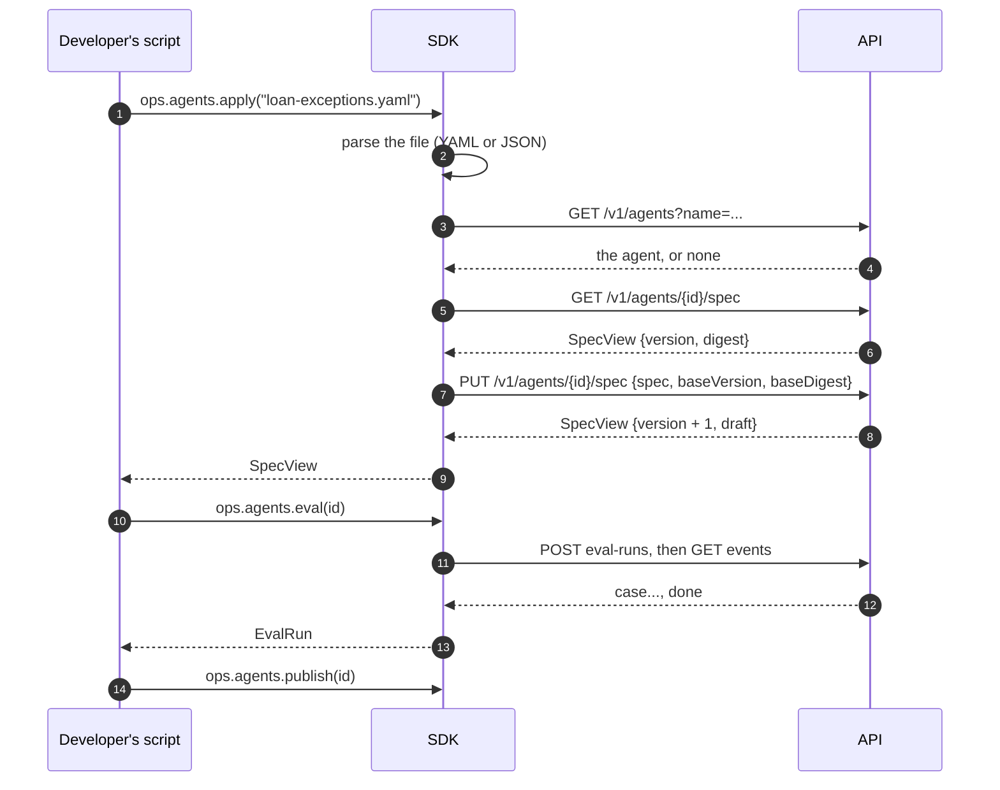
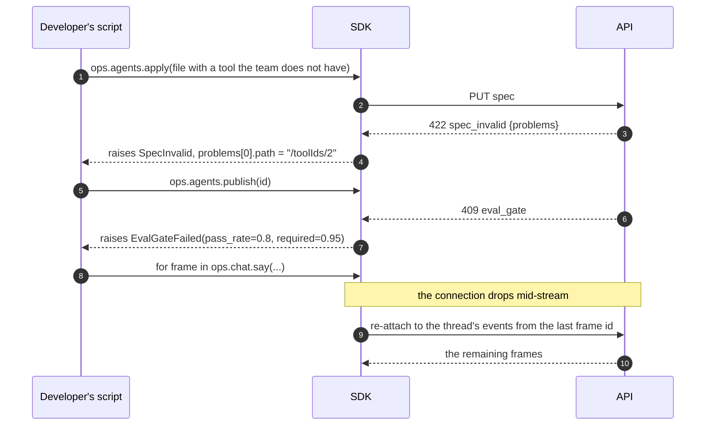

# SDK changes for agents version 2

Status: proposed design, written 2026-11-26. Nothing on this page is built. Each method is marked with its release.

Developers reach Ops AI from Python and TypeScript through one SDK in each language. This page lists what the three
releases add to both: saving an agent from a spec file, drafting one from a description, reading a turn's trace,
working with a conversation's sandbox files, drawing and running teams, and answering human tasks. Both SDKs have a
generated layer made from the services' documents and a small hand-written layer of nouns on top; the rule that the
hand-written layer adds no HTTP call of its own stays.

## Purpose

| Goal | Measure |
|---|---|
| A developer keeps an agent in a file under version control | `ops.agents.apply(path)` saves it and `ops.agents.export(id)` writes the same file back, byte for byte after formatting |
| Both languages have the same nouns and verbs | The method table below has a Python and a TypeScript entry for every row; a parity test compares the two word lists |
| Nothing in the SDK is typed by hand twice | Request and response types come from the generated layer |
| A developer never writes a loop | No SDK method takes a callback that drives model calls |

## What it owns and what it must not own

| Owns | Must not own |
|---|---|
| The nouns and verbs a developer types, their defaults, paging helpers and stream iterators | Request or response shapes: the generated layer (`sdk/python/src/ops_ai/_generated`, `sdk/typescript/src/generated`) |
| Reading and writing spec files, including YAML | Validation rules: the server checks a spec; the SDK only parses the file |
| Typed errors per error code | Retry policy beyond what the transport already has |

## Today

| Fact | Where |
|---|---|
| The hand-written agents noun has `apply`, `validate`, `export`, `publish`, `eval` and related methods taking a definition dictionary | `sdk/python/src/ops_ai/_agents.py:75`, `sdk/typescript/src/agents.ts:32` |
| An update sends a fixed list of fields | `sdk/python/src/ops_ai/_agents.py:27` |
| Chat has `start`, `say`, `act` | `sdk/python/src/ops_ai/_chat.py:118` |
| Tasks have `decide` and `approve`, mapped onto the reviews routes | `sdk/python/src/ops_ai/_client.py:349` |
| The generated layer is rebuilt by `make sdk` after `make openapi` | `make/sdk.mk:5`, `:9` |

## Methods

Python names are shown; TypeScript uses the same words in camelCase (`ops.agents.specDiff`). Every method has an async
twin in Python (`AsyncOps`) and returns a promise in TypeScript.

### Agents (1.4.0)

| Method | Calls | Returns | Notes |
|---|---|---|---|
| `ops.agents.apply(spec_or_path, *, note=None)` | `POST /v1/agents` or `PUT /v1/agents/{id}/spec` | `SpecView` | Accepts a path to a `.yaml` or `.json` file, a string, or a dictionary. Finds the agent by `name`; reads the current digest first and sends it as the base, so a stale file is refused. Replaces today's `apply` |
| `ops.agents.spec(id, *, version=None)` | `GET /v1/agents/{id}/spec` | `SpecView` | |
| `ops.agents.export(id, path=None, *, format="yaml")` | same | The text; writes the file when a path is given | Keys in schema order, so two exports of one version are identical |
| `ops.agents.validate(spec_or_path)` | `POST /v1/agents/spec/validate` | `SpecCheck` | Replaces today's `validate` |
| `ops.agents.spec_diff(id, spec_or_path, *, against="live")` | `POST /v1/agents/{id}/spec/diff` | `SpecDiff` | |
| `ops.agents.draft(description, *, draft=None, accepted=(), message=None)` | `POST /v1/agents/spec/draft` | `SpecDraft` | |
| `ops.agents.try_spec(spec_or_path, say, *, thread_id=None)` | `POST /v1/agents/spec/try` | `SpecTryOut` | |
| `ops.agents.loops()` | `GET /v1/agents/loops` | `list[LoopKind]` | |
| `ops.agents.eval(id, *, cases=None, repeat=1, wait=True)` | `POST /v1/agents/{id}/eval-runs`, then the events stream | `EvalRun` | With `wait=False` returns the run reference. Raises `EvalGateFailed` only from `publish` |
| `ops.agents.eval_events(run_id)` | `GET /v1/eval-runs/{id}/events` | An iterator of events | |
| `ops.agents.publish(id, *, note="")` | As today | | Raises `EvalGateFailed` on `eval_gate` |
| `ops.agents.update(id, fields)` | `PATCH /v1/agents/{id}` | | Name, description, owner team, archive only. A behaviour field raises `UseSpec` before any request |

Removed: the definition-dictionary forms of `create`, `apply` and `validate`, `grant_tools`, `add_reference`, and the
update key list. A spec file replaces each.

### Chat (1.4.0)

| Method | Calls | Notes |
|---|---|---|
| `ops.chat.say(thread, text, *, stream=True)` | The runs stream | The iterator yields the new frames `mode`, `plan`, `agent_asked`, `handoff`, `interrupt`, and `sandbox_command` from 1.5.0, as typed objects |
| `ops.chat.answer(thread, interrupt_id, *, decision=None, answer=None, edited=None, note=None)` | `POST /v1/threads/{id}/approvals` | One method for the three interrupt kinds; `ops.chat.approve` and `ops.chat.reject` are thin forms of it |
| `ops.chat.cancel(thread, run_id)` | `POST /v1/threads/{id}/runs/{run}/cancel` | |
| `ops.chat.trace(thread, run_id)` | `GET /v1/threads/{id}/runs/{run}/trace` | `RunTrace` |

### Sandbox (1.5.0)

A new noun, `ops.sandbox`, keyed by the conversation.

| Method | Calls | Notes |
|---|---|---|
| `ops.sandbox.get(thread)` | `GET /v1/threads/{id}/sandbox` | Raises `NoSandbox` when the conversation has none |
| `ops.sandbox.files(thread, **query)` | `GET …/sandbox/files` | A paging iterator |
| `ops.sandbox.read(thread, path, to=None)` | `GET …/sandbox/files/{path}` | Streams; writes to `to` when given, else returns bytes |
| `ops.sandbox.upload(thread, path_or_bytes, *, name=None)` | `PUT …/sandbox/files/{path}` | Into the inbox; streamed |
| `ops.sandbox.delete(thread, path)` | `DELETE …/sandbox/files/{path}` | |
| `ops.sandbox.save(thread, path, *, to="files", folder_id=None, collection_id=None)` | `POST …/files/{path}/save` | |
| `ops.sandbox.commands(thread, **query)` | `GET …/sandbox/commands` | A paging iterator of commands and network requests |
| `ops.sandbox.options()` | `GET /v1/sandbox/options` | |

The SDK has no method that runs a command in a sandbox. Commands are run by the agent, through the tool gateway.

### Workflows, runs and tasks (1.6.0)

| Method | Calls | Notes |
|---|---|---|
| `ops.workflows.validate(definition)`, `.save(definition)` | The definition routes | Accept groups, connection kinds and the new settings; no new method |
| `ops.workflows.team_layouts()` | `GET /v1/workflows/team-layouts` | |
| `ops.workflows.tests(id)`, `.set_tests(id, tests)` | `GET`, `PUT /v1/workflows/{id}/tests` | |
| `ops.workflows.test(id, *, names=None, wait=True)` | `POST /v1/workflows/{id}/test-runs` | `TeamTestRun` |
| `ops.runs.turns(run_id, **query)` | `GET /v1/runs/{id}/turns` | A paging iterator |
| `ops.runs.notes(run_id)` | `GET /v1/runs/{id}/notes` | A paging iterator |
| `ops.runs.cancel(run_id, *, undo=False)` | `POST /v1/runs/{id}/cancel` | |
| `ops.tasks.list(*, view="mine", kind=None, role=None)` | `GET /v1/tasks` | Replaces the reviews-backed list |
| `ops.tasks.answer(task_id, text=None, **fields)` | `POST /v1/tasks/{id}/answer` | |
| `ops.tasks.take_over(task_id)`, `ops.tasks.return_(task_id, note, *, output=None, finished=True)` | `POST …/take-over`, `…/return` | `returnTask` in TypeScript |
| `ops.tasks.decide(...)`, `.approve(...)` | As today | |

## Interfaces

Types exported from both packages, all from the generated layer: `AgentSpec`, `SpecView`, `SpecCheck`, `SpecProblem`,
`SpecDiff`, `SpecDraft`, `DraftSection`, `LoopKind`, `ModeStep`, `RunTrace`, `TraceStep`, `EvalRun`, `EvalCaseResult`,
`ThreadSandbox`, `SandboxFile`, `SandboxActivity`, `SandboxOptions`, `TurnRow`, `NoteRow`, `Task`, `TeamTest`,
`TeamTestRun`.

`AgentSpec` in TypeScript is generated from the spec's JSON Schema, so an editor completes field names in a spec written
in code. In Python it is a `TypedDict` generated the same way.

Errors, each a subclass of the SDK's base error carrying `code`, `status`, `request_id` and `details`:

| Error | `code` | Extra fields |
|---|---|---|
| `SpecInvalid` | `spec_invalid` | `problems: list[SpecProblem]` |
| `StaleBase` | `stale_base` | `current_version` |
| `UseSpec` | `use_spec` | `fields` |
| `EvalGateFailed` | `eval_gate` | `pass_rate`, `required`, `run_id` |
| `BudgetReached` | `budget_reached` | `budget_id`, `limit`, `spent` |
| `NoSandbox` | `no_sandbox` | |
| `SandboxUnavailable` | `sandbox_unavailable` | `retryable = True` |
| `HostNotAllowed` | `host_not_allowed` | `host`, `allowed_by` |
| `NotAssignee` | `not_assignee` | |
| `TaskClosed` | `task_closed` | `status` |

Stream frames are a tagged union on `type`. An unknown `type` is yielded as `UnknownFrame` with the raw data, so an
older SDK keeps working when a later release adds a frame.

## Data model

None. The SDK stores nothing but the profile file it has today.

## Flows

Failure paths:

## Settings

No new setting. The profile, base URL and token settings are unchanged.

## Security, cost and limits

| Concern | Rule |
|---|---|
| Secrets in a spec file | A spec holds secret names, never values. `apply` refuses a file whose text matches the secret patterns the CLI's export already checks, before any request |
| Uploads | `ops.sandbox.upload` streams and stops at the server's limit with `file_too_large` |
| Cost | `draft` and `try_spec` spend model budget; both return usage so a script can stop |

## Acceptance criteria

| # | Failure mode | Test proves |
|---|---|---|
| 1 | The two SDKs differ in what they offer | The parity test fails when a method exists in one word list only |
| 2 | A hand-written method invents a route | The generated-layer check fails for a call not in a service document |
| 3 | `apply` overwrites someone else's draft | With a changed draft on the server, `apply` raises `StaleBase` and sends no save |
| 4 | An export does not round-trip | `apply(export(id))` produces no new version: the server answers with the same digest |
| 5 | A new stream frame breaks an older SDK | A frame with an unknown `type` is yielded as `UnknownFrame` and iteration continues |
| 6 | A spec file with a secret value is uploaded | `apply` raises before any request |

## Use cases per layer

The `sdk` layer of each component's use cases runs these methods in both languages:
`docs/usecases/<area>/scripts/test-uc-<number>-sdk.py` and `…-sdk.mjs`, with `make usecase-test UC=<id> LAYER=sdk`.

| Use case | Python | TypeScript |
|---|---|---|
| Apply a spec, run its evals, publish | `ops.agents.apply`, `.eval`, `.publish` | `ops.agents.apply`, `.eval`, `.publish` |
| Chat until an approval, approve, read the trace | `ops.chat.say`, `.answer`, `.trace` | same |
| Upload a file, let the agent work, download the result | `ops.sandbox.upload`, `ops.chat.say`, `ops.sandbox.read` | same |
| Run a team, answer its question, read the turns | `ops.runs.start`, `ops.tasks.answer`, `ops.runs.turns` | same |

## Files to add, change and delete

| Package | Add | Change | Delete |
|---|---|---|---|
| `sdk/python/src/ops_ai` | `_spec.py` (read, write and order a spec file), `_sandbox.py`, generated `AgentSpec` types | `_agents.py`, `_chat.py`, `_client.py` (tasks, runs, the sandbox noun), `_workflows.py`, `_words.py`, `errors.py`, `_generated/` (by `make sdk`) | The update key list and the definition forms in `_agents.py` |
| `sdk/typescript/src` | `spec.ts`, `sandbox.ts` | `agents.ts`, `chat.ts`, `client.ts`, `workflows.ts`, `words.ts`, `errors.ts`, `generated/` | The same forms in `agents.ts` |
| `sdk/generate.py` | A step that turns the spec's JSON Schema into `AgentSpec` types for both languages | | |
| `sdk/examples` | `agent-from-spec`, `sandbox-files`, `team-run`, each run by `make sdk-check` | | Examples that use the removed forms |

## Open points

| # | Open point | Settled by |
|---|---|---|
| 1 | Whether the TypeScript package should ship a YAML parser or accept JSON and objects only | Owner; the draft assumes a small parser dependency, with its licence checked in trial 0 |
| 2 | Whether a typed builder for specs in code (a fluent API) is wanted beside the file | Not in these releases; the file is the one form |
