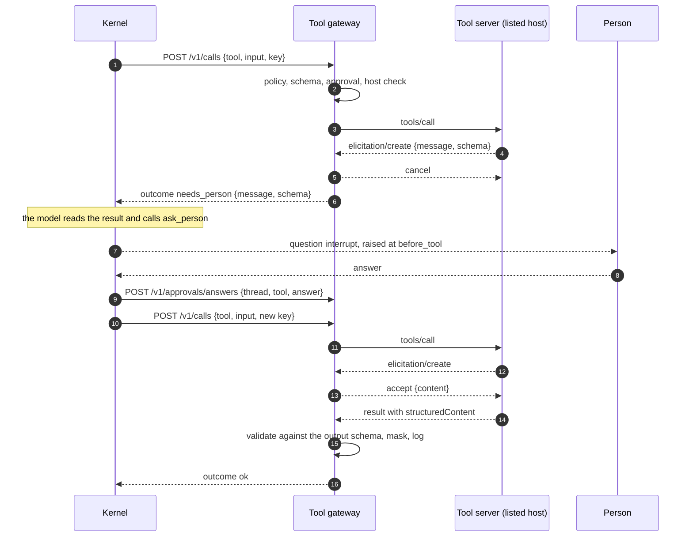
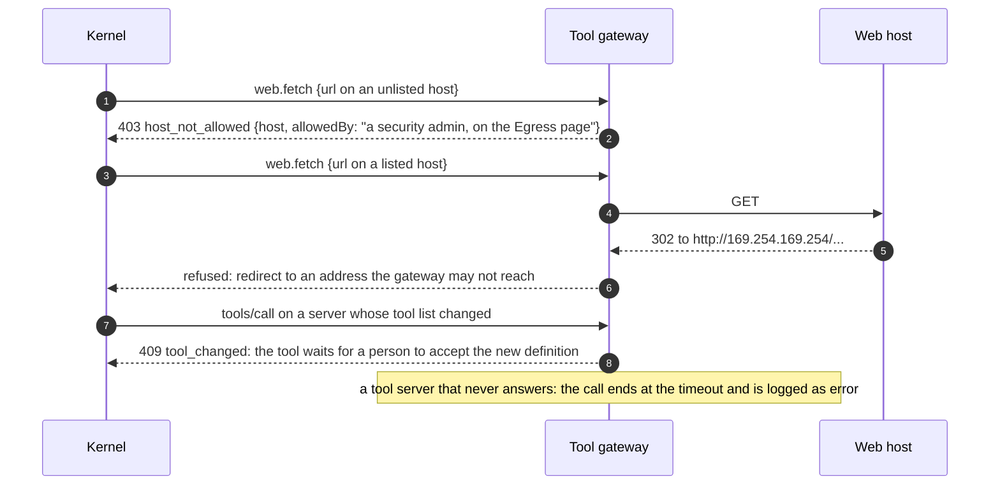

# Tool gateway: tool server client additions, web search and fetch

Status: proposed design, written 2026-11-26. Nothing on this page is built. The decide and approval routes are release
1.4.0. The rest is release 1.5.0, after the sandbox's exit gate, because web fetch and the exit gate share one host list.

Every action an agent takes on another system passes through one gateway of ours, which decides who may do what, holds
changes for approval and logs the call. This page adds three things to it: the parts of the tool-server standard its
client lacks, a web search tool and a page fetch tool. It also lists the two additions the sandbox needs from the same
gateway, which are specified on the sandbox pages. An agent library's own tool-server client is never used, because it
would hold credentials inside the loop.

## Purpose

| Goal | Measure |
|---|---|
| Tool servers that use more of the standard work through the gateway | A server that declares an output schema, asks a question mid-call and changes its tool list is used end to end in a use case |
| Agents can search the web and read a page | Two gateway tools, both bound by the tenant's host list and logged like any call |
| No new way out | The import and network checks still show two gateways and nothing else (SC1) |

## What it owns and what it must not own

| Owns | Must not own |
|---|---|
| The tool-server client and what it does with each message kind | Running a tool server. The gateway never starts a process (`services/tools-service/src/ops_tools/mcp.py:5`) |
| The `web.search` and `web.fetch` tools: policy, host check, limits, call log | A search index. Search is a provider connection a tenant configures |
| The sandbox's tool calls and the exit gate ([sandbox service](sandbox-service.md)) | The sandbox's computers, which the sandbox service owns |

## Tool server client additions

Facts about the tool-server standard on this page are from its 2025-06-18 specification, read on 2026-11-26:
[tools](https://modelcontextprotocol.io/specification/2025-06-18/server/tools),
[elicitation](https://modelcontextprotocol.io/specification/2025-06-18/client/elicitation) and
[authorization](https://modelcontextprotocol.io/specification/2025-06-18/basic/authorization). The rows on progress,
resources, prompts, sampling and the older transport were not re-read and are marked **unverified**; the lane's first
step is to read those pages and correct this table.

Today the client does three things over streamable HTTP: initialize, list tools and call a tool
(`services/tools-service/src/ops_tools/mcp.py:1`, methods at `:131`, `:137`, `:151`). The protocol version sent is
`2025-06-18` (`mcp.py:30`).

| Addition | Today | Change | Why it matters |
|---|---|---|---|
| Structured results | Paged tool lists and `structuredContent` are already read (`mcp.py:137`, `:155`) | Only one thing is added: a result is validated against the tool's `outputSchema` when the server declares one, which the specification says a client should do | A typed result that breaks its own schema does not reach the model |
| Tool list changes | Discovery runs when a person presses Refresh | A `notifications/tools/list_changed` message, or a changed list at the next scheduled check, marks the module "changed" and opens the existing review of discovered operations. New tools are never usable until a person accepts them | A server cannot add a write tool to an agent silently |
| A question mid-call (elicitation) | Not supported: the call fails | The client declares the `elicitation` capability. A tool call cannot stay open for the days a person may take, and a turn pauses only before a tool runs. So when a server sends `elicitation/create`, the gateway answers `cancel`, and the call returns `needs_person` with the question and its schema as an ordinary tool result. The agent asks the person with `ask_person`, which pauses at `before_tool`, then calls the tool again; the gateway holds the answer for that conversation and tool and replies `accept` with it when the server asks again. The specification forbids a server from asking for sensitive information this way; a question whose schema names a field matching the secret patterns is refused | A tool server that needs one more value does not fail the turn |
| Progress (**unverified**) | Ignored | `notifications/progress` messages are passed to the kernel as tool stream events and shown as the tool's status line | Long tool calls no longer look stuck |
| Resources (**unverified**) | Not supported | `resources/list` and `resources/read` are exposed as two read-only operations of the module, `list_resources` and `read_resource`, subject to the same policy and masking | Agents can read a server's documents |
| Prompts (**unverified**) | Not supported | Not built. A server's prompt templates would be instructions from outside our review | Stated so nobody adds it by accident |
| Sampling (**unverified**) | Not supported | Not built. A server asking our model for a completion would spend a tenant's budget on a third party's request | Same |
| Sign-in | Bearer and header keys through connections | The specification's authorization flow for HTTP transports, which is optional and built on OAuth 2.1: read the server's protected-resource metadata after a 401, discover the authorization server, use PKCE and the `resource` parameter, and send the token only to the server it was issued for. The token is held by the gateway's secret store | Hosted tool servers that require OAuth |
| The older event-stream transport (**unverified**) | Not supported | Not built; streamable HTTP only | Believed deprecated by the standard |
| The process transport (stdio) | Not supported | Not built in the gateway. A stdio server can run inside a sandbox, where its calls leave through the exit gate | The gateway starts no process |

The client is built on the `mcp` package the gateway already depends on (`services/tools-service/pyproject.toml:8`):
its session and message types are used over the gateway's own egress HTTP client, so the pinned-address rule holds.
If the package's client cannot take an injected HTTP client, the hand-written client stays and only the message types
are reused; the lane's first step checks this (**unverified**).

Every request still goes through the egress policy's client, so a tool server is reached only on a listed host at an
address resolved once and pinned (`services/tools-service/src/ops_tools/egress.py:227`).

## Web search and page fetch

Two tools in a built-in module `web`, off until a tenant admin turns them on and, for search, configures a provider.

| Tool | Access | Input | Output | Notes |
|---|---|---|---|---|
| `web.search` | read | `{query: string (1..400), count?: integer (1..10, default 5), site?: hostname}` | `{results: [{title, url, snippet, publishedAt?}], provider}` | Sent to the tenant's search connection. The query is the only thing that leaves |
| `web.fetch` | read | `{url: https URL, maxChars?: integer (1000..40000, default 12000)}` | `{url, finalUrl, title, text, truncated: boolean, contentType, fetchedAt}` | Fetched by the gateway. Text is extracted server side; scripts are not run |

Rules:

| Rule | Detail |
|---|---|
| Host list | `web.fetch` passes a URL through `EgressPolicy.check_url` (`egress.py:212`): https, port 443, and a host that is listed or allowed by the account's new-hosts policy. Under the default policy an unlisted host is refused with the host named and who can allow it |
| Redirects | Followed at most 3 times; each hop is checked again; a hop to an address literal or a private range is refused |
| Size and time | At most `OPS_TOOLS_WEB_FETCH_MAX_BYTES` read and `OPS_TOOLS_WEB_FETCH_SECONDS` waited |
| Untrusted content | Search snippets and page text reach the model inside labelled data blocks, as retrieved passages do. They are never instructions |
| Citations | Each result and fetched page is numbered like a knowledge passage, so the answer can cite it and the chat shows the source |
| robots | `web.fetch` sends a fixed user agent and honours a site's robots rules for that agent, read with the standard library's `urllib.robotparser` |
| Text extraction | An existing HTML-to-text library, chosen and licence-checked in trial 0; no extractor of ours is written |
| Caching | A fetched page is cached per tenant for `OPS_TOOLS_WEB_CACHE_SECONDS`; a cached answer is marked `cached` on the call record, as reads are today |
| Search provider | A connection of kind `search` with an adapter per provider, in the plugin form the gateway already uses. The provider is a setting, `OPS_TOOLS_WEB_SEARCH_PROVIDER`, and one adapter ships: Brave Search (default, 2026-11-26; its terms are checked in trial 0). Nothing is on until a tenant adds its own key. An install with none lists `web.search` as "not set up" |
| Hosted provider tools | A model provider's own web search tool is never switched on: it runs on the provider's servers, outside the gateway |

## What the sandbox needs from the gateway

Specified in [sandbox service](sandbox-service.md); listed here so the gateway's change list is in one place.

| Addition | Summary |
|---|---|
| A built-in module `sandbox` with tools `shell`, `python`, `read_file`, `write_file`, `remove_file`, `list_files`, `save_file` | Each call is decided, held for approval when its kind requires it, logged, and then sent to the sandbox service |
| The exit gate | A forward proxy run by the gateway. It applies the tenant's and the agent's host lists, adds secrets outside the sandbox, and records every request as a call |
| Calls from inside a sandbox | The existing code-run call route (`POST /v1/code-runs/calls`, `services/tools-service/src/ops_tools/app.py:613`) accepts a sandbox's token as it accepts a function's today |

## Interfaces

The public call route is unchanged: `POST /v1/calls` (`app.py:591`) with `CallRequest` (`gateway_calls.py:57`).

```python
class ToolOutcome:                     # moves to ops_contracts.tools; fields today at ops_agent_kernel/ports.py:21
    ok: bool
    output: Any
    view: dict[str, Any] | None = None
    needs_review: str | None = None
    for_model: Any = None
    signed_in: SignedIn | None = None
    needs_person: PersonQuestion | None = None     # new: an elicitation
    sources: list[SourceRef] | None = None         # new: web results and pages, for citations

class PersonQuestion(ServiceShape):
    message: str
    schema: dict[str, JsonValue]       # a flat object of string, number, boolean or enum fields, as the standard allows

class SourceRef(ServiceShape):
    title: str
    url: str
    snippet: str
    fetched_at: str | None = None
```

Routes added in 1.4.0, both for service callers only:

| Method | Path | Body | Returns | Purpose |
|---|---|---|---|---|
| POST | `/v1/calls/decide` | `CallRequest` | `{verdict: "allow"\|"needs_review"\|"refuse", reason, inputHash, approversNeeded, editable}` | Runs the policy, schema and approval checks of `POST /v1/calls` and sends nothing. The kernel calls it in `before_tool`, so a pause starts before a tool runs |
| POST | `/v1/approvals` | `{binding: {threadId or runId, step, tool, inputHash}, approvers: [user id]}` | `{token, expiresAt}` | Mints the approval token. The gateway checks each approver against the approval policy (`can()`, the two-person rule, the team's `requesterMayDecide` setting) before it signs. The signing key lives only here; the agents service's review key is removed |
| POST | `/v1/approvals/answers` | `{threadId, tool, schemaHash, answer}` | 204 | Holds a person's answer for a tool server's question until the tool is called again, at most `OPS_TOOLS_MCP_ELICITATION_HOURS` |

New admin routes, all under the existing settings permission:

| Method | Path | Purpose |
|---|---|---|
| GET | `/v1/web-tools` | Whether search and fetch are on for the tenant, the search connection, and today's usage |
| PUT | `/v1/web-tools` | Turn each on or off; choose the search connection. Writes an audit entry in the same transaction |

Errors added to `POST /v1/calls`:

| Status | `code` | When |
|---|---|---|
| 403 | `host_not_allowed` | `web.fetch` to a host that fails the list check; `details: {host, allowedBy}` |
| 409 | `web_search_not_set_up` | No search connection |
| 413 | `page_too_large` | The page exceeds the byte limit before any text was extracted |
| 422 | `tool_result_invalid` | A tool server's structured result fails its declared output schema |

## Data model

| Table | Change | Tenant scope | Retention |
|---|---|---|---|
| Tool modules and discovered operations (`store/modules.py`, `store/discoveries.py`) | A module gains `list_changed_at`; a discovery row gains `output_schema` | As today | As today |
| `web_tool_settings` (new) | One row per tenant: `tenant_id` primary key, `search_on`, `fetch_on`, `search_connection_id`, `updated_by`, `updated_at` | Tenant scoped | With the tenant |
| `web_page_cache` (new) | `tenant_id`, `url_hash` (primary key together), `final_url`, `title`, `text`, `content_type`, `fetched_at`, `expires_at` (indexed) | Tenant scoped | Until `expires_at`; a sweep deletes expired rows and writes nothing when none are due (DA13) |
| Call log (`store/calls.py`) | No new column. `web.*` and `sandbox.*` calls are ordinary rows | As today | As today |

| Database | Note |
|---|---|
| PostgreSQL | `text` column for page text |
| SQL Server | `nvarchar(max)`; the cache upsert goes through `ops_store.dialect.upsert` (`packages/ops_store/src/ops_store/dialect.py:99`) |

## Flows



Failure paths:



## Settings

| Setting | Default | Meaning |
|---|---|---|
| `OPS_TOOLS_WEB_SEARCH_PROVIDER` | `brave` | Which search adapter a search connection uses |
| `OPS_TOOLS_WEB_FETCH_MAX_BYTES` | `5000000` | Bytes read from one page |
| `OPS_TOOLS_WEB_FETCH_SECONDS` | `15` | Time for one fetch, redirects included |
| `OPS_TOOLS_WEB_CACHE_SECONDS` | `900` | Life of a cached page |
| `OPS_TOOLS_WEB_CALLS_PER_MINUTE` | `30` | Per team, across both tools |
| `OPS_TOOLS_MCP_TIMEOUT_MS` | `15000` | Today a constant (`mcp.py:38`); it becomes a setting (CF2) |
| `OPS_TOOLS_MCP_ELICITATION_HOURS` | `72` | How long a tool server's question may wait for a person before the call is closed |

## Security, cost and limits

| Concern | Rule |
|---|---|
| Data leaving in a search query | The query is logged on the call row, masked by the same rules as tool inputs, and the search connection's host must be on the egress list |
| A fetched page that tells the agent what to do | Page text is labelled untrusted data; writes still need approval at this gateway whatever the page says |
| Server-side request forgery | The pinned-address rule and the private-range refusal apply to every hop |
| A tool server gaining power after review | A changed tool definition is unusable until accepted again |
| Cost | Search providers charge per query; the per-team rate limit and the call log's count give a tenant its number. Fetch costs the gateway's bandwidth only |

## Acceptance criteria

| # | Failure mode | Test proves |
|---|---|---|
| 1 | `web.fetch` reaches a host the tenant did not list | 403 `host_not_allowed`, and the scripted web host saw no request |
| 2 | A redirect leads the gateway to a private address | The fetch is refused at the hop; nothing is read |
| 3 | A tool server adds a write tool and an agent can call it at once | The new tool answers 409 `tool_changed` until a person accepts it |
| 4 | A tool server's question fails the turn | The call returns `needs_person`; after the person answers, the second call completes and the server received `accept` with the answer once |
| 5 | A structured result that breaks its schema reaches the model | 422 `tool_result_invalid`; the model is told the tool failed |
| 6 | Page text is treated as instructions | The fetched text appears inside a labelled data block in the next model request |
| 7 | One tenant reads another's cached page | A fetch by tenant B of a URL tenant A cached reaches the web host again |
| 8 | Search runs with no connection | 409 `web_search_not_set_up` |
| 9 | A token is minted for someone the policy does not allow | `POST /v1/approvals` naming the asker under the two-person rule answers 403 and signs nothing |
| 10 | `decide` and `calls` disagree | For the same request, a `decide` verdict of `needs_review` and a call without a token being refused come from one function; a table-driven test runs both |

## Use cases per layer

| Use case | api | sdk | cli | ui |
|---|---|---|---|---|
| An agent answers from a fetched page and cites it | Chat stream with a `web.fetch` call and a citation | `ops.chat.say` | `opsai chat say` | Citation chip in chat |
| An admin turns web tools on and picks a search connection | `PUT /v1/web-tools` | `ops.raw.tools` operation | `opsai tools web --search on --fetch on` | Settings, Web tools |
| A tool server asks a question mid-call | Chat stream with an `interrupt` of kind `question` | `ops.chat.answer` | `opsai chat answer` | The approval card carrying a question |

## Files to add, change and delete

| Package | Add | Change | Delete |
|---|---|---|---|
| `services/tools-service` (1.4.0) | `src/ops_tools/approvals.py` (mint, verify, held answers), the three routes above | `gateway_calls.py` (one decision function behind `decide` and `calls`) | |
| `services/tools-service` | `src/ops_tools/web_tools.py` (search and fetch as `app` functions), `web_routes.py`, `store/web.py`, `connections/search.py` (the provider port), a migration | `mcp.py` (structured results, list-changed, elicitation, progress, resources), `mcp_tools.py`, `gateway_calls.py` (the `needs_person` outcome, the held answer), `app.py`, `openapi.json` | |
| `packages/contracts` | `tools.py` (`ToolOutcome`, `PersonQuestion`, `SourceRef`) | | |
| `packages/ops_agent_kernel` | | The tool wrapper returns `needs_person` to the model as a result that says to ask the person, and maps `sources` to citations. The `ask_person` tool exists from 1.4.0 | |
| `builtin-plugins` | The Brave Search adapter | | |

## Open points

| # | Open point | Settled by |
|---|---|---|
| 4 | Whether the tool gateway should stop importing the agents service's catalogue and local executor (`registry.py:15`, `tools.py:11`), so that it no longer installs the loop library | A later release; nothing here depends on it |
| 2 | Whether `web.fetch` should render pages that need scripts | Not in 1.5.0. Browser use is the one feature left out of the plan |
| 3 | Whether a tool server's OAuth sign-in can reuse the connection kinds unchanged | A spike against one public server that requires OAuth, before the lane starts |
