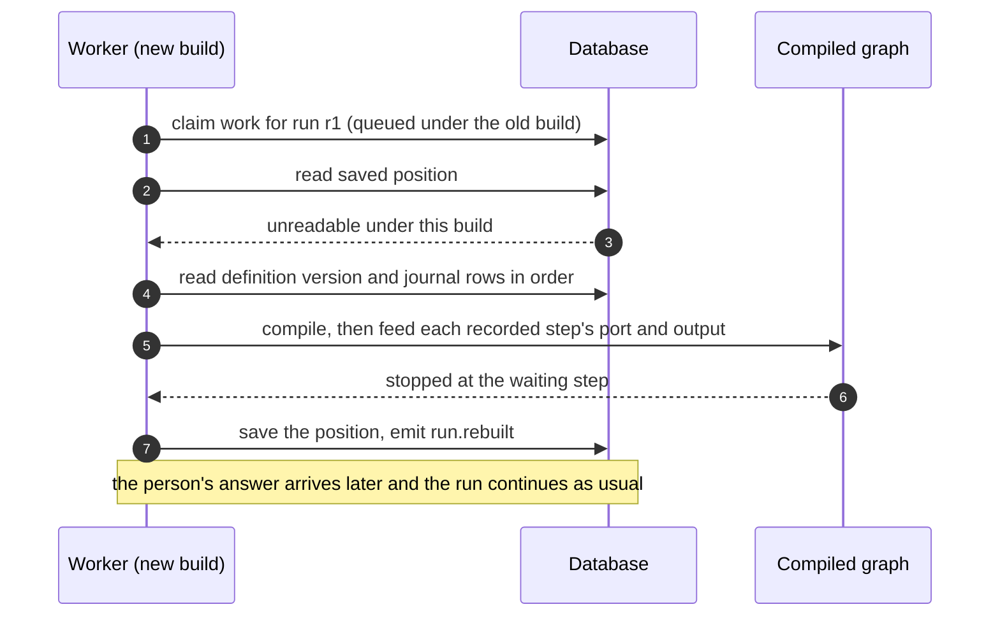
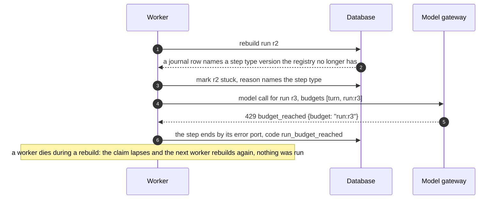

# Workflow durability changes

Status: proposed design, written 2026-11-26. Nothing on this page is built. Release 1.6.0.

A workflow run can wait for a person for days, and agent teams make such waits common. This page lists the changes that
let a run survive those waits across a product upgrade, hold a spending limit for the whole run, and pause an agent in
the middle of its turn for an approval. It also lists the database statements that still work on PostgreSQL only. The
workflow engine stays ours and stays on both databases; no outside workflow product is adopted.

## Purpose

| Goal | Measure |
|---|---|
| A waiting run continues after an upgrade that changed how saved state is laid out | Trial 11 |
| A run has one spending limit across every step, member and helper | A run with a budget stops starting model calls once the budget is spent; the limit is held at the model gateway |
| An agent step can pause for approval and continue the same turn | Trial 13; the step no longer fails when a write needs approval |
| Every engine statement runs on SQL Server | The portable-store check's baseline has no engine line left |

## What it owns and what it must not own

| Owns | Must not own |
|---|---|
| Rebuilding a run's position from its journal | The journal's meaning: one row per step and iteration, written once, stays as it is |
| The run budget's id, its creation and what happens when it is spent | Budget arithmetic and reservations: the [model gateway](model-gateway.md) |
| Storing a paused agent turn's state with the run | What the state contains: the [runtime contract](runtime-contract-and-strands-loop.md) |

## Today

| Fact | Where |
|---|---|
| The engine compiles a definition to a graph and saves its position through a checkpoint saver after each step | `packages/ops_engine/src/ops_engine/worker.py:3` |
| The journal has one row per run, step and iteration; a continued run returns recorded steps without running them again | `packages/ops_engine/src/ops_engine/store/tables.py:142`, `worker.py:6` |
| Work queued under another engine build is never claimed by this build's workers and is reported stuck | `packages/ops_engine/src/ops_engine/store/tables.py:16`, `store/reconciler.py:12` |
| A waiting run stores which step waits and why | `store/tables.py:118` |
| An agent step whose turn stopped for a paused write is a failed attempt: it is retried, then leaves by the error port | `services/agents-service/src/ops_agents/api/engine_agents.py:204` |
| A run's passes are capped | `packages/ops_engine/src/ops_engine/worker.py:55` |
| Eleven engine statements are on the PostgreSQL-only baseline: row locks in `steps.py`, `work.py`, `definitions.py` and `runs.py`, one skip-locked claim in `work.py`, two database-clock reads in `clock.py` | `portable-baseline.txt` |

## Change 1: rebuild from the journal

The journal is the truth about what a run has done. The saved graph position is a cache of it.

| Rule | Detail |
|---|---|
| When a rebuild happens | A worker claims a run whose saved position is missing, unreadable, or written by another engine build |
| How | Compile the run's pinned definition version. Replay the journal in order: each recorded step's output is fed to the graph without running the step. The graph stops where the journal stops; the run continues from there |
| What a rebuild needs to be exact | Each journal row already stores the port a step left by and its output. A row gains `left_by` where it was implicit, and a waiting row keeps its interrupt id and payload |
| The build rule | A work row for another build is claimed and rebuilt instead of being reported stuck. The reconciler's "another build" row is deleted |
| What cannot be rebuilt | A journal row whose step type no longer exists in the registry at that version. The run is marked `stuck` with the step named, and the registry's check refuses to remove a step type version that a waiting run still uses |
| Proof it is the same | A property test runs random definitions to a wait, deletes the saved position, rebuilds, finishes, and compares the journal with an uninterrupted run |

## Change 2: run budget

```python
class RunBudget(_Model):               # WorkflowDefinition.budget
    cost_usd: Decimal = Field(gt=0, alias="costUsd")
    on_spent: Literal["fail", "needs_person"] = Field(default="fail", alias="onSpent")
```

| Rule | Detail |
|---|---|
| Creation | When a run starts, the engine's host creates a budget `run:<run id>` at the model gateway with the definition's amount (`PUT /v1/models/budgets/{id}`) |
| Use | Every model call of the run sends the run's budget id, after any narrower one (a group's, a turn's), in `X-Budget-Id` |
| Spent | The gateway refuses the call with `budget_reached`. The step that made it ends by its error port with code `run_budget_reached`; with `onSpent: needs_person` the run opens a `take_over` task instead and waits |
| A run with no budget | Uses the team's default run budget, `OPS_ENGINE_RUN_BUDGET_USD`. A run never runs without one |
| What a run shows | `spend` and `budget` on the run view, read from the gateway's budget row |
| Tool calls | Not counted in dollars. The pass cap and each step's own limits bound them |

## Change 3: an agent step can pause

| Rule | Detail |
|---|---|
| The result | The agent port returns `paused` with the interrupt and the loop state, in place of raising an error |
| What the engine stores | `engine_runs.waiting` gains `loopState` (a reference to the stored state, not the bytes) and `kind` (`approval`, `question`, `plan_review`). The state itself is stored once by the agents service, keyed by run, step and iteration |
| The task | An `approve` or `answer` task is opened for the step, titled with the agent's name and what it wants to do |
| Resume | The decision resumes the same step and iteration with `AgentRequest.resume`. The turn continues from the saved state; model answers already recorded are replayed by the gateway, and tool calls already made repeat their keys |
| Timeout | The step's own `timeoutSeconds` does not run while the step waits for a person. The task's deadline and `onTimeout` apply |
| A rejected approval | The turn is resumed with the rejection, so the agent can answer without the change. The step ends by `ok` or its error port as the turn decides |

## Change 4: SQL Server statements

| Statement | File | Replacement |
|---|---|---|
| Row lock on a step row | `store/steps.py` | A conditional update that checks the row's version, through `ops_store.dialect` |
| Row lock and skip-locked claim on work rows | `store/work.py` | `ops_store.dialect.claim` (`packages/ops_store/src/ops_store/dialect.py:63`), which emits the lock hints SQL Server needs |
| Two database-clock reads | `store/clock.py` | The dialect's clock expression |
| Three row locks on definitions | `store/definitions.py` | Conditional update on the version column |
| Three row locks on runs | `store/runs.py` | Conditional update with the fence value the worker already holds |

When all eleven are replaced, the engine's lines are removed from `portable-baseline.txt` and the check keeps them out.

## Interfaces

| Item | Change |
|---|---|
| `WorkflowDefinition.budget` | New, above |
| `GET /v1/runs/{run_id}` | Adds `spend`, `budget`, `waitingOn: {step, kind, taskId, since}` |
| Run event `run.budget` | `{runId, spentUsd, budgetUsd}`, at most once a minute while a run spends |
| Run event `run.rebuilt` | `{runId, steps, fromBuild, toBuild}`, when a rebuild happened |
| `AgentResult.paused`, `AgentRequest.resume` | See [teams and human tasks](workflow-teams-and-human-tasks.md) |

## Data model

| Table | Change | Notes |
|---|---|---|
| `engine_steps` | `left_by` (string 80) made explicit | Backfilled by reseeding; the product is not in production |
| `engine_runs` | `waiting` JSON gains `loopState` and `kind`; new `budget_id` (string 120) | |
| `engine_turn_states` (new) | Primary key `(run_id, node, iteration)`; `tenant_id`, `team_id`; `loop`, `schema`, `data` (binary, encrypted with the tenant's key); `created_at` | Deleted when the step finishes; a sweep removes rows of ended runs |

| Database | Note |
|---|---|
| PostgreSQL | `bytea` for `data` |
| SQL Server | `varbinary(max)`; change 4 applies |

## Flows



Failure paths:



## Settings

| Setting | Default | Meaning |
|---|---|---|
| `OPS_ENGINE_RUN_BUDGET_USD` | `25` | A run's budget when its definition sets none |
| `OPS_ENGINE_RUN_BUDGET_MAX_USD` | `500` | The most a definition may set |
| `OPS_ENGINE_REBUILD_MAX_STEPS` | `20000` | A journal longer than this is not rebuilt in one pass; the run is marked stuck for an operator |

## Security, cost and limits

| Concern | Rule |
|---|---|
| A paused turn's state holds a conversation | Encrypted with the tenant's key, tenant scoped, deleted when the step ends |
| A rebuild runs a step again | It cannot: replay feeds recorded outputs and runs nothing. The property test proves it |
| Spend past the budget | Bounded by the gateway's reservation: at most one call's reservation over |

## Acceptance criteria

| # | Failure mode | Test proves |
|---|---|---|
| 1 | A waiting run is lost by an upgrade | Start a run to a wait, change the engine build, answer: the run finishes and no step has two journal rows |
| 2 | A rebuild runs a step again | The scripted tool sees no call during a rebuild |
| 3 | A run spends past its budget | With a budget of 1 dollar and scripted calls of 40 cents, the third call is refused at the gateway and the step ends by its error port |
| 4 | An agent step fails when a write needs approval | The run waits with an `approve` task; after approval the same turn continues and the write is sent once |
| 5 | A removed step type strands waiting runs silently | The registry check fails while a waiting run uses the version |
| 6 | An engine statement fails on SQL Server | The engine's store tests pass on SQL Server and the baseline has no engine line |

## Use cases per layer

| Use case | api | sdk | cli | ui |
|---|---|---|---|---|
| A run waits across a restart of every service and continues | `POST /v1/runs`, restart, `POST /v1/tasks/{id}/decision`, `GET /v1/runs/{id}` | `ops.runs.start`, `ops.tasks.decide` | `opsai runs start`, `opsai tasks approve` | Run timeline shows one row per step |
| A run stops at its budget | `GET /v1/runs/{id}` shows `spend` and the error | `ops.runs.get` | `opsai runs get` | Budget line on the run page |

## Files to add, change and delete

| Package | Add | Change | Delete |
|---|---|---|---|
| `packages/ops_engine` | `rebuild.py`, `store/turn_states.py` (port only; the table is the host's) | `worker.py`, `compiler.py`, `journal.py`, `store/steps.py`, `store/work.py`, `store/clock.py`, `store/definitions.py`, `store/runs.py`, `store/tables.py`, `definition.py` | The reconciler's other-build rule in `store/reconciler.py` |
| `services/agents-service` | `store/engine_turn_states.py`, `app/run_budgets.py`, a migration | `api/engine_agents.py`, `api/routers/engine.py`, `openapi.json` | |
| Root | | `portable-baseline.txt` loses the engine lines | |

## Open points

| # | Open point | Trial |
|---|---|---|
| 1 | Whether replay through the compiled graph reproduces the position for joins, loops and child runs | Trial 11 |
| 2 | Whether conditional updates hold under load on SQL Server without deadlocks | Trial 14 |
| 3 | Whether a run budget should also cap tool calls that cost money, such as search queries | Owner, after 1.5.0 usage numbers exist |
