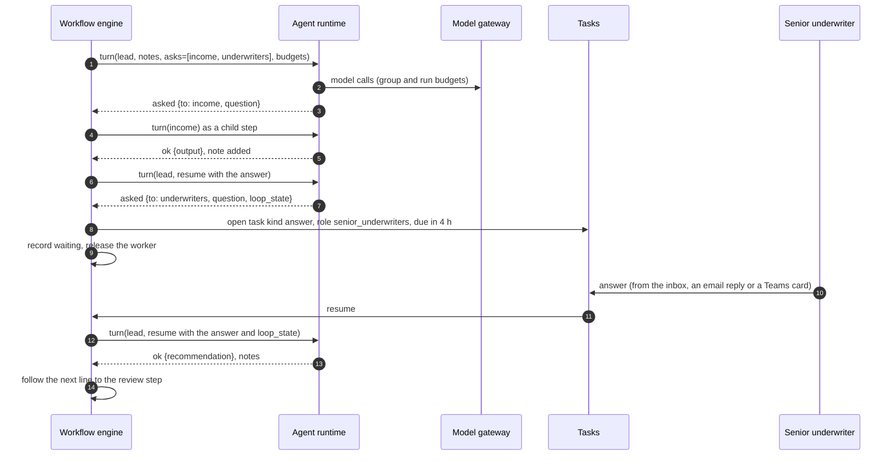
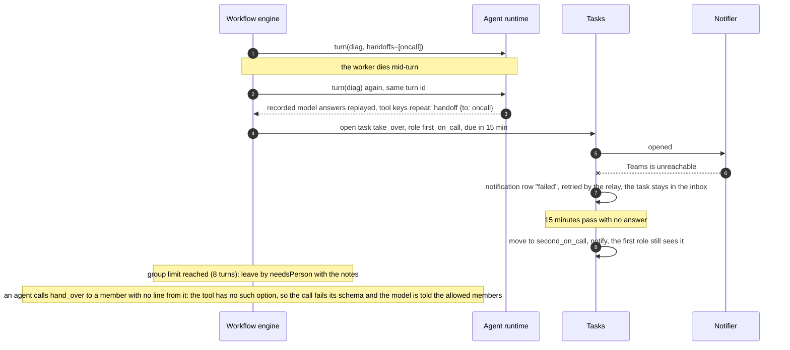

# Agent teams on the workflow canvas, and human tasks

Status: proposed design, written 2026-11-26. Nothing on this page is built. Release 1.6.0. This page changes the earlier
teams design: a team is drawn on the canvas as agents and people connected to each other, and the Team step is a folded
view of that drawing.

Operations work is rarely one task. A loan exception needs someone to check the income, someone to find the rule and an
underwriter to decide. This page lets a builder draw that team on the workflow canvas: each agent and each role of
people is a step, and the lines between them say who passes work to whom, who may ask whom, and who checks whose draft.
A run shows every member's turn as its own row. People answer their tasks from the inbox, from email or from Teams, and
a task nobody answers moves to the next role.

## Purpose

| Goal | Measure |
|---|---|
| A team is visible | Every member is a step on the canvas and every hand-over, question and check is a line a reader can follow. Nothing about who talks to whom is in a hidden list |
| The agent decides only among drawn lines | An agent can pass work only along a line a builder drew from it |
| People are members | A role can receive a hand-over, be asked a question or check a draft, with a deadline and a next role |
| One engine | The workflow engine moves the work between members and saves each turn; the agent runtime runs one member's turn |

## Where this departs from the earlier teams design

| Earlier design | This page | Reason |
|---|---|---|
| One `ops.ai.team` step with a member list, a kind and a hand-over map in its settings | Members are steps; hand-overs, questions and checks are connections with a kind. A group frame holds the team's limits | Owner direction: the team step hid the detail one level down. Products that draw teams as connected agents, such as Relevance AI, show two connection kinds, one where the agent decides and one that always follows ([Relevance AI, workforces](https://relevanceai.com/docs/workforce/introduction), read 2026-11-26) |
| A new engine port that runs a whole team | The existing agent step runs one member's turn; the engine follows the connection the member chose | The journal already records one row per step and iteration, so each turn is a step row with no new table |
| Three team kinds: supervisor, swarm, evaluator | Three starter layouts that place ordinary steps and connections, which the builder then edits | A kind was a second vocabulary for something the canvas can draw |
| The Team step | Kept, as the folded view of a group. Unfolding shows the same steps in place | The owner keeps the idea of a team step, without the hidden level |

## What it owns and what it must not own

| Owns | Must not own |
|---|---|
| Connection kinds and the checks on them | One member's reasoning. That is a turn of the agent runtime |
| Groups: members, limits, the way out when a limit is reached | Budget arithmetic. The model gateway reserves against the run's and the group's budgets |
| Shared notes of a run | Approval of a change. The tool gateway holds it, whichever member tried |
| Human tasks: kinds, assignment to a role, deadlines, moving on, answering outside the console | Sending email or Teams messages itself: a notifier port with one adapter per channel |
| Undo steps | |

## The model

### Steps that are members

No new step type is needed for a member.

| Member | Step type | New settings |
|---|---|---|
| An agent | `ops.ai.agent` (`packages/ops_engine/src/ops_engine/node_types.py:1238`) | `does` (one line shown on the canvas and given to members that may ask or hand to it), `notes: "read" \| "write" \| "none"` (default `write` inside a group, `none` outside) |
| A role of people who answer a question or take the job | `ops.flow.ask` (`node_types.py:1035`) | `assignTo` (a role, a person, or a value from the run), `dueWithinMinutes`, `remindEveryMinutes`, `thenAsk` (roles, in order), `onTimeout: "wait" \| "escalate" \| "expire"` |
| A role of people who approve | `ops.flow.humanReview` (`node_types.py:1596`) | `assignTo`, `thenAsk`, and `onTimeout` gains `escalate` beside today's `wait` and `expire` (`node_types.py:1640`) |

### Connection kinds

A connection today is a source step and port and a target step and port
(`packages/ops_engine/src/ops_engine/definition.py:67`). It gains four optional fields.

```python
class Connection(_Model):
    source: Endpoint = Field(alias="from")
    target: Endpoint = Field(alias="to")
    kind: Literal["next", "handoff", "ask", "check"] = "next"
    when: str = Field(default="", max_length=400)      # handoff and ask: told to the agent, in the builder's words
    pass_: dict[str, str] = Field(default_factory=dict, alias="pass")   # extra mapped values sent along
    check: CheckSettings | None = None                 # check only: standard, max_rounds

class CheckSettings(_Model):
    standard: str = Field(min_length=1, max_length=2000)
    max_rounds: int = Field(default=3, ge=1, le=5, alias="maxRounds")

class Endpoint(_Model):
    node: str | None = None            # exactly one of node and group
    group: str | None = None
    port: str
```

| Kind | Drawn as | Leaves from | Meaning | Who decides |
|---|---|---|---|---|
| `next` | A solid line (today's) | Any port | When the source finishes by that port, the target runs with the mapped input | The flow |
| `handoff` | A dashed line labelled with `when` | An agent step's `handoff` port | The agent may pass the whole job to the target. Its turn ends; the target starts with the notes, the message and `pass` | The agent, among the lines drawn |
| `ask` | A dotted line with a return arrow | An agent step's `asks` port | During its turn the agent may ask the target, an agent or a role, and gets the answer back. Its turn continues | The agent |
| `check` | A line with a loop mark | A step's `ok` port | The target reviews the source's output against `standard`. Pass goes on by the target's `ok` port; otherwise the source runs again with the feedback, at most `maxRounds` times | The checker |

How the engine turns these into something an agent can use:

| Connection | What the member's turn is given | What the engine does with the result |
|---|---|---|
| `handoff` lines from step S | One tool, `hand_over(to, message, why)`. `to` is an enumeration of the targets; each option's description is the target's `does` and the line's `when` | If the turn called it, the step leaves by the port `handoff:<target>`; otherwise by `ok` |
| `ask` lines from step S | One tool per target, `ask_<target>(question, why)` | Asking an agent runs that step as a child step and returns its output. Asking a role opens a task and pauses the turn; the answer resumes it |
| A `check` line from S to C | Nothing for S. C's turn is asked for `{verdict: "pass" \| "revise", feedback}` beside its own output | `revise` runs S again with `feedback` in its input and a higher iteration |

Rules the definition check enforces, each with a code:

| # | Rule | `code` |
|---|---|---|
| 1 | `handoff` and `ask` lines leave only agent steps, from the `handoff` and `asks` ports | `connection_kind_source` |
| 2 | A `handoff` or `ask` target is an agent step, an Ask step or a review step | `connection_kind_target` |
| 3 | Every member of a `handoff` or `ask` line is a published agent of the workflow's team, or a role of that team | `member_not_in_team` |
| 4 | A cycle is allowed only when every line on it is `handoff` or `check` and every step on it is in one group | `cycle_outside_group` |
| 5 | A step reached only by `ask` lines has no `next` line out; its output returns to the asker | `ask_target_has_next` |
| 6 | A `handoff` or `ask` line has `when` text of at least 10 characters | `when_missing` |
| 7 | A group has limits, and a line from its `needsPerson` port | `group_limits_missing`, `group_exit_missing` |
| 8 | A step is in at most one group | `step_in_two_groups` |

### Groups

A group is a frame on the canvas around the steps of one team. It adds limits and one way out; it changes nothing about
how its steps run.

```python
class Group(_Model):
    id: str = Field(pattern=r"^[A-Za-z][A-Za-z0-9_]*$", max_length=80)
    name: str = ""
    nodes: list[str] = Field(min_length=2)
    limits: GroupLimits
    folded: bool = False               # how the canvas draws it; no effect on a run
    goal: str = Field(default="", max_length=1000)   # shown on the folded card and given to every member

class GroupLimits(_Model):
    turns: int = Field(ge=1, le=200)
    cost_usd: Decimal | None = Field(default=None, gt=0, alias="costUsd")
    minutes: int | None = Field(default=None, ge=1)    # members' working time; waiting for a person is not counted

class WorkflowDefinition(_Model):       # definition.py:72, plus:
    groups: list[Group] = []
    budget: RunBudget | None = None     # {costUsd}; see workflow-durability.md
    notes: Literal["shared", "off"] = "off"
```

| Group port | Fires when |
|---|---|
| `needsPerson` | A limit is reached, or a member with no line to take says it cannot meet the goal. The notes so far go with it |

The folded view is one card titled with the group's name, showing its members' count, its limits and its lines in and
out. This is the Team step. Unfolding it shows the same steps where they are.

### Starter layouts

"Add a team" on the canvas offers three layouts. Each inserts ordinary steps, lines and a group, already wired.

| Layout | What it inserts |
|---|---|
| A lead hands out the work | One agent step with `ask` lines to two agent steps |
| Each passes the job on | Three agent steps with `handoff` lines in a row and one back to the first |
| One drafts, another checks | Two agent steps joined by a `check` line |

### Shared notes

| Rule | Detail |
|---|---|
| What a note is | `{by: step id, byKind: "agent" \| "person", byName, at, text, sources: [citation]}`; text at most 2,000 characters |
| Who writes | A member with `notes: write`, at the end of its turn, through the tool `add_note(text)`; a person's answer to a task is added as their note |
| Who reads | A member with `notes` `read` or `write` gets the notes of its group, or of the run when it is in no group, at the start of its turn, inside a labelled data block |
| What a hand-over carries | The notes and the hand-over message. The earlier member's full exchange with the model is not passed on: it keeps cost down and keeps personal data where it was needed |
| Secrets and personal data | A note is scanned for secret patterns before it is saved and refused when one is found; it is masked for readers as run data is today |

### Human tasks

Every way a person enters a run produces a task in one inbox.

| Kind | Opened by | Answer | State today |
|---|---|---|---|
| `approve` | A change held by the tool gateway, from a step or from an agent in mid-turn; or a review step | A decision, with corrections when the step allows them | Today for steps (`node_types.py:1596`); new for an agent in mid-turn, see [workflow durability](workflow-durability.md) |
| `answer` | An `ask` line to a role, or an Ask step | Free text, or the fields the Ask step defines | New for `ask` lines |
| `take_over` | A group's `needsPerson` way out, or a person taking a job from a group | The person finishes the job or returns it with a note | New |

Settings every task has:

| Setting | Values | State today |
|---|---|---|
| Assigned to | A role, a named person, or a value from the run such as an account's manager | A person or the team's queue (`services/agents-service/src/ops_agents/store/review_assignments.py:48`); roles are new |
| Deadline and reminders | `dueWithinMinutes` or `slaHours`; `remindEveryMinutes` or `remindEveryHours` | Today (`node_types.py:1626`, `:1639`) |
| Then ask | A list of roles. At the deadline the task is assigned to the next one; the earlier role still sees it | The first engine only (`services/agents-service/src/ops_agents/graphs/sla.py:42`) |
| If nobody answers | `wait`, or `expire` by the Timeout way out, after the last role's deadline | Today |
| Where it can be answered | The inbox; email; Teams | Inbox today; the others are new |

A role is a reviewer group of the team, resolved to people when the task opens and again at each move, so a change of
who is on duty takes effect. Who may decide is still `can()` with the rule that the person who started the run cannot
approve its changes (`services/agents-service/src/ops_agents/api/engine_reviews.py:1215`).

Answering outside the console:

| Channel | Notification | How an answer is accepted |
|---|---|---|
| Email | A message per task with the question or summary, the notes, and one link | An `answer` task: a reply from an address that belongs to an assignee, on a message that passes the sender checks the mail provider reports, is recorded as that person's answer. An `approve` task: the link opens a confirm page that requires sign-in; a link is never a decision by itself, because mail scanners open links |
| Teams | A card in the role's channel or the person's chat | A button posts to our endpoint with the Teams user's identity, which is matched to a member by the directory id. `approve` asks for the same step-up sign-in the console asks for when the policy requires one |

The link carries a signed, expiring claim made the way run resume links are today
(`services/agents-service/src/ops_agents/api/engine_resume.py:78`).

### Undo steps

| Rule | Detail |
|---|---|
| Declared on | An `ops.action.tool` step: `undo: {operation, input}` |
| Runs when | A later step fails and the run ends as failed, or a person cancels the run with "undo changes" ticked, and the step with the undo had succeeded |
| Order | Newest first |
| How | Each undo is a journal row of its own, with its own idempotency key, sent through the tool gateway like any write. One that needs approval opens an `approve` task titled "Undo: …" |
| When an undo fails | The run ends as `failed` with `undo: "incomplete"` and lists which undos did not finish; nothing is retried without a person |

## Interfaces

Routes, with exact shapes in the [OpenAPI draft](openapi-draft.yaml):

| Method | Path | Change |
|---|---|---|
| POST | `/v1/workflows/definitions/validate`, `/v1/workflows/definitions` | Accept `groups`, `budget`, `notes`, connection `kind`, `when`, `pass`, `check`, the member settings and `undo` (`services/agents-service/src/ops_agents/api/routers/engine.py:390`, `:418`) |
| GET | `/v1/workflows/option-sources` | New source `roles` beside `agents` (`engine.py:1214`) |
| GET | `/v1/workflows/team-layouts` | New. The three starter layouts as definition fragments |
| GET | `/v1/runs/{run_id}` | Adds `spend`, `budget`, `waitingOn`, and per group `turnsUsed` (`engine.py:1878`) |
| GET | `/v1/runs/{run_id}/turns` | New. The steps of a group in the order they ran, each a turn: `{step, iteration, member, memberKind, kind: "work"\|"asked"\|"answered"\|"handoff"\|"check", summary, costUsd, startedAt, finishedAt, waitedSeconds}`. Paged; filters `group`, `step` |
| GET | `/v1/runs/{run_id}/notes` | New. The shared notes, paged |
| GET | `/v1/runs/{run_id}/events` | New event types `team.turn`, `team.handoff`, `team.asked`, `team.answered`, `team.checked`, `run.budget` (`engine.py:2180`) |
| POST | `/v1/runs/{run_id}/cancel` | Adds `undo: boolean`. Cancel withdraws open tasks (`engine.py:2010`) |
| GET | `/v1/tasks` | New on this prefix. The inbox list with filters `role`, `kind`, `view`. Today the list is served by the reviews routes (`services/agents-service/src/ops_agents/api/routers/reviews.py:160`); the new route calls the same app function |
| POST | `/v1/tasks/{task_id}/decision` | The SDK's `tasks.decide` call (`sdk/python/src/ops_ai/_client.py:352`); shape unchanged |
| POST | `/v1/tasks/{task_id}/answer` | New. `{text, fields?}` |
| POST | `/v1/tasks/{task_id}/take-over` | New. Assigns the job to the caller |
| POST | `/v1/tasks/{task_id}/return` | New. A person who took a job over hands back `{output?, note}`; the group leaves by `ok` or `needsPerson` |
| POST | `/v1/channels/teams/actions` | New. The endpoint a Teams card posts to; verified by the Teams app's signature |

The engine's agent port gains fields; the engine still never imports the agent service
(`packages/ops_engine/src/ops_engine/ports.py:172`).

```python
@dataclass(frozen=True)
class AgentRequest:                    # ports.py:147, plus:
    notes: list[Note] = ()             # what the member reads
    may_write_notes: bool = False
    handoffs: list[MemberOption] = ()  # targets of this step's handoff lines: {id, does, when}
    asks: list[MemberOption] = ()      # targets of this step's ask lines
    budget_ids: list[str] = ()         # innermost first: group, then run
    resume: AgentResume | None = None  # a pause being continued: the loop state, the answer or the approval token
    goal: str = ""

@dataclass(frozen=True)
class AgentResult:                     # ports.py:160, plus:
    handoff: HandoffChoice | None = None      # {to, message, why}
    asked: AskRequest | None = None           # the turn is paused on a question to a member: {to, question, why, loop_state}
    paused: AgentPause | None = None          # the turn is paused for an approval: {interrupt, loop_state}
    notes_added: list[str] = ()
    cost_usd: Decimal = Decimal(0)
    summary: str = ""                         # one line for the turn row

class TaskNotifier(Protocol):          # a port in the engine's host; adapters: inbox (none needed), email, teams
    async def opened(self, task: TaskView, to: list[Recipient]) -> None: ...
    async def moved(self, task: TaskView, to: list[Recipient]) -> None: ...
    async def closed(self, task: TaskView) -> None: ...
```

### How a member's turn reaches the runtime

The engine knows steps and lines. The kernel knows tools and interrupts. The agents service's engine adapter
(`services/agents-service/src/ops_agents/api/engine_agents.py`) translates between them, and the kernel learns nothing
about workflows.

| Engine side (`AgentRequest`) | Kernel side (`TurnRequest`, release 1.6.0 additions) | Who defines the tool the model sees | What comes back |
|---|---|---|---|
| `handoffs` | `handoff_targets: list[MemberOption]` | The kernel's `hand_over` tool, the same one the swarm loop kind uses in chat, with these targets as its options | `TurnResult.handoff: {to, message, why}`, mapped to `AgentResult.handoff`. The kernel ends the turn and switches nothing; the engine follows the line |
| `asks` | `ask_targets: list[MemberOption]` | The kernel adds one tool per target, `ask_<id>(question, why)`. Calling one pauses the turn | An `Interrupt` of kind `question` with `question.to` set to the target. The adapter returns `AgentResult.asked`. The engine answers it by running an agent step or opening a task, then resumes with `TurnRequest.answers[interrupt_id]` |
| `notes`, `may_write_notes` | `notes: NotesGrant` (the notes to read, and whether writing is allowed) | The kernel's `add_note(text)` tool, a local tool like the plan tool: it makes no gateway call | `TurnResult.notes_added`; the engine stores them after the secret scan |
| `budget_ids` | `budget_ids: list[str]`, sent innermost first in `X-Budget-Id` after the turn's own budget | None | `TurnResult.usage` and cost, summed onto the step row |
| `resume` | `loop_state` and `answers` | None | The same turn continues |
| `goal` | Added to the volatile tail of the prompt, after the stable part | None | |

In chat, a helper named in an agent's spec is asked inline by the runtime, within the turn. In a team, an `ask` always
pauses and returns to the engine, so that each member's turn is a journal row. The kernel decides which by whether the
target arrived in `helpers` or in `ask_targets`.

## Data model

In the workflow engine's store, within the agents service's migration chain.

| Table | Change |
|---|---|
| `engine_steps` (`packages/ops_engine/src/ops_engine/store/tables.py:142`) | New columns: `parent_node` and `parent_iteration` (a child step run by an `ask`), `group_id`, `member_kind` (`agent`, `person`), `turn_kind`, `summary` (string 400), `cost` (numeric 18,6), `waited_seconds` (int). Index `(tenant_id, run_id, group_id, started_at)` for the turns list |
| `engine_notes` (new) | `id` primary key; `tenant_id`, `team_id` (tenant scoped, team owned); `run_id` indexed with `created_at`; `group_id` null; `by_node`, `by_kind`, `by_name`; `text` (2,000); `sources` JSON; `created_at`. Append only |
| `engine_group_usage` (new) | Primary key `(run_id, group_id)`; `tenant_id`; `turns`, `working_seconds`; updated with a conditional statement at each turn's end |
| `review_assignments` | Gains `role` (string 120, null) and `step` (int): the place in the `thenAsk` list |
| `task_notifications` (new) | `id`; `tenant_id`; `task_id` indexed; `channel` (`email`, `teams`); `recipient`; `message_ref` (the mail message id or the card's activity id, to match a reply); `sent_at`; `status`. Unique `(task_id, channel, recipient, step)` so a redelivery sends nothing twice |

| Table | Retention |
|---|---|
| `engine_steps`, `engine_notes`, `engine_group_usage` | With the run, under the journal's retention |
| `task_notifications` | With the task; a sweep removes rows of closed tasks after 90 days |

| Database | Note |
|---|---|
| PostgreSQL and SQL Server | New statements use only `ops_store.dialect`. The turns list pages in SQL (DA5). The escalation timer is claimed with `dialect.claim`. No partial index is added: the 11 engine statements still to be ported are listed in [workflow durability](workflow-durability.md) and none is added here |

## Flows

A lead asks a specialist and a role, then hands the result to an approval:



Failure paths:



## Settings

| Setting | Default | Meaning |
|---|---|---|
| `OPS_ENGINE_GROUP_MAX_TURNS` | `200` | Ceiling on a group's `limits.turns` |
| `OPS_ENGINE_ASK_DEPTH` | `1` | How deep `ask` may nest: a member asked by a member asks no one |
| `OPS_ENGINE_NOTES_MAX` | `500` | Notes per run; past it the oldest are summarised into one |
| `OPS_TASKS_EMAIL_REPLY_DOMAIN` | unset | The inbound mail domain for replies; unset, email carries the link only |
| `OPS_TASKS_LINK_HOURS` | `72` | Life of a task link |
| `OPS_TASKS_TEAMS_APP_ID`, `OPS_TASKS_TEAMS_APP_SECRET` | unset; from the secret store | The tenant's Teams app; unset, Teams is not offered |

## Security, cost and limits

| Concern | Rule |
|---|---|
| Tenant and team | Every member must belong to the workflow's team; a hand-over cannot leave it (rule 3). Notes, turns and tasks are tenant scoped and team owned |
| A person approves every change | Unchanged and not configurable per team: the tool gateway refuses a change with no approval, whichever member tried |
| The requester cannot approve | Applies on every channel; the decision is made by the same app function |
| An email or a Teams action from someone who is not an assignee | Ignored, with a notice to the sender and an audit entry. The channel never decides who a person is: the address or directory id must match a platform member with the permission |
| Cost | A run budget and a group budget inside it, both reserved at the model gateway before each call. A turn row carries its cost, summed from the gateway's settle |
| Runaway hand-overs | Bounded by the group's turns, cost and minutes; cycles are allowed only inside a group |
| What a note may hold | No secret (scanned), masked for readers, never sent to a member outside the group |

## Acceptance criteria

| # | Failure mode | Test proves |
|---|---|---|
| 1 | An agent hands work to a member no line leads to | The `hand_over` tool's options are exactly the drawn targets; a scripted call naming another step is refused and the step does not leave by a hand-over port |
| 2 | A finished turn runs again after a crash | Kill the worker during turn 3 of 5: turns 1 and 2 have one journal row each, no model call is charged twice, no write is sent twice. On PostgreSQL and SQL Server |
| 3 | A question to a role fails the step | The run records waiting with a task of kind `answer`; the answer resumes the same turn and the member's next model request contains it |
| 4 | A task nobody answers stays with the first role | At the deadline the task is assigned to the next role in `thenAsk`, both roles see it, and one reminder is sent per period |
| 5 | A person who is not an assignee answers by email | The reply is ignored, the task is unchanged, an audit entry exists |
| 6 | An approval is given by opening a link | Fetching the link without a signed-in confirm changes nothing |
| 7 | A hand-over leaks the previous member's exchange | The receiving member's first model request holds the notes and the message and no tool result of the earlier member |
| 8 | A group runs past its limits | The ninth turn of a group with `turns: 8` does not start; the run leaves by `needsPerson` |
| 9 | A note stores a secret | A note containing a value matching a secret pattern is refused and the member is told |
| 10 | An undo runs twice, or runs for a step that never succeeded | After a failure, each succeeded step's undo has one gateway call; a step that failed has none |
| 11 | The folded view and the canvas disagree | Folding and unfolding a group leaves the saved definition's digest unchanged |
| 12 | A cycle outside a group is saved | The definition check answers `cycle_outside_group` |

## Use cases per layer

| Use case | api | sdk | cli | ui |
|---|---|---|---|---|
| Draw a lead with two specialists and a role, run it, answer the question, approve | `POST /v1/workflows/definitions`, `POST /v1/runs`, `POST /v1/tasks/{id}/answer`, `POST /v1/tasks/{id}/decision` | `ops.workflows.save`, `ops.runs.start`, `ops.tasks.answer`, `ops.tasks.decide` | `opsai workflows validate`, `opsai runs start`, `opsai tasks answer` | Canvas with a group; Human Tasks inbox |
| Read each member's turn and the notes | `GET /v1/runs/{id}/turns`, `/notes` | `ops.runs.turns`, `ops.runs.notes` | `opsai runs turns`, `opsai runs notes` | Run timeline, a group's rows |
| A missed deadline moves the task | Clock advanced in the use case's stack; `GET /v1/tasks?role=` | `ops.tasks.list(role=)` | `opsai tasks list --kind answer` | Inbox deadline cell |
| A person takes the job from the team | `POST /v1/tasks/{id}/take-over`, `/return` | `ops.tasks.take_over`, `ops.tasks.return_` | `opsai tasks take` | Task sheet |

## Files to add, change and delete

| Package | Add | Change | Delete |
|---|---|---|---|
| `packages/ops_agent_kernel` | `notes.py` (the `add_note` tool and the notes block) | `types.py` (`handoff_targets`, `ask_targets`, `notes`, `budget_ids` on the request; `handoff`, `notes_added` on the result; `question.to` on an interrupt), `kernel.py` (the `ask_<id>` tools; `hand_over` with targets from the request) | |
| `packages/ops_engine` | `groups.py` (limits, the way out), `handoffs.py` (ports from lines, the cycle rule), `notes.py`, `undo.py`, `store/notes.py`, `store/group_usage.py` | `definition.py` (connection fields, groups, checks 1 to 8), `compiler.py` (hand-over ports, child steps for `ask`, the check loop, group limits, pause in place of failure at `:720`), `node_types.py` (member settings on three step types, `undo`), `ports.py`, `journal.py`, `store/tables.py`, `store/steps.py` | |
| `services/agents-service` | `app/tasks.py` (answer, take over, return, move on), `app/task_notify.py` and adapters `adapters/task_email.py`, `adapters/task_teams.py`, `api/routers/task_actions.py`, `store/engine_notes.py`, `store/task_notifications.py`, a migration | `api/engine_agents.py` (the new request and result fields; a pause is returned, not raised, at `:204`), `api/engine_reviews.py`, `api/hitl_facade.py`, `api/routers/engine.py`, `api/routers/tasks.py`, `api/timers.py` (escalation), `openapi.json` | The first engine's escalation code in `graphs/sla.py`, once the inbox no longer reads it |
| `packages/ops_email` | | `inbound.py` (match a reply to a task by message reference) | |
| `apps/console` | See [console screens](console-screens.md) | | |

## Open points

| # | Open point | Settled by |
|---|---|---|
| 1 | The canvas mocks were drawn for the earlier Team step: a member list inside one step's sheet. They need redrawing with members as steps and the three line kinds | Owner, before the console lane starts |
| 2 | Whether `ask` should be allowed to nest more than one level | After trial 12; one level matches today's rule for agents asking agents |
| 3 | Whether a Teams card may carry an approval without opening the console when the tenant's policy requires no step-up | Owner and a security review |
| 4 | Whether an email reply can be trusted for an answer on the sender checks alone | A security review, with trial 13's notes |
| 5 | Whether the compiled graph's cycle support holds under a crash in the middle of a cycle | Trial 12 |
