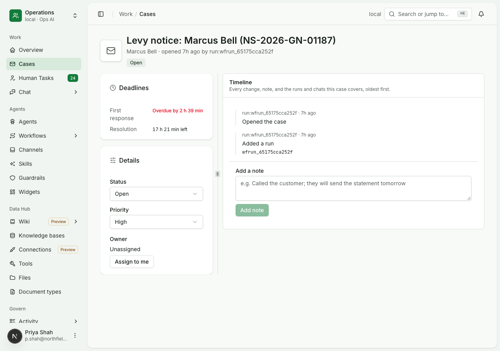
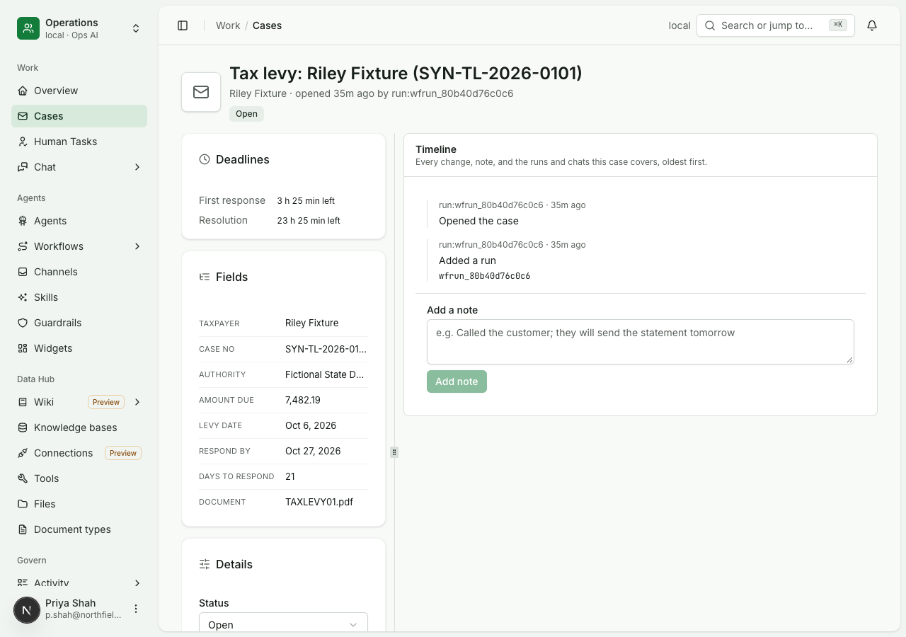
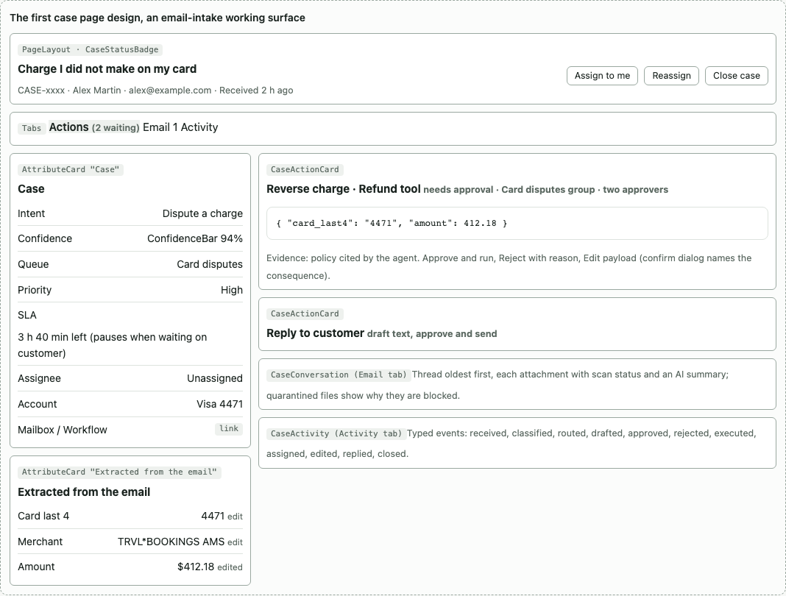
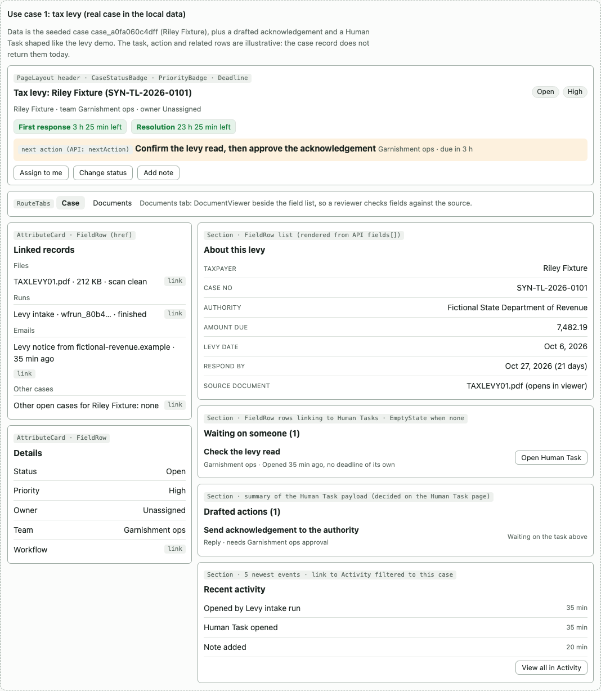
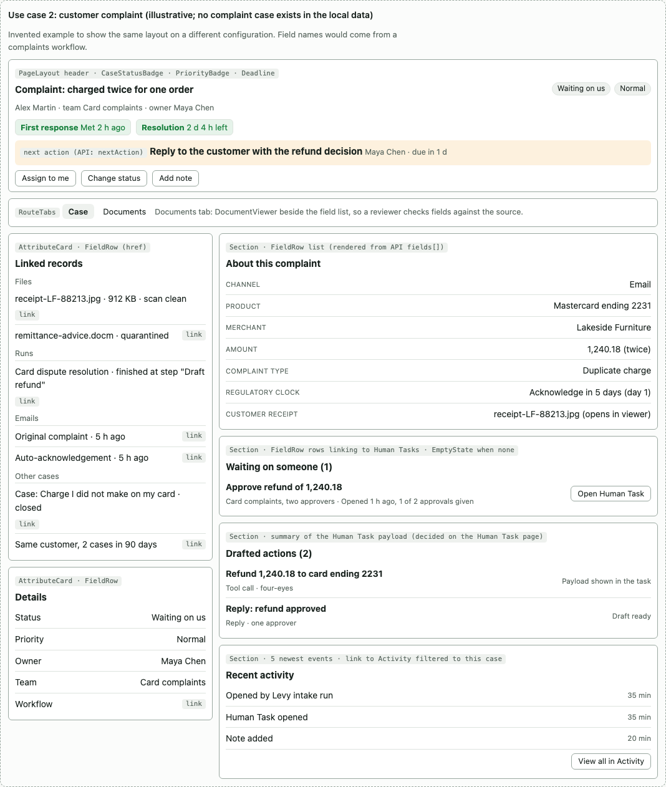
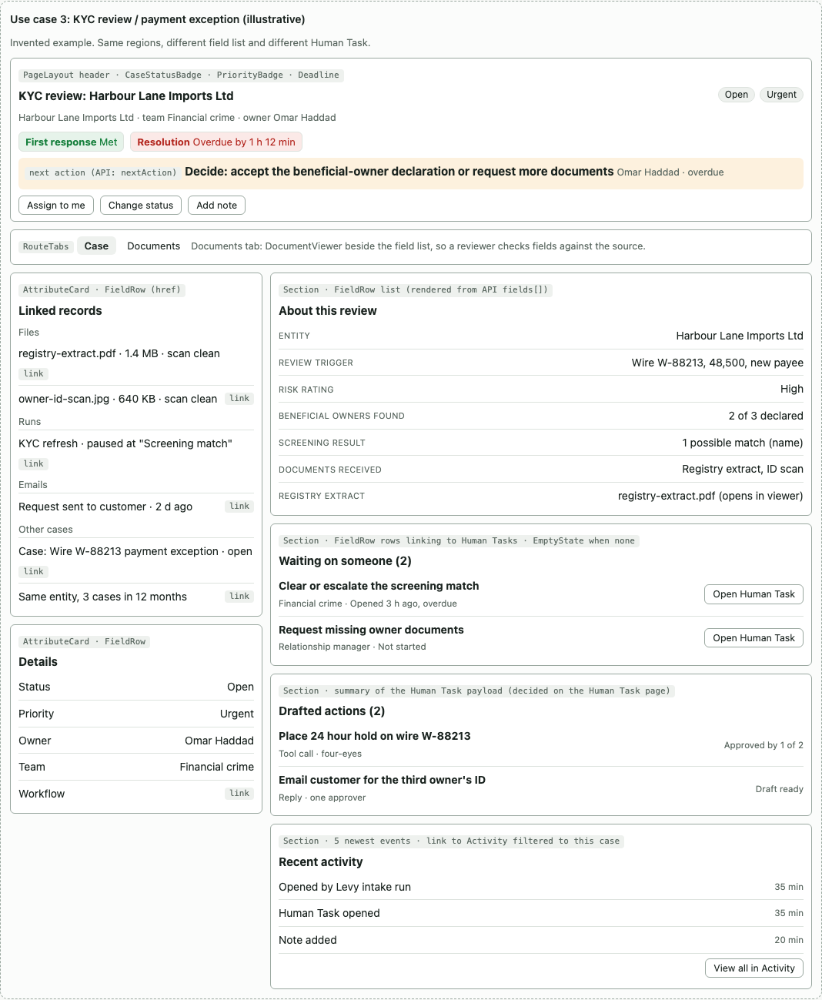

# Case page

Status: current design. The assembled case read is built and proven by
[uc-251](../../usecases/agents-service/a-case-reads-assembled.md); the console walk is
[uc-139](../../usecases/console/cases-console.md). A built screen is in [console/proposed/cases](../../console/proposed/cases/case-fields-1280.png).

## The problem

A case is a customer issue that lives for days: a court order on an account, a complaint, a KYC review. The person working it
needs to see what the case is about, what it is waiting on and who, what actions have been drafted, and where the
source documents are. The case page as first rebuilt was a timeline, a deadline card, a status form and, for some
cases, a read-only list of fields. It did not answer any of those questions.





| What was wrong | Effect |
|---|---|
| Every timeline read "Opened the case" and "Added a run wfrun_…", with the raw run id as the actor | The history said nothing a person could use |
| Nothing said what the case was waiting for | The Human Task holding the court order check was not on the page |
| Fields appeared only when the workflow happened to set them | Two of four cases opened showed none |
| The source document was a file name with no link or viewer | The person could not check a value against its source |
| The two clocks (first response, resolution), status, priority and owner worked | These survive into the design |

## The first design

An earlier version of the console drew cases as a working surface for one workflow family, email intake: the values
extracted from the email (each correctable), one card per drafted action with its payload, approver group and four-eyes
progress, the email thread with attachment summaries, and typed events.



| Region | First design | Rebuilt page |
|---|---|---|
| Fields | Extracted values, each correctable and marked "edited"; corrections logged and fed to the agent's evaluation set | Read-only, only when the workflow set them, truncated in the rail |
| Drafted actions | Payload, evidence, approver group, four-eyes progress, approve, reject, edit | None; the case did not return its runs' Human Tasks |
| Conversation | Email thread with attachments, scan status and summaries | None |
| Classification | Intent, confidence, queue, workflow link | None |
| Clock | One SLA, paused while waiting on the customer | Two clocks with pause, which is better |
| Header actions | Assign to me, Reassign, Close with a reason; Close blocked while approvals wait | Status, priority and owner in a side form; no reason on close |
| Events | Typed and readable | Raw event kinds with a run id as actor |

The first design was built for email cases only. The design below keeps its working surface and makes it generic.

## How other products do it

| Product | Layout | What we take |
|---|---|---|
| Zendesk Agent Workspace | Ticket properties left, conversation centre, context panel right; admins reorder components with a layout builder | The layout is configuration, with the same components for every ticket type |
| Salesforce Service Cloud | A highlights panel of key fields and actions pinned at the top, a feed and details switch, related lists | A header strip chosen per record type; related records as lists, not copies |
| ServiceNow customer service workspace | A ribbon of key fields, a timeline, SLA components with time left, a side panel of related lists | SLAs and open tasks visible without scrolling; related lists with "view all" |
| Pega Customer Service | A case summary built on stages, the current stage expanded with its assignments | "What is waiting on whom" is the centre of the page |

The common pattern: a header strip with state and clock, work items in the middle, context on the side, history
demoted to a feed. None of them makes the history the page.

## The design

One layout, three regions, all content from the case's API response. Composed only from components the console already
has (page and record layouts, attribute cards, field rows, tabs, sections, status badges, the document viewer, empty
states).

| Region | Contents |
|---|---|
| Header | Subject, status, priority, owner, team, customer, both clocks, and the next action: what, who, when |
| Main: about | The workflow's fields in its order, formatted; a file value opens the viewer; correctable when the workflow allows it |
| Main: waiting | Open Human Tasks: title, group or person, age, deadline, each linking to its task page. An empty state when nothing waits |
| Main: drafted actions | The actions those tasks carry, with a summary of the payload and approval progress. Approving stays on the Human Task page, where step-up and two-person rules live |
| Side | Linked records (files with a viewer link, runs, emails, other cases for the same customer or entity) and details (status, priority, owner, team, workflow) |
| Activity | The five newest events and View all, which opens Activity filtered to this case |
| Actions | Assign (to me or someone), change status (close asks for a reason), add note. A Documents tab shows the viewer beside the fields |

The layout does not change per use case. A workflow's case type supplies the field list, labels, types and order, the
team, and which Human Tasks it opens. A new use case needs no console change. The three wireframes below are the same
layout with three configurations.

### Tax order



### Customer complaint



### KYC review



## What the API returns

One call, `GET /v1/cases/{id}`, returns the page already assembled. The console renders it and joins nothing.

```jsonc
{
  "id", "subject", "status", "priority",
  "owner": { "email", "name" } | null,
  "team": { "id", "name" },
  "customer": { "id", "name", "href" } | null,
  "sla": { "response": { "state", "dueAt", "leftS", "metAt" }, "resolution": { ... }, "pausedSince" },
  "nextAction": { "kind": "human_task|reply|note", "label", "owner", "dueAt", "href" } | null,
  "fields": [ { "key", "label", "type": "text|money|date|file|link", "display": "7,482.19",
                "raw", "fileId": "fil_..." | null, "editable", "edited" } ],
  "waiting": [ { "taskId", "title", "assignee": { "name" } | null, "group", "openedAt", "dueAt", "href" } ],
  "actions": [ { "id", "taskId", "label", "kind": "reply|tool", "status",
                 "approvalsGiven", "approvalsNeeded", "summary", "href" } ],
  "links": {
    "files":  [ { "fileId", "name", "mime", "sizeBytes", "scan", "viewerHref" } ],
    "runs":   [ { "id", "workflowName", "state", "href" } ],
    "emails": [ { "id", "subject", "direction", "at", "href" } ],
    "cases":  [ { "id", "subject", "status", "relation": "same_customer|linked", "href" } ]
  },
  "workflow": { "id", "name", "href" },
  "activity": { "recent": [ { "at", "actorName", "text", "href" } ], "total", "allHref": "/activity?case={id}" },
  "permissions": { "assign", "changeStatus", "close", "note" }
}
```

| Rule | Why |
|---|---|
| `fields` are ordered by the case type and carry display text formatted on the server | The console never formats or orders business values |
| `waiting` and `actions` come from a server-side lookup of the case's open Human Tasks | The page never fetches two lists to join them |
| Every list in `links` and `waiting` is capped and has an `allHref` | The response stays fast and the browser never pages through data |
| Activity text and actor name are written by the server | A raw event kind or run id never reaches the page |

## Open questions

| Question | Recommended answer |
|---|---|
| Is a drafted action approved on the case page or only on its Human Task page? | On the Human Task page, with a summary and link on the case, so step-up and two-person rules stay in one place |
| Who defines the field list? | A case type setting with labels and types, falling back to the order the workflow's "open case" step sets them |
| Do email cases get a conversation tab again? | The linked-emails list for now; a tab when an email workflow needs it |
