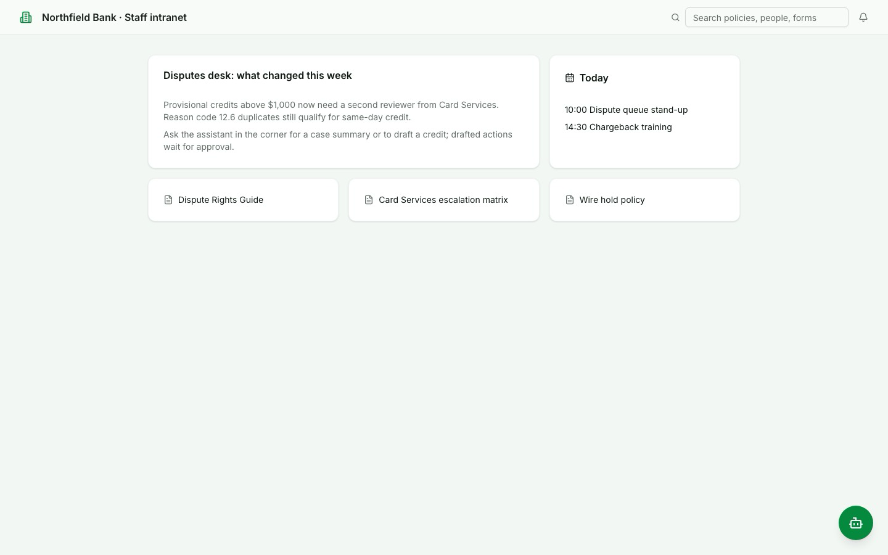
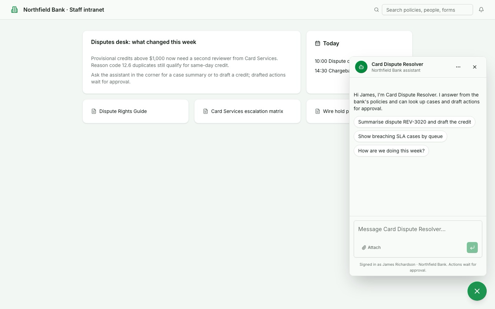
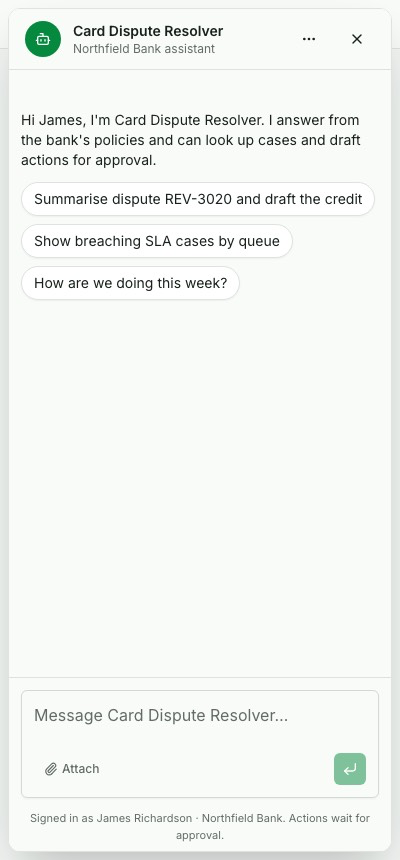
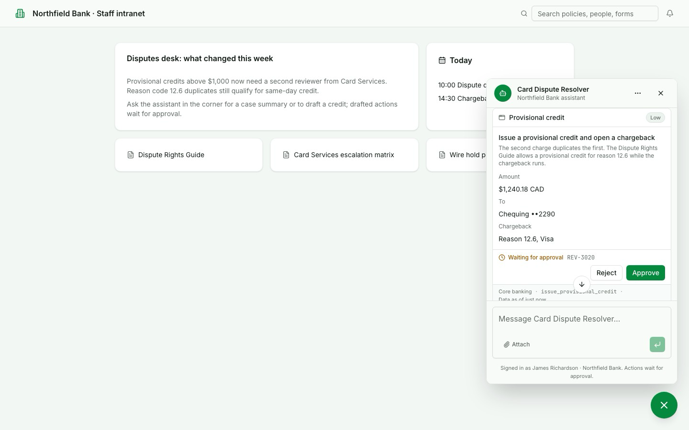
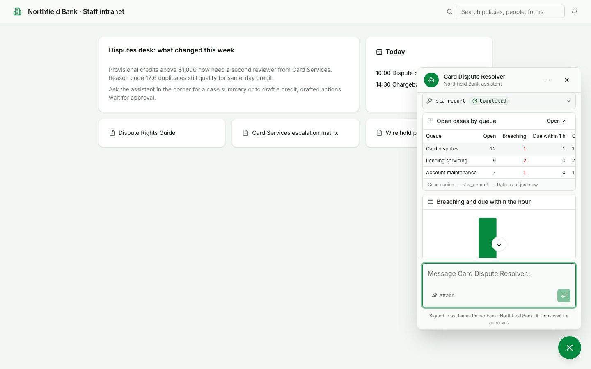
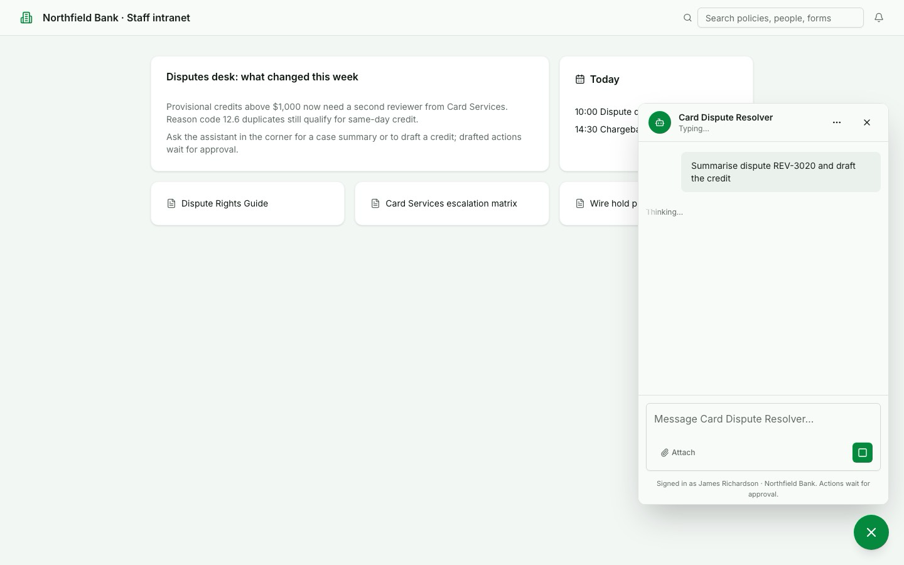
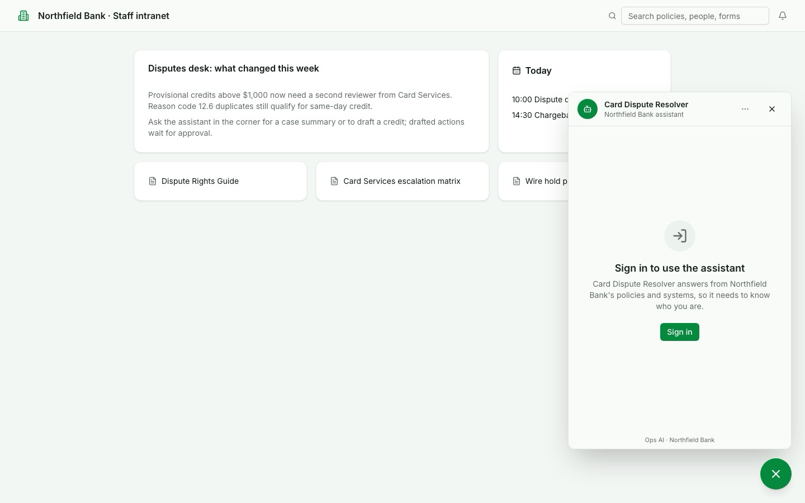
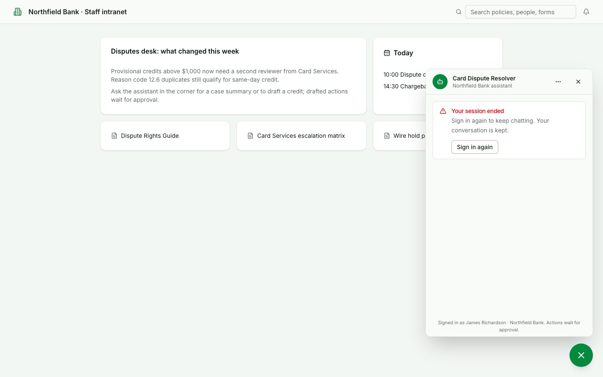

# Embedded chat screens

Status: current design. The screens are a mock on a sample intranet page; the loader and embed app that implement it
are described in [embedded chat](../../architecture/embedded-chat.md), and the steps a builder follows are in
[embedding the chat](../../console/embedding-the-chat.md).

## The problem

Staff spend their day on a bank's own intranet pages, not in the Ops AI console. If an agent's chat only exists in the
console, people have to switch tools to ask a question or approve a drafted action. A small script-drawn chat in the
host page would have to redraw every answer widget, tool status and approval card by hand, and would drift from the
console chat.

The design embeds the full console chat: a launcher in the corner of the bank's page opens the same chat components
the console uses, inside a frame served from Ops AI. Answers, sources, widgets, tool buttons and approvals look and
behave as they do in the console, and a person is always signed in.

## Design decisions

| Decision | Choice | Reason |
|---|---|---|
| Where the chat is drawn | A separate small embed app on its own host, loaded in a frame by a launcher script | The host page never sees the conversation, and the public route sits on a different host from the console |
| What it shows | The full chat: text, sources, answer widgets, tool buttons and approvals | Staff approve drafted actions where they ask for them; a text-only chat would send them back to the console |
| How the person is identified | The bank's server mints a short session for the signed-in person | One signer, nothing long-lived in the page, one revoke stops it; see [identity options](../../architecture/embedded-chat.md#identity-options) |
| Who can use it | Signed-in people only | An agent that reads bank systems needs to know who is asking; a public visitor mode is not part of this design |

## The screens

Every screen is at 1440 px on the sample intranet page, except the phone screen at 400 px. The agent is a card
dispute assistant and the person is a seed persona; all data is synthetic.

| State | What it shows |
|---|---|
| Closed | One launcher in the corner; nothing of the chat is in the page |
| Open | Header with the agent, a menu and close; a greeting; three suggested starters; the console's composer; a footer naming who is signed in |
| Phone | Full screen at 400 px, closed from its header, with no sideways scroll |
| Approval | The console's approval card for a drafted credit; deciding it here decides the same review that Reviews lists |
| Answer widget | A tool's result drawn as the console draws it: a table and a chart of cases by queue |
| Streaming | The phase label while the agent works, and Stop in place of Send |
| Signed out | Sign in runs the host page's own login; the chat explains why it needs to know who is asking |
| Session ended | Says so, offers Sign in again, and keeps the conversation |

### Closed

### Open

### Phone

### Approval

### Answer widget

### Streaming

### Signed out

### Session ended

