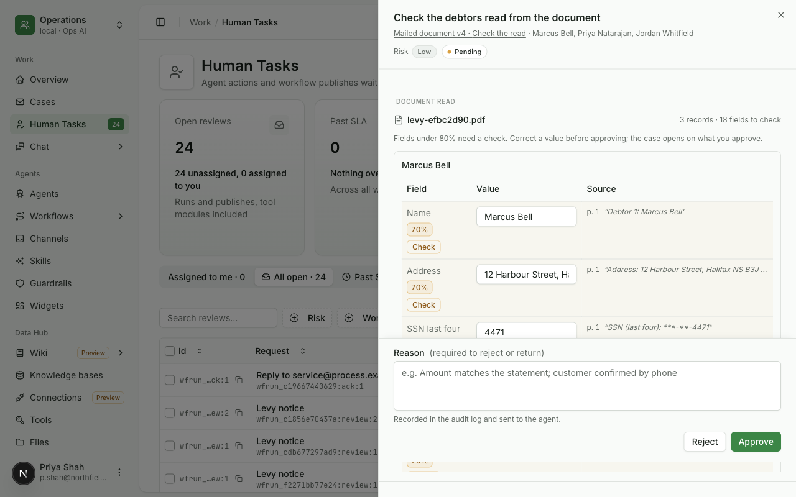
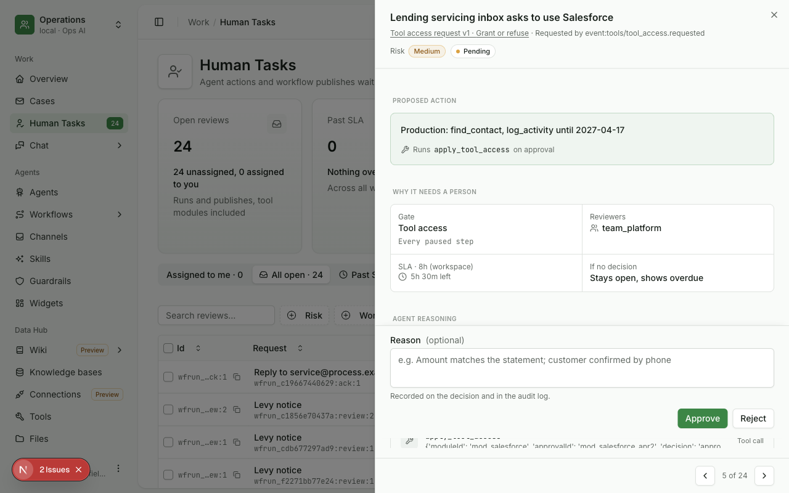
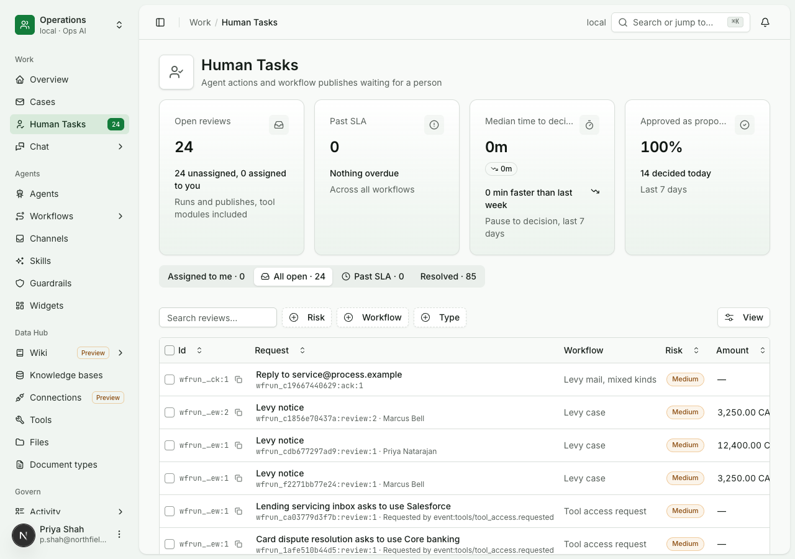
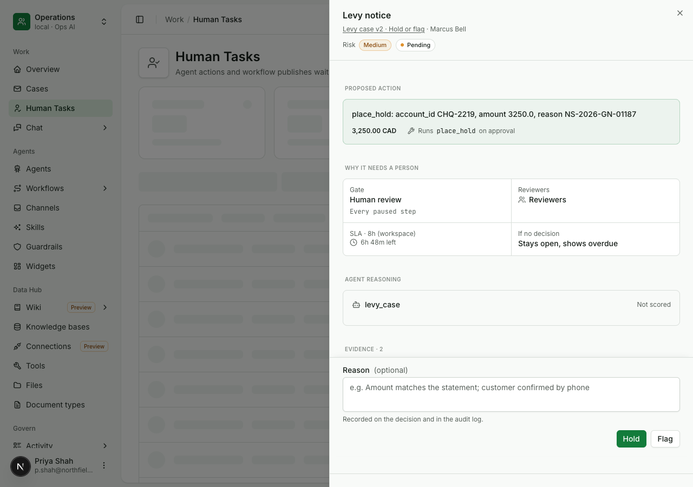
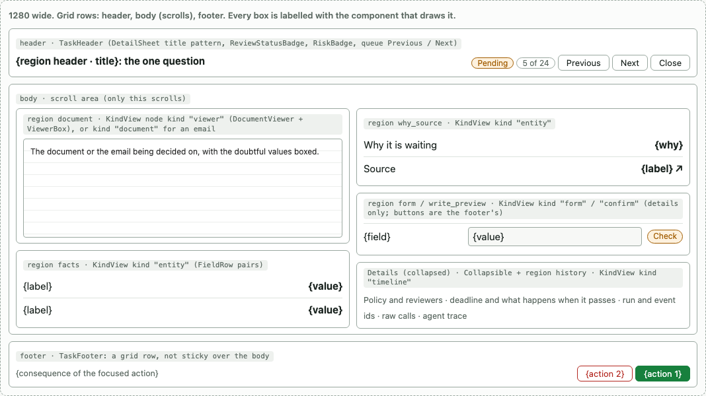
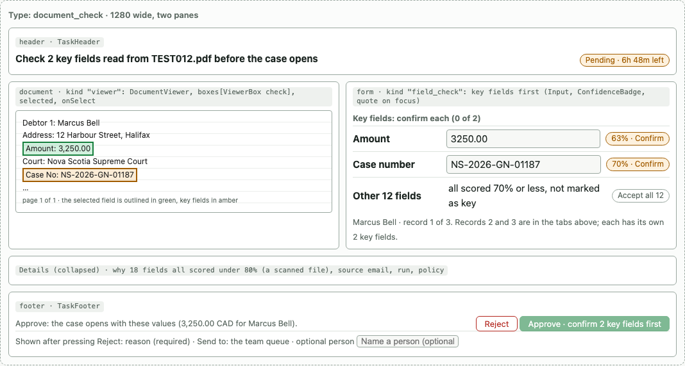
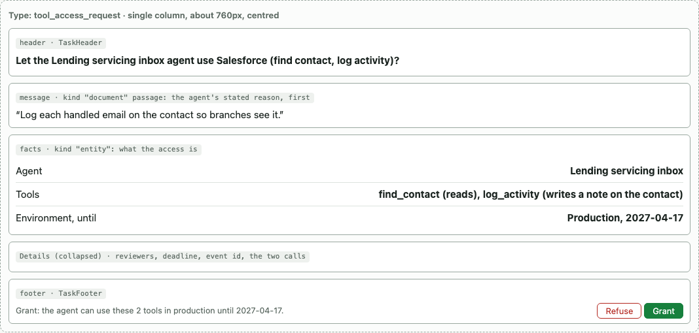
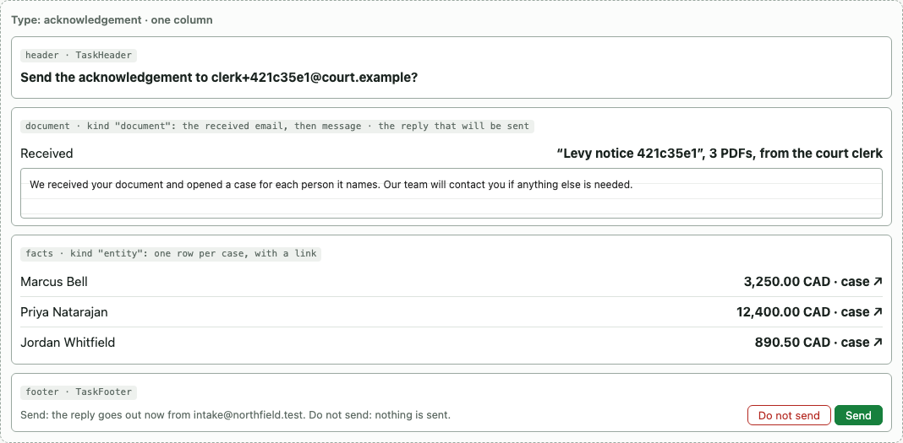
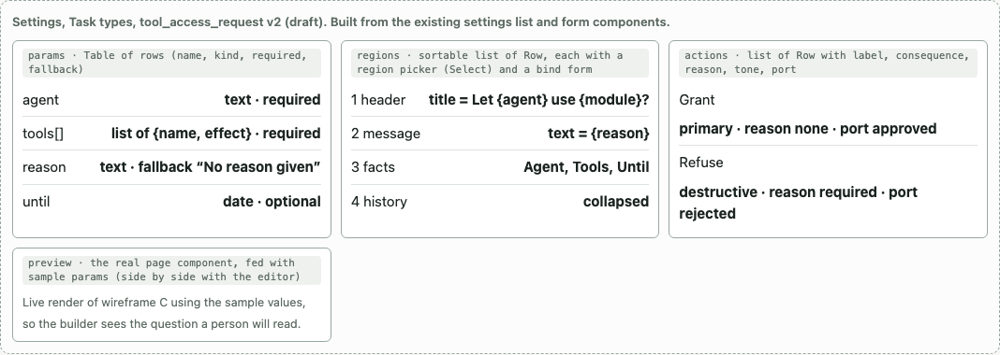

# Human task page

Status: current design. Task types are built and proven by
[uc-254](../../usecases/agents-service/typed-human-tasks.md); the full-page task view by
[uc-234](../../usecases/console/human-task-page.md). Where the build still differs from this design is listed in
[console/proposed/tasks](../../console/proposed/tasks/README.md).

## The problem

A Human Task is the moment a workflow or an agent stops and asks a person to decide: check what was read from a
document, approve a write to a core system, grant an agent access to a tool, or send a reply. The first task screen
showed whatever data the workflow happened to pass, under headings written for the engine. It did not say what the
task was asking, what each button would do, or what the person should look at first. Opening five real tasks showed
the same three failures on every one:

| Failure | What the person saw |
|---|---|
| The question is never stated, and the evidence comes last | The agent's reason for a tool request was the last line of a section called "Agent reasoning: Not scored". A read check had no document beside its fields. An acknowledgement did not show the email it answered |
| Engine vocabulary fills the space | "Gate: Human review / Every paused step", run ids, event names such as `event:tools/tool_access.requested`, and tool calls printed as raw dictionaries, often the same fact twice |
| The container works against the content | A 672 px side sheet (52% of a 1280 px window), with a 199 px decision bar overlaid on the bottom of the scroll area, and four screens of scrolling on a read check of 18 fields |





| Task opened | On screen that does not help | Missing |
|---|---|---|
| Read check (3 debtors, 18 fields) | All 18 fields scored 63 to 70%, so every field said "Check" and the badge separated nothing; a quote repeated under each field; an empty Currency row on every record | The document itself; which fields matter (amount, case number); what Approve and Reject do |
| Acknowledgement | "Debtor 1 / wfrun_… / case_…" as opaque text; "Risk: Medium" on a polite reply | The email being answered; names and amounts of the cases it opened; that Approve sends and Reject sends nothing |
| Hold or flag (a write approval) | The `place_hold` call shown twice as a dictionary; an empty "Agent reasoning" box | The account balance against the hold; which button runs which call |
| Tool access request | "Runs apply_tool_access on approval"; two evidence cards showing the same call | Whether each tool reads or writes; the agent's stated reason, first |





## Requirements the design meets

| # | Requirement | Where it is met |
|---|---|---|
| 1 | Tasks are types, not code: a general type works for any workflow, a specialised type is configuration, and both look relevant to the decision | [Task types as records](#task-types-as-records), [One renderer](#one-renderer-reuse-the-chat-widget-kinds) |
| 2 | The task has room, and the actions never cover content | [Layout](#layout-a-full-page-with-a-footer-row) |
| 3 | The person knows what to focus on | [The focus rule](#the-focus-rule) |
| 4 | A missing setting warns and shows a fallback; it never refuses the save | [How a step or an API caller picks the type](#how-a-step-or-an-api-caller-picks-the-type) |
| 5 | When every field read is doubtful, key fields come first and must each be confirmed; the rest can be accepted together | Wireframe B, the `document_check` type |
| 6 | A rejected read goes to the team queue; the checker may name a person | Wireframe B, the Reject action's optional assignee |

## The focus rule

Every task has one question, written as a sentence at the top, for example "Grant the Lending servicing inbox
read-write access to the CRM?". The evidence for that question comes first and sits next to it: the document, the
email, the balance, the agent's stated reason. Everything else (policy, reviewers, deadline detail, run ids, raw calls,
the agent's trace, fields read with high confidence) is folded under one Details disclosure that a person opens on
purpose. A region that cannot show evidence for the question is not drawn.

Any task, in any workflow, answers these questions in this order:

| # | Question | Shape of the answer |
|---|---|---|
| 1 | What is this? | A sentence with a verb and the thing: "Check 2 key fields read from TEST012.pdf before the case opens" |
| 2 | Why is it waiting on me? | The situation ("2 of 14 fields scored under 80%"), then the source (email, sender, run), then the deadline and what happens when it passes |
| 3 | What will each button do? | One sentence per option, naming the next step and the system it touches |
| 4 | What is the source? | The document, email or record, openable, with the evidence for each doubtful value beside it |
| 5 | What exactly will be sent or changed? | For a write: system, operation and inputs, as the person will see them in that system |
| 6 | How sure is the read? | Per field: value, quote, confidence; doubtful first |
| 7 | Who asked, and who else can decide? | Requester, reviewers, assignee |

## Layout: a full page with a footer row

| Part | Rule |
|---|---|
| Route | A task row opens the task as its own page (`/reviews/{id}`). Previous and Next move through the queue and keep the position ("5 of 24"). A quick view on the list shows the question, a one-line evidence summary and Open, so the list stays usable |
| Width | Content up to 1280 px. With a document: two panes from 1024 px (evidence 55%, decide 45%, both `minmax`), one pane below that with an Evidence / Decide switch. Without a document: one column of about 760 px so lines stay readable |
| Grid | Three rows: header (auto), body (1fr, the only scroll area), footer (auto). The footer is a row of the layout, not sticky over the body, so the body ends where the footer starts and nothing is covered |
| Header | The question as title, status, deadline, Previous / Next / Close. No actions; the footer is the one place to decide |
| Footer | Left: the consequence of the focused action ("Approve: the case opens with these values"). Right: the actions in the order the type declares. A disabled primary button says why ("Confirm 2 key fields first"). An action that needs a reason adds a reason row, which makes the footer taller and the body shorter |
| Narrow screens | The footer stacks: consequence line, then full-width buttons |

### Wireframe A: the page, any task type



### Wireframe B: read check with key fields

The document type marks Amount and Case number as key fields. Each key field needs its own confirmation; the other 12
are accepted together. Reject asks for a reason and sends the document to the team queue, optionally naming a person.



### Wireframe C: tool access request

A specialised type in one column: the agent's reason first, then what the access is, then Grant or Refuse.



### Wireframe D: acknowledgement

The received email, the reply that will be sent, and one row per case the email opened.



## Task types as records

A task is an instance of a task type: a database record that declares its parameters, its screen (an ordered list of
regions) and its actions. No type is code. Publishing a type creates a new version, and a task keeps the version it was
created with, so changing a type never changes a task that is already open.

| Field | Holds |
|---|---|
| `id`, `version`, `status` | Type key, integer version, draft or published. Created by copying a seed or from nothing |
| `name`, `description` | Shown in the builder's picker and the list's Kind column |
| `params` | A JSON Schema for what the caller passes. A property may have a fallback template used when it is missing |
| `regions[]` | Ordered. Each: `region` (one of the fixed set below), `bind` (a map from region slots to templates over params, such as `{"title": "Check {params.keyCount} key fields read from {params.file.name}"}`), optional `when`, and `collapsed` (true for Details) |
| `actions[]` | Ordered. Each: `name`, `label`, `consequence` (template), `reason` (required, optional or none), `tone` (primary, neutral, destructive), `port` (the workflow step's output port, or the value returned to an API caller), optional `inputs` (such as an assignee) and `requires` (such as "all key fields confirmed") |
| `defaults` | Deadline hours and what happens when it passes; a workflow step or API call can override them |

### The fixed set of regions

| Region | Draws |
|---|---|
| `header` | The question, status, deadline, queue controls |
| `why_source` | Why it waits, where it came from, who asked |
| `document` | A file with boxes on the values in question, or a received email |
| `facts` | Label and value rows |
| `write_preview` | System, operation and inputs of the write an action will run |
| `form` | Inputs to collect or correct, with key-field marking and confidence |
| `message` | Text that will be sent, or the agent's stated reason |
| `history` | What happened before the task, in order |

### Seed types

| Seed type | Regions | Default actions | Main params |
|---|---|---|---|
| `generic_decision` | header, why_source, facts, history (folded) | Approve, Reject, each with a consequence | title, why, facts |
| `document_check` | header, why_source, document, form (field check), history | Approve (needs key fields confirmed), Reject (reason required; to the team queue, optional assignee) | title, document, fields with key flags, consequence texts |
| `write_approval` | header, why_source, facts, write_preview, history | One action per write option, plus decline | title, why, facts, options each with a call |
| `acknowledgement` | header, document (the received item), message (the reply), facts, history | Send, Do not send | title, received, reply, facts |
| `data_entry` | header, why_source, form, history | Submit, Cancel | title, fields (name, kind, required) |

A specialised type is a copy with edits. `tool_access_request` is `write_approval` with a message region first (the
agent's reason), three fixed facts (agent, tools, environment and expiry) and the actions Grant and Refuse.

### The same types across use cases

Each column is configuration: parameters filled by a workflow step or an API call. No column adds a region or an
action to the product.

| | Levy read check | KYC document check | Vendor bank-detail change | Tool access request | New supplier form |
|---|---|---|---|---|---|
| Type | `document_check` | `document_check` | `write_approval` | `tool_access_request` | `data_entry` |
| Question | Check {n} key fields read from {file} | Check the ID read for {applicant} against the passport scan | Change the bank account for {vendor} to {newAccount}? | Let {agent} use {module}? | Enter the details for new supplier {name} |
| Evidence | The PDF; amount and case number as key fields | The scan; name, number and date of birth as key fields | Current and new account; the email that asked; the callback number on file | The agent's reason; the tools and what they read or write | The supplier request email |
| Action 1 | Approve: the case opens | Accept: moves to the sanctions check | Change it: the account is updated now | Grant: tools usable until {date} | Submit: the supplier is created |
| Action 2 | Reject: team queue, optional person | Ask for a new scan: an email goes out | Call the vendor first: a call task is created, nothing changes | Refuse: the agent keeps running without it | Cancel: nothing is created |
| Reason asked | On Reject | On Ask for a new scan | On Call the vendor first | On Refuse | None |

### How a step or an API caller picks the type

```jsonc
// A workflow's human review step (shape only)
{ "taskType": { "id": "document_check", "version": 3 },
  "params": {
    "title": "Check {$.nodes.read.out.keyCount} key fields read from {$.input.name}",
    "document": "$.input.fileId",
    "fields": "$.nodes.read.out.fields",
    "onApprove": "The case opens with these values.",
    "onReject": "No case opens. The team queue decides what the document is." } }

// An API caller
POST /v1/tasks
{ "type": "write_approval", "version": 2,
  "params": { "title": "Change the bank account for Acme to ...", "why": "...",
    "facts": [ { "label": "Current", "value": "..." } ],
    "options": [ { "name": "change", "label": "Change it", "call": "update_vendor_bank" } ] },
  "dueAt": "2026-10-19T17:00:00Z", "callback": "https://client.example/hooks/tasks" }
-> 201 { "id": "task_...", "url": "/reviews/task_...", "warnings": [] }
```

| Rule | Behaviour |
|---|---|
| Version | Omitting `version` pins the latest published version when the task is created; the task stores it |
| Missing parameter | Not refused. The workflow editor warns on save, the API returns the task with a `warnings` entry, and the screen shows the parameter's fallback line |
| Wrong-typed parameter | 422, because no fallback line can show it |
| Drawing | The screen reads only the type and the parameters. There is no task-specific component. A region whose bound parameters are all missing is not drawn |

### Wireframe E: the type editor

A builder edits params, regions and actions with the existing settings list and form components, beside a live
preview of the real page fed with sample parameters.



## One renderer: reuse the chat widget kinds

The chat already has a JSON-to-UI renderer: a node has a kind and data, and the component draws it (metric, table,
chart, timeline, entity, form, confirm, document, quote and others). Task regions map onto those kinds, so a region is
a kind node that the type's templates fill.

| Task region | Kind that draws it | Gap the design closes |
|---|---|---|
| `why_source`, `facts` | entity | None |
| `history` | timeline | None |
| `message` | document passage, quote | None |
| `write_preview` | confirm | Its own buttons are hidden, because the page footer owns the actions |
| `form` | form | Values are returned as data, not as chat text |
| `document` with boxes | none | A new `viewer` kind over the shared document viewer |
| Checking read values | none | A new `field_check` kind: value, confidence, quote, key marking, accept all |
| Header, footer, Details | not kinds | The page frame, fixed because it is the frame, not content |

One renderer means a chat agent can show the same read check inline in a conversation, and a kind added for tasks is
available to chat. Two renderers would drift in spacing, dark mode and accessibility.

## How other products do it

| Product | What it does | What we take |
|---|---|---|
| Zapier, Human in the Loop | The step author writes an approval message, a list of content to review, and the button labels; a setting decides whether a decline stops the run | The author supplies the question and labels; the engine supplies the frame. Zapier has no consequence text per button; this design adds it |
| Camunda Tasklist | List columns include task name, process, business id, assignee, priority and due date; the detail shows a form per task, or the raw variables when there is no form | A business id in the list beats a run id. A form per task type stops the screen being a variable dump |
| Google Document AI human review | The reviewer sees the fields that need validation, confirms each, then submits; review is triggered by a confidence threshold (the feature has since been deprecated) | Confirm per field plus one submit, with the document and fields on one screen |

None of the products read describes a consequence line per option; that is this design's addition.

## Open questions

| Question | Current answer |
|---|---|
| Is the full page right for every task, or should short tasks stay in a side sheet? | Full page, with the quick view on the list for a glance |
| Should a wrong-typed parameter also warn rather than refuse? | Refuse with 422, since no fallback can show it |
| Not covered | Bulk decisions, permission to edit task types, and the list screen's columns |
