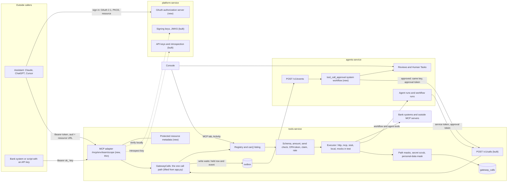
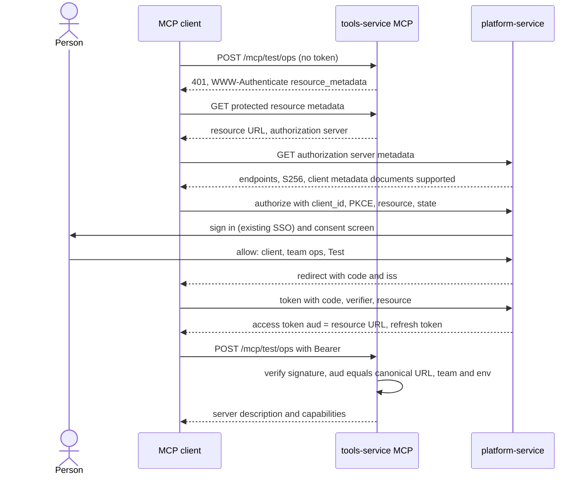
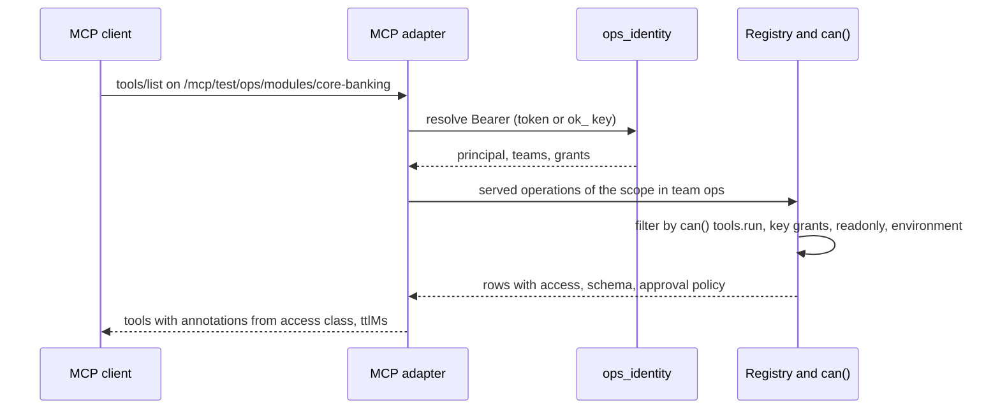
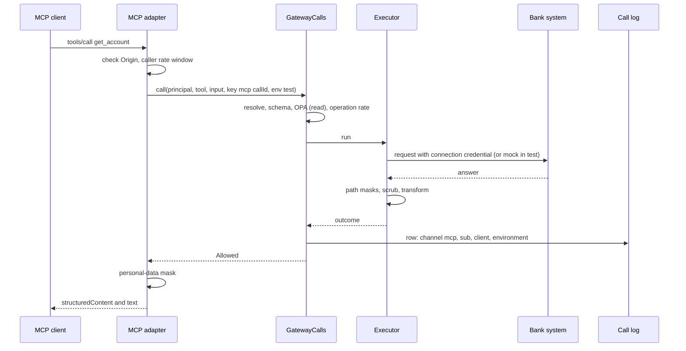
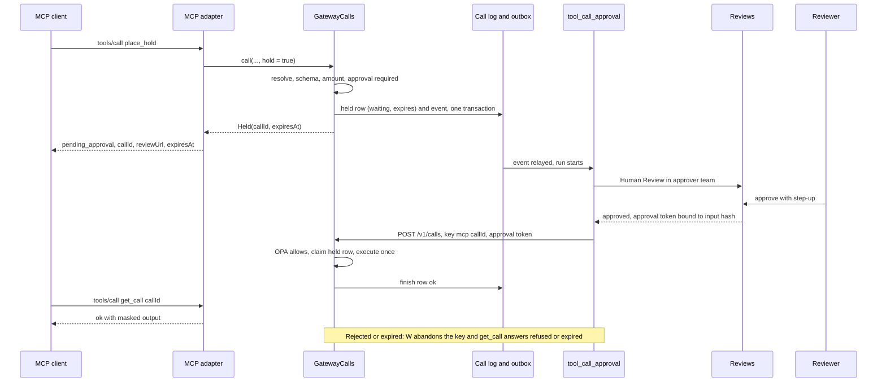
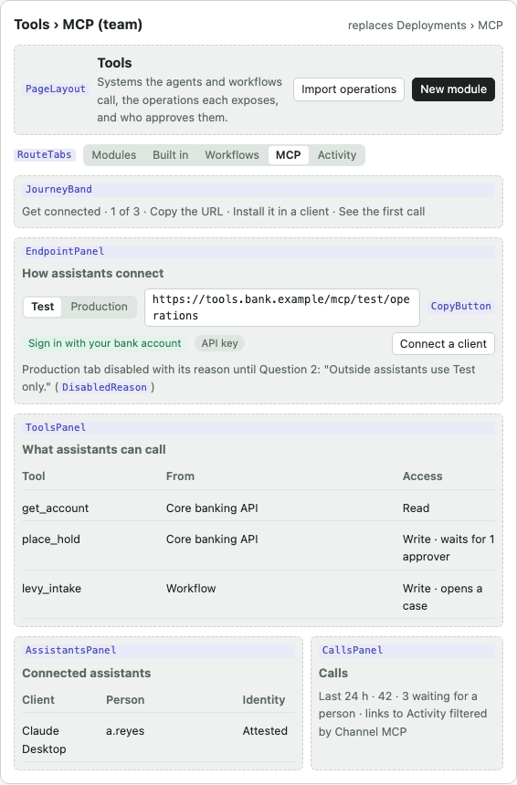
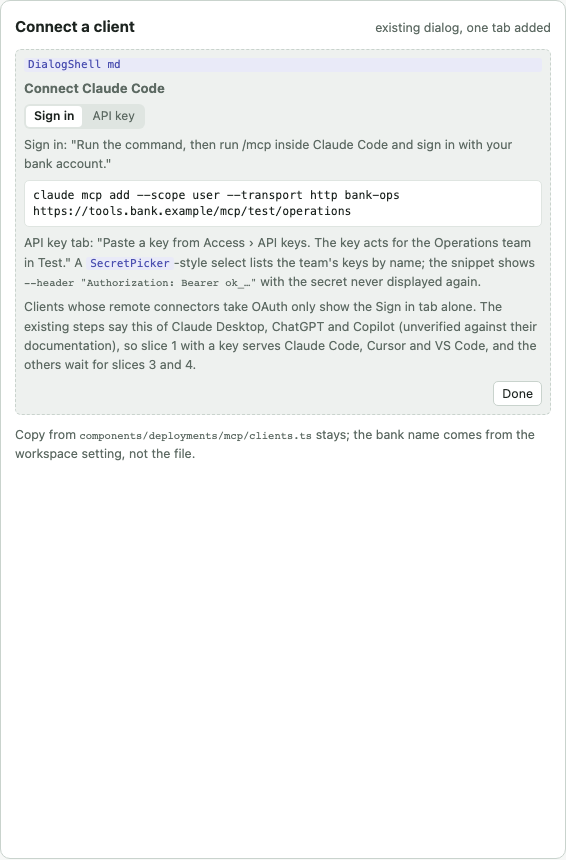
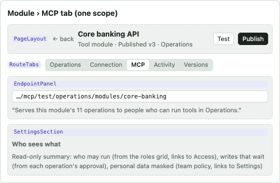
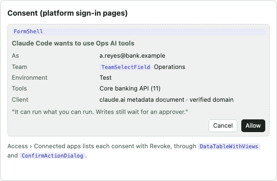
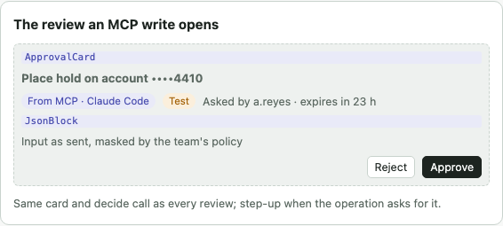

# Tools MCP server

Status: proposed design. Slice 1 (read tools over MCP with an API key, test only) is built and proven by
[uc-410](../../usecases/tools-service/mcp-server.md); the rest is not built unless the "Slices and state" table says so.

## The problem

Agents and workflows inside the platform call governed tools through tools-service: the registry decides each tool's
access class, writes need an approval token, every call is logged. People also work in outside assistants such as
Claude, ChatGPT, Cursor and VS Code, and bank systems want to call the same tools from scripts. Before this design,
tools-service was an MCP client only: it called other MCP servers, but nothing served the platform's own governed tools
over MCP, and its one call route accepted service tokens only. An outside caller either reached nothing, or would have
needed a second path around the gateway's rules.

This design serves every tool tools-service governs over the Model Context Protocol, through the same gateway function
agents and workflows use, so an MCP call meets every rule a REST call meets. Read with the
[tool system design](tool-system.md), the [tools-service overview](../../services/tools-service/overview.md),
[human in the loop](../../architecture/human-in-the-loop.md) and the [service map](../../architecture/service-map.md).

## The design in four points

| Point | Decision |
|---|---|
| Endpoint | One MCP server per team and environment, `/mcp/{env}/{team}`, with narrower scopes as path segments (a module, built-in tools, workflows, one agent's grants) and `?tools=` and `?readonly=1` to narrow further. A scope can only narrow what the caller may run |
| Sign-in | tools-service is the resource server. platform-service, already the only token issuer, becomes the OAuth 2.1 authorization server: protected resource metadata, PKCE, a token bound to the exact resource URL, pre-registered clients and client ID metadata documents, dynamic registration off. An API key as `Bearer ok_…` serves bank systems and the first slice |
| One path | The body of `POST /v1/calls` is one function, `GatewayCalls.call`, which both routes call. The MCP adapter is a thin translation in tools-service with no rule of its own beyond protocol rules |
| Approvals | A write that needs a person is held: the caller gets a pending result with a review link and an expiry at once; a system workflow opens the review; on approval it runs the held call once. The client reads the outcome with `get_call`. Nothing is approved by the client, by an elicitation or by a timeout |

## What existed before

| Part | What exists | State |
|---|---|---|
| MCP client | `initialize`, `tools/list` (paged), `tools/call` over streamable HTTP; every request through the egress client | Built |
| Signing in to outside MCP servers | 401, protected resource metadata, authorization server metadata, issuer checked, S256 | Built |
| Call path | Registry resolve, schema, amount limit, check before sending, OPA with an approval token bound to the input hash, write claim and fence, idempotent replay, rate limit, executor, call log | Built, service tokens only before this design |
| The tool shape a model needs | Name, description, access class, input JSON Schema, approval policy, output shape | Built (`GET /v1/grantable-operations`) |
| API key as a bearer | `Bearer ok_…` classified by prefix and introspected by platform-service | Built |
| Personal-data masking | Masked values for what people see; the model sees real values | Built, applied per agent |
| Service events to system workflows | A service writes an event to its outbox; agents-service starts the handler workflow (tool access requests already work this way) | Built |
| Abandon a key | A caller that gave up on a write marks its key so the write never runs later | Built |
| MCP as a channel | An earlier plan put an MCP deployment channel in agents-service, exposing a workflow as a tool | Planned, replaced by this design |

## Architecture

The MCP adapter is one more route on tools-service, beside `POST /v1/calls`. A write that needs a person leaves
tools-service only as a service event, and a system workflow in agents-service opens the review and runs the approved
call, which is how tool access requests work already.

| Component | Lives in | Job | State |
|---|---|---|---|
| MCP adapter | tools-service | Parse the request, resolve the caller and scope, list tools, map `tools/call` to one `GatewayCalls.call` and its outcome back to an MCP result. Protocol rules only: Origin check, protocol version, scope parsing | Built for slice 1 |
| `GatewayCalls` | tools-service | The one call path, taking a verified principal and returning Allowed, Refused or Held. `POST /v1/calls` keeps its wire contract | Built (Allowed and Refused) |
| Protected resource metadata | tools-service | Metadata per URL naming platform-service; the 401 challenge points at it | Planned |
| Authorization server | platform-service | Metadata, authorize with consent, token with PKCE and resource, refresh, revoke, registered clients, client metadata documents | Planned |
| `tool_call_approval` | agents-service seed, owned by no team | Started by `tool_call.approval_requested`: a Human Review step with the operation's approvers, approver team and step-up, then a tool step that runs the held call; on rejection or expiry it abandons the key. A record, no new node | Planned |
| Console MCP tab | Console, Tools area | The MCP panels moved to Tools and pointed at tools-service | Planned |

Service boundaries hold: tools-service reaches agents-service only through the event route and, for workflow and agent
tools, the run API. It never opens a review itself.

## What an MCP gateway needs, and what this design keeps

These are the parts a multi-tenant MCP gateway usually carries. Port means the behaviour is kept as it is; adapt means
kept but changed; drop means not taken.

| Capability | Here | Verdict and why |
|---|---|---|
| A workspace URL, workspace from the host or path | `/mcp/{env}/{team}` | Adapt. Assets belong to teams and a caller acts in one team, so the team is in the URL (an MCP client cannot send a team header). The environment is in the URL so a test token can never reach production |
| A named toolset URL serving exactly that set | Scope segments: `/modules/{id}`, `/builtin`, `/workflows`, `/agents/{id}` | Adapt. A module, the built-in view, the workflow tools and an agent's grants are already the curated sets builders manage. A named toolset record waits until a team needs a mix these cannot express |
| Published servers as their own record with their own inbound auth | A published module's scope | Drop. A module already has publish, versions and a security review; a second "server" record would be a second home for the same thing |
| End-user session URLs with the caller bound from the session token | Identity only from the verified token or key | Port the rule. No caller id is ever taken from a header or a body |
| Meta tools (search, describe, execute) instead of one tool per operation | Direct tools only | Drop for now. Scopes keep lists short. A search-and-call surface for a team with hundreds of operations is a later option |
| Register every tool, filter only what `tools/list` shows | Listing is visibility; `GatewayCalls` decides every call | Port. An unlisted tool called by name goes through the gateway and is refused and logged, never "tool not found" from the protocol layer. Empty visibility lists nothing |
| Inbound credential chosen by what is presented; never forwarded | Identity resolution; connection credentials for upstreams | Port. An inbound token never reaches a bank system |
| Connect links for end-user accounts | Per-person sign-in (tool system slice 14) | Adapt later. When an operation needs the caller's own account, the result carries a sign-in link |
| First-party tools: memory, knowledge, prompts, guide | Built-in tools | Adapt knowledge search and starting a workflow. Drop memory (agents remember people themselves) and a guide (onboarding a self-serve workspace is not a bank's need) |
| Prompts and skills served as MCP prompts | Skills are agents-service records | Later, optional |
| Instructions at `initialize` | The scope's description | Port. One sentence: team, environment, and that writes wait for a person |
| Annotations guessed from a tool name's verb | From the registry's access class | Replace. Every operation is reviewed as Read or Write, so the hints come from that |
| Pending approval as a structured, non-error result with id and expiry | Held outcome, pending result and `get_call` | Port and extend with the review link, the read-back tool, URL elicitation and later the Tasks extension |
| Monthly request allowance and quota warnings | None | Drop. No plan tiers in a bank deployment; usage shows per client in Activity |
| Per-caller throttle in an in-process map | Per-caller window in PostgreSQL | Adapt. A map is per process; the gateway runs several processes and must hold across restarts |
| Caller attribution: credential id, client id, client name | Call log columns `channel`, `client_id`, `client_name` | Port. Never the key secret; the client name is a claim and is shown as one |
| An OAuth authorization server with consent, revoke and client metadata documents | platform-service | Port, with a team picker on the consent screen. Drop anonymous authorize and a sandbox. Dynamic registration off by default |
| Protected resource metadata that fails closed with no issuer | Path-suffixed metadata per team and environment | Port. No issuer configured means the MCP route answers 503 |
| Stateless streamable HTTP | Python SDK session manager, stateless, JSON responses | Port. The current specification removed sessions |
| Public, unauthenticated knowledge servers and guest sandboxes | None | Drop. Nothing at a bank is served anonymously; trying before production is the Test URL, which answers from mock answers |

Beyond listing and calling tools, this server carries the gateway's own rules to every MCP caller:

| Concern | What applies |
|---|---|
| Approvals | An approval token bound to the exact input hash, approvers counted by OPA, approver team, step-up, separation of duties, expiry, decided in Reviews |
| Test and production | Two environments per connection; test answers from mock answers first; the URL and the token name the environment |
| Masking | Output paths masked per operation, secrets scrubbed, personal data masked for what leaves to an outside model |
| Grants | `can()` over the roles grid and team policies; keys bound to a team and optionally to one agent |
| Egress and review | Every upstream request on the allow-list at a checked address; every module version reviewed by Security before calls see it |
| Check before sending | A team's sending policy judges writes that carry no approval |

## How others do it

### The specification

| Topic | What the current revision says | Consequence here |
|---|---|---|
| Revision | 2026-07-28 removed the initialize handshake, sessions and the GET stream; every request carries its protocol version and capabilities | Serve both the current form and the initialize form older clients send |
| Transport | One POST endpoint; JSON or a per-request SSE stream; servers must validate Origin and answer 403 when it is present and invalid | JSON responses only, so the adapter is stateless and runs in any gateway process |
| Authorization | Servers must publish RFC 9728 protected resource metadata; RFC 8707 resource in authorize and token requests; servers must validate the audience and must not pass tokens on; RFC 9207 issuer checked | platform-service mints a token whose audience is the exact resource URL; tools-service compares it with the request's URL |
| Client registration | Pre-registered first, then client ID metadata documents, then dynamic registration (deprecated) | Pre-registered and metadata documents on; dynamic registration a setting, off |
| Tool list | `tools/list` may vary by the authorization presented; results carry `ttlMs` | The list is computed per caller from `can()`; clients re-list after `ttlMs` |
| Annotations | Clients must treat annotations as untrusted unless the server is trusted | Set from the registry; the server enforces approval itself |
| Results | With an `outputSchema`, `structuredContent` must conform; servers return handles the model passes back | The pending result carries `callId` as such a handle |
| Elicitation | Form mode must not ask for credentials; in URL mode, accepting means only that the person agreed to open the page | URL mode can open the review page; it never counts as an approval |
| Tasks | An extension where a `tools/call` returns a task the client polls; the overview names approval gates as a use | Later: the held call is the task |
| Human in the loop | "There SHOULD always be a human in the loop with the ability to deny tool invocations" | Client prompts add a check; the server still enforces every approval |

### Products serving many governed tools

| Product | Endpoint model | Selecting tools | Sign-in | Approvals |
|---|---|---|---|---|
| GitHub MCP server | One host | Path `/x/{toolset}`, `/readonly`, or headers; read-only wins | OAuth, or a personal token; a classic token filters tools by its scopes | Some write tools open a form first |
| Stripe | One endpoint | Four generic tools (search, details, read, write) | OAuth per account, or a restricted key | Refunds and payouts return a URL; the person approves in the dashboard; the approval expires after 24 hours |
| Cloudflare | One unified server plus specialised ones | Code over the whole API; for servers you build, register tools per user so the model never sees what it cannot use | OAuth with permission choice, or an API token | None documented |
| Composio | Per-toolkit servers or a session URL per user | Allowed tools, toolkits, meta tools by default | API key header | None found |
| Pipedream | One endpoint, app chosen by header | App slug header | OAuth client credentials plus project, environment and user headers | None; a missing account returns a connect link |
| Atlassian | One remote server (unverified) | Permission groups such as delete off until an admin enables them | OAuth 2.1, or an admin-enabled API token | Actions follow the person's own permissions |
| Client-side gates | OpenAI's MCP tool has `require_approval`; Claude connectors set each tool to always allow, needs approval or blocked | | | Both depend on the client honouring them |

What this settles: one endpoint per tenant with narrowing by path or header is the common shape (GitHub, Stripe,
Cloudflare). A server that must enforce approval does it on the server and hands back a link with an expiry (Stripe),
because client gates and annotations can be ignored. Filtering the list by the credential's rights is documented by
GitHub and recommended by Cloudflare.

## Endpoint model

Each URL is its own OAuth resource, so a token minted for one scope or environment is refused on another.

| URL on the tools host | Serves | Typical caller |
|---|---|---|
| `/mcp/{env}/{team}` | Every tool the caller may run in the team: module operations, built-in tools, workflow tools, agent tools | A person in an assistant |
| `/mcp/{env}/{team}/modules/{module}` | One module's served operations | A person or bank system that uses one system |
| `/mcp/{env}/{team}/builtin` | Built-in tools | A builder in a coding assistant |
| `/mcp/{env}/{team}/workflows` | Published workflows with Use as a tool on | Staff assistants |
| `/mcp/{env}/{team}/agents/{agent}` | Exactly the tools the agent's live version is granted (in test, its current draft), under the agent's approval rules | A key pinned to the agent, for an outside harness or evaluation |
| Any of the above with `?tools=a,b` or `?readonly=1` | The same list narrowed by name, or to reads | Clients that want a short list |

`{env}` is `test` or `production`. `{team}` must match the key's team or one of the token's teams, else 403
`team_forbidden`. The query narrows and does not change the resource, which RFC 8707 asks to carry no query.

## Which tools appear

`tools/list` is computed per request, then filtered by who is asking. Listing decides only visibility; every
`tools/call` goes through the full gateway path and is refused and logged if it fails any rule.

| Filter | Rule |
|---|---|
| Served | Enabled operation of a published module that has not drifted; staged edits not served |
| Team | Modules the URL's team owns, plus another team's operations the team holds an unexpired access approval for |
| Grant | A person: `can(p, "tools", "run", team=…)`. A key: its grants. A key pinned to an agent: only that agent's scope. A read-only key or `?readonly=1`: reads only |
| Scope | The URL's module, built-in view, workflows or agent |
| Environment | Production lists an operation only when its connection has production settings; test lists all and answers from mock answers first |
| System tools | Never listed |
| `get_call` | Listed whenever a write is listed |

| MCP field | From |
|---|---|
| `name` | The operation name |
| `title`, `description` | The description for the agent; title from the module and operation |
| `inputSchema` | The operation's input schema, with `additionalProperties: false` |
| `outputSchema` | The sample answer's fields, once they exist |
| `annotations` | Read: `readOnlyHint: true`. Write: `destructiveHint: true`, `idempotentHint: false`. `openWorldHint` true for http and mcp kinds, false for built-ins |
| `_meta` | `requiresApproval`, approvers and environment, so a client can warn before calling |

## Sign-in

| Credential | How it works | For | State |
|---|---|---|---|
| Platform OAuth token | The client discovers platform-service from the 401 and the metadata, signs the person in through the existing sign-in (SSO or password), shows a consent screen naming the client, team, environment and scope, and issues a 15-minute token whose audience is the exact resource URL, with a refresh token bound to the sign-in session. tools-service verifies it locally against the published keys | People in Claude, ChatGPT, Cursor, VS Code, Copilot | Planned |
| API key | `Authorization: Bearer ok_…`, introspected and cached; bound to one team; optionally pinned to one agent | Bank systems, scripts, coding assistants configured with a header | Built |
| Service token | Unchanged; agents-service keeps `POST /v1/calls` | Runs | Built |

| Rule | Detail |
|---|---|
| Resource server | tools-service answers 401 with `WWW-Authenticate: Bearer resource_metadata="…"` naming platform-service as the only authorization server |
| Authorization server | RFC 8414 metadata, authorize, consent, token, revoke, PKCE S256 required, exact redirect addresses, issuer returned, state single-use |
| Clients | Pre-registered by an admin, or identified by a client metadata document URL. Dynamic registration is a workspace setting, off by default |
| Audience | A token for `/mcp/test/ops` fails on `/mcp/production/ops` and on `/mcp/test/ops/modules/x` |
| No passthrough | The inbound token never leaves tools-service. Upstreams get only their connection's credential |
| Revocation | Revoking a consent or a key takes effect within the token lifetime (15 minutes) or the key cache |
| Origin | A request whose Origin header is present and not allowed is 403; clients that send none are not refused for it |
| Fail closed | With no issuer or key set configured, the MCP mount answers 503 |

## Approvals over MCP

An agent pauses itself before calling a write, so the gateway on its own only refuses a write without a token. An MCP
caller has no run to pause, so the gateway function returns a third outcome, Held, when the caller asks for holding.
The MCP adapter always asks; `POST /v1/calls` keeps refusing.

| Step | What happens |
|---|---|
| 1. Decide | Approval is required by the operation's flag, the team's policy that tool writes need approval, or a check before sending that wants a person. Same code as REST |
| 2. Hold | One transaction: a call row with outcome waiting, its key, the input hash and an expiry; and an outbox event `tool_call.approval_requested` carrying the tool, input, approvers, approver team, step-up, requester and expiry, fixed at request time |
| 3. Answer at once | `isError: false`; `structuredContent {status: "pending_approval", callId, reviewUrl, expiresAt, approvers, reason}`, and the same as one line of text for clients that read only text |
| 4. Review | The system workflow opens a Human Review in the approver team; the requester may not decide unless the policy allows it; step-up as the operation says. The review shows "From MCP", the client name and the environment |
| 5. Run once | The workflow's tool step calls a built-in operation, `run_held_call {callId, inputHash, decision, reason}`, with the approval token from the review. The gateway claims the held row and runs its frozen input once through the same executor, rate window and log row. A changed input hash, a decided row or an expired row runs nothing |
| 6. Read back | `get_call {callId}` answers waiting, ok with the masked output, refused with the reason, or expired. Only the caller who made it, or a person who can see the team's calls, reads it |
| 7. Reject or expire | The workflow abandons the key; a late approval token is then refused `call_abandoned` |

Where the client supports more:

- URL elicitation. When the client declares it and the caller may decide this review themselves, the answer is
  `input_required` with the review page's URL and a signed request state. The person decides on the review page with
  step-up. Accepting the elicitation only opens the page.
- Tasks extension. When the client declares it, the held call is returned as a task and `tasks/get` reads the same row.

Never:

- Form elicitation as an approval: the person answering is the person who asked, and form mode has no step-up.
- A client's own confirmation counting as approval: the specification treats annotations and client gates as untrusted.
- A held call running after its expiry, or because nobody answered. The default wait is a setting, 24 hours.
- A second way to run the write: the approved call is an ordinary gateway call.

MCP has no retry key, so each `tools/call` gets its own key; a client may send `_meta.idempotencyKey`, which the
adapter uses when present.

## Test and production

| Rule | Detail |
|---|---|
| The URL names it | `/mcp/test/…` or `/mcp/production/…`; the token's audience includes it, and an API key's environment must match (403 `key_environment`) |
| Test | Each call runs in the test environment: mock answers first, else the connection's test settings. Every row and review is badged Test |
| Production | The connection's production settings; an operation without them is not listed and is refused `CONNECTION_NOT_SET`. Production answers 403 `production_off` until a team opens it |
| Approvals | Held writes follow the same rule in both; a test approval runs against mock answers or the test system |

## What the MCP client sees

An outside assistant is a model the bank does not run, outside the platform's model routing and its sensitivity rules.
Inside the platform the model sees real values and people see masked ones; over MCP the model and the person are the
same client. Proposed default: mask.

| Layer, in order | What it removes | State |
|---|---|---|
| Operation masks | Output paths the operation marks, redacted before anything is logged | Built |
| Secret scrub | Every resolved secret and token value | Built |
| Transform | Whatever the operation's answer template leaves out | Built |
| Personal data | National identifiers, card and account numbers, emails, phone numbers in results and pending payloads. Ids glued to letters are not masked, so a model can still chain calls by record id. A team policy, on unless a team turns it off | Planned |
| Call log | What it keeps today; people with the right read it in Activity | Built |

A masked account number cannot be passed back by the model. Operations that need one take a record id or a bound field.

## One path and audit

`GatewayCalls.call(principal, request, *, generation, hold)` returns Allowed, Refused or Held. `POST /v1/calls` maps
them to its current JSON; the MCP adapter maps them to MCP results. Nothing about deciding or executing lives in the
adapter. Unchanged for MCP calls: registry resolve and access class; hidden, unpublished, drifted, schema and amount
checks; check before sending; OPA with the approval token and approver count; the system-tool refusal; write claim,
abandon and replay; the per-operation rate limit; the executor with egress, secrets, connections, mock answers, masks
and scrub; the call log row and traffic counts.

| Call log field | For an MCP call |
|---|---|
| `sub` | The person or the key id; never the secret |
| `act` | The MCP client: OAuth client id, or the client's own name marked as claimed |
| `channel` | `mcp` or `api` |
| `client_name` | The client's own name or User-Agent, clamped, shown as a claim |
| `thread_id`, `step` | The call id and the key, which the approval token binds |
| `environment` | From the URL |

Activity and the module's Activity tab show MCP calls, filtered by channel. Consents, consent revocations, client
registrations and key creation are audit entries in platform-service.

## Rate limits

| Limit | Protects | Rule | State |
|---|---|---|---|
| Per operation | The upstream system | Per tenant and operation; 429 `RATE_LIMITED` with the reset time | Built |
| Per caller | Fairness between callers and the gateway itself | Requests per minute per principal on the MCP mount, counted in PostgreSQL in fixed windows; default 60; 429 with `Retry-After` | Planned |
| Listing | The registry | `tools/list` carries `ttlMs` (60 s) so clients cache it | Planned |
| Held writes | Reviewers | Open held calls per principal, default 20; beyond it 429 `too_many_pending` | Planned |

## Sequences

### Connect with OAuth

### `tools/list`

### A read call

### A write that needs approval

## Console

The MCP panels move to Tools and read from tools-service: the team's MCP page at Tools › MCP, and an MCP tab on each
module, built-in view and agent showing the same panels for its scope. The connect dialog keeps its clients and gains
an API key tab. Clients whose remote connectors take OAuth only show the Sign in tab alone, so the key-based first slice
serves clients configured with a header (coding assistants), and the others wait for the OAuth slices.

| Screen | Wireframe |
|---|---|
| Tools › MCP for a team: endpoint, what assistants can call, connected assistants, calls |  |
| Connect a client, with Sign in and API key tabs |  |
| A module's MCP tab for one scope |  |
| The consent screen on the platform's sign-in pages |  |
| The review an MCP write opens: the same card and decide call as every review |  |

## Proof

One use case grows with the slices: [uc-410](../../usecases/tools-service/mcp-server.md). It drives the stack
(tools-service, platform-service, agents-service on the scripted model, OPA, PostgreSQL) through the official Python MCP
client, never a hand-built JSON-RPC body, so the adapter is checked against a real client. No real model calls.

| Check | Expected | Slice |
|---|---|---|
| Connect to `/mcp/test/{team}` with `Bearer ok_…` | `tools/list` holds the team's read operations with `readOnlyHint` and no writes | 1 |
| `tools/call` a read against the fake bank | Output equals the fake bank's answer after masks; a call row with `channel = mcp` | 1 |
| Call a write by name though it is not listed | Refused and logged by the gateway path, beside the passing read | 1 |
| Another team's slug with the same key | 403 `team_forbidden` | 1 |
| A write that needs approval | `pending_approval` with `callId`; the fake bank has received nothing | 2 |
| Approve as a second person through Reviews | `get_call` answers ok; the fake bank received exactly one request | 2 |
| Reject one, let one expire | Refused and expired; a replayed approval token is refused `call_abandoned` | 2 |
| OAuth: 401, metadata, authorize, consent, token with PKCE | The token works on its URL and fails on the production URL and on another scope | 3, 4 |
| Masking on, then off for the team | A national identifier shown masked, then in full | 6 |

## Slices and state

| # | Slice | Done when | State |
|---|---|---|---|
| 1 | Read-only tools over MCP with an API key | The call path is one function with the REST suite unchanged; `POST /mcp/test/{team}` stateless with JSON answers; reads listed and called; a write called by name refused and logged; channel and client name on the call row; production refused | Built ([uc-410](../../usecases/tools-service/mcp-server.md)) |
| 2 | Writes wait for a person | Held outcome; outbox event; `tool_call_approval` seeded; `get_call`; expiry through abandon | Not built |
| 3 | platform-service as the authorization server | Metadata, authorize, consent page, token with PKCE and resource, refresh, revoke, registered clients, client metadata documents | Not built |
| 4 | tools-service as the resource server | Protected resource metadata per URL; 401 challenge; audience equals the URL; Origin check; per-caller rate window | Not built |
| 5 | Scopes | Module, built-in, workflows and per-agent URLs; `?tools=` and `?readonly=1` | Not built |
| 6 | Masking for MCP results | The team policy, on by default; pending payloads and results masked | Not built |
| 7 | Console MCP tab | Panels moved to Tools › MCP and each scope's MCP tab; API key tab in the connect dialog; connected apps under Access | Not built |
| 8 | Production over MCP | Production URL, key environment, production badges | Not built |
| 9 | Retire the agents-service MCP channel | Workflow exposure is Use as a tool | Not built |
| 10 | URL elicitation and the Tasks extension | Self-decidable approvals open the review page from the client; a client declaring Tasks gets the held call as a task | Not built |

Workflow and agent tools appear on the MCP server as soon as their tool kinds exist ([tool system](tool-system.md)
slices 12 and 15); they need no slice here.

## Open questions

| Question | Proposed | Alternative |
|---|---|---|
| Where MCP lives | tools-service is the only MCP server; the agents-service MCP channel is retired and a workflow reaches assistants by Use as a tool | Keep a second MCP surface in agents-service for workflows only |
| Production for outside assistants | Test only until a team opens it; then production through its own URL and token, with every production write waiting for a person whatever the operation says | Production on the same terms as agents |
| Masking for MCP clients | Personal data masked in everything an MCP client receives, on unless a team turns it off, because the client is a model the bank does not run | Follow each agent's rule, where the model sees real values |
