# Tool system design

Status: proposed design. Parts are built; the "Slices and state" table says which. The tools-service
[overview](../../services/tools-service/overview.md) is the authority on what runs today.

## The problem

A builder at a bank wants an agent to look up an account in core banking, screen a name on a compliance MCP server
and start the levy workflow. Before this design those were three different things in three places. Only the first
was edited on the Tools page, and its editor assumed every operation was an HTTP request:

| Problem | Effect on the builder |
|---|---|
| An MCP tool opened in the HTTP editor, as a GET to the MCP endpoint, with a warning that its inputs were dropped | The warning was false (the gateway sends them as `tools/call` arguments), so the screen taught the opposite of what runs |
| The core banking key was a header row, `X-Api-Key: {{BANK_API_KEY}}`, repeated on each of eleven operations | No single place to rotate or change how a system signs in; no OAuth at all |
| The Connections page described OAuth consent and scopes on sample data only | A page that promised something no call used |
| A request mixed four placeholder forms: `{name}` in the path, `{{SECRET}}` in headers (upper case meant secret), `{{amount}}` in the body, `{{ data.x }}` in the transform | A builder could not read a request before running it |
| Only "Mock" and "Test environment" existed | No switch to production and no separate production credential |
| The mock answered `{"ok": true}` while the real system answered an account with holds | Every test of a workflow saw an answer it would never get |

| | |
|---|---|
| 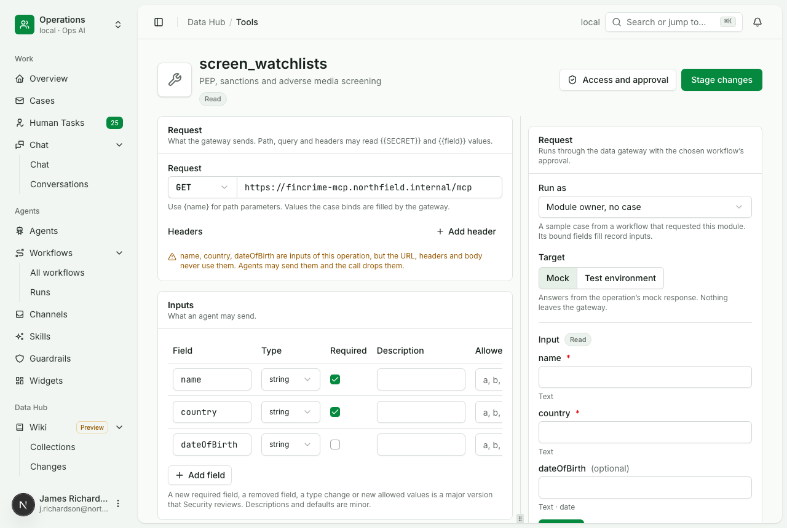 | 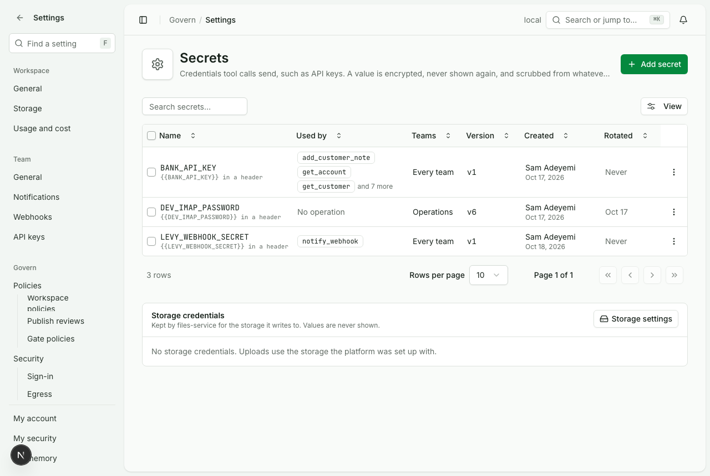 |
| 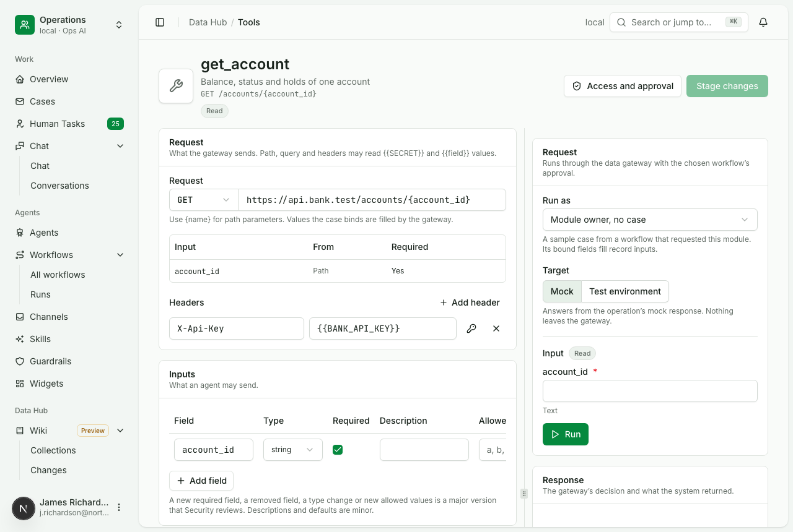 | 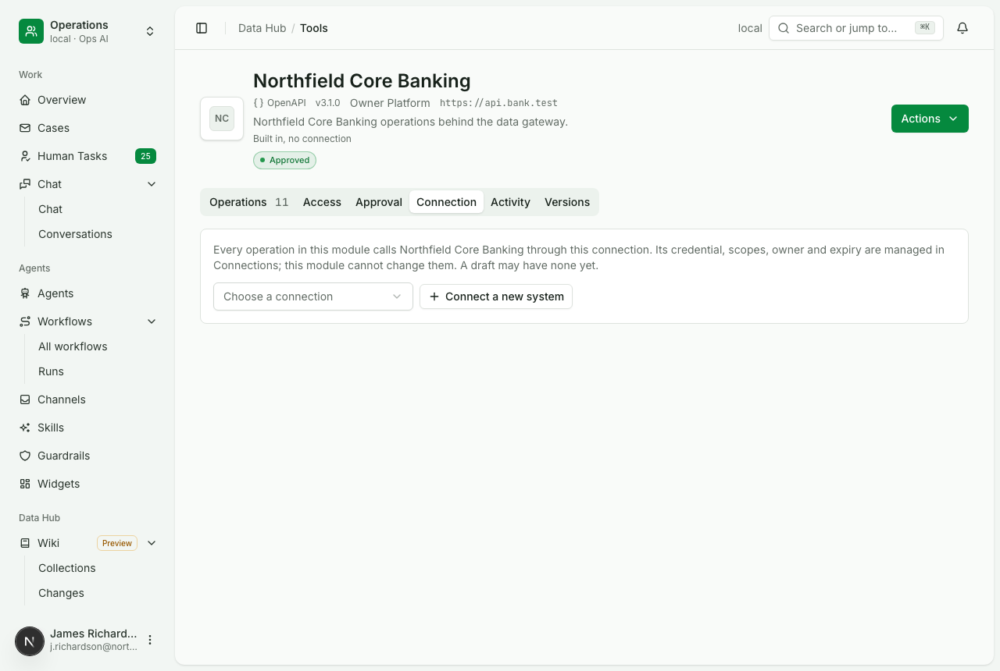 |

The design gives one tool model for everything an agent or a workflow can call: an outside HTTP API, an MCP server,
a workflow, an agent, the platform's own services, and code. Connections hold how a call signs in and are reused
across tools. One variable syntax fills every field of a request. The editor works like a request builder with a Try
it panel, composed from components the console already has.

It extends what tools-service does and redesigns none of it: the registry, versions and security review, workflow
approvals with expiry, the egress allow-list, the secret store, record binding, the test console, transforms and
limits stay as they are. Read with [tools-service overview](../../services/tools-service/overview.md),
[tools-service design](../../services/tools-service/design.html), [tool lifecycle](../../architecture/tool-lifecycle.md)
and [tool screens](../../console/tools-design.md).

## Principles that shaped every screen

| Principle | Why |
|---|---|
| Write for a bank operations builder, not a developer | They need the description the agent reads, what the agent provides, what is sent and what comes back. Request tabs, many variable roots and token timers are developer detail |
| A tool is an agreement between an agent and a system | So the first field is the description the agent reads to choose the tool, and each input says who fills it |
| Creating a record is one screen | A name and one required field; an import or wizard is a second button, never the default |
| One home per thing | A workflow or agent used as a tool is configured on its own page, not copied into Tools as a module with a second version history |
| Values are picked, not typed | Every non-developer product studied shows a mapped value as a named chip picked from a list; typing an expression is a second mode |
| Say what the platform decides | Which environment a call uses, which account a connection signed in as and what happens when a sign-in fails are stated on screen |

## How others do it

Each row is from the product's own documentation. A claim the page did not state is marked unverified.

| Product | How they do it | What we take |
|---|---|---|
| Postman: variables | Global, collection, environment, data and local scopes; `{{base_url}}` syntax; narrowest scope wins; a vault holds secrets | One `{{ }}` syntax everywhere; secrets kept apart from ordinary values |
| Postman: auth | An Authorization tab per request with "Inherit auth from parent"; OAuth 2.0 grants include authorization code with PKCE and client credentials; scheduled runs and the CLI do not refresh tokens | Auth lives on the connection; refresh runs in the gateway for every call, scheduled or not |
| Postman: responses and mocks | Save a response as an example; a mock server answers by matching a request to a saved example; cURL import and export | Keep a real answer; copy as curl; curl and Postman collection import |
| Postman: scripts | Pre-request and post-response scripts | Not taken. Scripts around a request hide behaviour from review; shaping stays in the reviewed transform |
| n8n | HTTP node imports cURL; credentials tested on save, shared without being readable, limited to allowed domains; per-user credentials; `{{ $json.city }}` with inline preview | Shared for use without reading; allowed hosts on the connection; per-person sign-in; inline preview |
| Zapier and Make | One connections page to test, reconnect and delete; sharing without exposing credentials; Make lists the scenarios that use a connection | A "Used by" list; delete refused while in use; reconnect on the connection |
| Retool | A resource holds credentials per environment; OAuth either shared or per user | Settings per environment; the shared or per-person choice made on the connection |
| Power Automate | Flows bind to a connection reference; importing into another environment supplies the connection | A module points at a connection and the environment picks its settings, so promotion needs no tool edits |
| MCP specification | Protected resource metadata, PKCE, the resource parameter, issuer check; client ID metadata documents preferred, dynamic registration deprecated | MCP sign-in discovered from the server; pre-registered client by default |
| OAuth 2.0 security BCP (RFC 9700) | Refresh tokens for public clients must be sender-constrained or rotated | Rotation stored atomically, one refresh at a time per token |

Two weak spots to avoid. Postman's scheduled runs do not refresh OAuth tokens; a gateway that calls for agents at any
hour needs refresh on every path. Zapier and Make show an expired grant only as a Reconnect button; here a connection
carries a status, an expiry and an event a workflow can notify on.

## The model

The unit stays the module: one system, many operations, one owning team, versioned and reviewed. A module gains a
kind, kind settings and a pointer to a connection. Every operation, whatever its kind, has the same outside: a name, a
description for the agent, an access class, an input schema, an output schema, a test answer, limits, record binding
and an approval policy. The kind decides only what happens between "the input passed every check" and "an answer came
back".

```text
Kind
  name             http | mcp | workflow | agent | system | code
  settings_schema  JSON Schema for module and operation settings, served by GET /v1/tool-kinds,
                   so the console draws the settings form without code per kind
  import_sources   e.g. http: openapi, postman, curl
  discover(source) -> operations with input and output schemas
  validate(op)     -> problems, each naming a field (refused at save)
  major_fields     settings whose change makes a major version
  prepare(op, scope) -> PreparedCall: what would be sent, secrets masked
                      (Try it's preview and the call log use the same one)
  execute(prepared)  -> answer, timing phases, failure code and side
```

What every kind shares:

| Stage | What runs |
|---|---|
| Before execute | Registry resolution, schema check, OPA, approval token bound to the input hash, write fencing, idempotency key, rate and amount limits |
| After execute | Masks, secret scrubbing, the transform and the call log |
| Around it | Try it, the test answer and versions: the same panels for every kind |
| In the console | One switch on kind picks the request panel; the rest of the page is the same component tree |

### Kinds

| Kind | One operation is | Operations come from | Signs in with | When |
|---|---|---|---|---|
| http | One request: method, path, query, headers, body | Written by hand, or imported from OpenAPI 3.0 or 3.1, a Postman collection, or a pasted curl command. OpenAPI is an import source, not a module type | The module's connection | Built; Postman and curl import planned |
| mcp | One tool of a remote MCP server; its input and output schemas are the tool's | `tools/list` over streamable HTTP, again on change and on Re-list; drift stops the module | The connection: none, bearer, custom headers, or MCP sign-in discovered from the server | Built. The gateway does not start stdio servers; a bank runs a bridge that serves them over HTTP |
| workflow | Start a run of a published workflow | The team's published workflows | None: the run identity, and the workflow's own gates apply inside the run | Workflow tools exist as agent grants; configuring them on the workflow page is planned |
| agent | Ask a live agent and return its reply, one level deep | The team's live agents | Run identity | Later, after the agent run API |
| system | One route of a platform service: knowledge search, a document read, starting a run | Each service's OpenAPI document, only routes marked `x-ops-tool` | A run token narrowed to the route; no connection, no secret | Planned for reads and starting runs |
| code | A pure function: JSON in, JSON out | Written in the editor | None | Later, after a sandbox runtime is chosen |
| database | A parameterised query | | | Not planned: a bank database is reached through the system's own API, which has a team responsible for it, an audit trail and a review |

Changing a module's kind, its connection, or a connection's hosts is a major version, because each can change what a
workflow reaches. This extends the existing rule that changing a module's hosts is major.

## Connections

A connection is how the platform signs in to one system. It is a record in tools-service. One connection serves many
modules, knowledge sources and mailboxes; a module points at one connection; the call's environment picks the
connection's settings for that environment.

### Sign-in kinds

| Kind | Settings (per environment) | Secret fields (write-only) | What the gateway does |
|---|---|---|---|
| No sign-in | | | Sends nothing |
| API key | Header or query; the name, such as `X-Api-Key` | key | Adds the header or query value |
| Username and password | username | password | `Authorization: Basic` |
| Bearer token | prefix (default `Bearer`) | token | `Authorization: Bearer` |
| Custom headers | Header names and the secret that fills each | one per header | For systems that need two keys, a tenant header or a signature |
| Client ID and secret (OAuth client credentials) | Token address, client ID, permissions, audience, how the client is sent | client secret | Fetches a token, caches it encrypted, refreshes before expiry, retries a read once after a 401 |
| Sign in with an account (OAuth authorization code with PKCE) | Sign-in address, token address, client ID, permissions | client secret (none for a public client) | A person signs in once in the browser; the gateway stores and rotates the tokens |
| MCP sign-in | Server address only; everything else is discovered from the server's protected resource metadata | client secret when the client is confidential | Authorization code with PKCE and `resource` set to the server address |
| Client certificate | CA bundle, client certificate | private key | Presents the certificate on the TLS handshake; combines with any kind above |
| Token exchange (RFC 8693) | | | Later: act for a person without a stored refresh token |

### Who sets up and uses a connection

| Question | Rule |
|---|---|
| Who may create a shared connection | Anyone holding the `connections.manage` permission; admins hold it by default. It is a `connections` area in the roles catalogue with the existing actions |
| Who may use one | Modules of the owning team, and teams it is made available to. Using a connection never shows a value |
| A builder without the permission | Sees the module's Connection picker with "Ask someone who manages connections to add one." |
| Per person | A connection set to "Each person signs in with their own account" uses the token of the person a run acts for: a chat turn acts for the person chatting, a run acts for the person who started it. A run started by a schedule, an email or the system has no person and fails `CONNECTION_NOT_LINKED`; it never borrows anyone's token |

No role name or flag is checked in code; every decision is a `can()` call.

### Secrets are entered once, by a person

- Every secret field is write-only. tools-service stores it in the one secret store, through the same cipher and
  tenant binding as other secrets.
- Only a person's token may write a secret value. A service token or an API key is refused, so no automation and no
  agent can set or change a credential.
- No route returns a value. The page shows "set by a Security admin, 3 days ago" and Replace. OAuth tokens are never
  shown either; the page shows their state.

### Moving existing modules

One migration reads each module's operations, finds the secret header they share, creates an API key connection from
it, points the module at it and removes the repeated header rows. Calls send the same request before and after; a use
case proves it by comparing the resolved request of every operation.

## Values in a request

One syntax, `{{ root.path }}`, fills every field of a request, and the same roots read the same in a workflow step.
The builder picks values from a grouped list and sees them as chips; Edit as text shows the stored form.

| Root | Reads | Allowed in |
|---|---|---|
| `{{input.account_id}}` | The call's input, after the schema check and defaults | Path, query, headers, body. Never in sign-in fields: a model must not choose a credential |
| `{{case.branch}}` | A case field the platform bound (record binding) | Path, query, headers, body |
| `{{steps.lookup.hold_amount}}` | An earlier step's output, in workflows only | Workflow step settings |
| `{{var.region}}` | A variable, with one value for test and one for production | Everywhere except the address's origin |
| `{{secret.SIGNING_KEY}}` | A secret by name, resolved last, never shown or logged | Headers, query, body, sign-in fields; never the address |

Roots for team variables, environment variables, a raw access token and a `??` fallback were considered and dropped:
three of them are the same idea (a stored value), the token root adds risk with no capability that Custom headers
lacks, and a fallback operator is grammar a builder should not need.

### Rules that keep it safe

| Rule | Detail |
|---|---|
| The origin is fixed | Scheme and host come from the connection or module. A value fills only path, query, headers and body, so a second system is a second module and a variable cannot send a write somewhere new |
| Substitution knows where it is | A path segment is percent-encoded, a query value form-encoded, a header value with CR or LF refused; in a JSON body a whole-value reference keeps its type and a reference inside text is escaped |
| Secrets resolve before model values | A model value that looks like `{{secret.X}}` is sent as text. Templates are never built from run values |
| The approval covers the input | The approval token binds the input hash; the call log keeps the resolved request with secrets masked |
| Checked at save | An unknown root or name is refused with the field and position; a reference to an input must exist in the input schema |

Older forms keep working and are rewritten when an operation is next saved, a minor change because the request is
unchanged: `{account_id}` becomes `{{input.account_id}}`, lower-case `{{amount}}` becomes `{{input.amount}}`, upper-case
`{{BANK_API_KEY}}` becomes `{{secret.BANK_API_KEY}}`. In workflows, `$.input.a` becomes `{{input.a}}` and
`$.nodes.x.out.y` becomes `{{steps.x.y}}`: a one-off migration rewrites drafts, the engine still reads the old form for
published versions (they are immutable and identified by their digest), and the next publish writes the new form.

## Test and production

One rule decides which credential a call uses, and it is shown wherever a call is logged: live agents and published
workflow runs use Production; Try it, test chats and test runs use Test. A bank's tools see two systems, so there are
two environments. A connection shows a Test column and a Production column; a production setting that is not set makes
live calls fail `CONNECTION_NOT_SET` and says so. Try it has one control, Answer from: Test answer, Test system, or
Production for reads only.

One Variables page replaces team variables, environment variables and the Secrets page: each row has a test value and
a production value, and Keep secret makes a row write-only. Connection keys appear there read-only as "Belongs to
&lt;connection&gt;".

## Screens, slice by slice

Each slice states the job, how other products do the same job, the decision and its reason, and the screen.
Wireframes are low fidelity: each region names the console component that builds it, or marks a gap.

### 1. The editor follows the kind

Job: a builder opens any tool and sets what the agent is told the tool does, what the agent must provide, and what goes
to the system.

| Product | How they do it |
|---|---|
| n8n | Any field can be handed to the model ("Let the model define this parameter"); others stay fixed |
| Copilot Studio | Every tool has Details, Inputs with a "Fill using" column (AI or a custom value), and Completion |
| OpenAI function tools | A name, a description of when and how to use it, and a JSON Schema of parameters, each described |
| Power Automate custom connectors | General, Security, Definition, Code, Test; each parameter with title, description, default and required |

Decision: four route tabs for every kind: Inputs (the description for the agent, then what the agent provides and who
fills each value), Request (named for the kind: Request, Arguments, Workflow or Code), Answer, and History. Try it
stays in a right-hand panel. There is no per-operation sign-in tab; the Request tab shows "Signs in with" and links to
the connection. Reasons: none of the products built for agent tools organises a tool as request tabs; declaring an
input once, where who fills it is set, removes the rename that breaks a second copy; and the description is the field
the agent chooses by, so it comes first.

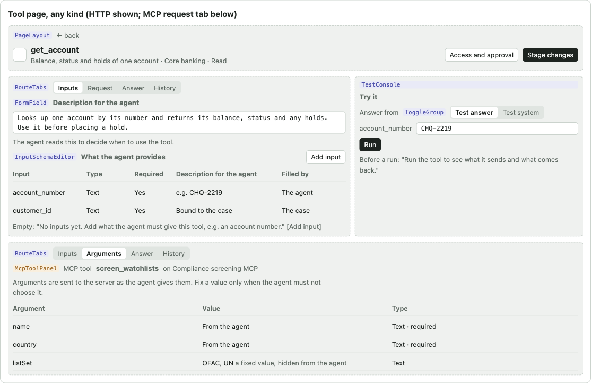

| Where | Copy |
|---|---|
| Inputs, first field | Description for the agent · help: "The agent reads this to decide when to use the tool." |
| Filled by options | The agent · The case · A fixed value |
| Inputs empty | No inputs yet. Add what the agent must give this tool, e.g. an account number. [Add input] |
| MCP Arguments tab | Arguments are sent to the server as the agent gives them. Fix a value only when the agent must not choose it. |
| Try it before a run | Run the tool to see what it sends and what comes back. |

### 2. Connections are real

Job: someone allowed to manage connections sets up once how the platform signs in to a bank system, and nobody pastes
a key into a tool.

| Product | How they do it |
|---|---|
| Zapier | One Connections tab with app, number of Zaps and people with access; sharing lets others use an account without its credentials |
| Make | Create the connection inside the module that needs it; Verify; a list of scenarios using it |
| n8n | Tested on save; people it is shared with cannot view it; allowed domains limit where it is sent |
| Power Automate | Each connection's details lists the flows using it |
| Pipedream | Accounts private by default; the Accounts page shows the workflows using each |

Decision: a list, a one-screen create (Name and Signs in with), and a record page with Settings, Used by and Activity.
Delete stays disabled while anything uses the connection, and says what. A connection can be made available to other
teams, so a system three teams use is one credential, not three. The module's Connection tab offers "New connection"
inline to people who may create one. Knowledge sync switches, a SaaS catalogue and guided connect are not on this page:
they belong elsewhere or promise connectors that do not exist.

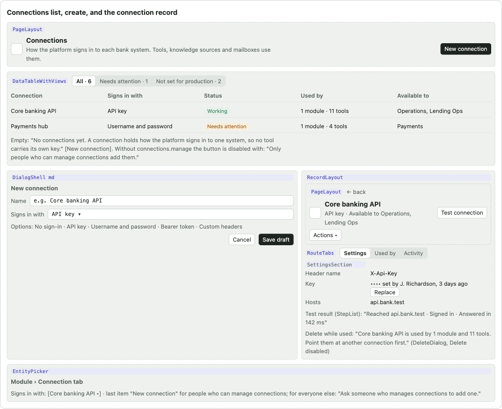

| Where | Copy |
|---|---|
| Page description | How the platform signs in to each bank system. Tools, knowledge sources and mailboxes use them. |
| List empty | No connections yet. A connection holds how the platform signs in to one system, so no tool carries its own key. [New connection] |
| Button disabled | Only people who can manage connections add them. |
| Secret after save | •••• set by &lt;person&gt;, &lt;n&gt; days ago [Replace] |
| Test result | Reached api.bank.test · Signed in · Answered in 142 ms |
| Delete while used | &lt;Name&gt; is used by 1 module and 11 tools. Point them at another connection first. |

### 3. One syntax, a value picker and "Will send"

Job: a builder puts a value from the agent, the case or a stored setting into any part of a request, and sees exactly
what will be sent before running it.

| Product | How they do it |
|---|---|
| Zapier, Power Automate, Workato, Make | Earlier steps' values picked from a list and shown as pills; an expression mode second |
| n8n | `{{ }}` expressions with an immediate preview of the computed value |
| Postman | `{{var}}` with scopes; secrets from a vault as `{{vault:name}}`, masked |
| Retool, Bruno, Insomnia | A secret is a flag on a variable, not a separate syntax |

Decision: typing `{{` or pressing + in any field opens a grouped list (From the agent, From the case, Variables,
Secrets) and inserts a chip. "Will send" sits under the request and updates as the sample input in Try it changes;
nothing is sent. This slice follows connections because, once the connection carries the key, most requests read no
secret and the picker has less to explain.

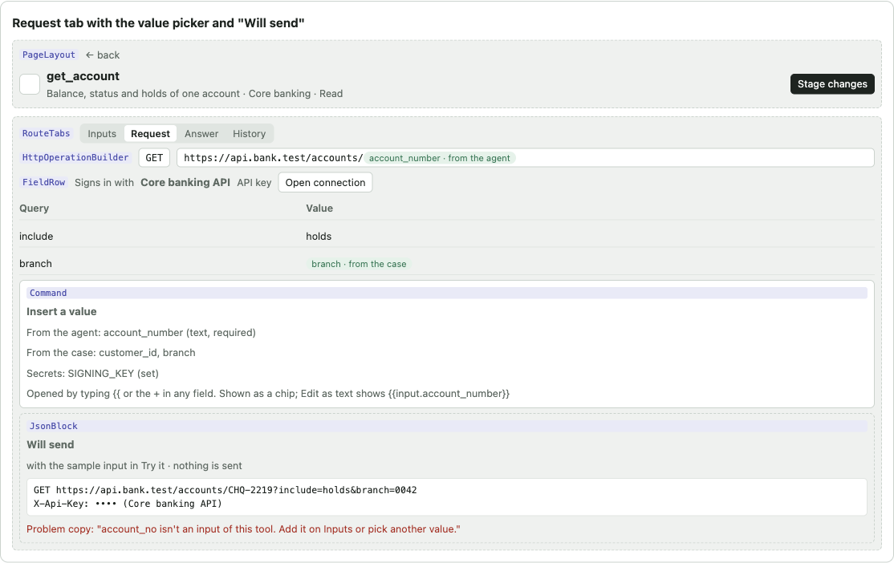

| Where | Copy |
|---|---|
| Chip | &lt;name&gt; · from the agent / from the case / variable / secret |
| Preview heading | Will send · "with the sample input in Try it · nothing is sent" |
| Unknown value at save | &lt;name&gt; isn't an input of this tool. Add it on Inputs or pick another value. |
| Secret in the address | Secrets can go in headers, the query and the body, not in the address. |

### 4. Sample answer: what comes back

Job: a builder records what the system answers, so the agent knows what it will get, workflows can pick fields from it,
and tests answer with something realistic.

| Product | How they do it |
|---|---|
| Power Automate | "Add default response" and "Import from sample" build the schema from a pasted sample |
| Workato, Make | Generate fields from a JSON sample |
| Postman | Saved examples; a mock server matches a request to an example |

Decision: an Answer tab with one sample answer (kept from a Try it run or pasted), the fields that come back (read from
the sample, descriptions editable, used by the agent and by workflow pickers), and "Shape the answer" (the existing
transform, collapsed). A warning appears when a real answer stops matching the sample. Tools for non-developers infer
the output from one sample; many named examples serve teams designing APIs. This comes before the workflow syntax
slice, which needs a tool's output fields. The built mock answers go further than one sample: several answers, each
optionally matched on input values, plus timeouts and delays ([mock answers](../../usecases/tools-service/mock-answers.md)).

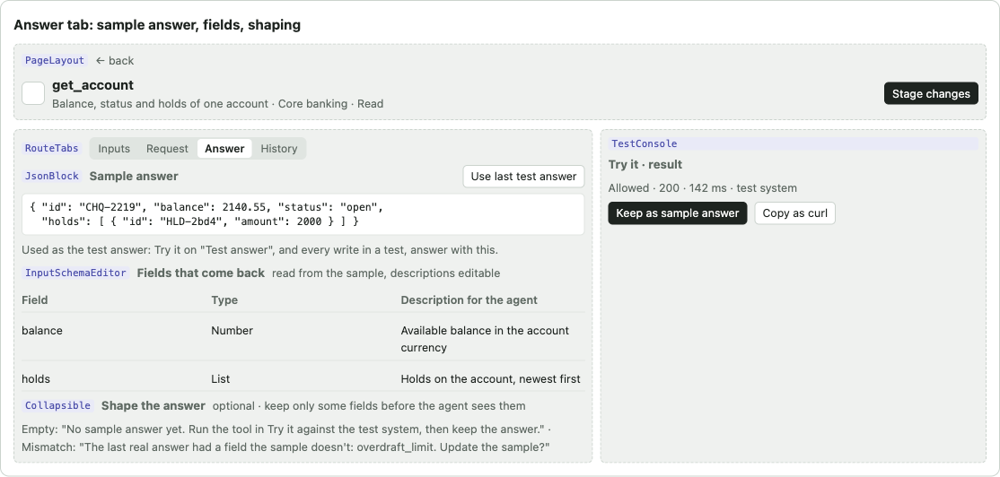

| Where | Copy |
|---|---|
| Answer tab empty | No sample answer yet. Run the tool in Try it against the test system, then keep the answer. |
| Try it result button | Keep as sample answer |
| Mismatch | The last real answer had a field the sample doesn't: overdraft_limit. Update the sample? |

### 5. Workflows use the same syntax

Job: a builder maps values from what started a run and from earlier steps into a workflow step with the same picker and
form as tools, and saved workflows keep running.

Decision: step settings in the workflow editor use the same chips, grouped Started with, Steps (by name, with each
step's output fields), Case and Variables. The conversion rewrites drafts and leaves published versions running as
published, because a published version is immutable and identified by its digest.

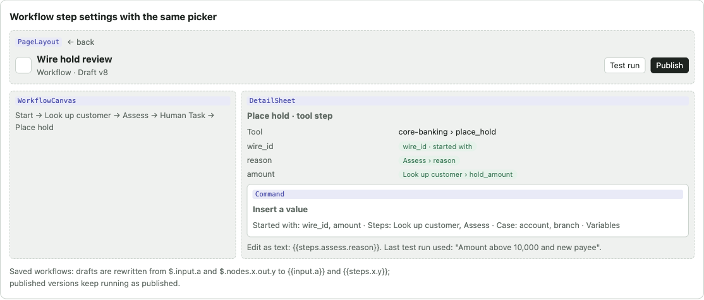

### 6. Test and production

Job: a builder tests tools against the test system, and once agents and workflows are live the same tools reach
production without anyone editing them.

| Product | How they do it |
|---|---|
| Retool | Credentials per environment on each resource; Production by default; an environment selector |
| Retool configuration variables | A default with per-environment overrides and a "Mark variable as secret" toggle |
| Workato | Development, Test and Production with their own connections; work moves by deployment |
| Power Automate | Connection references, supplied on import into another environment |

Decision: the one environment rule above; a Test and a Production column on each connection; one Variables page with
Keep secret; Try it's single Answer from control. Three environment names and two overlapping Try it switches were
rejected because a builder could not predict which credential a call would use, and that decides whether a test can
touch real money.

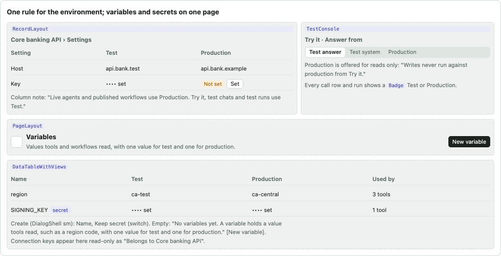

| Where | Copy |
|---|---|
| Connection note | Live agents and published workflows use Production. Try it, test chats and test runs use Test. |
| Production not set | Not set [Set] · Tools that use this connection fail in live runs until it is set. |
| Try it, write in production | Writes never run against production from Try it. |
| New variable | Name · Keep secret · "A secret can be replaced but never read back." |

### 7. Client ID and secret (OAuth client credentials)

Job: an admin connects a system that issues machine tokens, once, and nobody handles a token again.

Workato and n8n ask for a token URL, client ID, client secret and scopes, with how the credentials are sent under
advanced settings; Power Automate custom connectors do not support this grant. Decision: fields Token address, Client
ID, Client secret and Permissions to ask for, with audience and how the client is sent under More settings. Token state
stays off the operation page; the connection shows Working or Needs attention, says what the system refused and when,
and notifies the owning team.

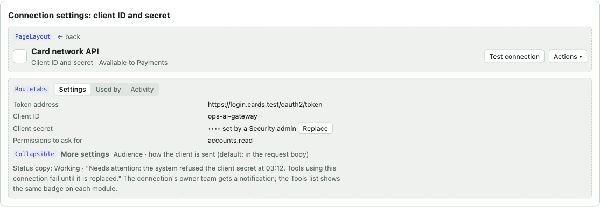

| Where | Copy |
|---|---|
| Needs attention | Needs attention: the system refused the client secret at 03:12. Tools using this connection fail until it is replaced. |
| Notification | Card network API stopped signing in. 4 tools are failing. [Open connection] |

### 8. Sign in with the team's account (OAuth authorization code)

Job: an admin signs in to a system once with the team's service account, and every tool on that connection acts as it.

Zapier and Make name the signed-in account and offer Reconnect; Retool chooses between a shared token and per-user
sign-in; Cursor lists the callback addresses a server's operator must allow. Decision: the Settings tab shows the redirect
address an admin must register with the bank's identity provider, with Copy, and each environment row says "Signed in
as &lt;account&gt; since &lt;date&gt;". Per-person sign-in is a separate setting (slice 14), because it has different
failure rules.

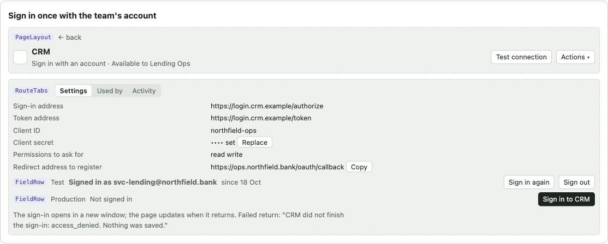

| Where | Copy |
|---|---|
| Field | Redirect address to register · "Give this to whoever manages sign-in for &lt;system&gt;." |
| Failed return | &lt;System&gt; did not finish the sign-in: access_denied. Nothing was saved. |
| Sign out confirm | Sign out of &lt;system&gt; in &lt;environment&gt;? 11 tools stop working until someone signs in again. |

### 9. MCP server sign-in

Job: a builder adds a remote MCP server by its address; if it needs sign-in, the platform finds out and someone who
manages connections signs in once.

The current MCP authorization specification requires protected resource metadata, PKCE and the resource parameter,
prefers client ID metadata documents and deprecates dynamic registration. Claude custom connectors, Cursor and VS Code
detect sign-in from the server's 401 rather than asking the builder to pick it. Decision: New module asks for Name,
What it calls and, for an MCP server, the address. On save the platform asks the server; if it needs sign-in, the page
says so and offers Sign in. A registered client ID and secret go under "Use the bank's registered client". This slice
reuses the sign-in flow of slice 8.

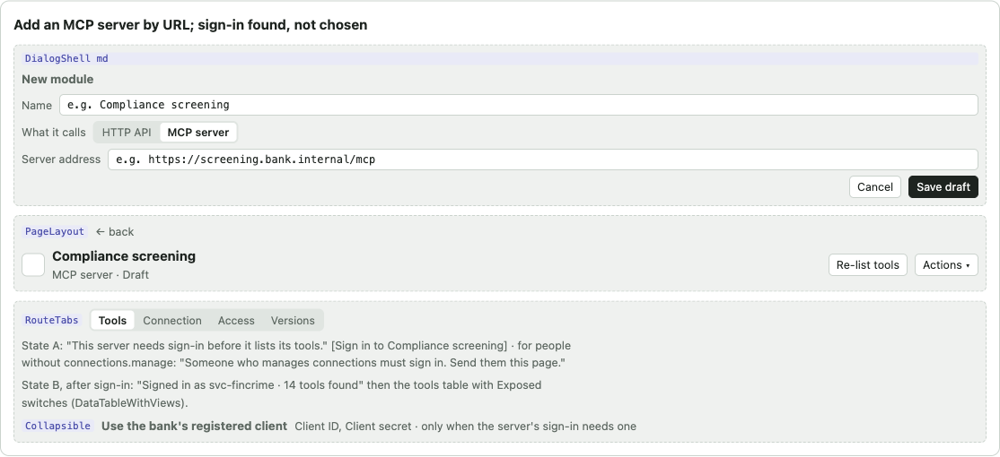

### 10. Add tools from a source

Job: a builder adds a system's operations from what they already have: an API spec, a Postman collection, or a curl
command copied from a vendor's documentation.

Postman and Insomnia import curl, Postman collections and OpenAPI; n8n imports curl into a node; Power Automate builds a
connector from a Postman collection but loses hand-set auth on re-import. Decision: New module stays one screen; Import
operations is a second button, one dialog with a tab per source. A credential found in a curl command is dropped and
the builder is told so. A re-import updates only what the source defines and keeps descriptions, added inputs and the
connection.

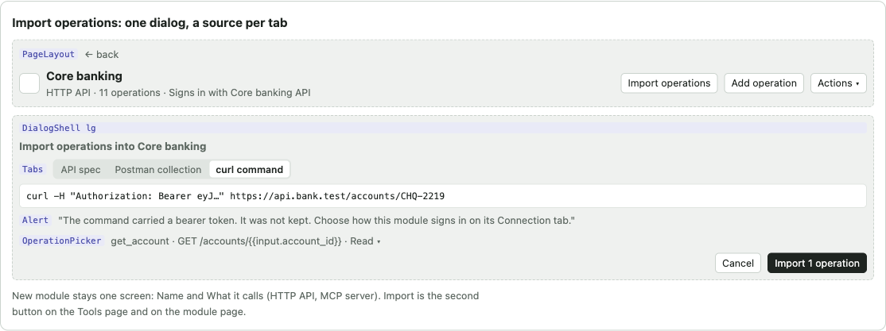

| Where | Copy |
|---|---|
| Credential found | The command carried a bearer token. It was not kept. Choose how this module signs in on its Connection tab. |
| Re-import note | Descriptions, inputs you added and the connection stay as you set them. |

### 11. Built-in tools

Job: a builder gives an agent the platform's own abilities, such as searching knowledge or starting a workflow,
without a connection. OpenAI hosted tools and Retool's core tools are used as they are. Decision: built-ins are listed
under a Built in view, read-only except a per-team description, with Try it, and granted like any tool. They cover
reads and starting a workflow only, because services never call each other to act; a change across subsystems stays a
workflow.

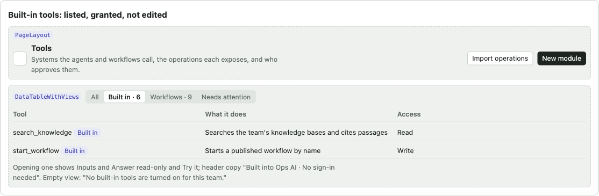

### 12. Workflows as tools

Job: a builder lets an agent start a published workflow, such as levy intake, and tell the person what happened.

Copilot Studio, n8n, Retool and Workato all require a published workflow with a response step; none shows a pattern for
a tool call that waits on a person mid-workflow. Decision: set on the workflow's own page, Settings › Use as a tool: a
switch, a description for agents, and what the agent gets back. "The result, within 2 minutes" is offered only when no
step waits on a person; otherwise the agent gets the case link at once, because a workflow with a Human Task would
always time out. Tools keeps a Workflows view whose rows open the workflow; there is no separate module or pin.

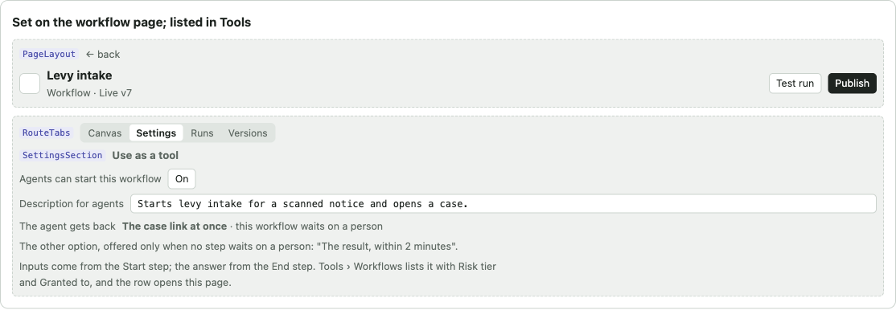

### 13. Client certificate

Job: an admin makes the platform present the bank's client certificate to a system that requires one. n8n, Postman and
Workato treat it as an add-on to any sign-in, not a sign-in kind. Decision: a Client certificate section on any
connection, per environment, and a Needs attention status 30 days before the certificate expires, because an expired
certificate stops every call.

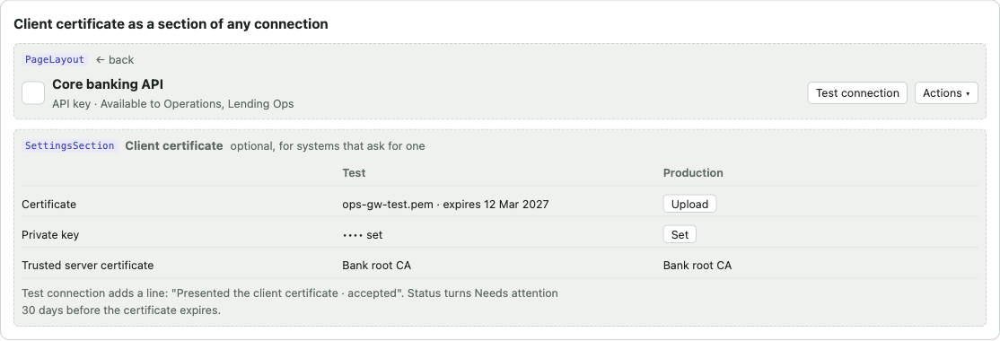

### 14. Each person signs in

Job: a person uses their own account in a system, so the system records who acted. Retool, Workato, Power Automate and
n8n all ask at the moment of need and none lets a scheduled run use a person's account. Decision: a connection setting,
a sign-in card in chat the first time a tool needs it, and Account › Connected accounts to see and remove sign-ins. A
run with no person fails with a message that says why. It comes late because most bank operations runs are started by
a schedule or a mailbox, which this cannot serve.

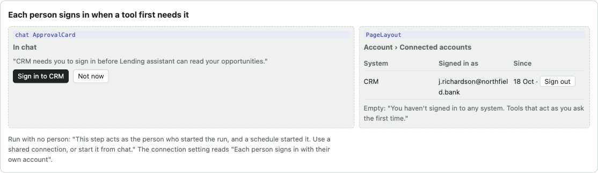

### 15. Agents as tools

Job: one agent asks a specialist agent and uses its answer. The OpenAI Agents SDK, Copilot Studio, n8n and Retool all
add another agent from the parent agent's tool picker. Decision: granted on the agent page from one picker with Tools,
Workflows and Agents; one level deep, as in Copilot Studio.

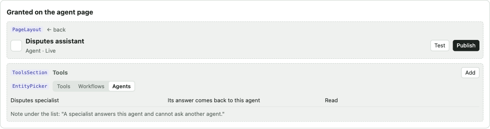

### 16. Code tools

Job: a developer on the bank's platform team writes a small calculation no system offers. Decision: last, and only as a
pure function with typed inputs and outputs, no network, no files and no calls to other tools. Chaining calls is a
workflow's job, where each call, approval and result is visible on the canvas. Until a sandbox runtime is approved, the
kind shows disabled with its reason.

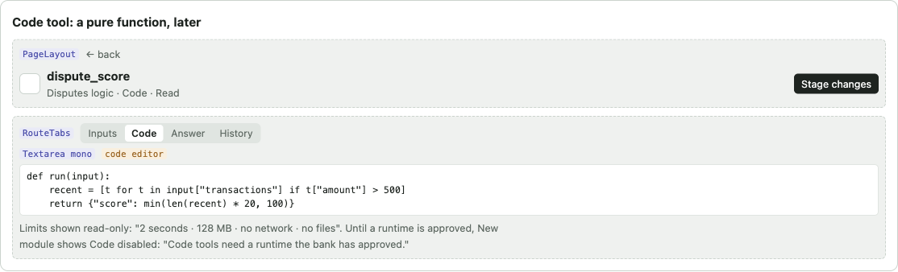

### Dropped: a GraphQL slice

No bank system in the worked examples speaks GraphQL. When one does, GraphQL becomes a body type on the HTTP request
(None, JSON, Form, GraphQL) with a Variables field that takes chips, as Insomnia does.

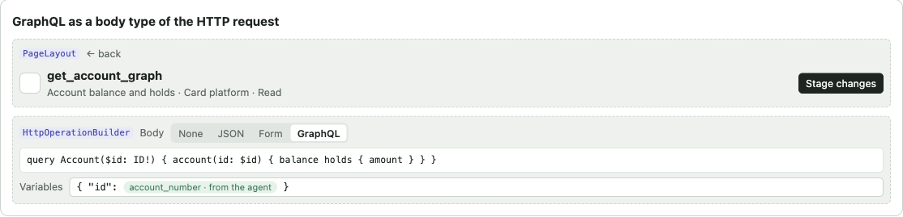

## API and data

All routes are tools-service's, in the platform envelope, team-checked, 404 for a record the caller cannot see.
Existing routes keep their shape; new fields are additive.

| Method and path | Does | Who may |
|---|---|---|
| `GET /v1/tool-kinds` | Each kind: settings schema, import sources, sign-in kinds, available now or later with the reason | tools.view |
| `POST /v1/tool-modules/discover` | Adds Postman collection and curl sources to OpenAPI and MCP | tools.create |
| `PATCH /v1/tool-modules/{id}` | Adds kind, kind settings, connection; each a major change | tools.edit |
| `PATCH .../operations/{op}` | Adds kind settings, query rows, body kind, output schema; references checked at save | tools.edit |
| `GET .../operations/{op}/variables` | Names the picker may offer, with types and where each is set; no secret values | tools.view |
| `POST .../operations/{op}/resolve` | `{input, environment, draft?}` to the prepared request, secrets masked, every problem named; sends and logs nothing | tools.view |
| `GET`, `POST /v1/connections` | List with used-by counts; create a draft | connections.view, connections.create |
| `GET`, `PATCH`, `DELETE /v1/connections/{id}` | Detail per environment, secret fields as set or not; delete is 409 `connection_in_use` while used | connections.view, edit, delete |
| `PUT /v1/connections/{id}/environments/{env}` | One environment's settings; secret values only from a person's token | connections.edit |
| `POST /v1/connections/{id}/test` | Egress check, token fetch where the kind has one, optional probe; each step's result and time | connections.run |
| `POST /v1/connections/{id}/authorize` | Returns the sign-in address; stores state and PKCE verifier for 10 minutes | connections.edit, or own for a person |
| `GET /v1/oauth/callback` | The browser returns with code and state; state is single-use, expires in 10 minutes and names who started; the one route authenticated by state instead of a token | the person who started |
| `POST /v1/connections/{id}/disconnect` | Revokes at the server when it offers revocation and deletes the token | connections.edit, or own |
| `POST /v1/calls` | Unchanged contract; reads the environment from the run context and logs the connection, environment and whose token | as today |

### Data

Every table carries `tenant_id`.

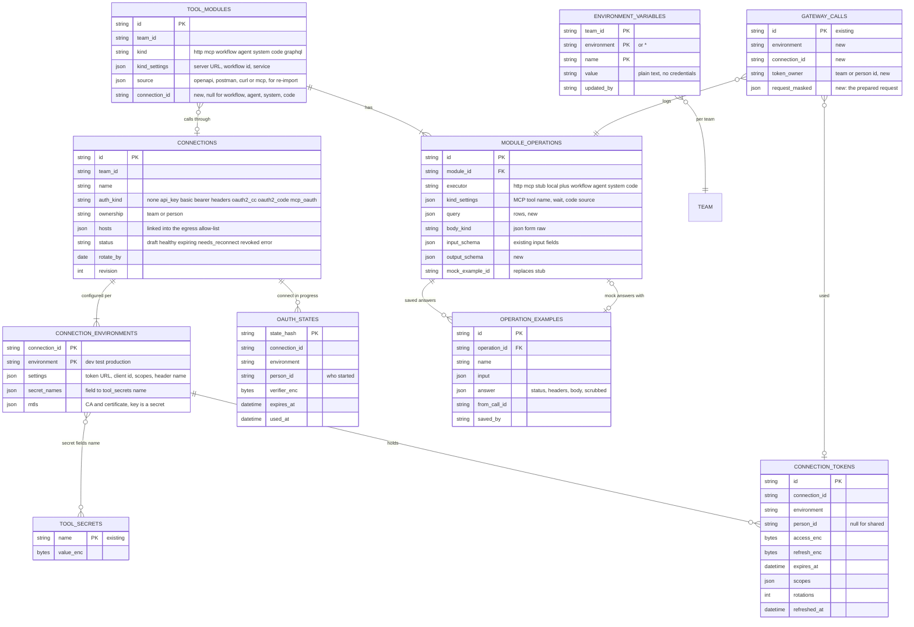

| Table | Guarantee |
|---|---|
| `connections`, `connection_environments` | One row per connection and environment, written in one transaction against its revision (409 on a stale write) |
| `connection_tokens` | Unique per connection, environment and person or shared. Refresh holds a row lock, so one refresh runs at a time, and a rotated refresh token is stored in the same transaction that uses the old one |
| `oauth_states` | Stored as a hash; single use; 10-minute expiry; bound to the person who started |
| `gateway_calls` | Gains the environment, the connection, whose token was used, and the masked prepared request |

### Sequence: sign in with an account

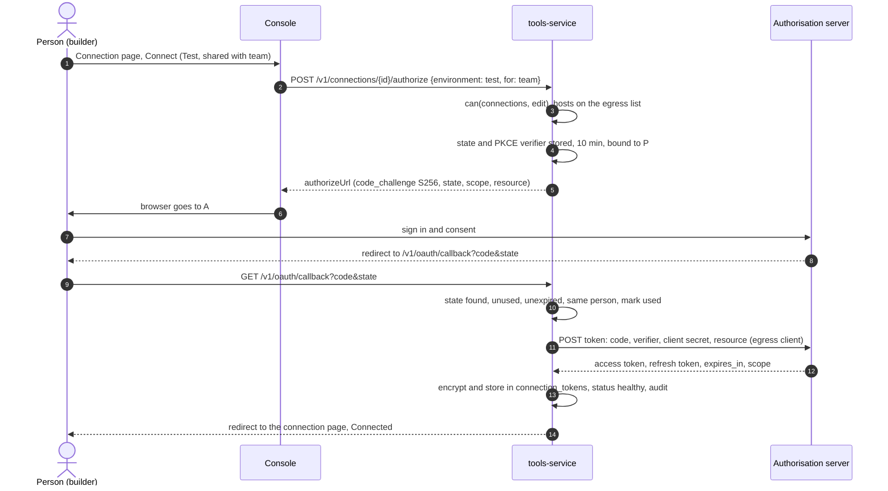

### Sequence: a call that resolves values and refreshes a token

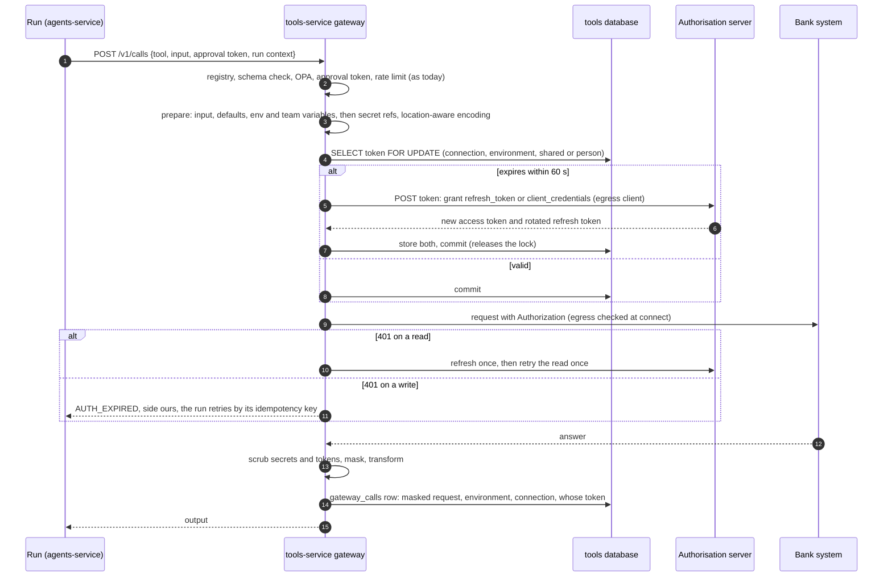

## Security

| Concern | Rule | Builds on |
|---|---|---|
| Server-side request forgery | Every new outbound request goes through the egress client: token endpoints, MCP and authorization server metadata, key sets, revocation. The sign-in address a person is sent to must be https on a listed host | The in-connection address check, no redirects, no cookie jar |
| Egress allow-list | A connection's hosts link into the allow-list; changing them is major for every module that uses it. Variables never change an origin | Module egress hosts |
| Token and secret encryption | Tokens and PKCE verifiers use the secret store's cipher, bound to tenant, connection, environment and person; never returned; added to the scrub set | The secret store and scrubbing |
| OAuth flow | PKCE S256 always; exact redirect address; state single-use, 10 minutes, bound to the person; `resource` sent for MCP; dynamic registration off by default because banks pre-register clients | MCP authorization specification, RFC 9700 |
| No token passthrough | The platform identity token never reaches an outside system. A system-kind call carries a run token narrowed to one route | Run tokens |
| Refresh and rotation | One refresh at a time per token; refresh 60 s before expiry; a failed refresh marks the connection Needs attention and writes an event a workflow can notify on. Writes never retry after a 401 in the same call | The service outbox |
| Personal sign-in | A run uses only the token of the person it acts for; a run with no person never borrows one | The run context's subject |
| Who may | Every create, edit, sign-in, use and delete is a `can()` call; secret values only from a person's token | The access package |
| Audit | Create, edit, sign-in, sign-out, secret write, failed refresh and delete are audit entries; each call logs connection, environment and whose token | Secrets audit and the call log |
| Injection | Location-aware encoding; CR and LF refused in headers; secrets resolved before model values; sign-in fields take no input values | The secret-first rule |
| Code | No network, no files, bounded time and memory | The transform sandbox's bounds |

## Slices and state

Each slice is one card-sized change with an end-to-end use case. The first four fix what builders hit; slice 5
carries the workflow syntax; 6 to 9 bring environments and sign-in; 10 to 16 add sources and kinds.

| # | Slice | State |
|---|---|---|
| 1 | The editor follows the kind | Not built |
| 2 | Connections are real | Built: kinds, settings per environment, write-only secrets ([API key](../../usecases/tools-service/connections-api-key.md), [basic](../../usecases/tools-service/connections-basic.md), [bearer](../../usecases/tools-service/connections-bearer.md)). Availability to other teams and Test connection are not |
| 3 | One syntax, picker and Will send | Not built |
| 4 | Sample answer | Mock answers built in a richer form ([mock answers](../../usecases/tools-service/mock-answers.md)); output fields from a sample not built |
| 5 | Workflows use the same syntax | Not built |
| 6 | Test and production | The environment rule is built; the Variables page is not |
| 7 | Client ID and secret | Built ([use case](../../usecases/tools-service/connections-client-credentials.md)) |
| 8 | Sign in with the team's account | Built ([use case](../../usecases/tools-service/connections-sign-in.md)) |
| 9 | MCP server sign-in | Built ([use case](../../usecases/tools-service/mcp-sign-in.md)) |
| 10 | Add tools from a source | OpenAPI and MCP built; Postman and curl not |
| 11 | Built-in tools | Not built |
| 12 | Workflows as tools | Workflow grants built; Use as a tool on the workflow page not |
| 13 | Client certificate | Built ([use case](../../usecases/tools-service/connections-certificate.md)); the expiry warning is not |
| 14 | Each person signs in | Not built |
| 15 | Agents as tools | Not built; needs the agent run API |
| 16 | Code tools | Not built; needs a sandbox runtime |

## Open questions

| Question | Proposed | Alternative |
|---|---|---|
| Code tools at all | Last, a pure function written by a developer; chaining tools stays the workflow's job | Drop code tools until a bank asks for them |
| Code runtime | A WebAssembly runtime running Python: no network by construction, isolation that does not depend on host configuration | A Linux process jail around a normal interpreter: faster, Linux only, more to configure |
| One Variables page | Variables with Keep secret replaces the Secrets page, team variables and environment variables | Keep the Secrets page, which people already use |
| Platform services as tools | Reads and starting runs only, so an agent never chains subsystems and multi-step changes stay workflows | Also expose single writes such as opening a case, each under its own approval |
