# Workflow canvas

Status: design mock; the editor is built to it and checked by
[uc-121](../../usecases/console/workflow-canvas.md). The screenshots are the mock on sample data for a fictional bank;
where the build differs, the difference is noted below.

A builder designing a ten-step workflow needs to see the whole graph at a readable size, add a step without hunting
through menus, change one step's settings without losing their place on the graph, and know before saving that the
server will refuse something. An editor that puts the graph between two fixed side columns leaves too little room for
the graph, and one that draws nodes but opens no settings sends the builder back to raw JSON. The canvas design gives
the graph the page, floats every control over it, and opens each step's settings in a sheet from the side.

Every part is composed from the console's own components over the server's real step types and checks: the step list
is a command list, the controls are the shared canvas controls, and the step forms are generated from each type's
schema ([workflow nodes](workflow-nodes.md)).

## Layout

| Part | Where | What it does |
|---|---|---|
| Canvas | Edge to edge under the page header | Holds the graph; the page header keeps the workflow's name, version and stage, Test run and Save version |
| Add a step | Floating, top left | A searchable list of step types grouped by kind, triggers first; collapses to an "Add a step" button (N) |
| Controls | Floating, top right | Keyboard shortcuts, zoom in and out, fit, fullscreen |
| Checks | Floating, bottom left | "No problems", or the count of errors and warnings; opens the list of findings |
| Minimap | Floating, bottom right | The whole graph at a glance |
| Step sheet | Slides in from the right over the canvas | The form the step's type generates; previous and next walk the steps in run order |

Each step is a card with a coloured icon tile per step group and its labelled ports. The trigger is drawn dashed and
marked "Starts here". AI steps get their own tile colour rather than a taller card, so every card keeps one height.
Colours come from theme tokens only.

## The canvas and the step list

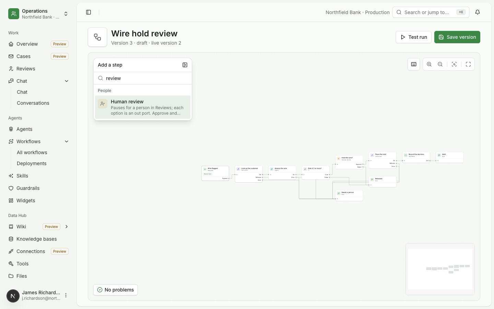

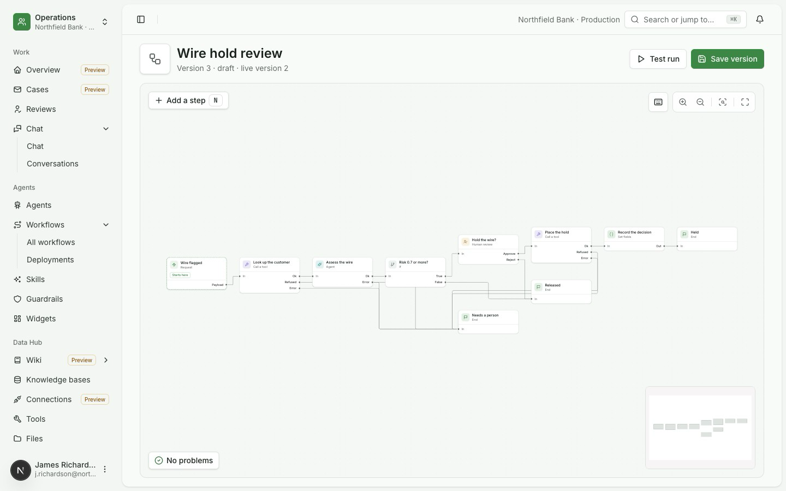

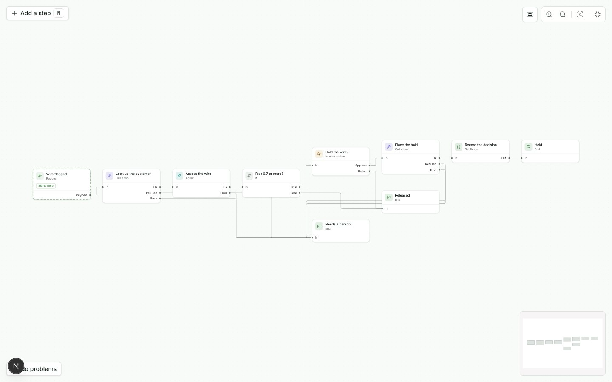

## Step and trigger sheets

A step's sheet shows its type, its group and its effects class, then the fields the type declares. Inputs are mapped
from earlier steps' outputs with a picker. The trigger's sheet adds how a run starts (from an app, from an agent that
has the workflow as a tool, or a test run from the editor) and the run input with its schema.

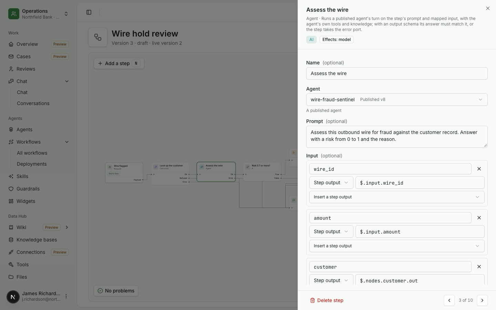

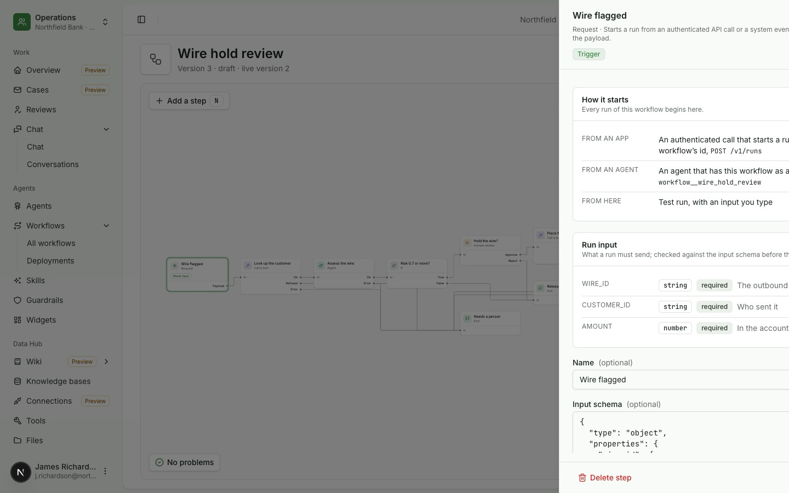

## Checks

The server checks the definition on every change. A step the check refuses is marked on the canvas and in its sheet,
and Save version is disabled until it is fixed. The checks list names each finding and the step it belongs to.

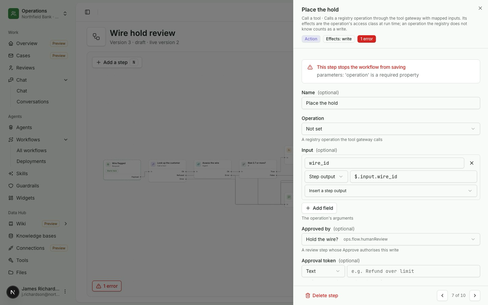

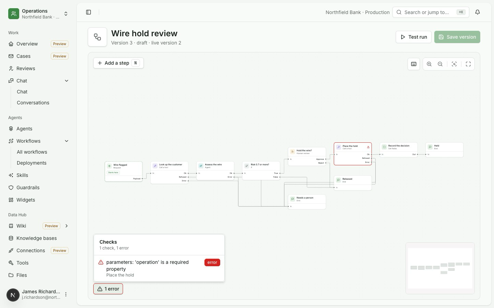

## Other states

| State | Screen |
|---|---|
| A new workflow, with the step list open and a prompt to start with a trigger | 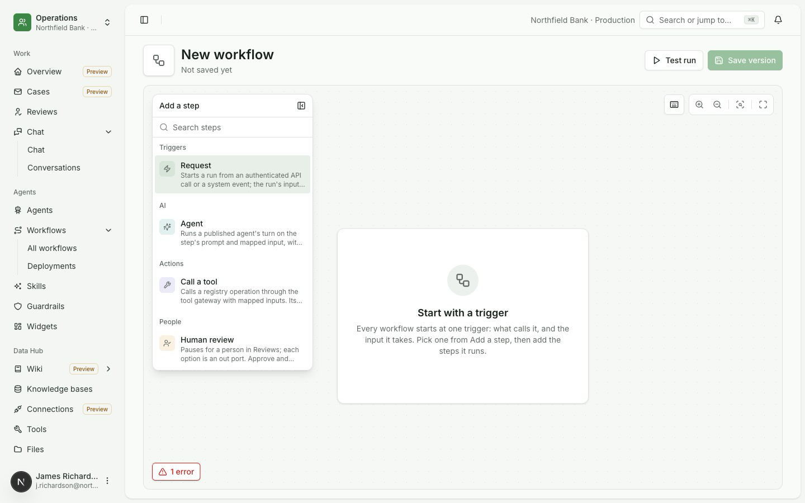 |
| Keyboard shortcuts | 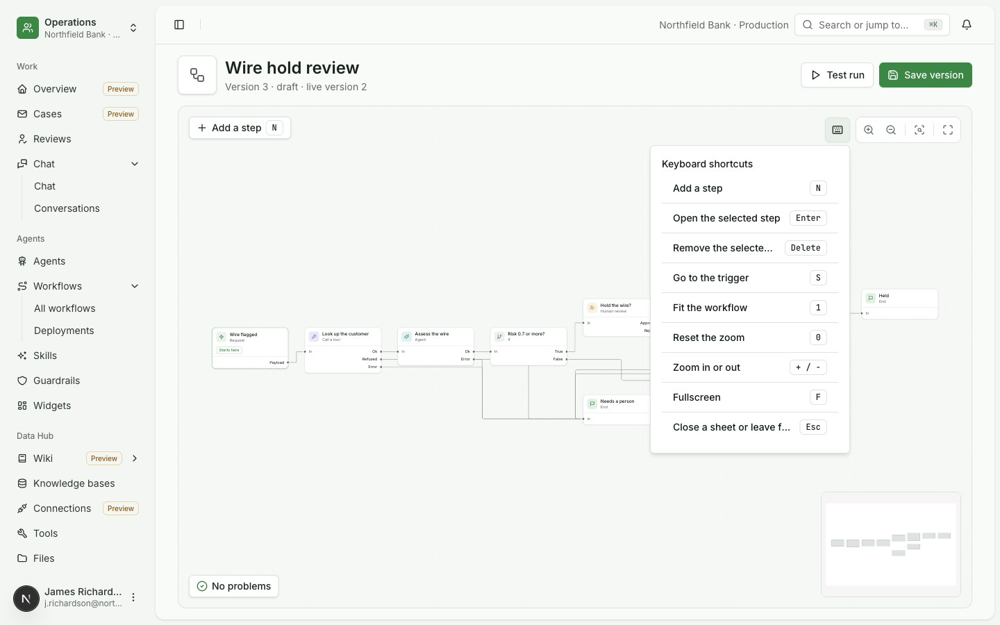 |
| Dark theme | 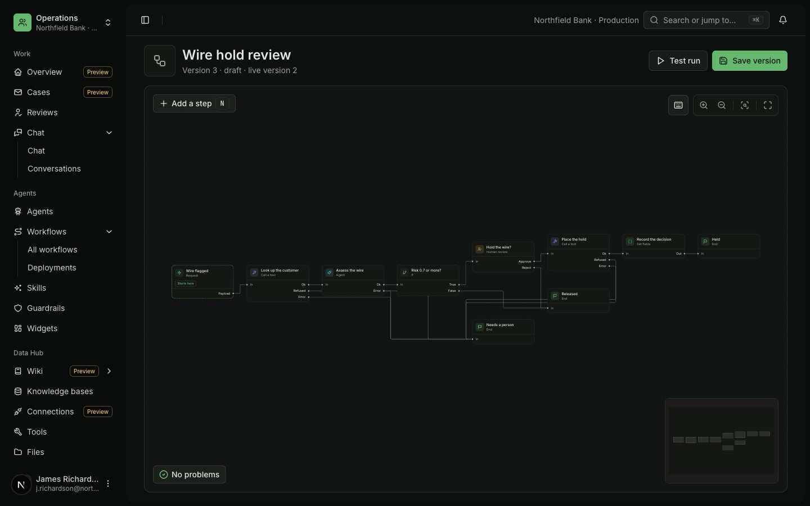 |
| Step sheet, dark theme | 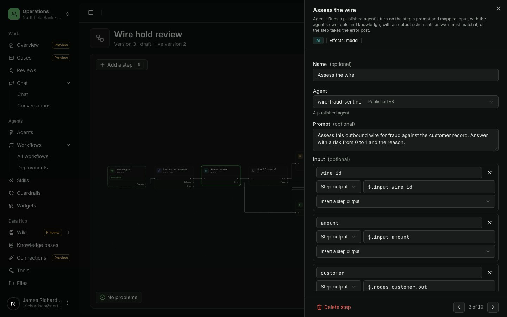 |
| 400 px: opens on the trigger at a readable zoom | 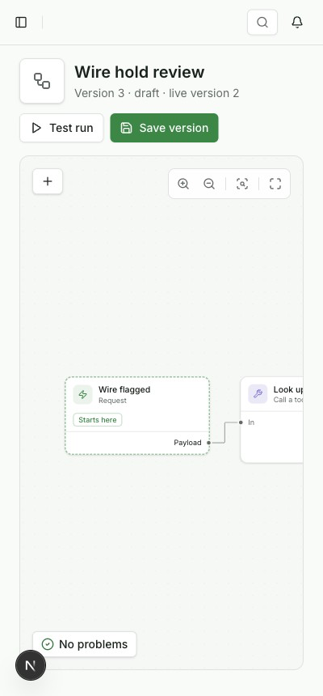 |
| 400 px: the step sheet takes the screen | 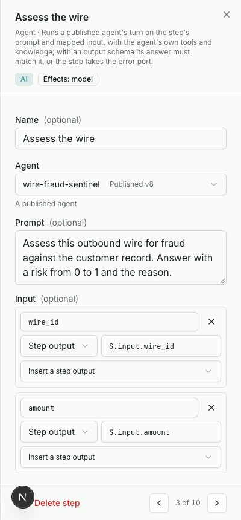 |

| Shortcut | Action |
|---|---|
| N | Add a step |
| Enter | Open the selected step |
| Delete | Remove the selected step |
| S | Go to the trigger |
| 1 | Fit the workflow |
| 0 | Reset the zoom |
| + and - | Zoom in or out |
| F | Fullscreen |
| Esc | Close a sheet or leave fullscreen |

## Design choices

| Taken | Left out |
|---|---|
| The canvas fills the page under the header, plus fullscreen over the whole window | Side columns around the graph |
| A floating step list top left with search, on the command component, with groups as headings, collapsing to a button | A category icon rail |
| Floating zoom, fit and fullscreen top right, on the console's existing canvas controls, plus a shortcuts popover | |
| A coloured icon tile per step group and a dashed trigger, with theme tokens only and labelled ports | A glow and an "AI" header band on AI steps; the AI group gets its own tile colour instead, so every card keeps one height |
| Version and stage in the page header | A template picker and an Active status on the canvas; templates belong to the create dialog |
| Step and trigger sheets from the side, the checks count and the minimap | |

## Where the build differs

| Mock | Built |
|---|---|
| A double-click opens a step's sheet | One click opens it |
| The sidebar stays open | The sidebar collapses while the editor is open, so the canvas is wider than 1200 px at 1440 px, and expands again on leaving |
| Errors only | Errors and warnings: a step that two branches meet at without a Join saves with a warning |
