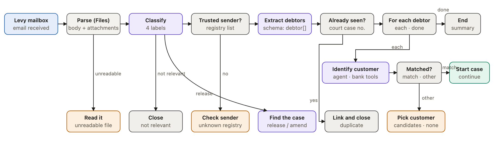
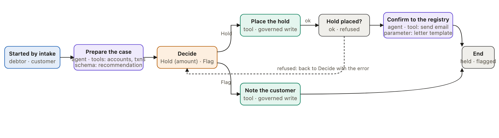
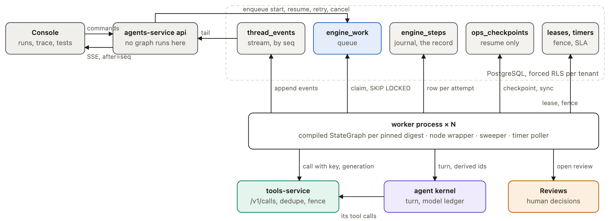

# Workflow nodes

Status: design record. The type and instance model, typed ports and the runner on LangGraph with a step journal are
built; the catalogue below marks each node type built or planned. What runs today is described in
[workflow runner](../../architecture/workflow-runner.md), and which seeded workflow proves each built type is in
[workflow node coverage](../../services/agents-service/workflow-node-coverage.md).

A workflow engine whose steps are a fixed list of kinds, special-cased by name in the compiler and sharing one state
object shaped for the first use case, cannot take a second use case without code changes, and its editor has to guess
what each step accepts. A bank needs hundreds of workflows built as configuration. That needs a node model in which
every step declares what it takes, what it emits and what it does to the outside world, so that the canvas, the
validator and the runner all read the same declaration and none of them carries a list of kinds. This page sets out that
model, the catalogue built on it, a worked example, and the runner options that were weighed.

The catalogue follows n8n's groups (trigger, data, AI, action, flow) with Voiceflow's rule that every node has typed
ports, so any workflow is drawable and the canvas never guesses.

## Types and instances

Two things exist, as in n8n. A node type is a definition the platform ships or a builder registers: what it takes,
what it emits, how it is configured and what executes it. A node in a workflow is an instance of a type: the type id, a
version pin, a name, parameter values and a position. A workflow is its node instances plus the connections between
their ports.

### Node type

| Field | Meaning | Example |
|---|---|---|
| `id` | Stable, namespaced | `ops.ai.agent`, `ops.trigger.email`, `ops.flow.humanReview` |
| `version` | Integer; an instance pins one; old versions keep running | `1` |
| `group` | trigger, data, ai, action, flow, human | `ai` |
| display | Label, description, icon, palette order | Agent, "decides its own steps with tools" |
| `inputs` | Named in ports, each with a connection type | `main`; plus model, tool, knowledge and memory on AI types |
| `outputs` | Named out ports; fixed, or derived from a parameter | fixed: `done`, `needsApproval`, `error`; derived: one per option on human review, one per label on classify |
| `parameters` | JSON Schema with UI hints (widget, option source, group, show when) | agent: agent, instruction, output schema, budget |
| `effects` | Side-effect class: none, model, read, write, human | `model` |
| `retry` | Default policy by effects class; an instance may tighten it | write: one attempt plus a reconciliation read |
| credentials | Which secret or connection the type needs, if any | a mailbox connection; a tool's secret comes with the operation |
| executor | Which runtime routine runs it | kernel turn, gateway call, files parse, engine loop |

### Connection types

`main` carries data between steps. The others attach a resource to a node: `model` (an alias from models-service),
`tool` (an operation from the tool registry, with its approval policy), `knowledge` (a knowledge base) and `memory`.
Only AI types declare those inputs. In this design the things attached are themselves node instances of sub-node types,
so a tool or a knowledge base can be attached to several nodes and shown on the canvas as its own box. The later
[workflows and agents](workflows-and-agents.md) design drops the tool and memory attachments: an agent's tools and
memory belong to the agent, not to the workflow step that calls it.

| Sub-node type | Attaches through | Parameters |
|---|---|---|
| `ops.model.alias` | model | alias, temperature, max tokens |
| `ops.knowledge.base` | knowledge | knowledge base, top k, floor |
| `ops.tool.operation` (dropped) | tool | module, operation; the approval policy comes with the operation |
| `ops.memory.thread` (dropped) | memory | scope: thread or customer |

### Node instance

```json
{
  "id": "identify",
  "type": "ops.ai.agent",
  "typeVersion": 1,
  "name": "Identify the customer",
  "parameters": {
    "agentRef": null,
    "instruction": "...",
    "budget": { "calls": 6 },
    "outputSchema": { "oneOf": ["match", "candidates", "none"] }
  },
  "position": [620, 150],
  "disabled": false,
  "notes": ""
}
```

```json
"connections": [
  { "from": { "node": "loop", "port": "each" }, "to": { "node": "identify", "port": "main" } },
  { "from": { "node": "identify", "port": "done" }, "to": { "node": "matched", "port": "main" } }
]
```

A connection joins one out port to one in port. The validator checks that the port exists on the pinned type version
and that the connection types agree. Options on a human review and labels on a classify are parameters, so their out
ports are derived: change the parameter and the ports change, and the canvas follows.

### The rule every type follows

A node has named in ports and named out ports, and an edge joins one out port to one in port. A node carries four things
the runner needs: an input mapping (which earlier outputs feed it), an output schema, a side-effect class and a retry
policy. The canvas draws ports from the server's declaration and keeps no list of its own.

## Catalogue

Status is read from the engine's type registry (`packages/ops_engine`). Types the first design listed as triggers
(schedule, webhook, poll) moved out of the engine into trigger adapters on one start API, as set out in
[workflows and agents](workflows-and-agents.md).

| Group | Type | Does | Out ports | Effects | Status |
|---|---|---|---|---|---|
| Trigger | Request (`ops.trigger.request`) | Starts a run from an authenticated call or a system event; payload checked against the input schema | payload | none | built |
| Trigger | Email received (`ops.trigger.email`) | A watched mailbox; attachments stored as files, never parsed here | payload | none | built |
| Trigger | Service event (`ops.trigger.event`) | Starts a run when a service reports an event, such as a file deleted or a tool access request; only a system workflow the platform maintains is started by one | payload | none | built |
| Trigger | Schedule, batch file, chat message | One run per tick, per CSV row, or per message | tick, row, message | none | planned as trigger adapters |
| Data | Set fields (`ops.data.set`) | Maps and renames, with no model; cannot fail | out | none | built |
| Data | Match (`ops.data.match`) | Matches a record by name plus another identifier | matched, none | none | built |
| Data | Combine (`ops.data.combine`) | Puts facts from several steps together | out | none | built |
| Data | Calculate (`ops.data.compute`) | Works out a value, such as the smaller of an asked amount and a balance | out, error | none | built |
| Data | Parse attachments | Message body and attachments to documents with pages; a file with no text layer goes out the `unreadable` port | pages, unreadable | read | planned; reading now runs in Extract with Detect |
| Data | Transform | One JMESPath expression | out, error | none | planned |
| Data | Filter or dedupe | Keeps or drops items | kept, dropped | none | planned |
| Data | Code | A sandboxed, deterministic script | out, error | none | deferred |
| AI | Agent (`ops.ai.agent`) | Runs a published agent's turn on the step's prompt and mapped input, with the agent's own tools and knowledge; with an output schema its answer must match | ok, error | model | built |
| AI | Extract (`ops.ai.extract`) | Fields from a document by schema, or Detect, which recognises the document type first | ok, error | model | built |
| AI | Classify, Summarise, Extract from text, Draft (`ops.ai.classify`, `ops.ai.summarise`, `ops.ai.extractText`, `ops.ai.draft`) | One model call each, with no saved agent | one per label (classify), out, error | model | built |
| AI | Answer from knowledge | Retrieval with citations; knowledge bases chosen on the node | found, notFound, error | model, read | planned |
| Action | Call a tool (`ops.action.tool`) | A governed call through the tool gateway; the operation's approval policy applies | ok, refused, error | read or write | built |
| Action | Start workflow (`ops.action.workflow`) | Starts another workflow of the team once or for each item, keyed so a retry never starts a second; with Wait for them on, it pauses until every child has ended | started, error; done, timeout when waiting | write | built |
| Action | Open case, Add to case (`ops.action.openCase`, `ops.action.addToCase`) | Opens a case or adds a note to one | opened or added, error | write | built |
| Action | Save data on file (`ops.files.setData`) | Keeps a read on the file it came from | ok, error | write | built |
| Action | Send message, reply | Email or notification on the channel that started the run; approval when policy says | sent, refused, error | write | planned (reply is a tool call today) |
| Flow | If (`ops.flow.if`) | Routes by rules over fields | true, false | none | built |
| Flow | Switch (`ops.flow.switch`) | Named cases, with an otherwise port | one per case, otherwise | none | built |
| Flow | Join (`ops.flow.join`) | Waits for every branch that can still arrive, then runs once with each branch's output | out | none | built |
| Flow | Wait (`ops.flow.wait`) | Pauses for a duration, or until a date read from a step (error when the value is not a date) | out, error | none | built |
| Flow | Loop over items | Runs a branch per item in parallel, then joins | each, done | none | planned; Run workflow for each item covers most uses |
| Flow | Repeat | A bounded while or until | again, done, exhausted | none | planned |
| Flow | End (`ops.flow.end`) | Names the outcome, the output and whether the run counts as succeeded or failed | none | none | built |
| Human | Human review (`ops.flow.humanReview`) | Options as out ports (Approve and Reject by default), approvers from the operation's policy or the node, deadline, reminders, step-up | one per option; timeout when it can expire | human | built |
| Human | Ask, handoff | Asks the customer and waits for the reply by conversation key; moves a conversation to a live team | answered, timedOut; closed | wait | planned |

## Files own parsing

Information can arrive in an email body, in an attachment, or both. Every input becomes a file, and reading is a
property of a file. Knowledge is a consumer of files that were already read, not the place reading happens. Extraction
has since moved into its own service, which reads bytes through files-service and never stores them
([documents service](../../services/documents-service/overview.md)); the split of responsibilities below still holds.

| Subsystem | Owns | Never does |
|---|---|---|
| Files | Stores bytes, dedupes by digest, keeps one read result per digest with a status (read, no text layer, unsupported). The mailbox adapter writes the email body as a message file beside its attachments | Chunk, rank or cite |
| Knowledge | Chunks, indexes, ranks and cites files that were already read | Read raw bytes or parse |
| Workflows, chat | Call files and documents directly: a workflow step, a chat upload | Reach a knowledge base to read a notice |

The Parse node's contract, as designed:

| Port | Shape |
|---|---|
| in `main` | `fileIds[]`: the message file and its attachments, or any uploaded files |
| out `pages` | `documents[]`: `{fileId, name, kind: message, attachment or upload, status, pages: [{page, text}], sections?}` |
| out `unreadable` | Files whose status is not read, with the reason |

The Extract node takes `documents[]`, so a debtor named in the email body and one listed in the PDF come out the same,
each with a source reference `{fileId, page}` that the case and the citation both show.

## Worked example: a court order notice

A court order notice (a garnishment or requirement to pay) arrives by email from a court or tax authority and asks the bank to hold
funds for one or more debtors. It is the first workflow these types were tested against, and it is split into two
workflows. One notice can name several people, and each needs its own owner, deadline, decision and audit trail; a
human step inside a loop would hold the whole notice until every person was decided.

### Intake



Every exit is a node, not an exception. Only a trusted, new order reaches extraction and the bank.

| Situation | Node that handles it | Outcome |
|---|---|---|
| Spam, marketing, unrelated mail | Classify (court order, release or amendment, other legal, not relevant) | Closed with a label; no further model spend |
| Sender is not a known court or registry | Trusted sender?, against a registry list | A person checks it; never straight to a hold |
| Attachment unreadable, no text layer | The `unreadable` port | A person reads it |
| The same notice again, by mail or another route | Already seen?, on the court case number | Linked to the open cases and closed |
| Release or amendment of an earlier order | Classify, then an agent finds the open case | The release path on that case |
| Debtor not found, or several possible customers | Matched?, after the identify agent | A person picks the customer or marks it unmatched |
| Several debtors in one notice | For each debtor | One case each, started and left to run |
| The registry replies to the bank's confirmation | The mailbox threads it to the case | A follow-up on the same case |

How the second workflow starts:

| Mode | Parent | Chosen |
|---|---|---|
| Start and continue | Starts the case with the debtor and customer as inputs and moves on; the case links back to the notice and reports its outcome to it | Yes |
| Start and wait | Pauses until every case ends, then replies once for the whole notice | No: the notice would stay open for days |

So the Start workflow type has a mode parameter. In continue mode its out port fires once the child is accepted, and
the child's end event updates the parent's summary. A bank that wants one reply per notice adds a "notice complete"
step that listens for the last case to close.

### The case



Prepare the case notes any other open court order on the customer and recommends an amount per account when funds are short
or spread across accounts. The Hold option takes a list of account and amount pairs, and the review carries the
registry's deadline (five business days) with escalation. The person decides with the agent's recommendation in front
of them. Hold is a governed write covered by the decision's approval and a step-up. The registry confirmation is drafted
from a letter template held as a node parameter and sent after approval. The bank's refusal of a hold returns to
Decide and is never retried. Neither agent uses a knowledge base; a bank that wants its procedures cited can attach one.

The workflows that run on the built types today, a customer hold and a complaint triage, are listed in
[workflow node coverage](../../services/agents-service/workflow-node-coverage.md).

## Decisions

| Decision | Outcome | Why |
|---|---|---|
| How tools, knowledge, model and memory attach | Through typed connections; later narrowed to model and knowledge, with tools and memory on the agent | The type model makes every attachment drawable and checkable |
| Type versions pin per instance | Yes | A published workflow keeps running on the type version it pinned, which replay needs; a builder adopts a new type version per node |
| Start workflow mode for court orders | Continue | A notice must not stay open while its cases run for days |
| Loop as an explicit node | Yes, with `each` and `done` ports | Implicit fan-out cannot be drawn or checked |
| Human review's options are its out ports | Yes, with Approve and Reject as the default two | The canvas shows every outcome as a path |

Typed ports were the main cost of moving from the first engine: every node there read and wrote one global state and
the compiler special-cased kinds by name. Typed per-node inputs and outputs with an input mapping touch the compiler, the
run state and the editor at once, and are the same change the step journal needs, so they were done once.

## Runner options

The type and instance model says what a workflow is. The runner is what executes it. The runner had to:

| Need | Meaning here |
|---|---|
| Run basic nodes for real | Trigger, set fields, if, call a tool through tools-service, human review through Reviews, end |
| Definitions as documents | Node instances plus port connections, stored and digested as JSON; YAML is an authoring and export form of the same document |
| Scale | Many runs across many worker processes, on one VM with PostgreSQL only, and further later |
| Track every run | Run list, run detail, a step trace with inputs, outputs, attempts and errors |
| Test, retry, replay | Test runs with pinned node outputs; retry a failed step; re-run from a step; prove a finished run's path |

Measured facts the options built on, from the agents-service experiments: a paused thread survives a graph change when
its version is pinned; a lease takeover works across two processes, but the killed node re-runs and repeats its model
calls; fencing costs about 0.55 ms per checkpoint; checkpoint p95 rises from 9 to 67 ms at 20 concurrent cases; timers
fire with 0.46 s median latency at a 1 s poll; and 13 conformance tests pass on the LangGraph adapter. See
[the experiments](../../services/agents-service/overview.md) for each.

### Prior art

| System | Run record | Scale model | Test and replay | Versioning | Licence |
|---|---|---|---|---|---|
| n8n | Executions table in PostgreSQL | Queue mode: the main instance enqueues execution ids in Redis, workers fetch the workflow and write results back; 10 jobs per worker by default | Pinned data in manual runs only; "debug in editor" pins a past execution's data; retry with the saved or the original workflow | `typeVersion` per node instance | Sustainable Use License: internal business use only |
| Temporal | Append-only event history per execution | A server plus workers polling task queues; PostgreSQL supported, Elasticsearch recommended for visibility at volume | Deterministic replay of workflow code against history | `patched()` branches or worker versioning that pins runs to a build | MIT |
| DBOS | Workflow and step rows in PostgreSQL; one write per step plus two per workflow | A library in the process; durable queues | List workflows and steps; resume, cancel; fork from a step to a new id | Application version per workflow; recovery only on the matching version | MIT |
| Restate | A journal per invocation in the server's embedded store | A single binary, single node or cluster | Completed journal entries skipped on retry | Per deployment | Server BSL 1.1, SDKs MIT |
| Hatchet | Task runs in PostgreSQL | Engine, API server and workers; RabbitMQ optional | Dashboard with run history; at-least-once tasks | not read | MIT |

### The four options

| Option | How it works | Records of one run | Fork from a step | Fits the existing leases and fence | New server | Effort to first slice |
|---|---|---|---|---|---|---|
| A. Own interpreter on PostgreSQL | A small interpreter walks the instance graph port by port; each node execution writes a step row; a node's input is assembled from the rows connected to its in ports, so there is no shared state and no checkpoint for workflow runs | 1 | Copy rows | Kept as is | No | M |
| B. Temporal with one generic interpreter workflow | One workflow type receives the definition digest and interprets it; each node is an activity. Updates and durable timers are native; history limits force continue-as-new on long cases | 2 (history and a projection for the console) | Ours to build | Replaced | Yes; a bank may refuse it | L, plus operating a stateful server |
| C. DBOS inside agents-service | The same interpreter as A, with DBOS recording steps and recovering on crash | 2 | Built in | Overlaps: DBOS owns recovery, which competes with the leases and fence | No | M to L; two recovery mechanisms to reconcile |
| D. LangGraph stays the walker, plus a step journal | Compile definitions to a LangGraph `StateGraph` with generic state, wrap every node so it writes a step row and reuses a recorded output, move runs to a queue and workers | 3 (checkpoints, step rows, events) | Hard, as first drafted | Kept as is | No | S to M |

Temporal stays possible behind the [engine seam](../../architecture/decisions/execution-engine-seam.md) for a bank that
wants it, since a decision made earlier keeps Temporal optional rather than required.

### The choice: LangGraph with a step journal

The runner is built on LangGraph, close to option D, made resilient with a step journal, a PostgreSQL queue and worker
processes. LangGraph stays in the codebase under every option, because chat, the sweeper, timers, metering and the
model ledger already use it. The design answered option D's three objections:

| Objection | Answer |
|---|---|
| Three records per run | Each record has one job. The step journal is the record of the run: the trace, tests, retry, fork and replay read it. Checkpoints are how LangGraph resumes and are deleted when the run ends. The event log is the live stream. The console never reads a checkpoint |
| Fork from a step is hard | A fork never edits a checkpoint. It is a new run with the source run's rows copied as pinned rows for every node before the chosen one. The wrapper returns pinned outputs without executing, so the new graph walks from the trigger to the chosen node. This works through joins, where updating LangGraph state "as a node" cannot name several predecessors |
| Checkpoint growth remains | State holds small envelopes and references, not payloads; large outputs live in the journal row. Checkpoints are deleted at run end. Retention is set per deployment |



The compiled form of each element, the resilience rules per effects class, scale, the console and versioning are in
[workflow runner](../../architecture/workflow-runner.md).

### Patterns taken from other systems

| Source | Pattern | Used here as |
|---|---|---|
| LangGraph | Pending writes of succeeded sibling nodes are kept when one fails; resume does not re-run them | A retry of a failed fan-out item re-runs that item only |
| LangGraph | `durability: sync` saves before the next step | `sync` for every run, so the fence can refuse a stale owner before its next step |
| LangGraph | Prune with the delete strategy; no built-in TTL in the library | Delete at run end; retention is a separate job |
| LangGraph | `RetryPolicy` per node; `CachePolicy` keyed by input | Not used: attempts must be journal rows, and a cache keyed by input would skip a write that should run |
| LangGraph Platform | A durable queue in PostgreSQL, a worker lease, one run per thread, double-texting policies (reject, enqueue, interrupt, rollback) | The work queue, the existing leases, and enqueue as the default |
| LangGraph Platform | Crons, completion webhooks, checkpoint TTL | Schedule trigger and run-ended webhook later; TTL as the retention job |
| Temporal | Run id plus activity id as the idempotency key; a start-to-close timeout per attempt; pinned worker versions that drain | Step keys, a per-attempt timeout, and the engine build on each work row |
| n8n | Executions list, pruning by age and count, pinned data in manual runs only, execute a step with its preceding nodes | Run list, retention, test pins, run from a node |
| DBOS | Fork copies steps up to a step; partitioned queues with one task per key; a deduplication id | Fork as copied pins; per-tenant caps; the run key |
| Restate | A journal of completed effects skipped on retry; awakeables resolved by id | Recorded outputs win; resume rows keyed by interrupt id |

One rule, "recorded outputs win", covers four console actions:

| Action | Rows | Prior art |
|---|---|---|
| Test with pinned data | Pinned rows written before the run, in test mode; live runs ignore pins | n8n data pinning |
| Retry a failed step | A new attempt row on the same run | n8n retry with the original workflow |
| Re-run from a step | A new run with rows up to the step copied, optionally on a newer version | DBOS fork, n8n retry with the saved workflow |
| Replay check | Walk recorded outputs; the path must match | Temporal replay tests |

Test runs answer a human review with the option the tester chooses per node, rather than always approving.

### Risks and their tests

| Risk | Test |
|---|---|
| A worker killed mid-node repeats an effect | SIGKILL at four fault points per effects class (before begin, after the call, after finish, after the checkpoint); count executions and ledger calls by key |
| Double delivery: two workers claim one row, or a decision and a timer both resume | Two workers on one queue with a forced race; the lease admits one; the second resume finds the interrupt answered and records a duplicate |
| A stale owner writes after a takeover | The conformance fencing test, plus a step-row write with an old generation refused |
| Resume after a definition change | A run paused on version 1 finishes on version 1 after version 2 publishes; migrating to a version without the waiting node returns 409 |
| Code before an interrupt runs twice | Resume the review node three times: one review row, one timer set. A node restarts from its beginning on resume, so nothing with an effect sits before the interrupt |
| Checkpoint growth on long cases | Stored size per run and p95 write at 20 concurrent; a finished run has no checkpoint rows |
| Queue starvation by one tenant | Tenant A queues 500 runs, tenant B one; B starts within one claim cycle |
| A LangGraph upgrade changes resume behaviour | The checkpointer conformance cases and the engine conformance tests gate every version bump |

Production reports to watch: checkpoint blobs grow with the square of message count when a channel is rewritten whole
(LangChain forum thread 4448); `AsyncPostgresSaver.from_conn_string` has no pool settings and drops idle connections
(LangGraph issue 7304); a subgraph resume once restarted from the subgraph's entry (issue 4796).

## Sources

- n8n: [queue mode](https://docs.n8n.io/hosting/scaling/queue-mode/), [data pinning](https://docs.n8n.io/data/data-pinning/), [debug in editor](https://docs.n8n.io/workflows/executions/debug/), [node versioning](https://docs.n8n.io/integrations/creating-nodes/build/reference/node-versioning/), [licence](https://github.com/n8n-io/n8n/blob/master/LICENSE.md), [executions settings](https://docs.n8n.io/hosting/configuration/environment-variables/executions/)
- Temporal: [event history](https://docs.temporal.io/workflow-execution/event), [Python versioning](https://docs.temporal.io/develop/python/versioning), [visibility](https://docs.temporal.io/self-hosted-guide/visibility), [activities](https://docs.temporal.io/activity-definition), [worker versioning](https://docs.temporal.io/worker-versioning)
- DBOS: [architecture](https://docs.dbos.dev/architecture), [workflow management](https://docs.dbos.dev/python/tutorials/workflow-management), [upgrading workflows](https://docs.dbos.dev/python/tutorials/upgrading-workflows), [queues](https://docs.dbos.dev/python/tutorials/queue-tutorial)
- Restate: [durable execution](https://docs.restate.dev/concepts/durable_execution), [awakeables](https://docs.restate.dev/develop/ts/awakeables)
- Hatchet: [architecture](https://docs.hatchet.run/home/architecture)
- LangGraph: [durability](https://reference.langchain.com/python/langgraph/types/Durability), [checkpointers](https://docs.langchain.com/oss/python/langgraph/checkpointers), [interrupts](https://docs.langchain.com/oss/python/langgraph/interrupts), [time travel](https://docs.langchain.com/oss/python/langgraph/use-time-travel), [Agent Server](https://docs.langchain.com/langsmith/agent-server), [double texting](https://docs.langchain.com/langsmith/double-texting), [cron jobs](https://docs.langchain.com/langsmith/cron-jobs), [TTL](https://docs.langchain.com/langsmith/configure-ttl), [forum 4448](https://forum.langchain.com/t/how-to-handle-growing-checkpoint-blob/4448), [issue 7304](https://github.com/langchain-ai/langgraph/issues/7304), [issue 4796](https://github.com/langchain-ai/langgraph/issues/4796)
- PostgreSQL: [SELECT … FOR UPDATE SKIP LOCKED](https://www.postgresql.org/docs/current/sql-select.html)
