# Workflows and agents

Status: proposed design. Parts are built and each table row says built, partial or planned; the agent run API, agent
jobs, the Reviews service (`ops_hitl`) and the trigger service (`ops_triggers`) are not built. The database section is
superseded in part by [ADR-0017](../../architecture/decisions/database-support.md): the supported databases are
PostgreSQL and SQL Server, and MySQL is dropped.

A bank's operations teams want to hand routine work to software, with a person approving anything that moves money or
changes a record. Some of that work is open-ended: a banker asks a question, or a morning check reads held wires and
decides what needs attention. Some of it is fixed: a court order notice arrives, is read, matched to a customer and turned
into a case in the same steps every time. One runtime that does both badly is the common failure: either the
open-ended work is squeezed into a fixed graph, or the fixed work inherits the unpredictability of a model choosing its
own steps. This design keeps two ways of running work, agents and workflows, on one set of shared services, and lets
each run with the other removed.

Read with [architecture overview](../../architecture/overview.md), [runtime](../../architecture/runtime.md) and
[workflow runner](../../architecture/workflow-runner.md), which describe what runs today. The node catalogue and the
runner options are in [workflow nodes](workflow-nodes.md).

## Summary

<!-- site: cards -->
| Part | What it is | Reference products |
|---|---|---|
| Agents | A configured model with tools, knowledge, skills and guardrails that decides its own next step. People reach it through chat; it also runs jobs started by a schedule, an email or a webhook. One run API serves all of them | Relevance AI |
| Workflows | A graph of typed nodes that runs the same steps every time and records each step in a journal. It survives crashes by replaying the journal and never repeats a payment | n8n, LangGraph |
| Shared services and gateways | Owned by neither: the data gateway (tools) with approvals, the AI gateway (models), Reviews and Cases, triggers and timers, identity and teams, knowledge, files and a work-item feed | |


Agents and workflows meet in two places only, both through public APIs: a workflow step can start an agent run, and an
agent can call a published workflow as a tool through the data gateway.

| Term | Meaning |
|---|---|
| Service | A Python package that exposes API routes, background loops and its own database migrations |
| Process | One running copy of the host program, `ops-host`, which starts any set of services |
| Run | One piece of work by an agent or a workflow, with a status, a budget and an event stream |
| Pack | A reviewed package of node types (workflows) or capabilities (agents), installed at deploy time |
| Review | A request for a person to decide something; the decision goes back into the waiting run |
| Upsert | Insert a row, or update it if a row with the same key already exists, in one statement |
| Queue claim | A worker taking the next due row of a work queue so that no other worker takes it |

Working assumptions:

- Agent runs are read at `/v1/agent-runs/{id}` and workflow runs at `/v1/workflow-runs/{id}`. `/v1/runs` is used today
  by workflow runs, so both get a prefix and `/v1/runs` stays as a read alias until the console moves.
- Custom node forms are console components reviewed with the console build; packs ship data only.
- The database is rebuilt from empty before the first production install, so the portable schema is written as new
  baseline migrations rather than conversion steps.
- Names for new tables (`agent_runs`, `reviews`, `work_items`, `trigger_bindings` and others) are proposals.

## Stories

End users are the banker (front or back office staff using an agent or a case), the reviewer (approves writes and
decisions) and the operations manager (owns a process and its cost). Developers are the builder (makes agents and
workflows in the console), the platform developer (calls the APIs), the pack author and the operator (deploys and runs
Ops AI). Slice names (A1, W1 and so on) refer to the implementation plan below.

| Who | Story | Status |
|---|---|---|
| **Agents** | | |
| Banker | As a banker I can ask an agent a question and get an answer cited by page and section, so that I can check it before I act. | built (uc-080) |
| Banker | As a banker I can see in the chat that the agent is waiting for an approval and on whom, so that I know why it stopped. | partial: approval shown; the waiting state is A1 |
| Reviewer | As a reviewer I can approve or reject a write the agent drafted, with step-up sign-in, so that nothing moves without a person. | built in chat (`services/agents-service/src/ops_agents/graphs/agent_wrapper.py:140-150`) |
| Operations manager | As an operations manager I can give an agent a job with a trigger, goal, report shape and budget, so that a routine check runs without anyone opening a chat. | planned A3 |
| Operations manager | As an operations manager I can open any job run and see its turns, tool calls, cost and report, so that I can trust or stop it. | planned A4 |
| Operations manager | As an operations manager I can pause an agent and every job it has, so that a misbehaving agent stops at once. | partial: agent pause exists; jobs planned (`services/agents-service/src/ops_agents/api/routers/agents.py:584`) |
| Builder | As a builder I can publish an agent version only through a review, so that every change has an approver. | built (`services/agents-service/src/ops_agents/api/routers/agents.py:557`) |
| Builder | As a builder I can attach skills and guardrails to an agent, so that it follows house rules. | built (`services/agents-service/src/ops_agents/api/routers/skills.py:232`) |
| Builder | As a builder I can test a draft agent and see the same approvals a real run would raise, so that I find problems before publishing. | partial: test exists; on the run API in A1 (`services/agents-service/src/ops_agents/api/routers/agents.py:626`) |
| Platform developer | As a platform developer I can start an agent run in stream, wait or background mode with an `Idempotency-Key`, so that any system can use an agent safely. | planned A1 |
| Platform developer | As a platform developer I can re-attach to a run's event stream after a dropped connection, so that no event is lost. | partial: per thread run today (`services/agents-service/src/ops_agents/api/routers/events.py:66`) |
| Platform developer | As a platform developer I can let one agent call another as a tool with its own budget, so that specialists stay separate. | planned A2 |
| Capability author | As a capability author I can add a guardrail kind or a knowledge source as a capability pack with a fake for tests, so that the kernel core never changes. | planned K1 |
| Banker | As a banker I can pick a model, set the temperature, switch tools off, choose knowledge and add instructions for a thread, each only within what the agent allows, so that I tailor the agent without a new version. | built for chat threads |
| **Workflows** | | |
| Operations manager | As an operations manager I can have court order notices emailed in become cases, with spam closed and unknown senders sent to a person, so that the team only handles real work. | partial: mailbox to cases runs on the workflow runner; the full exit set is L1 (uc-082) |
| Reviewer | As a reviewer I can decide a workflow review step, with two distinct approvers when the operation's policy asks, so that four-eyes rules hold. | built (`packages/ops_engine/src/ops_engine/node_types.py:957`) |
| Banker | As a banker I can open a case and see each step, its timing and who decided, so that I can answer a customer. | partial: run journal built; Cases from work items in S2 |
| Builder | As a builder I can edit every node's settings in a form instead of JSON, so that I make fewer mistakes. | built: forms generated from each type's schema |
| Builder | As a builder I can publish a workflow version through review and pause it, so that only approved versions run. | built |
| Builder | As a builder I can loop over items and start a child workflow for each, so that batch work is one design. | built: Start workflow for each item, with or without waiting |
| Builder | As a builder I can pin a step's output, retry a step or run from a node, so that I debug without re-running everything. | planned R1 |
| Pack author | As a pack author I can write a node type against one SDK contract and test it with fake ports, so that it works without a database or network. | planned W1 |
| Pack author | As a pack author I can ship a pack as a reviewed package pinned by hash, so that operators know exactly what code ran each step. | planned W1 |
| Platform developer | As a platform developer I can start a workflow run with a run key and get the same run back on a repeat, so that retries are safe. | built (`packages/ops_engine/src/ops_engine/store/tables.py:83`) |
| Operator | As an operator I can kill a worker mid-run and see the run continue without repeating a write, so that crashes cost nothing. | built (uc-081) |
| **Shared services and gateways** | | |
| Reviewer | As a reviewer I can work one Reviews inbox for agent approvals, workflow reviews and publish requests, so that nothing is missed. | partial: one facade over three sources in agents-service; `ops_hitl` in S1a (`services/agents-service/src/ops_agents/api/hitl_facade.py:1-35`) |
| Reviewer | As a reviewer I can see how long is left on each review and what happens when it expires, so that I work in order. | built: deadlines and reminders on review steps (`services/agents-service/src/ops_agents/api/timers.py:1-12`) |
| Operations manager | As an operations manager I can see agent job runs and workflow runs together in Cases, so that one list shows what is waiting. | planned S2 |
| Operations manager | As an operations manager I can cap how many runs a trigger starts per day, so that a flood of mail cannot run up cost. | planned S3 |
| Builder | As a builder I can connect a webhook whose signature is checked over the raw bytes and whose repeats start one run, so that outside systems can start work safely. | planned S3 |
| Platform developer | As a platform developer I can let an agent call a published workflow as a tool under the operation's approval policy, so that agents reuse deterministic steps. | built ([workflows as tools](../../architecture/workflows-as-tools.md)) |
| Operator | As an operator I can see every tool call with actor, decision and outcome, so that audit has one record. | built (`services/tools-service/src/ops_tools/store/calls.py:18`) |
| Operator | As an operator I can run every service in one process on a laptop and split them in production with the same code, so that development matches production. | planned H1 |
| Operator | As an operator I can run Ops AI on the database the bank already runs. | partial: PostgreSQL today; SQL Server per ADR-0017 |

## Design choices

Each row is a choice this design makes, why, what was rejected and what it costs. The research behind them is in
[agent run API prior art](../research/agent-run-api.md), [node SDK and forms prior art](../research/node-sdk-and-forms.md)
and [a comparable workflow tool](../research/forge-workflow-study.md).

| Choice | Why | Rejected | Cost |
|---|---|---|---|
| Agents and workflows are two ways of running work that meet only through public APIs | Each can be deployed and tested alone; a fault in one cannot corrupt the other's tables | Agents only as workflow nodes (n8n's shape) | Two bridges to build and keep working (B1); some duplicate UI |
| One run resource with stream, wait and background modes | Chat, jobs, tests and the workflow step use one path, so a fix lands everywhere | Separate chat, test and job paths into the kernel | Stream and wait runs stay in the request for chat latency; background runs and resumes need a queue and a run worker; a sweeper continues a run whose web process died |
| The agent sets defaults and limits; callers override within them | Chat, the embedded widget and API callers tailor a run without a new agent version, and every rule only narrows what a reviewed version allows | No overrides (a new version for every small need); free overrides that replace instructions or add tools | Limit fields on agent versions; one resolver; effective settings stored on every run |
| A pause waits in place, holding no lease | One run keeps one budget, one audit trail and one event stream across approvals | End the run at the pause and start a linked resume run (OpenAI, LangGraph Platform, Letta) | Waiting runs stay as rows and checkpoints for up to 7 days |
| One state model for agent runs and workflow runs, with a separate reason | Cases, Overview and webhooks read one vocabulary | Separate states per kind | Agent runs adopt the workflow names (`succeeded`) |
| Services separate from processes (`ops-host`) | Development and tests run everything in one process; production chooses its split | One process per service from the start | Generated clients with two transports; a CI job per layout |
| Agent jobs live on the agent side, not as generated workflows | Agents work with the workflows service absent | A job as a workflow with a goal-mode agent step | A goal loop on the agent graph (check, route, back edge) |
| Layered workflow engine: core, Node SDK, packs | The core stays small and testable; removing the agents pack proves workflows run without agents | One flat catalogue inside the engine | A pack format, loader and allowlist to build |
| The node type owns every fact; editor, validator and runner read `registry.get(id, version)` | No drift between form, validator and runner | Facts spread over several files | Every type needs ui hints, output schemas and examples |
| Generated forms by default, custom forms optional and server-validated | Common nodes cost nothing; rich nodes get a better editor that cannot store invalid values | Hand-written dialogs only, or a closed widget set only | A form renderer and a custom-form registry |
| Mappings are path lookups with no code evaluation | No server-side code runs from a workflow field | JavaScript expressions (n8n's CVE-2025-68613, CVSS 9.9) | Some transforms need a transform node (JMESPath) |
| Packs installed at deploy time from an allowlist pinned by hash; hash on every journal row | Audit can name the exact code that ran a step | Runtime install from a public registry, the route of n8n's January 2026 supply-chain attack | Adding a pack needs a deploy |
| Triggers are adapters on one start API, with a dedupe key and window | Every trigger gets the same duplicate protection and audit envelope | Trigger node types inside the engine, each with its own dedupe | An adapter service (`ops_triggers`) to run |
| Kernel core plus capability packs | Guardrail kinds and knowledge sources are added without touching the turn loop | Built-in capabilities in the kernel | A refactor with no behaviour change (K1) |
| Tenant isolation in the store layer; database row-level security as a second check | Works on every supported database | Row-level security as the only control (PostgreSQL only) | Every query goes through scoped repositories; a test checks the filter |
| Leases on rows with generation fencing, no advisory locks | Portable, and already how thread leases fence writes | PostgreSQL advisory locks | Lock rows must exist before they are locked |
| Reconcile by key for every write | A crash never repeats a payment | At-least-once retries | The gateway keeps an execution record per key |

## Entities

| Entity | What it is | Table |
|---|---|---|
| Agent | A configured model with instructions, tools, knowledge, skills and guardrails; versioned, published through review | `registry_agents`, `registry_agent_versions` |
| Agent run | One unit of agent work: input or resume, mode, budget, status, reason, output | `agent_runs` (planned) |
| Thread | A conversation container; holds messages and checkpoints; its state comes from its runs | `graph_threads` |
| Checkpoint | A saved copy of a run's graph state after each step, so a run can stop and continue later | `ops_checkpoints`, `ops_checkpoint_writes` |
| Lease | A time-limited claim on a thread or a queue row by one worker, renewed while working | `thread_leases`, queue `lease_expires_at` |
| Generation (fencing token) | A counter raised on every lease takeover; a write carrying an older number is refused | `thread_leases.generation`, fence tables |
| Run event | An append-only record of something a run did, numbered by `seq` so a client can resume reading | `thread_events` |
| Agent job | A trigger, goal, report shape, budget and handoff group attached to an agent | `agent_jobs` (planned) |
| Workflow definition | A versioned graph of nodes and edges with a stage: draft, live, paused or superseded; "in review" is a draft with an open publish request | `engine_definitions` |
| Node type | A kind of step with its schema, effects and executor | registry in code; `node_types` catalogue planned |
| Pack | A reviewed package that adds node types or agent capabilities | `installed_packs` (planned) |
| Workflow run | One execution of a definition version | `engine_runs` |
| Step (journal row) | One attempt of one node in one iteration, with its key, input, output and port | `engine_steps` |
| Work queue row | A unit of work for a worker: start, resume or retry a run | `engine_work`; `agent_run_queue` planned |
| Effects class | What a node does to the world: none, read, model, write, human, wait; decides retry and reconcile | on the node type |
| Review | A decision request with options, policy, deadline and the key of the run waiting on it | `reviews` (planned) |
| Decision | The recorded answer to a review, with who decided and the step-up proof | `review_decisions` |
| Timer | A due time that fires once: review deadline, workflow wait | timers tables |
| Trigger binding | Connects a source (schedule, mailbox, webhook, poll) to an agent or workflow, with a mapping and a thread policy | `trigger_bindings` (planned) |
| Trigger event | One received event with its dedupe key, raw bytes reference and the run it started | `trigger_events` (planned) |
| Work item | One row per agent job run or workflow run for Cases and Overview | `work_items` (planned) |
| Operation | One callable action in a tool module, with access class and approval policy | `module_operations` |
| Execution | The gateway's record of one call by idempotency key | `gateway_calls` |
| Knowledge base | Sources, items, versions and searchable chunks | `kb_*` |
| Skill, guardrail | Versioned instructions an agent loads on match; versioned checks on its answers | `registry_skills`, `registry_guardrails` |
| Tenant, team, user, member | The customer organisation, a group that owns things, a person, a person's role in a team | platform-service tables |

Every table as built, with keys and owning service, is in the [data model](../../architecture/data-model.md). The
diagrams below show the design: solid boxes exist, dashed green boxes are new, dashed amber boxes exist and move to
another service, and grey boxes retire with the first workflow engine. Every agent and workflow table also carries
`tenant_id`.

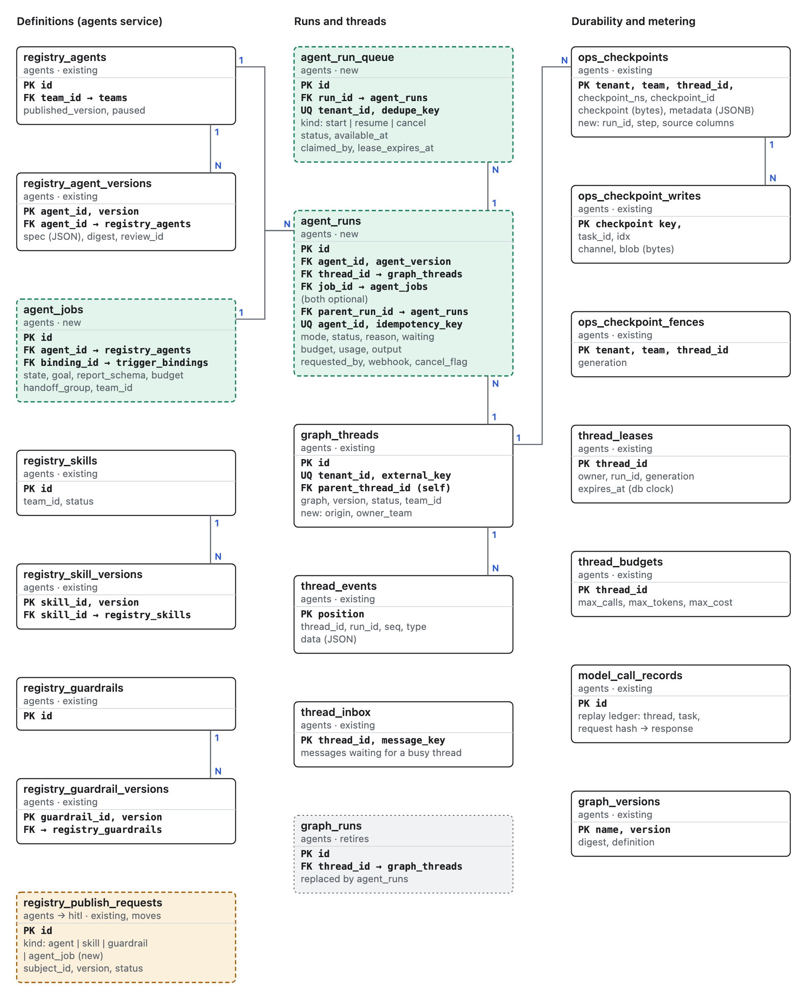

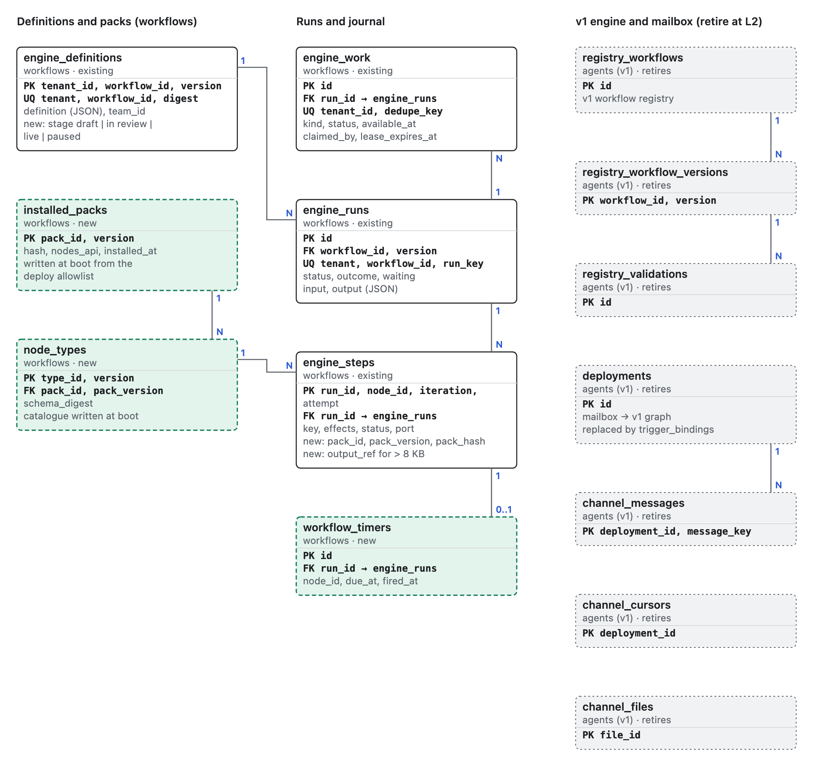

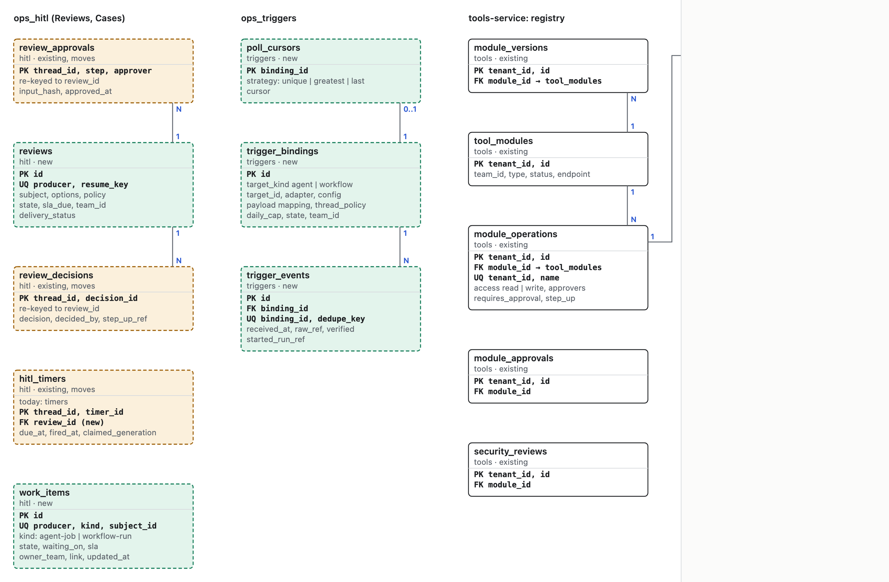

`reviews.resume_key` and `work_items.subject_id` point at an agent run or a workflow run by key. Neither is a database
foreign key, because the rows live in another service.

## State machines

**Run.** Agent runs and workflow runs use the same states. A separate reason says why a run is waiting or why it
failed. A waiting run holds no lease and no worker.

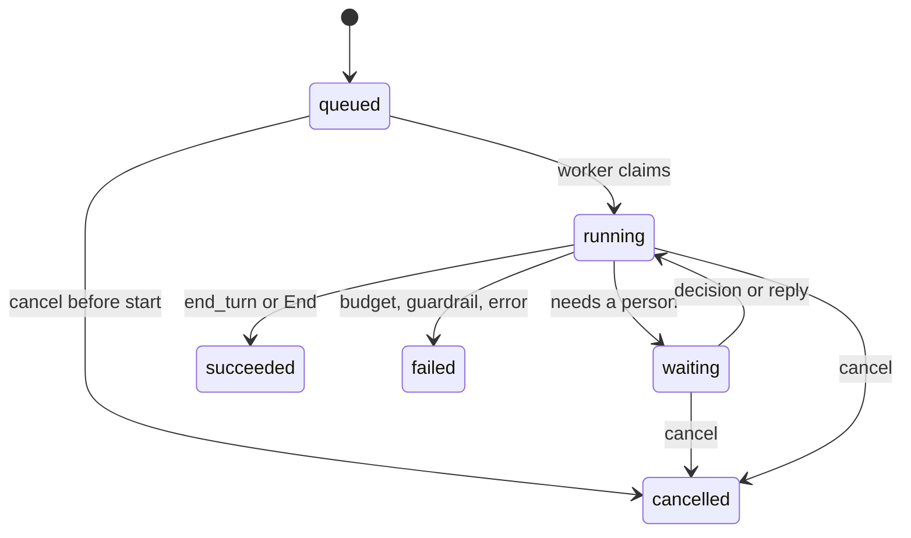

| Status | Reasons | Note |
|---|---|---|
| waiting | `requires_approval`, `ask_customer`, `handoff`, `wait` (a workflow timer) | The run's waiting field names the review key or timer |
| succeeded | `end_turn` (agent), `end` (workflow End node) | Output is checked against the output schema when one was given |
| failed | `budget_exhausted` (turns, tool calls, cost, deadline), `guardrail`, `output_invalid`, `write_not_replayed`, `agent_paused`, `error` | A failed run keeps its events and partial usage |
| cancelled | `by_user`, `by_parent`, `review_withdrawn` | Cancelling a waiting run withdraws its open review |

**Review.** The decision is recorded first, then the Reviews service calls the producer's resume endpoint with the
review key until the producer acknowledges. The resume is idempotent on that key, so a repeated delivery continues the
run once.

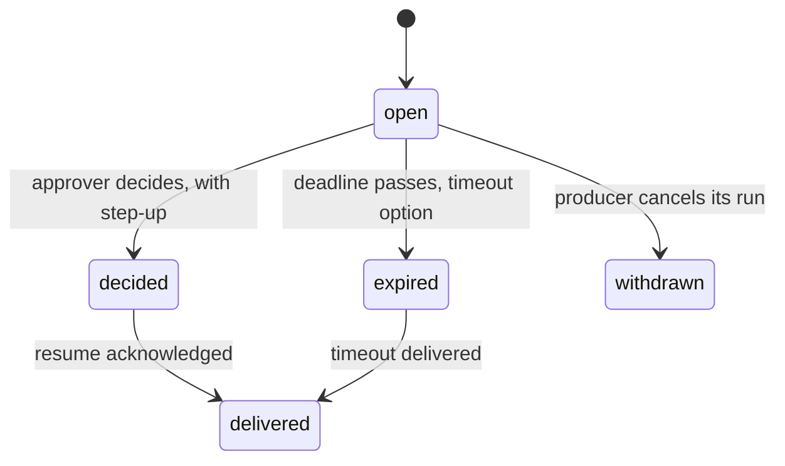

**Agent job.** Only an approved publish review enables a job and its trigger binding. Pause is immediate and stops new
runs; runs already started finish. Editing an enabled job makes a new draft that needs its own review.

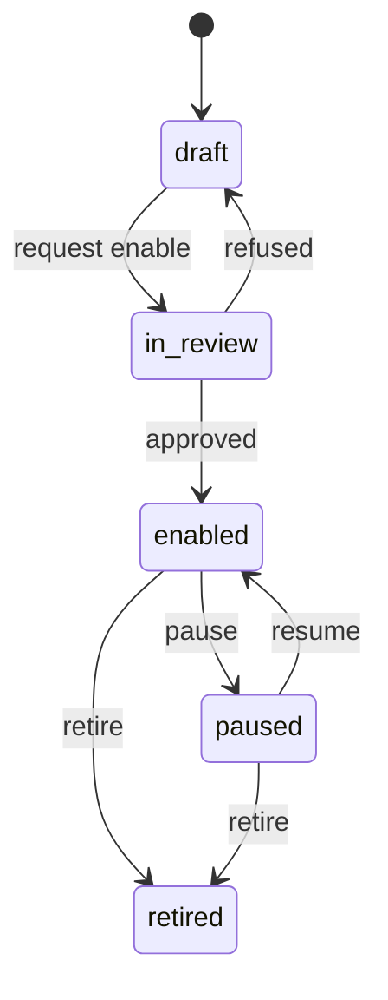

**Workflow version.** Only a live version starts runs outside test mode, and a paused workflow starts none. Runs in
flight keep the version they started on. This is built.

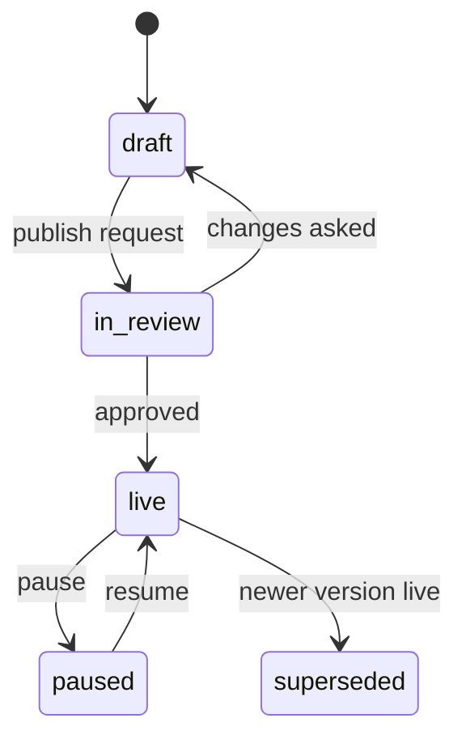

**Thread.** The state is derived from the thread's runs and never set directly. One active run per thread; a waiting
run counts as active. A second message follows the thread's multitask rule: enqueue (the default, as inbound channels
do today) or reject.

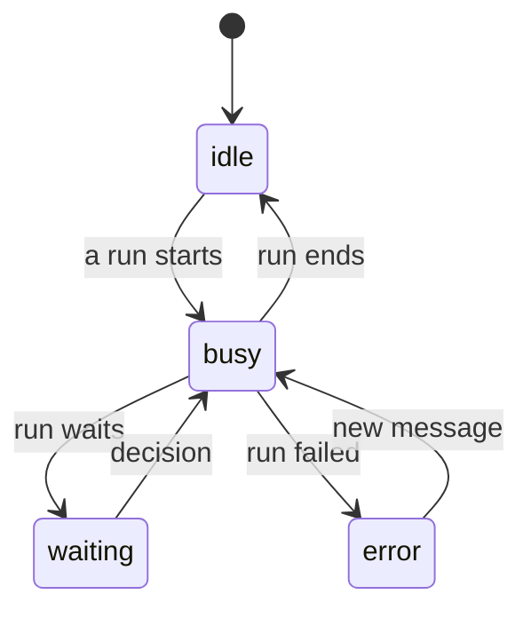

## APIs

All responses use the platform envelope, every list takes a cursor, and every write takes an `Idempotency-Key` header
whose repeat returns the first result. Service-token endpoints are callable only by another Ops AI service through its
generated client. The routes that exist today are listed in [API](../../architecture/api.md); this section covers the
new resources.

### Agent runs, threads and jobs

| Method | Path | Purpose | Status |
|---|---|---|---|
| POST | `/v1/agents/{id}/runs` | Start a run: input or resume; a thread id or a new thread; mode `stream`, `wait` or `background`; overrides; output schema; budget; goal; webhook; multitask rule. Stream answers SSE, wait the final run, background 202 with the run | planned |
| GET | `/v1/agent-runs/{id}` | Read a run with status, reason, waiting, usage and output | planned |
| GET | `/v1/agent-runs?agent=&thread=&job=&status=` | List runs, by cursor | planned |
| GET | `/v1/agent-runs/{id}/events?after=seq` | Attach or re-attach to a run's events | partial: per thread run today |
| POST | `/v1/agent-runs/{id}/cancel` | Cancel; idempotent | planned |
| POST | `/v1/agent-runs/{id}/resume` | Deliver a decision or reply (service token); a repeat with the same key continues once | planned |
| GET | `/v1/threads/{id}`, `/v1/threads/{id}/runs` | A thread with its derived state, and its runs | partial |
| POST, GET | `/v1/agents/{id}/jobs` | Create a job as a draft, and list jobs | planned |
| GET, PATCH | `/v1/jobs/{id}` | Read and edit a job; an edit makes a draft | planned |
| POST | `/v1/jobs/{id}/enable-requests`, `/pause`, `/resume`, `/retire` | Ask for a publish review; change job state | planned |
| GET | `/v1/jobs/{id}/runs` | Runs of a job | planned |

### Workflow definitions and runs

| Method | Path | Purpose | Status |
|---|---|---|---|
| GET | `/v1/workflows/node-types` | Node type catalogue with parameters, ui hints, output schemas and pack | built |
| GET | `/v1/workflows/option-sources?source=` | Picker options: agents, tools, knowledge, workflows, reviewer groups, models, steps | partial |
| POST | `/v1/workflows/definitions/validate` | Validate without saving; findings by JSON pointer | built |
| POST | `/v1/workflows/definitions` | Save a version, always as a draft | built |
| POST | `/v1/workflows/definitions/{id}/publish-requests` | Ask for review of a version; approval makes it live and supersedes the previous live version | built |
| POST | `/v1/workflows/definitions/{id}/pause`, `/resume` | Stop or restart new live runs; the owning team's builders or an admin only | built |
| POST | `/v1/workflow-runs` | The one start-run API. A live start of a version that is not live answers 409; test mode runs any version. A seen run key or `Idempotency-Key` returns the same run | built as `POST /v1/runs` |
| GET | `/v1/workflow-runs`, `/{id}`, `/{id}/events` | List and read runs with their steps; step events by `after=seq` | built under `/v1/runs` |
| POST | `/v1/workflow-runs/{id}/cancel` | Cancel; a step in progress finishes and is journaled, the next step is refused | built under `/v1/runs` |
| POST | `/v1/workflow-runs/{id}/resume` | Decision, reply or agent-run webhook (service token) | planned |
| POST | `/v1/workflow-runs/{id}/steps/{node}/retry`, `/run-from` | Retry a step or run from a node | planned |

### Reviews and work items (`ops_hitl`)

| Method | Path | Purpose | Status |
|---|---|---|---|
| POST | `/v1/reviews` | Open or update a review (service token): producer, resume key, subject, options, policy, deadline, team; upsert by producer and key | planned |
| DELETE | `/v1/reviews/{id}` | Withdraw, when the producer cancelled its run | planned |
| GET | `/v1/reviews`, `/{id}` | The Reviews inbox | built in agents-service; moves |
| POST | `/v1/reviews/{id}/decision` | Decide: option, note, step-up proof | built in agents-service; moves |
| POST | `/v1/reviews/bulk-decision`, `/assign` | Bulk actions, a result per id | built in agents-service; moves |
| POST | `/v1/work-items` | Upsert a work item (service token): producer, kind, subject, title, state, waiting on, deadline, link | planned |
| GET | `/v1/work-items?kind=&state=&team=` | The Cases and Overview list | planned |

### Trigger bindings and ingress (`ops_triggers`)

| Method | Path | Purpose | Status |
|---|---|---|---|
| POST, GET | `/v1/trigger-bindings` | Create (disabled) and list bindings: target kind and id, adapter, config, mapping, thread policy, daily cap | planned |
| GET, PATCH | `/v1/trigger-bindings/{id}` | Read and edit | planned |
| POST | `/v1/trigger-bindings/{id}/enable-requests`, `/pause` | Enable through review; pause now | planned |
| POST | `/v1/hooks/{binding_id}` | Public webhook ingress: raw body and signature header; 401 on a bad signature before any run exists | planned |
| GET | `/v1/trigger-bindings/{id}/events` | Received events and the runs they started | planned |

Email intake has no public endpoint: the email adapter reads the mailbox, as the mailbox adapter does today.

### Events and webhooks

| Event | Source | Delivered by | Notes |
|---|---|---|---|
| `run.started`, `run.waiting`, `run.resumed` | both | event stream; work item upsert | |
| `message.delta`, `message.completed`, `tool.call`, `tool.result` | agent | event stream | |
| `approval.requested` | agent | event stream | carries the review id |
| `run.settings` | agent | event stream | the run's effective settings |
| `step.started`, `step.finished` | workflow | event stream | from the journal |
| `run.succeeded`, `run.failed`, `run.cancelled` | both | event stream and webhook | webhook body: event id, run, status, reason, output (masked when redaction is on); retried with backoff until 2xx; signed with HMAC-SHA256 over the raw body |
| `review.opened`, `review.decided` | Reviews | optional outbound webhook | for a bank's own task system |

### Overrides

The agent version sets defaults and limits; the run API, chat and the embedded widget override within them. Each layer
can only narrow what the one before allows, and every run stores the effective settings it used. A value outside the
limits is refused with 422 naming the field.

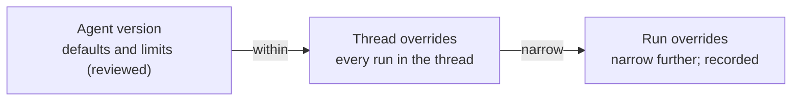

| Setting | Trusted caller | Public widget key |
|---|---|---|
| Model | choose from the allowed models | no |
| Temperature | within the range | no |
| Instructions | add to, never replace | no |
| Tools | switch off, never add | switch off |
| Knowledge | choose from or narrow to the allowed bases | narrow |
| Budget | lower only | lower only |
| Output schema, variables | free | free |
| Guardrails, approval policy | never | never |

## How things flow

**A chat turn with an approval.** The stream run executes inside the request on the web process; after the decision,
the resume runs on the run worker and the banker's open stream keeps receiving its events. One run id, one budget and
one event stream cover the whole turn.

```mermaid
sequenceDiagram
  participant B as Banker (console)
  participant A as agents (run API and graph)
  participant T as tools-service (gateway)
  participant H as Reviews
  participant R as Reviewer (console)
  B->>A: POST /v1/agents/{id}/runs mode=stream
  A->>A: in the request: lease thread, kernel turn
  A->>T: draft write
  T-->>A: needs approval (policy)
  A->>H: POST /v1/reviews (key = run:turn)
  A-->>B: event approval.requested; run waiting
  A->>A: checkpoint, release lease
  Note over B,R: the run holds no worker while it waits
  R->>H: POST /v1/reviews/{id}/decision with step-up
  H->>A: POST /v1/agent-runs/{id}/resume with the key
  A->>T: call with approval token, same key
  T-->>A: executed once
  A-->>B: events continue on the same seq; succeeded
```

**A scheduled job.** No workflow is involved and the workflows service need not be installed. The tick time is the
dedupe key, so a retried tick starts no second run. The example is a morning review of held wires.

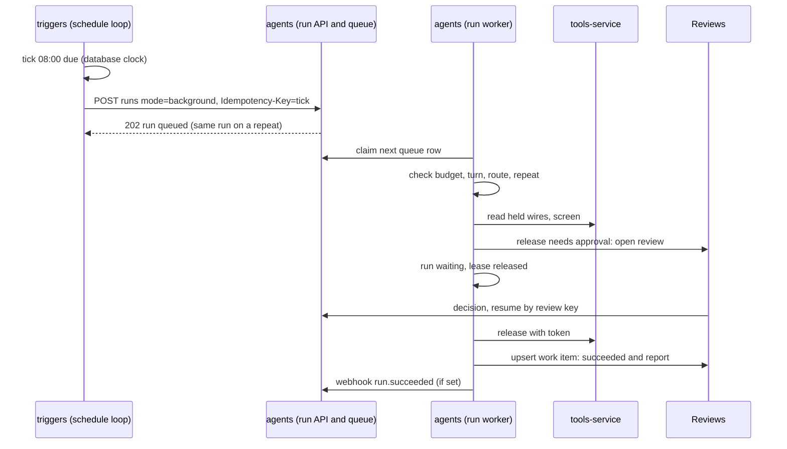

**A workflow run with an agent step.** The workflow never holds a lease while the agent works. A lost webhook is
retried until acknowledged, and the workflow sweeper also reads the run once a waiting step passes its expected time.

```mermaid
sequenceDiagram
  participant WW as workflows (worker)
  participant P as agents pack (node)
  participant A as agents (run API)
  participant H as Reviews
  participant WR as workflows (resume API)
  WW->>P: execute ops.ai.agent (effects wait)
  P->>A: POST runs background, key=run:node:iteration, webhook
  A-->>P: 202 run id
  WW->>WW: step waiting; workflow lease released
  A->>H: agent drafts a write: review
  H->>A: decision resumes the agent run
  A->>WR: webhook run.succeeded with output
  WR->>WW: queue resume work for the step
  WW->>WW: step done on port ok; next node
```

**Crash and resume.** The step key is stable across attempts, so worker B finds the write worker A made and records it
instead of repeating it. Generation fencing refuses anything worker A sends after the takeover. For agent turns the
same rule needs deterministic turn ids (A1); a found write the replay does not reproduce fails the run with
`write_not_replayed`.

```mermaid
sequenceDiagram
  participant WA as worker A
  participant D as database (queue, leases)
  participant WB as worker B
  participant T as tools-service (executions)
  WA->>D: claim work, lease generation 7
  WA->>T: write with key run:node:0:1, generation 7
  Note over WA,T: worker A dies before the journal row
  WB->>D: lease expired (database clock): take over, generation 8
  WB->>T: find executions by key
  T-->>WB: found: executed, result
  WB->>D: journal the found result; no second send
  WA->>T: A wakes: any write with generation 7
  T-->>WA: refused: lease superseded
```

**An email reply reaching a waiting run.** The adapter only derives the key; agents and workflows each apply their own
inbox rules: no thread starts one, a waiting run takes the mail as its reply, a busy one follows the multitask rule, a
closed one starts a linked follow-up. A repeated delivery of the same Message-ID returns the run already started.

```mermaid
sequenceDiagram
  participant M as Mailbox
  participant E as triggers (email adapter)
  participant S as agents or workflows start API
  participant R as waiting run
  M->>E: new message (In-Reply-To set)
  E->>E: verify SPF and DKIM, store raw bytes in files
  E->>E: conversation key from References
  E->>S: start, thread_policy=continue:key, dedupe=Message-ID
  S->>S: find thread or run for key: waiting
  S->>R: deliver as the reply; resume
  R-->>S: run continues from the ask step
  S-->>E: 200 run id (same run)
```

## Node SDK and forms

One node type holds every fact about a kind of step. The editor, the validator and the runner all read
`registry.get(id, version)`, so they cannot disagree. Packs depend on the SDK, the SDK on the core, and the core on
nothing outside itself. A pack reaches the outside only through ports the engine hands it, narrowed to what its type
declares. Triggers sit outside the engine and call its one start API.

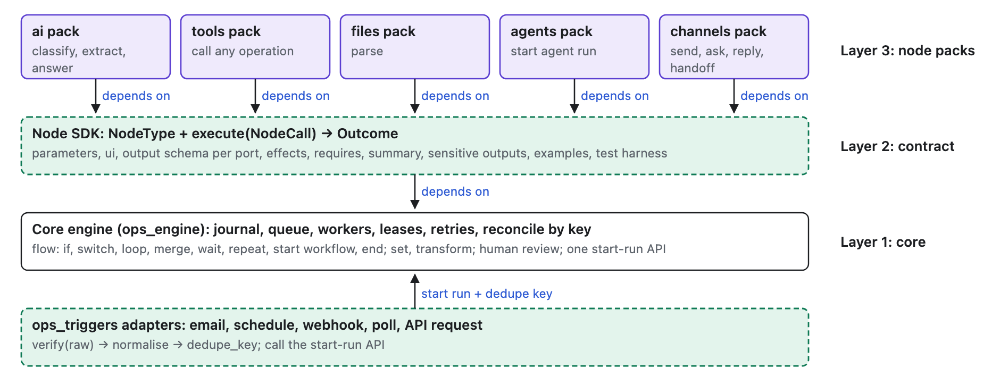

### The node contract

| Field | Meaning | Status |
|---|---|---|
| `id`, `version` | `<pack>.<group>.<name>` and an integer; an instance pins both | built |
| `pack`, `nodes_api` | Pack id, version and hash it came from; the engine contract level, refused at load when unsupported | planned |
| `group`, `label`, `description`, `icon`, `docs_url` | Palette and help; the console keeps no copy | partial |
| `inputs`, `outputs`, `outputs_from` | Ports; derived ports add to fixed ones (classify keeps `error`) | built |
| `output_schema` per port | What a port carries; feeds the step-output picker and checks | built (uc-401) |
| `parameters` | JSON Schema 2020-12; show and hide rules as `if`/`then` inside it | built |
| `ui` | Order, groups, widget per field, rules, option source per field, mappable or not | partial |
| `effects` | `none`, `read`, `model`, `write`, `human`, `wait` | built without `wait` as a class |
| `retry`, `timeout_seconds` | A pack may lower attempts; write and human get one attempt | built |
| `requires` | Ports the executor may use, and for tools the operation ids it may call | planned |
| `summary` | Template for the one-line text on the canvas card, run view and audit log | planned |
| `sensitive_outputs` | Output paths always masked in the journal view and exports | planned |
| `deprecated`, `replaced_by` | Hidden from the palette; existing runs continue | planned |
| `examples` | Parameter fixtures and expected outcomes for tests and help | planned |
| `execute(NodeCall) -> Outcome` | `NodeCall`: params, key, iteration, attempt, run id, ports narrowed to `requires`, log. `Outcome`: port, out, summary. A raised exception means no answer and may retry; an error port means the operation answered with an error | built in shape |

### Effects classes

The effects class tells the engine what a node does to the outside world. The engine, never the pack, applies retries
and reconciliation from it, so a pack cannot ask for a second send of a write.

| Class | Means | Attempts | After a crash |
|---|---|---|---|
| none | Pure data or flow | 3 | Re-run |
| read | Reads outside data | 3 with backoff | Re-run |
| model | Calls a model | 2 | The ledger replays the recorded response by request hash |
| write | Changes the world | 1 | Find the execution by key before any retry; never send twice |
| human | Opens a review | 1 | Review upserted by key |
| wait (new) | Waits on a timer, a reply or another run | none | Waiting row kept across the interrupt; resumed by key |

### Packs

| Pack | Kind | Node types | Ports used |
|---|---|---|---|
| core | Built into the engine | trigger, set, transform, if, switch, loop, repeat, merge, wait, start workflow, human review, end | engine only |
| ai | Pack | classify, extract (presets "Write text" and "Score"), answer; model and knowledge attachments | model, knowledge |
| tools | Pack | call any registry operation; preset "Send message" | tool |
| files | Pack | parse files to pages and rows | files |
| agents | Pack (the bridge) | start an agent run and wait for it | agent run |
| channels | Pack | reply, ask, handoff | channel |

Packs are Python packages with a manifest. They are installed at deploy time from an internal index with pinned hashes,
and the registry loads only packs on the deployment's allowlist. Each journal row records pack id, version and hash. A
new pack version never changes a saved workflow; moving a node to a new type version is an explicit, recorded migrate
step. Packs never import engine internals, a database driver or an HTTP client, and the worker's network policy allows
only the gateway, model and files endpoints.

### Trigger adapter contract

An adapter is `verify(raw, headers, config)`, `normalise(raw, headers)` and `dedupe_key(event)`. It calls the start API
once with an envelope: target, trigger, received time, a files reference to the raw bytes, headers with secrets
removed, the payload, the dedupe key and how the event was verified. The start API returns the existing run for a key
seen within the window (24 hours by default).

| Adapter | Dedupe key | Verification |
|---|---|---|
| Email | mailbox and Message-ID | Record SPF, DKIM and DMARC results; attachments to files before the run starts |
| Schedule | workflow or job and the planned tick time | Internal; a missed tick is skipped or caught up, by policy |
| Webhook | provider event id, else SHA-256 of the raw body | HMAC over the raw bytes, constant-time compare, timestamp tolerance |
| Chat (widget, chat API) | conversation id and message id | The chat session's authentication; for an agent it is a run on the thread, for a workflow a start with `continue:<conversation>` |
| Poll | item id; a cursor kept per binding (unique, greatest or last) | The poll call goes through the gateway as a read |
| API request | the caller's `Idempotency-Key` | The API's own authentication |

### Forms: generated by default, custom when useful

The type's schema is the only source. A custom form can change how editing looks and can never store a value the
generated form could not, because the server validates every save.

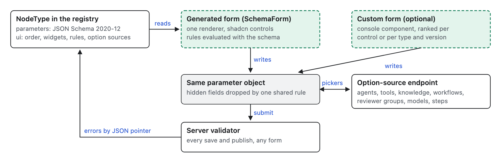

- Mappings are path lookups such as `{"path": "$.nodes.parse.out.pages"}`, and code-free templates such as
  `{"template": "Dear {{$.input.name}}"}`. No field ever evaluates code.
- Option sources come from a closed set served by one endpoint: agents, tools, knowledge, workflows, reviewer groups,
  models and earlier steps. Packs cannot add option loaders that run code with credentials.
- Custom forms are console components registered by type and version range, for one control or the whole form. Each
  must round-trip every `examples` fixture unchanged, and an "all settings" generated view stays available.
- Hidden fields are dropped on save by one shared rule, and a field required only when shown is an `if`/`then` in the
  schema, so the server enforces it.

The node catalogue, with each type's ports, effects and status, is in [workflow nodes](workflow-nodes.md).

## Agent kernel and capability packs

The kernel is the code that runs one agent turn: it builds the prompt, calls the model, runs tools and checks the
answer. It gets the same layering as the workflow engine: a core that knows no capability by name, and capabilities that
plug in through one contract (prompt parts, tools, checkpoint checks, events and a fake for tests).

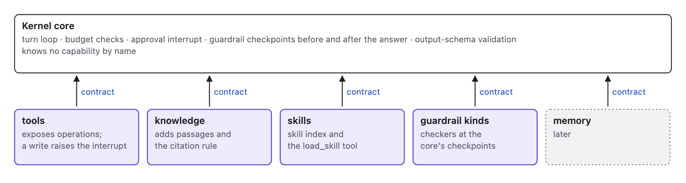

| Capability | Today | On the contract | Status |
|---|---|---|---|
| Tools | Granted operations through the gateway, approval per operation | Exposes tools; a write raises the core's approval interrupt | built; moves in K1 |
| Knowledge | Knowledge bases searched through the kernel's knowledge port, cited by page | Adds passages and the citation rule | built; moves in K1 |
| Skills | On-match and always-on skills with caps | Adds the skill index and the `load_skill` tool | built; moves in K1 |
| Guardrail kinds | Blocked topics, checked before and after the answer | A checker per kind at the core's checkpoints: blocked topics, then required citations, output shape, personal-data redaction | partial |
| Memory | Per-person memory the person can see, correct and forget | Later, as a pack | built outside the contract |

### Goal runs (jobs)

A job's run loops on the agent graph: check (cancel flag, budget, deadline), turn, route. The graph already has the
turn, approval and resume nodes; A2 adds the check node, the route node and the back edge.

| Rule | Value |
|---|---|
| Turn envelope | With goal settings the output is `{status: continue | done | handoff, progress, report?, handoffReason?}`; a mismatch fails the run with `output_invalid` |
| Budget | Turns, tool calls, cost and deadline counted over the whole run, checked before each turn. Default 10 turns, 20 tool calls, US$0.50 and 24 hours, editable up to the team cap. The thread budget stays the hard stop before every model call |
| Rejected writes | A second rejection of the same input, or a third in the run, waits with reason `handoff` |
| Turn ids | Derived from thread, run, node and turn number, so tool keys survive a crash |
| Version pin | A run keeps the agent version it started on through every approval |

## Data layer and database portability

Ops AI uses SQLAlchemy with async drivers throughout, keeps portable column types, and has one Alembic chain per
service with its own version table. Each repository declares the guarantees it needs (compare-and-set, transaction,
lock, clock, row-level security) and is refused on a backend that lacks one. Repositories never write dialect-specific
SQL; they call a small set of store ports, each with a renderer per supported database.

The supported databases are PostgreSQL and SQL Server, including Azure SQL
([ADR-0017](../../architecture/decisions/database-support.md)). The earlier plan for MySQL 8 is dropped. SQLite stays
for unit tests and a laptop only.

### What is PostgreSQL-only today, and the portable form

| Feature | Portable form |
|---|---|
| Queue claim with `FOR UPDATE SKIP LOCKED` | A `claim_one(queue)` port with a renderer per dialect |
| `UPDATE` or `INSERT … RETURNING` | PostgreSQL keeps `RETURNING`; SQL Server uses `OUTPUT` |
| Conditional upsert (`ON CONFLICT DO UPDATE … WHERE`), used for a lease takeover only if expired | `UPDATE … WHERE expires_at < now`; `INSERT` when no row changed; the primary key catches the race and the loser retries once |
| Plain upserts | `upsert(table, keys, values, update=)`: `ON CONFLICT` on PostgreSQL, `MERGE … WITH (HOLDLOCK)` on SQL Server |
| Advisory locks (thread lock, call key lock) | `lock_row`: `SELECT … FOR UPDATE` (`UPDLOCK` on SQL Server) on the thread's lease row, created with the thread, or on the call row for the key, inserted first |
| Database clock via `extract(epoch from now())` | `db_now()`: `DATEDIFF_BIG(ms, '1970-01-01', SYSUTCDATETIME()) / 1000.0` on SQL Server |
| `date_trunc` and interval arithmetic | Window start computed in Python from `db_now()`, stored as an integer epoch minute |
| Row-level security and `SET LOCAL ROLE` | A tenant filter added by the store layer in every tenant transaction; row-level security kept on PostgreSQL; a SQL Server security policy as the second check |
| JSONB column, GIN index and JSON operators | Filtered fields promoted to indexed columns; the rest stays a portable JSON column filtered in Python |
| `bytea` and unbounded text primary keys | `LargeBinary`; bounded `VARCHAR` keys with a binary collation (`NVARCHAR(MAX)` and `TEXT` cannot be key columns on SQL Server) |
| Full text: `tsvector`, `ts_rank_cd` | A search port per dialect: `tsvector` on PostgreSQL, a full-text index with `CONTAINSTABLE` on SQL Server |
| PostgreSQL-only DDL: `DO $$` blocks, roles, `GRANT` | A dialect branch in a shared migration helper |
| asyncpg imported directly by the checkpointer | The checkpointer moves to SQLAlchemy async Core |

### Each concern on each database

| Concern | PostgreSQL | SQL Server and Azure SQL |
|---|---|---|
| Queue claim | `SELECT … FOR UPDATE SKIP LOCKED LIMIT 1`, then `UPDATE … RETURNING` | A CTE that picks the oldest due row, then `UPDATE` through it with `OUTPUT`; the statement is below |
| Upsert | `INSERT … ON CONFLICT (keys) DO UPDATE / DO NOTHING` | `MERGE … WITH (HOLDLOCK)` for one row; update-then-insert under `UPDLOCK, HOLDLOCK` for conditional cases |
| Lease and lock | Row lock on the lease row; generation fencing | Same, with `UPDLOCK`; `READ_COMMITTED_SNAPSHOT` does not affect locking reads |
| JSON column | JSONB | `NVARCHAR(MAX)` with `CHECK (ISJSON(col) = 1)` |
| JSON queries | Only through promoted columns | A persisted computed column `JSON_VALUE(…)` and an index, where a query needs one |
| Binary | `bytea` | `VARBINARY(MAX)` |
| Tenant isolation | Store filter and a row-level security policy | Store filter and a security policy on `SESSION_CONTEXT(N'tenant_id')`, set by `sp_set_session_context` in the tenant transaction |
| System versus tenant access | `SET LOCAL ROLE` per transaction | Two logins or two Entra identities |
| Isolation level | `READ COMMITTED` | `READ COMMITTED` with `READ_COMMITTED_SNAPSHOT` on. Plain reads see the last committed version, so every state change is a conditional `UPDATE` that checks the row count |
| Deadlock retry | SQLSTATE 40P01 | error 1205 |
| Key collation | C collation behaviour by default | `Latin1_General_100_BIN2_UTF8` on key columns; the default `SQL_Latin1_General_CP1_CI_AS` ignores case |
| Index key size | about 2,700 bytes per entry | 900 bytes clustered, 1,700 nonclustered |
| Async driver | `postgresql+asyncpg` | `mssql+aioodbc` with ODBC Driver 18 (encrypts by default). With Entra ID, a token from `azure-identity` passed in a connect event, and a pool recycle time below the token lifetime |

The SQL Server claim for `engine_work`. `UPDATE TOP (1)` without a CTE would pick an arbitrary row, so the order lives in
the CTE:

```sql
WITH next AS (
  SELECT TOP (1) *
  FROM engine_work WITH (UPDLOCK, READPAST, ROWLOCK)
  WHERE build = :build
    AND ((status = 'queued' AND available_at <= :now)
      OR (status = 'claimed' AND lease_expires_at < :now))
  ORDER BY id
)
UPDATE next
SET status = 'claimed', claimed_by = :owner,
    lease_expires_at = :now + :ttl, attempts = attempts + 1
OUTPUT inserted.id, inserted.tenant_id, inserted.run_id, inserted.kind,
       inserted.payload, inserted.attempts, inserted.claimed_by;
```

`:now` comes from `db_now()` in the same transaction. `UPDLOCK` holds the chosen row until commit, `READPAST` skips rows
another worker holds, and `ROWLOCK` stops the lock from growing to a page.

### Rules for the schema

- One portable JSON type: JSONB on PostgreSQL, `NVARCHAR(MAX)` with an `ISJSON` check on SQL Server. No SQL filters
  inside JSON; a field that needs a query becomes a column.
- Key columns (ids, run keys, dedupe keys, idempotency keys, external keys, checkpoint ids) are bounded `VARCHAR` with a
  binary collation, so `Msg-1` and `msg-1` stay different keys. Index size is counted in bytes, so every key column is
  bounded in bytes and kept to ASCII ids or hex. A key that can carry outside text, such as a thread's external key, is
  indexed through a SHA-256 hex column (64 ASCII bytes), with the full key in an unindexed column.
- Names stay lowercase snake case under 60 characters; constraint names come from a naming convention. Reserved words
  used as column names are quoted by SQLAlchemy and never written in raw SQL.
- Timestamps stay as ISO strings or epoch seconds from the database clock; both are portable.
- A test walks the metadata of every service and fails on an unbounded key column, a key wider than 900 bytes, a name
  over 60 characters or a JSON column used in an index.

### Tenant isolation

Each tenant transaction adds `tenant_id = :t` to every statement on a tenant table, through repositories that take the
tenant from the transaction, never from the caller. In tests a statement hook fails any statement on a tenant table
that lacks the filter. On PostgreSQL the row-level security policies stay on as a second check; on SQL Server a
security policy reading `SESSION_CONTEXT` does the same job and is created from the first migration.

### The LangGraph checkpointer

The checkpointer saves agent graph state. LangGraph's own savers cover PostgreSQL and SQLite only, so Ops AI keeps its
own saver and rewrites it on SQLAlchemy async Core:

- Same tables, serializer and blob format; keys bounded, blobs as `LargeBinary`.
- `run_id`, `step` and `source` promoted from metadata to indexed columns; listing filters use them and filter the rest
  in Python.
- The fence becomes three steps: `UPDATE … SET generation = :g WHERE` thread key `AND generation <= :g`. If one row
  changed, the write goes ahead. If none changed, read the generation: a higher one refuses the write as superseded; no
  row means `INSERT` with `:g`. A primary-key error on that insert means another owner won the race, so re-read and
  apply the same rule once.
- The tenant scope stays fixed when the saver is built, now enforced by the store filter.
- The LangGraph checkpoint conformance tests run against every supported database.

### Migrations

- Alembic stays, one chain per service. Each chain gets one portable baseline written in SQLAlchemy DDL; dialect-only
  parts (row-level security, the SQL Server security policy, full-text indexes, roles) live in one shared helper that
  branches on the dialect.
- After the first production install every change is expand then contract: add the new column or table, deploy code
  that writes both, backfill, deploy code that reads the new one, drop the old.
- The host runs the migrations of the services it starts under a row lock on a migration lock row, so two processes
  starting together do not race. The migrate command creates that table and row first, with an insert that ignores a
  duplicate.

The step-by-step database plan for a DBA is in [the database guide](../../deploy/database.md).

## Scalability

| Mechanism | Design | Target | Status |
|---|---|---|---|
| Work queues | One for agents and one for workflows, on the same queue-and-lease library. One row claimed per transaction; an idle worker polls every 0.5 s with backoff. PostgreSQL `LISTEN/NOTIFY` is not used, because it is not portable | Claim latency p95 under 1 s at 200 queued rows | partial |
| Workers | Loops-only processes scale out; each runs a fixed number of runs at once. A waiting run holds no worker | Add a process to add capacity, with no coordination | partial |
| Per-tenant caps | Agents and workflows each count running runs per tenant; the claim skips a tenant at its cap, so one tenant cannot starve the rest | Default 50 running runs per tenant for each | planned |
| Budgets and caps | Run budget, thread budget as the hard stop, team cap, daily cap per trigger binding | No run exceeds its budget by more than one model call | partial: thread budgets built |
| Large outputs by reference | A step or run output over 8 KB is stored in files; the journal and event keep the reference | Journal row size stays under 8 KB | planned |
| Step limits | Derived per workflow from declared loop bounds, and for goal runs from the turn budget (turns × 4 + 10) | A runaway loop fails with a reason instead of hanging | planned |
| Event and checkpoint growth | `thread_events` is append-only with retention per tenant (90 days by default), then archived to files. After a run ends, keep the last checkpoint per thread | Database size grows with active work, not history | planned |
| Webhooks | Outbox rows retried with backoff until acknowledged; delivery status on the run | A slow receiver never blocks a worker | planned |

The targets below are proposals. Each becomes true only when its load job passes. Load jobs use the fake model and the
fake bank tools, with no real model calls.

| Target | Proof |
|---|---|
| 200 concurrent workflow runs on two workers, plus 20 agent runs waiting on approvals | uc-083, on each supported database, nightly |
| 50 concurrent background agent runs on two loops-only processes | a load script in A3 |
| 100 webhook events per second into one binding, every duplicate refused | a load script in S3 |
| 10,000 open reviews, with the Reviews page under 500 ms | seeded data in S2 |

## Deployment

Ops AI must run on one virtual machine with no container runtime; Compose and Kubernetes are optional
([deploy](../../deploy/install-guide.md)). The host program makes the same packages fit every layout: only the
`--services`, `--no-loops` and `--loops-only` flags change. The same use cases passing in layouts A and C in CI is the
proof that the layouts are equivalent.

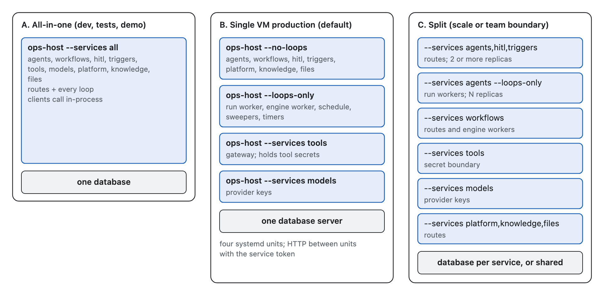

### Layout B: which process runs what

| Process | Command | Routes | Loops |
|---|---|---|---|
| web | `ops-host --services agents,workflows,hitl,triggers,platform,knowledge,files --no-loops` | Every public and console route. Runs agent runs in stream and wait mode inside the request | none |
| loops | `ops-host --services agents,workflows,hitl,triggers --loops-only` | none | agent run worker (background runs and every resume), engine worker, sweepers, schedule loop, poll loop, review deadline timers, webhook outbox |
| tools | `ops-host --services tools` | Gateway routes | rate window cleanup |
| models | `ops-host --services models` | Model routes | none |

A run in stream or wait mode executes inside the request on the web process, so the first token arrives with no queue
hop. The web process takes the thread lease, renews it while the turn runs, and releases it at the end or when the run
starts waiting. A background run, and every resume after a wait, goes through the agent run queue to the run worker. If
a web process dies mid-turn its lease stops being renewed; the sweeper takes the expired lease, raises the generation
and continues the run from its last checkpoint as a background run. The client re-attaches with
`GET /v1/agent-runs/{id}/events?after=seq` and sees the rest of the same run.

| Setting | How | Scope |
|---|---|---|
| Which services and loops | Command-line flags of `ops-host` | Per process |
| Database URL | One per service; services may share a server and database. The URL's dialect picks the store renderers | Per service |
| Service token | Shared secret or workload identity for calls between processes | Per deployment |
| Pack allowlist | Pack ids, versions and hashes; the registry refuses anything else at boot | Per deployment |
| Tool and provider secrets | Read only by the tools and models processes | Per service |
| Limits | Budgets, tenant caps, poll intervals, retention; validated at boot | Per deployment |

Upgrades:

1. Run `ops-host migrate --services …` once per release, before any new process starts.
2. Start the new processes beside the old ones. Workers claim only work rows stamped with their build, so old and new
   workers run side by side. Once every old worker has stopped, the next migrate step restamps queued and claimed rows
   of the previous build, so retries the old build left behind are not orphaned. A due row that no running worker can
   claim for 5 minutes raises an alert.
3. Stop the old processes. Runs in flight keep their pinned workflow or agent version; waiting runs resume on the new
   build, which must read checkpoints from the previous one.
4. Contract migrations (drops) ship one release later.

## Security and governance

| Control | Rule | Status |
|---|---|---|
| Approvals | Every write goes through the gateway; the operation's policy decides whether it needs approval and how many approvers | built |
| Step-up | A decision on a sensitive operation needs a fresh step-up sign-in, recorded on the decision | built |
| Guardrails | Checked before and after every answer; a failing or unavailable checker fails the run with reason `guardrail` | built for chat; every run after A1 |
| Personal data | Masking covers progress, output, event payloads and webhook bodies; a node's sensitive outputs are masked in the journal view | partial: run pages and agent replies mask personal data |
| Budgets | Run, thread, team and trigger caps; the thread budget stops a model call before it is made | partial |
| Team scope | Jobs and bindings cannot be enabled across teams | planned |
| Who a triggered run acts as | The run is requested by the job or binding; the approver who enabled it is the accountable owner. Runs never use the author's credentials | planned |
| Audit | The audit log, the gateway's execution record per key, the journal with pack hashes, and run events | partial: pack hash planned |
| Fail closed | An unknown pack, an unverified webhook, a missing guardrail checker, or a repository on a database lacking a guarantee it needs all refuse instead of running | partial |
| Pack trust | A deploy-time allowlist pinned by hash; review checks for no network, filesystem or environment access outside ports; worker egress limited to gateway, models and files | planned |
| No code in mappings | Path lookups and code-free templates only | built |
| Tenant isolation | Store-layer filter on every database; row-level security on PostgreSQL; a security policy on SQL Server | partial |
| Secrets | Tool credentials stay in tools-service and are bound to the operations allowed to use them; a form never shows a secret back | built |
| Webhooks | Inbound: HMAC over raw bytes before any run exists. Outbound: signed, with an event id for deduplication | planned |
| Caller overrides | A caller changes a run only within the agent's reviewed limits; guardrails and approval policy are never overridable; public widget keys get a smaller set; every run records its effective settings | built for chat threads |

## Implementation plan

The order is inside out: boundaries, host and store first, then the shared services, then the core of agents and of
workflows, then packs and bridges. Each slice is at most eight tasks. Its use-case gate must pass, in both host layouts
once the host exists, before a slice that needs it starts.

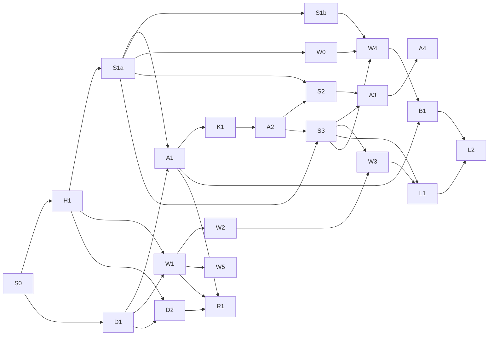

Critical paths. Agentic: S0, H1, S1a, A1, K1, A2, then S2 and S3, then A3. Deterministic: S0, H1 and D1, then W1, W2,
W3 and L1, with S3 for the email binding. L2 retires the first engine after L1 and B1.

| Slice | What it delivers | Needs | Use-case gate |
|---|---|---|---|
| S0 Boundaries | Import rules for agents, workflows and shared services as warnings; shared contracts for reviews, work items and runs; a shared queue-and-lease library; boot-without-workflows and boot-without-agents tests marked expected to fail | none | The two boot tests fail for the listed reasons only |
| H1 Service host | The service package interface (routes, loops, migrations); `ops-host` with its flags; a client generator with in-process and HTTP transports; every service as a host service; migrations under the lock; a CI job in layouts A and C | S0 | uc-081 and uc-085 pass in both layouts |
| D1 Portable store | The `db_now`, `claim_one`, `upsert` and `lock_row` ports; queue claims, upserts and locks moved onto them; the store-layer tenant filter; the conformance suite per database | S0 | Conformance suite green on every supported database; uc-081 green on PostgreSQL |
| D2 Portable schema | Portable JSON, binary and key types; the checkpointer on SQLAlchemy; a portable baseline per chain; the knowledge search port per dialect; drivers; isolation level and deadlock retry; CI database jobs | D1, H1 | uc-080, uc-081 and uc-085 pass on every supported database |
| S1a Reviews contract | The Reviews service and its tables; review open and upsert; decision then resume by key until acknowledged; approval tokens; deadline timers; the publish-request and workflow producers moved | H1 | A workflow approval and a publish request decided through the Reviews service |
| S1b Reviews producers | The chat approval producer moved; console Reviews on the new API; the import rule becomes an error | S1a | uc-085 chat approval unchanged |
| S2 Work items | The work items table and upsert API; workflow run and agent run producers; Cases and Overview from the joined list | S1a | A waiting workflow run and a waiting agent run listed by one Cases call |
| S3 Trigger adapters | The trigger service with bindings, events and cursors; the schedule loop; the webhook adapter; email intake; the poll adapter; enable through review | H1, S1a | A schedule fires once per tick; a replayed webhook starts one run |
| A1 Run API and run worker | `agent_runs` and its queue; the run worker; the run API with three modes and `Idempotency-Key`; deterministic turn ids; waiting without a lease; the multitask rule; cancel, events and webhooks; chat and test on the run API | H1, S1a, D1 | uc-085 through the run API; a background run claimed by the worker; a repeated resume continues once |
| K1 Kernel layering | The capability contract; the kernel core reduced to turn loop, budget, interrupt, checkpoints and output schema; tools, knowledge, skills and blocked topics as capabilities; a harness with fake capabilities | A1 | uc-085 unchanged; a turn with no capabilities answers from the model alone |
| A2 Goal runs and agents as tools | Check and route nodes and the back edge; the turn envelope; budget and deadline over the whole run; the rejection cap; the handoff review; agent-to-agent child runs | K1 | A goal run that waits on one approval, resumes and succeeds; a turn budget of 2 fails with `budget_exhausted` |
| A3 Jobs | The job entity and states; the job publish kind; the job binding; the report as run output; redaction enforced; team check and team budget cap; work items for job runs | A2, S2, S3 | A held-wires morning review on a schedule with the workflows service and the agents pack absent |
| A4 Jobs UI | A jobs section on the agent page; job detail with its runs; agent run detail from events | A3 | Add a job, request enable, approve, see a run |
| W0 Workflow lifecycle | The stage column; drafts; publish through review; start refused for versions that are not live; pause and resume; cancel | S1a | A stored draft cannot start a run; a paused workflow starts none (built) |
| W1 Node SDK and core flow | The node contract fields; pack manifest, loader, allowlist and hash on every journal row; a testing kit with fake ports and a crash injector; switch, merge, repeat and wait; loop; start workflow; typed mappings and templates; large outputs by reference | H1, D1 | A sweep core path on fake tools starts exactly four children after a kill |
| W2 ai and files packs | Classify, extract and answer; the model alias attachment; parse to pages and rows | W1 | Parse, classify and extract on a sample notice, each attempt journaled |
| W3 tools and channels packs | Call a tool moved out of the core; the "Send message" preset; reply, ask and handoff | W2, S3 | A dispute email with the agents pack absent |
| W4 Workflows service | The workflows service with its routes, worker loop and adapters; routes renamed with an alias; the boot-without-agents test green | W0, S1b, S3 | The workflows, Reviews, triggers, tools and models services run a sweep without agents |
| W5 Editor forms | The schema form renderer; ui hints for every type; the option-source endpoint; server errors by JSON pointer; the custom form registry with a round-trip test | W1 | Every built type edited without JSON; a custom form's invalid value refused by the server |
| L1 Court order rebuild | Court order intake on parse, classify, extract, loop and start workflow; the court order case workflow with review and hold; spam closed; unknown senders to a person; the email binding | W2, W3, S3 | uc-082: spam closes, an unknown sender reaches a person, one case per debtor |
| L2 Retire the first engine | Open threads on it migrated; mailbox deployments replaced by bindings; its compiler, registry and routes removed | L1, B1 | No first-engine thread open; both boot tests green |
| B1 Agents pack and workflow tools | The agent step as a background run with a webhook; workflow resume on the run-ended webhook; the remove-the-pack test | A1, W4 | With the agents pack removed, every other use case passes |
| R1 Runner tools | Pin a step and test with pins; retry a step and run from a node; version pinning and migrating paused runs; 200 concurrent runs | W1, A1, D2 | uc-083 on every supported database |

Out of scope: a Tasks page; multi-agent planning beyond one agent calling another as a tool; the code node; node packs
uploaded at runtime; an assistant that writes workflows; several triggers on one job or workflow; databases other than
PostgreSQL and SQL Server.

## Open questions and risks

| Topic | Risk or question | Proposed answer |
|---|---|---|
| Moving Reviews | Every approval path depends on it | Producers move one at a time across S1a and S1b behind the same console contract; chat last, gated by uc-085 |
| SQL Server behaviour proven in a container | The SQL Server container differs from Azure SQL Database in defaults, Entra ID and full-text population | A nightly job on a real Azure SQL database; a release needs it green |
| aioodbc throughput | A thread-pool driver may cap concurrent runs per process | Measured by the nightly load test; scale out loop processes if needed |
| Full-text parity | Retrieval answers differ by database | Retrieval thresholds per dialect; an external search index stays possible behind the same search port |
| Route rename | The console and scripts call `/v1/runs` for workflow runs | A read alias kept until the console moves |
| Schedulers | Trigger schedules, review deadlines and workflow waits fire from different loops | All use the database clock and fire once by key |
| Long waits | A run waiting days keeps a checkpoint and a pinned version | A deadline of at most 7 days; no lease or worker held |
| Cost | Schedules and polls multiply runs; crash re-runs are paid twice | Run, team and binding caps; projected daily cost on the job form |
| Envelope compliance | A model ignoring the status field ends runs with `output_invalid` | Measure within a small real-model allowance before shipping A2 |
| Bridge delivery | A lost webhook leaves a workflow step waiting | Retried until acknowledged; the workflow sweeper reads the run once a step passes its expected time |
| Open runs on the first engine | Runs still open when the first engine retires | Each open run moves to the new runner at its current step; L2 carries an operator migration story and its own gate |
| First service to split | Which service gets its own process first in production | Decided from the first customer's secret-boundary needs |
