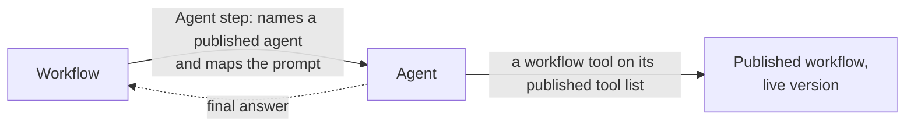

# Build with Ops AI

Status: current. Every folder named below runs against a local stack, and its test is part of the repository's checks.

Start with one message, one search and one read, then an agent and a workflow, then the two ways agents and workflows
call each other. Approvals, roles and evaluations come after that, in the agents and workflows manuals. Each step is a
folder you run as it is and then copy.

## Before you start

Run the stack on your machine as the [Quickstart](quickstart.md) shows. `make up` installs the sample team the
examples use. Each folder has the same three files to start from:

| File | What it does |
|---|---|
| `setup.py` | Signs in, creates or finds what the example needs, and writes `.ops-profile.json` into the folder |
| `test_example.py` | Runs the example through the Python SDK and checks the result |
| `README.md` | What the example teaches and the commands for it |

Run any folder the same way:

```bash
uv run python examples/chat/01-ask-once/setup.py
uv run pytest examples/chat/01-ask-once/test_example.py
```

## The ladder

<!-- site: steps -->
1. **Chat**: send one message and read the reply. `examples/chat/01-ask-once/`
2. **Knowledge**: add one page to a knowledge base and search it. `examples/knowledge/01-search-a-page/`
3. **Tool**: call one read operation and see the record. `examples/tools/01-find-a-customer/`
4. **Agent**: ask a published agent one question. `examples/agents/01-answer-from-instructions/`
5. **Workflow**: validate and run a three-step workflow. `examples/workflows/01-normalize-a-request/`
6. **A workflow asks an agent**: an Agent step calls a published agent and keeps its cited answer. Run
   `examples/agents/02-cite-the-handbook/setup.py` first. `examples/compositions/01-workflow-asks-agent/`
7. **An agent starts a workflow**: a chat calls a published workflow as a tool. Run
   `examples/workflows/01-normalize-a-request/setup.py` first. `examples/compositions/02-agent-starts-workflow/`

The [workflows manual](workflows.md) and the [agents manual](agents.md) list every further folder.

## How agents and workflows meet

Agents and workflows are separate systems that call each other only through their public APIs, so either one works
without the other.



| Direction | How | What comes back |
|---|---|---|
| A workflow asks an agent | An Agent step names a published agent and maps the prompt from the run's data | The agent's final answer, as the step's output |
| An agent starts a workflow | The agent's published tool list holds `workflow:<id>`; calling it starts that workflow's live version on behalf of the signed-in person | The run's result, or a handle when the run waits for a person |

[Workflows as agent tools](../architecture/workflows-as-tools.md) has the design.

## The same operations on every surface

The REST API, the Python SDK, the TypeScript SDK and the `opsai` command offer the same lifecycle: validate, apply,
publish, run in test mode, inspect, and evaluate an agent. Where a surface is still missing an operation (replaying a
run, evaluating a workflow, the agent run API from TypeScript), [developer surface
coverage](developer-surface-coverage.md) marks it planned.

## Examples, seeds and use cases

| Word | Where | What it is for |
|---|---|---|
| Example | `examples/` | A folder that teaches one idea, which you run and copy |
| Seed | `scripts/sample-team/` | The demo data a local stack starts with; [the seeded workflows](skills/wf-builder/examples.md) are listed for the workflow builder skill |
| Use case | `docs/usecases/` | A user story with its acceptance test, run on every change |
