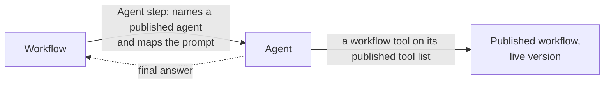

# Build with Ops AI

Status: current. Each step has a runnable example folder in the repository, tested on every change.

A developer new to Ops AI needs a path from one chat message to an agent and a workflow that call each other. This
guide is that path, seven short steps, each through the Ops AI command line with the same calls available in the
Python and TypeScript SDKs. Each step links to an example folder you can run and copy.

## Before you start

| You need | How |
|---|---|
| An install you can sign in to | Your company's Ops AI, or one on your machine from the [Quickstart](quickstart.md) |
| The command line | [Install the CLI](install-cli.md), then `opsai login` |
| The Builder role in a team | Builders create agents, workflows and knowledge bases |

## Ask once

Send one message to a published agent and read the reply.
([`ask_once.py`](../../examples/chat/01-ask-once/ask_once.py))

```python
"""Send one message to a published agent and print the reply."""

from __future__ import annotations

from typing import TypedDict, cast

from ops_ai import OpsAI


class AgentRow(TypedDict):
    id: str
    status: str


class ChatReply(TypedDict):
    reply: str
    threadId: str


def main() -> None:
    ops = OpsAI()
    agent = cast(
        AgentRow,
        next(row for row in ops.agents.list() if row.get("status") == "published"),
    )
    answer = cast(
        ChatReply,
        ops.agents.chat(agent["id"], "What documents open a business account?"),
    )
    print(answer["reply"])


if __name__ == "__main__":
    main()
```

```bash
python ask_once.py
# or:
AGENT=$(opsai agents list --json | jq -r '.[] | select(.status=="published") | .id' | head -1)
opsai agents chat "$AGENT" --message "What documents open a business account?"
```

## The ladder

<!-- site: steps -->
1. **Chat**: ask once (above).
2. **Knowledge**: add one page and search it
   ([`examples/knowledge/01-search-a-page/`](../../examples/knowledge/01-search-a-page/)).
3. **Tool**: run one read operation
   ([`examples/tools/01-find-a-customer/`](../../examples/tools/01-find-a-customer/)).
4. **Agent**: apply, publish, and chat
   ([`examples/agents/01-answer-from-instructions/`](../../examples/agents/01-answer-from-instructions/)).
5. **Workflow**: validate, apply, and run
   ([`examples/workflows/01-normalize-a-request/`](../../examples/workflows/01-normalize-a-request/)).
6. **A workflow asks an agent**
   ([`examples/compositions/01-workflow-asks-agent/`](../../examples/compositions/01-workflow-asks-agent/)).
7. **An agent starts a workflow**
   ([`examples/compositions/02-agent-starts-workflow/`](../../examples/compositions/02-agent-starts-workflow/)).

Expected at each step: the command prints the record it made or the answer it got. A refused step prints why.

The [workflows](workflows.md) and [agents](agents.md) pages list every further example: approvals, checklists,
delegation, evaluations.

## How agents and workflows meet

Agents and workflows call each other only through their public APIs, so either one works without the other.



| Direction | How | What comes back |
|---|---|---|
| A workflow asks an agent | An Agent step names a published agent and maps the prompt from the run's data | The agent's final answer, as the step's output |
| An agent starts a workflow | The workflow is on the agent's published tool list; calling it starts the workflow's live version for the signed-in person | The run's result, or a handle when the run waits for a person |

## The same operations on every surface

| Operation | Console | `opsai` | Python SDK | TypeScript SDK | HTTP API |
|---|---|---|---|---|---|
| Validate, apply, publish, run and trace a workflow | built | built | built | built | built |
| Apply an agent and chat with it | built | built | built | built | built |
| Evaluate an agent | planned | planned | built | planned | built |
| Run an agent in wait, stream or background mode | planned | built | built | planned | built |
| Replay a workflow run | planned | planned | planned | planned | planned |

## Next

<!-- site: cards -->
- [Examples for builders](examples/README.md): short examples on each surface, in Python, TypeScript and the command line.
- [Build your first tool](build-your-first-tool.md): a REST tool on your own API.
- [Card disputes](use-cases/card-disputes.md): a full workflow with an agent and an approval.
- [Python SDK](../sdk/python.md) and [TypeScript SDK](../sdk/typescript.md).
