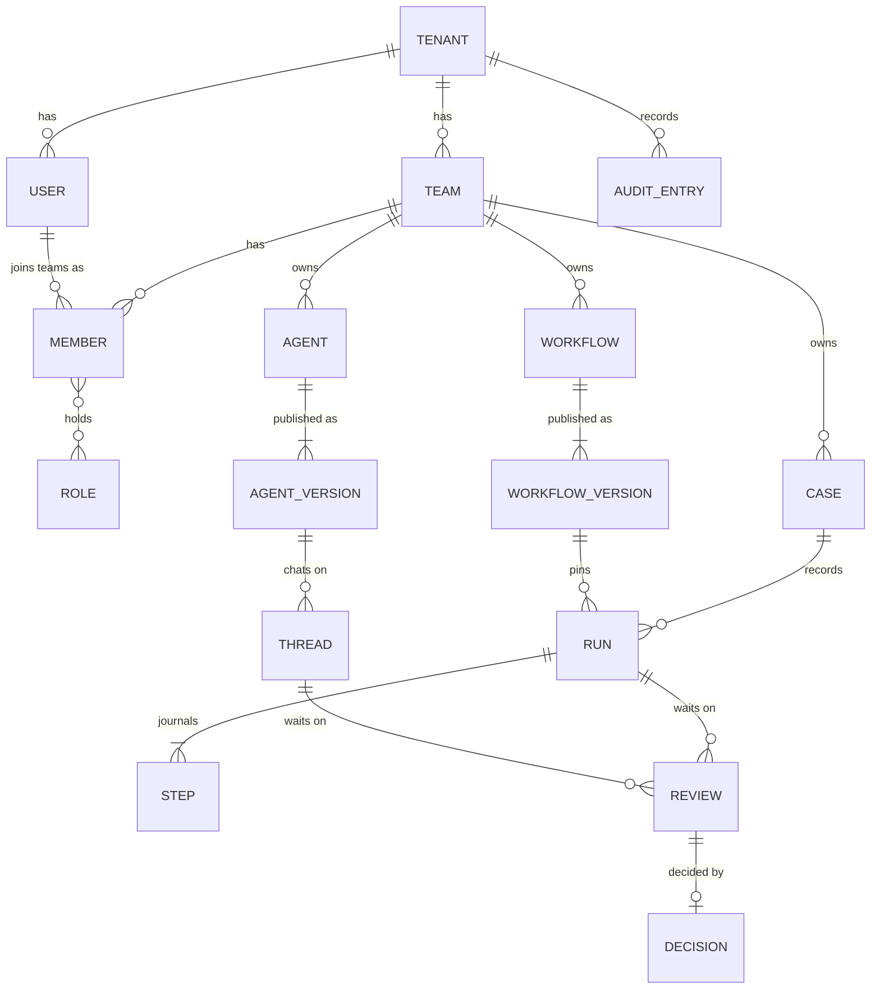
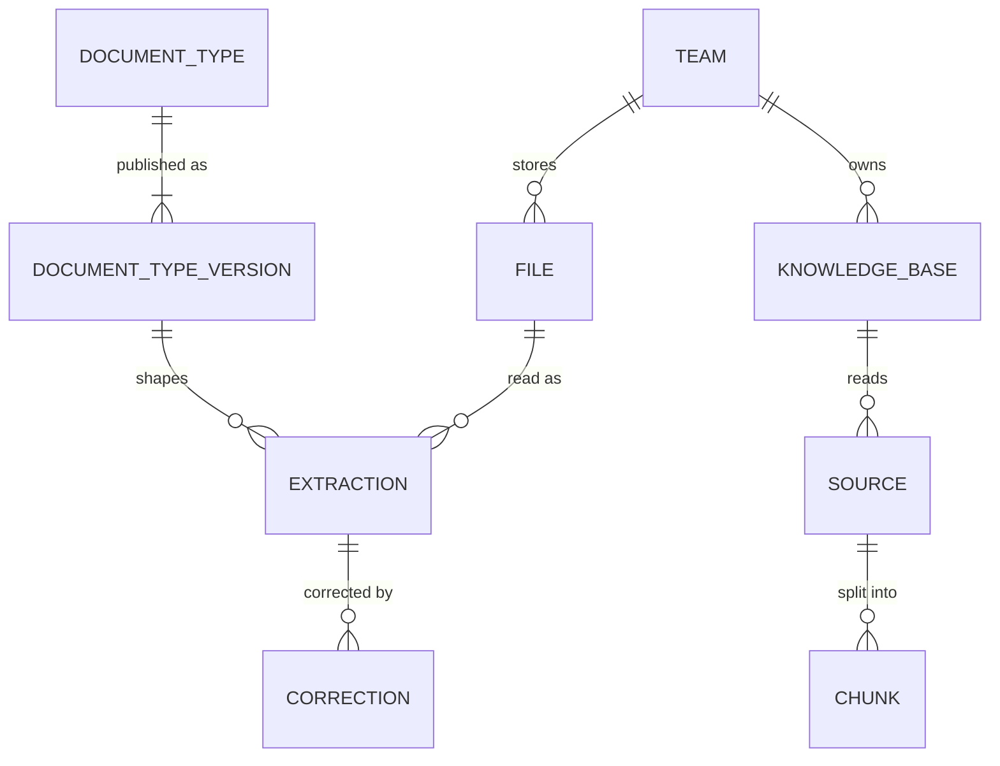
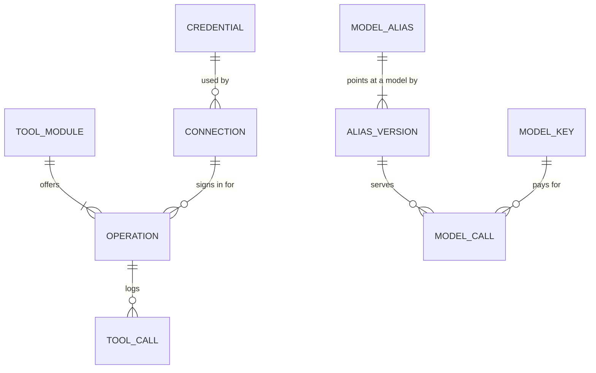

# Data and database

Status: current. Table lists and isolation facts are read from the release's schema scripts.

Ops AI keeps everything in one PostgreSQL database. Each of the seven services owns its own tables, applies its own
migration history and connects with its own login, which can read and write rows in that service's tables and nothing
else. File bytes live outside the database, on a volume or in object storage.

## The main entities

*Who owns what. A version is immutable once published; a run and a chat thread each pin the version they started on.*

*Files and what is read from them. The documents service keeps what it read and the corrections people made; the
bytes stay with the files service.*

*What a run calls: operations on your systems with the connections and credentials they use, and model aliases with
the keys that pay for each call.*

## What each service stores

| Service | What it keeps | Tables |
|---|---|---|
| platform | Your organisation, teams, people, roles and team policies; sessions and API keys; sign-in providers, verified domains and password hashes; the audit log | `tenants`, `teams`, `users`, `members`, `roles`, `role_permissions`, `role_assignments`, `policies`, `api_keys`, `sessions`, `audit_entries`, `signin_providers`, `signin_domains`, `signin_identities`, `signin_flows`, `signin_lockouts`, `signin_email_failures`, `password_credentials`, `password_resets` |
| agents | Agents, workflows, skills, guardrails, widgets and their versions; publish requests; runs, steps and the work queue; chat threads and saved run state; reviews, decisions and timers; cases, case types and task types; mailboxes and channel ledgers; budgets, agent memories and the model call record | `registry_*` (agents, workflows, skills, guardrails, widgets and their versions, publish requests), `engine_definitions`, `engine_runs`, `engine_steps`, `engine_work`, `graph_threads`, `graph_runs`, `graph_versions`, `thread_events`, `thread_leases`, `thread_inbox`, `thread_budgets`, `ops_checkpoints`, `ops_checkpoint_writes`, `ops_checkpoint_fences`, `review_decisions`, `review_approvals`, `review_assignments`, `timers`, `cases`, `case_events`, `case_types`, `case_type_versions`, `task_types`, `task_type_versions`, `task_assists`, `mailboxes`, `poll_cursors`, `channel_messages`, `channel_cursors`, `channel_files`, `deployments`, `widget_deployments`, `widget_mint_keys`, `chat_attachments`, `chat_search`, `agent_memories`, `memory_audit`, `model_call_records`, `service_events`, `trigger_events`, `team_default_agents` |
| tools | Tool modules, their operations and versions; connections and their sign-in tokens; credentials; the outbound allow-list; mock answers for tests; rate windows; sending policies; the call log | `tool_modules`, `module_versions`, `module_operations`, `module_approvals`, `module_egress_hosts`, `connections`, `connection_environments`, `connection_tokens`, `connection_audit`, `oauth_states`, `tool_secrets`, `secret_audit`, `egress_hosts`, `egress_ranges`, `egress_audit`, `operation_mocks`, `operation_rate_windows`, `send_policies`, `send_checks`, `service_outbox`, `gateway_calls`, `gateway_fences` |
| models | Provider connections, aliases and their versions, model keys with budgets and spend, the call log (metadata only) | `provider_connections`, `model_aliases`, `model_keys`, `model_key_tenants`, `model_call_log` |
| kb | Knowledge bases, their sources, items and versions, searchable chunks, ingestion runs | `kb_bases`, `kb_sources`, `kb_base_sources`, `kb_retired_bases`, `kb_items`, `kb_item_versions`, `kb_chunks`, `kb_changes`, `kb_runs` |
| files | File records, stored copies, versions, references that block deletion, legal holds, read requests, storage settings and their credentials | `files`, `file_blobs`, `file_versions`, `file_references`, `file_idempotency`, `file_legal_holds`, `file_read_requests`, `files_outbox`, `storage_settings`, `storage_credentials`, `storage_settings_audit` |
| documents | Document types and versions, samples and tests, examples learned from corrections, extractions, corrections and page layouts | `document_types`, `document_type_versions`, `document_type_samples`, `document_type_tests`, `document_type_examples`, `extractions`, `extraction_corrections`, `documents_layouts`, `documents_outbox` |

Every table that holds customer data carries a `tenant_id`, and the team-owned ones a `team_id`. Each service also
keeps one version table that records which of its migrations the database holds.

## Tenants and teams

A tenant is your installation's organisation; a team is the data boundary inside it. Roles decide what a person may
do inside a team; they never open another team's data.

| Boundary | How it is enforced | Status |
|---|---|---|
| Tenant, from the sign-in token | The tenant always comes from the verified token or API key, never from a request body, header or parameter. A record of another tenant answers 404 | Built |
| Tenant, in the database, for agents and platform | Forced row-level security on 33 agents tables (including saved run state) and 18 platform tables: a row is visible only when its `tenant_id` equals the tenant the transaction set, and a transaction that set none sees nothing. The policies apply to the tables' owner too | Built |
| Tenant, in the database, for tools, models, kb, files and documents | Every store query filters by tenant in the service's code; database policies for these services are still to come | Partial |
| Background loops | The agents service's lease sweeper, timer poller and thread inbox loops claim work before they know its tenant through one system role that may read across tenants; each then does the work under the row's own tenant. No request ever runs as that role | Built |
| Team, in the services | Every read of a team-owned table goes through one team filter in the store layer, so a person sees only the teams they belong to; another team's record answers 404 | Built |
| Team, in the database | A database-level team policy beneath the store filter | In progress |
| Installation-wide records | Model aliases, provider connections and model keys belong to the installation, so every tenant in one installation shares them (see [Deployment options](deployment-options.md#single-tenant-and-multi-tenant)) | Built |

## Files and knowledge

| Store | Where the bytes go | What protects them | Status |
|---|---|---|---|
| Files | A volume on the host until a Security admin points each upload purpose at a target: local, S3 or an S3-compatible store, or Azure Blob Storage. Each target is tested with a write, a read and a delete before it is saved | Type judged from the bytes; size and type limits per tenant; one stored copy per content per team; storage credentials encrypted with AES-256-GCM; a reference from a case or a run blocks deletion | Built |
| Malware scanning | A hook your scanner calls back on, with files held as pending until it answers; a test engine that recognises the EICAR test file. Scanning cannot be turned off outside development | No scanner ships in the package | Partial |
| Knowledge | Source files on the knowledge volume; their text split into chunks in the database. PDF (with OCR for scanned pages), Word, Excel, CSV, HTML, text and Markdown, up to 50 MB each | Search with PostgreSQL full-text ranking; every answer cites page and section; a knowledge base belongs to one team | Built |
| Vector search | Embeddings through an embedding alias on the AI gateway | Same | Planned |
| Documents | Page layouts, extracted fields with the place each came from, corrections. The documents service never holds the bytes and reads them from files | A model may see page images only where the document type, the team's policy and the alias all allow it | Built |

## Retention

| Data | What happens | Status |
|---|---|---|
| Files | Each upload purpose has a retention class; a file cannot be deleted before its date. On S3 and Azure Blob, a WORM class sets the store's object lock in compliance mode | Partial: classes, dates and object lock built; files are not yet deleted automatically when their date passes |
| Legal hold | A held file cannot be deleted by anyone until the hold is lifted; every hold keeps its history | Built |
| Deleted files | Deleting a file also removes what the documents service read from it | Built |
| Agent memories | A team's memory retention setting deletes older memories, with an audit row for each | Built |
| Saved run state | Kept while a thread is open; pruning after a run ends exists and runs on request | Partial: no scheduled pruning yet |
| Run journals, events, call logs and the audit log | Kept | Planned: a retention setting per tenant and export |
| Model call log | Metadata only: key, alias, model, tokens, cost, latency, outcome. No prompt or answer text is stored | Built |
| Sign-ins in progress | Expire after ten minutes | Built |

## The audit trail

| Record | What it holds | Where |
|---|---|---|
| Audit log | Sign-in, sign-out, step-up and refresh-token reuse; invites, role changes and removals; API keys created and revoked; team renames; team policy changes; access checks. Written in the same transaction as the change it records | platform, `audit_entries` |
| Tool call log | Every tool call: who it was for, which agent or workflow made it, the tool, the input's hash, the decision and its reasons, the approvers, the outcome, the environment and connection used | tools, `gateway_calls` |
| Security changes | Every credential created, rotated, deleted or used; every allow-list change; every connection change, sign-in and failed refresh; every storage settings change | tools and files audit tables |
| Run journal | Each step of each run with its input, output and outcome; each event of each conversation; each case event | agents |
| Decisions | Who decided each review, what they saw, their reason, and a fingerprint of the fresh sign-in a payment was approved under | agents, `review_decisions` |
| Model calls | One row per call, refusals included, with no prompt text | models, `model_call_log` |

The audit log is append-only on PostgreSQL: the role the platform service writes it under may insert and read, and
may not update or delete. A tamper-evident hash chain and export to WORM storage are planned.
