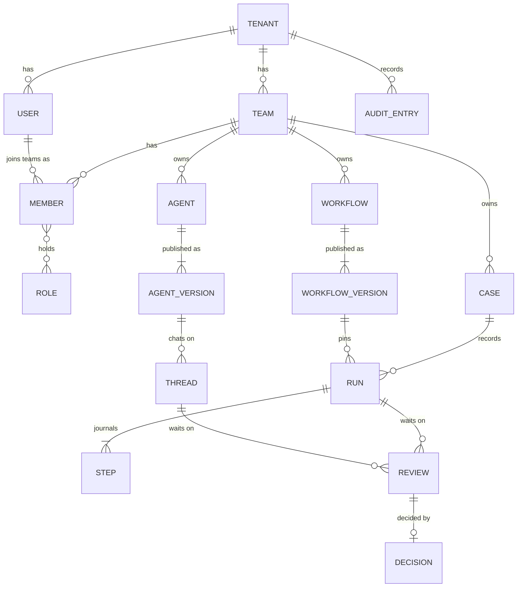
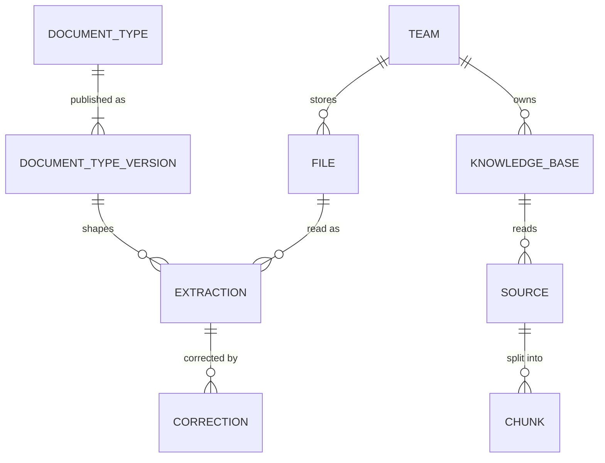
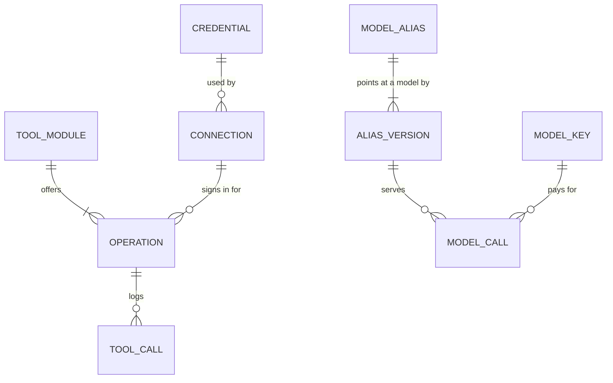

# Where Ops AI keeps your data

Status: current.

A security reviewer, a DBA or a records manager will ask where your customer data lives, who can read it and how long it
stays. This page answers those questions for an install. It covers what each service stores, how one team's data stays
apart from another's, where files and knowledge go, what is deleted and when, and what the audit trail records. Each
answer says whether the control is built, partly built or planned.

## Everything is in one PostgreSQL database

Ops AI keeps all of its records in one PostgreSQL database that you run, and keeps file bytes outside it. The schema
scripts in each release list every table.

<!-- site: layers frame="Where one install keeps its data" caption="Seven services keep their records in one PostgreSQL database, each on its own login, and file and knowledge bytes sit outside it" -->
- **Seven services**: Each owns its own tables and applies its own migrations
  - **Platform and agents**: People, teams, roles and the audit log; agents, workflows, runs and cases
  - **Tools and models**: Connections, credentials and the allow-list; model aliases, keys and call logs
  - **Knowledge and documents**: Sources and searchable chunks; what was read from files, and the corrections
  - **Files**: File records, versions, holds and storage settings
- **PostgreSQL**: One database that you run
  - **One login per service**: It can read and write that service's tables and nothing else
- **Outside the database**: Where the bytes go
  - **A volume or object storage**: File and knowledge bytes, on the host, in S3 or in Azure Blob

*Who owns what. A version is immutable once published, and a run or a chat thread keeps the version it started on.*

*Files and what is read from them. The documents service keeps what it read and the corrections people made. The files
service keeps the bytes.*

*What a run calls: operations on your systems, with the connections and credentials they use, and model aliases, with
the keys that pay for each call.*

## What each service keeps

| Service | What it keeps |
|---|---|
| platform | Your organisation, teams, people, roles and team policies. Sessions and API keys. Sign-in providers, verified domains and password hashes. The audit log |
| agents | Agents, workflows, skills, guardrails, widgets and their versions, and publish requests. Runs, steps and the work queue. Chat threads and saved run state. Reviews, decisions and timers. Cases, case types and task types. Mailboxes and channel ledgers. Agent memories |
| tools | Tool modules, their operations and versions. Connections and their sign-in tokens. Credentials. The outbound allow-list. Mock answers for tests, rate windows and sending policies. The call log |
| models | Provider connections, aliases and their versions, model keys with budgets and spend, and the call log (metadata only) |
| kb | Knowledge bases, their sources, items and versions, searchable chunks and ingestion runs |
| files | File records, stored copies, versions, the references that block deletion, legal holds, read requests, and storage settings with their credentials |
| documents | Document types and versions, samples and tests, examples learned from corrections, extractions, corrections, and each file's reading |

Every table that holds customer data carries a `tenant_id`, and the tables a team owns also carry a `team_id`. Each
service keeps one version table that records which of its migrations the database holds.

## Keeping tenants and teams apart

A tenant is your installation's organisation, and a team is the data boundary inside it. Roles decide what a person may
do inside a team. A role never opens another team's data.

| Boundary | How it is enforced | Status |
|---|---|---|
| Tenant, from the sign-in token | The tenant always comes from the verified token or API key. It never comes from a request body, header or parameter, and a record of another tenant answers 404 | Built |
| Tenant, in the database, for agents and platform | Forced row-level security on the tenant-owned tables of both services, including saved run state. A row is visible only when its `tenant_id` equals the tenant the transaction set, and a transaction that set none sees nothing. The policies apply to the tables' owner too | Built |
| Tenant, in the database, for tools, models, kb, files and documents | Database policies hold the tenant-owned tables of these services to their tenant, and every store query also filters by tenant in the service's code. Installation-wide tables, such as model aliases and provider connections, have no tenant policy | Partial |
| Background loops | The agents service's lease sweeper, timer poller and thread inbox loops claim work before they know its tenant, using one system role that may read across tenants. Each loop then does the work under the row's own tenant, and no request ever runs as that role | Built |
| Team, in the services | Every read of a team-owned table goes through one team filter in the store layer, so a person sees only the teams they belong to. Another team's record answers 404 | Built |
| Team, in the database | A database-level team policy beneath the store filter. It is built for files and documents, including each file's reading, so two teams holding the same bytes each read them once and never see the other's reading. The kb and tools services also have team policies on their team-owned tables. The agents service filters by team in its code | Partial |
| Installation-wide records | Model aliases, provider connections and model keys belong to the installation, so every tenant in one installation shares them ([Deployment options](deployment-options.md#single-tenant-and-multi-tenant)) | Built |

## Where files and knowledge go

| Store | Where the bytes go | What protects them | Status |
|---|---|---|---|
| Files | A volume on the host, until a Security admin points each upload purpose at a target: local, S3 or an S3-compatible store, or Azure Blob Storage. Each target is tested with a write, a read and a delete before it is saved | The type is judged from the bytes. Size and type limits apply per tenant, and each team keeps one stored copy per content. Storage credentials are encrypted with AES-256-GCM. A reference from a case or a run blocks deletion | Built |
| Malware scanning | A hook that your scanner calls back on, with files held as pending until it answers, and a test engine that recognises the EICAR test file (a standard, harmless antivirus test file). Scanning cannot be turned off outside development | No scanner ships in the package, so you connect your own | Partial |
| Knowledge | Source files on the knowledge volume, and their text split into chunks in the database. It reads PDF (each file once, with OCR for scanned pages, half-scanned pages and images, and with filled form fields), Word, Excel, CSV, HTML, text and Markdown, up to 50 MB each | Search uses PostgreSQL full-text ranking and search by meaning. Every answer cites its page and section, and a knowledge base belongs to one team | Built |
| Vector search | Each piece of knowledge is embedded through the environment's embedding alias on the AI gateway and stored in PostgreSQL with pgvector | Results combine meaning and keywords, and each result says which one found it | Built on PostgreSQL, not built on SQL Server |
| Documents | Page layouts, extracted fields with the place each came from, and corrections. The documents service never holds the bytes and reads them from the files service | A model sees page images only where the document type, the team's policy and the alias all allow it | Built |

## What is deleted, and when

| Data | What happens | Status |
|---|---|---|
| Files | Each upload purpose has a retention class, and a file cannot be deleted before its date. On S3 and Azure Blob, a WORM class sets the store's object lock in compliance mode | Partial: classes, dates and object lock are built. Files in classes counted from release (knowledge snapshots) are deleted automatically once their days pass. Other classes are never deleted automatically |
| Legal hold | A held file cannot be deleted by anyone until the hold is lifted, and every hold keeps its history | Built |
| Deleted files | Deleting a file also removes what the documents service read from it | Built |
| Agent memories | The tenant's memory retention policy (Govern > Policies) deletes older memories hourly and writes an audit row for each | Built |
| Saved run state | Kept while a thread is open. Pruning after a run ends exists and runs on request | Partial: no scheduled pruning yet |
| Run journals, events, call logs and the audit log | Kept indefinitely, with no automatic deletion, so plan for database growth | Planned: a retention setting per tenant, and export |
| Model call log | Metadata only: key, alias, model, tokens, cost, latency and outcome. No prompt or answer text is stored | Built |
| Sign-ins in progress | Expire after ten minutes | Built |

## What the audit trail records

| Record | What it holds | Where |
|---|---|---|
| Audit log | Sign-in, sign-out, step-up and refresh-token reuse. Invites, role changes and removals. API keys created and revoked. Team renames and team policy changes. Access checks. Changes to knowledge base and source settings, each field before and after. Each entry is written in the same transaction as the change it records, so the Audit page reads one log | platform |
| Tool call log | Every tool call: who it was for, which agent or workflow made it, the tool, a hash of the input, the decision and its reasons, the approvers, the outcome, and the environment and connection used | tools |
| Security changes | Every credential created, rotated, deleted or used. Every allow-list change. Every connection change, sign-in and failed refresh. Every storage settings change | tools and files |
| Run journal | Each step of each run with its input, output and outcome, each event of each conversation, and each case event | agents |
| Decisions | Who decided each review, what they saw, their reason, and a fingerprint of the fresh sign-in a payment was approved under | agents |
| Model calls | One row per call, refusals included, with no prompt text | models |

On PostgreSQL the audit log is append-only. The role the platform service writes it under may insert and read, and it
may not update or delete. A tamper-evident hash chain and export to WORM storage are planned.
