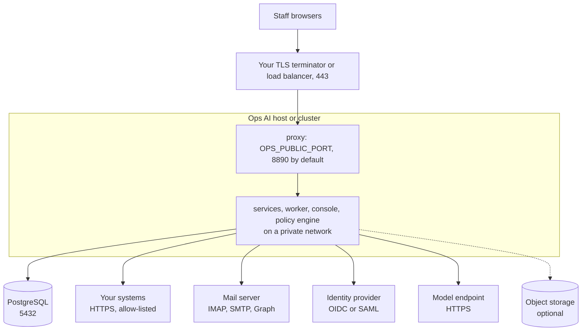

# Choose a deployment

Status: current. Compose and Kubernetes layouts are proven by the release's install proofs, and the sizing figures are a
starting point to measure against.

Before anyone installs Ops AI, your team has to decide where it runs. An architecture review asks the same
questions each time: one machine or a cluster, whether the machines can reach the internet, how many organisations share
an install, which ports open, and how big the database must be. This page answers them. The same images run in every
layout. What changes is how they start, how secrets reach them and where file bytes are kept. PostgreSQL is always yours
and runs outside the containers.

Settle it before you install, because the layout decides how secrets reach the containers and where file bytes live. To
decide, find your situation in the first table, then read the network and sizing sections for what your platform team
needs to approve.

## Where it can run

| Option | Use it when | Status |
|---|---|---|
| [The install script](../deploy/install.md) | One Linux machine with Docker. The script installs, checks, upgrades, backs up and restores. A second machine with the same install is a standby you restore a backup onto | Built: proven on a CI runner and on one machine, not yet on a client's server |
| [Docker Compose by hand](../deploy/compose.md) | One machine, where you run each step yourself | Built: proven on one machine |
| [Kubernetes](../deploy/kubernetes.md) | Your platform team runs a cluster. Plain Kustomize: a base and an overlay per environment | Built: proven on a local kind cluster, not yet on a managed cloud cluster |
| [Release package](../deploy/release-package.md) | The machines have no internet access | Built: proven on a machine holding only the package |
| A Helm chart | | Planned: the Kustomize overlays carry the same choices |
| One VM with no container runtime | | Planned |

## Single-tenant and multi-tenant

| Choice | What it means | Status |
|---|---|---|
| One installation per organisation | The install creates one tenant, its Security team and the first admin. Departments are teams inside it, and the team is the data boundary between them | Built: the recommended shape |
| Several organisations in one installation | Every row carries its tenant, and the agents and platform tables enforce it in the database. Creating a second tenant, per-tenant model aliases and keys, and tenant policies in the database for every service are still to come | Planned |

## The network

<!-- diagram: network-map -->

*One inbound port, from your TLS terminator only. Every outbound connection is one you configure.*

| Direction | From | To | Port | Why |
|---|---|---|---|---|
| Inbound | Your TLS terminator or load balancer | The proxy | `OPS_PUBLIC_PORT` (8890 by default), plain HTTP inside your network | The console and the APIs, all on one origin |
| Outbound | Ops AI | PostgreSQL | 5432, TLS where the server requires it | All data |
| Outbound | Ops AI | Your model endpoint | 443 | Model calls |
| Outbound | Ops AI | Your systems | 443, hosts on the allow-list only | Tool calls |
| Outbound | Ops AI | Your mail server or mail API | 993 for IMAP, 587 or 465 for SMTP, 443 for Microsoft Graph or Gmail | Team mailboxes and replies |
| Outbound | Ops AI | Your identity provider | 443 | Single sign-on, key discovery |
| Outbound | Ops AI | Your DNS resolvers | 53 | Proving an email domain for single sign-on |
| Outbound | Ops AI | S3 or Azure Blob, when configured | 443 | File bytes |
| Outbound | the host | `ghcr.io` (or your own registry), unless images are loaded from the offline image file | 443 | Install and upgrade only |

Nothing else needs to leave your network. Put TLS in front of the proxy, because the containers speak plain HTTP to each
other on the private network.

## Sizing

| Part | Starting point | Notes |
|---|---|---|
| One machine for Compose | 4 vCPUs, 8 GB memory and 60 GB of disk to start. Any current 64-bit Linux on x86-64 or ARM64 with Docker Engine 24 or newer and Compose 2.22 or newer. The install script's preflight wants at least 4 GB of memory for the containers and 15 GB of free disk | In the release's install proof all containers together used about 2 GB of memory at rest. Images take about 1.2 GB of disk |
| PostgreSQL | 15 or newer; on Azure Database for PostgreSQL Flexible Server, 16 or newer. General Purpose, 2 vCores, 8 GB memory, 64 GB storage to start | Database size grows with open work and with history until retention jobs exist. The `vector` extension (pgvector 0.5 or newer) must be available, and no other extension is needed |
| Kubernetes requests | 50m CPU each. Memory is 256 MiB by default, 512 MiB for agents, worker, documents and console, 1 GiB for the code-tools runner and 128 MiB for the proxy. Memory limits equal the requests, and no CPU limit is set | One replica each. The files and knowledge services keep bytes on a 1 GiB ReadWriteOnce volume each, so they run one replica. Raise the size for real use |
| Workflow throughput | Each worker process runs 4 runs at once and polls every half second | Add worker processes to add capacity. A run waiting for a person holds no worker |
| File storage | The size of the documents and attachments you keep, for as long as their retention class says | Move to S3 or Azure Blob for large volumes and WORM retention |

Load figures for many concurrent runs are still to be measured and published. Size against a pilot of your own
workload, and watch the work queue and database load ([What to watch](../deploy/monitoring.md#what-to-watch)).
