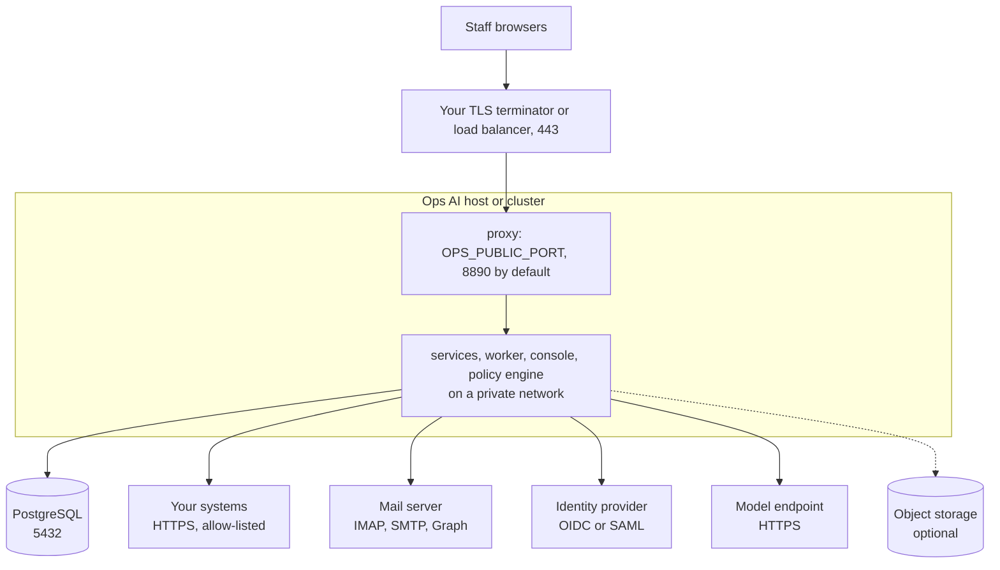

# Deployment options

Status: current. Compose and Kubernetes layouts are proven by the release's install proofs; sizing is a starting point
to measure against.

The same images run in every layout. What changes is how they are started, how secrets reach them and where the bytes
of files are kept. PostgreSQL is always yours, outside the containers.

| Option | Shape | Status |
|---|---|---|
| One machine with Docker Compose | `./install.sh` from a clone: every container on one Linux machine, one published port behind your TLS terminator, images pulled from `ghcr.io/chanl-ai/ops-ai` or loaded from the offline image file. A second machine with the same install is a standby you restore a backup onto | Built: proven on one machine by the install script's proof |
| Kubernetes | Kustomize: a base with one folder per service and an overlay per environment, applied with `kubectl apply -k`. A migrate Job, one Secret per service, a network policy, an outside PostgreSQL | Built: proven on a local kind cluster; not yet on a managed cloud cluster |
| A Helm chart | | Planned: the Kustomize overlays carry the same choices |
| One VM with no container runtime | The services as host processes under systemd, with native PostgreSQL | Planned |

## Single-tenant and multi-tenant

| Choice | What it means | Status |
|---|---|---|
| One installation per organisation | The install creates one tenant, its Security team and the first admin. Departments are teams inside it, and the team is the data boundary between them | Built: the recommended shape |
| Several organisations in one installation | Every row carries its tenant, and the agents and platform tables enforce it in the database. Creating a second tenant, per-tenant model aliases and keys, and tenant policies in the database for every service are still to come | Planned |

## The network

<!-- diagram: network-map -->

*One inbound port, from your TLS terminator only. Every outbound connection is one you configure.*

| Direction | From | To | Port | Why |
|---|---|---|---|---|
| Inbound | Your TLS terminator or load balancer | The proxy | `OPS_PUBLIC_PORT` (8890 by default), plain HTTP inside your network | The console and the APIs, all on one origin |
| Outbound | The services | PostgreSQL | 5432, TLS where the server requires it | All data |
| Outbound | models | Your model endpoint | 443 | Model calls |
| Outbound | tools | Your systems | 443, hosts on the allow-list only | Tool calls |
| Outbound | worker and tools | Your mail server or mail API | 993 for IMAP, 587 or 465 for SMTP, 443 for Microsoft Graph or Gmail | Team mailboxes and replies |
| Outbound | platform | Your identity provider | 443 | Single sign-on, key discovery |
| Outbound | platform | Your DNS resolvers | 53 | Proving an email domain for single sign-on |
| Outbound | files | S3 or Azure Blob, when configured | 443 | File bytes |
| Outbound | the host | `ghcr.io` (or your own registry), unless images are loaded from the offline image file | 443 | Install and upgrade only |

Nothing else needs to leave your network. Put TLS in front of the proxy: the containers speak plain HTTP to each other
on the private network.

## Sizing

| Part | Starting point | Notes |
|---|---|---|
| One machine for Compose | 4 vCPUs, 8 GB memory, 60 GB disk to start; any current 64-bit Linux on x86-64 or ARM64 with Docker Engine 24 or newer and Compose 2.22 or newer. The install script's preflight wants at least 4 GB of memory for the containers and 15 GB of free disk | In the release's install proof all containers together used about 2 GB of memory at rest. Images take about 1.2 GB of disk |
| PostgreSQL | 15 or newer; on Azure Database for PostgreSQL Flexible Server, 16 or newer. General Purpose, 2 vCores, 8 GB memory, 64 GB storage to start | Database size grows with open work and with history until retention jobs exist. No extensions are needed |
| Kubernetes requests | 50m CPU each; memory 256 MiB, 512 MiB for agents, worker, documents and console, 128 MiB for the proxy (requests equal limits) | One replica each. files and kb keep bytes on a 1 GiB ReadWriteOnce volume each, so they run one replica; raise the size for real use |
| Workflow throughput | Each worker process runs 4 runs at once and polls every half second | Add worker processes to add capacity; a run waiting for a person holds no worker |
| File storage | The size of the documents and attachments you keep, for as long as their retention class says | Move to S3 or Azure Blob for large volumes and WORM retention |

Load figures for many concurrent runs are still to be measured and published; size against a pilot of your own
workload and watch the work queue and database load ([Operate](operate.md#what-to-watch)).
