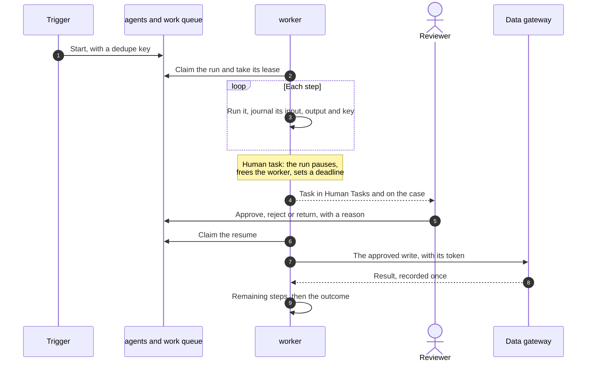
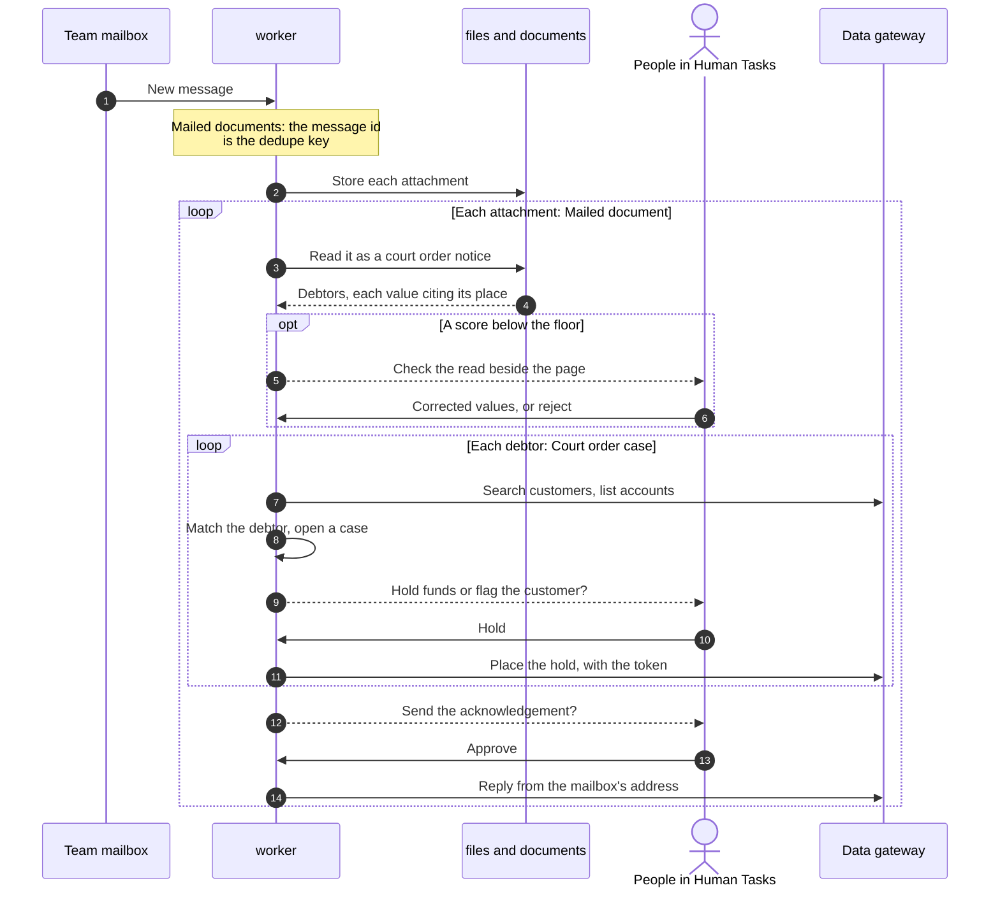

# How work flows

Status: current.

## A reviewer will ask what the AI did

An agent that can change a customer's account is only useful if you can say exactly what it did, who approved it and
what happens when something fails halfway. Most agent tools cannot answer that, so teams put a person in every step or
hold the pilot back. This page follows three real flows from start to finish: a person chats with an agent that wants
to change something, a workflow pauses for a person and resumes days later, and an email becomes cases that people
decide. The release's automated use cases run each of these flows end to end.

## Why the answers matter

Without this picture you cannot tell a reviewer where an approval is enforced, or what a crash does to a half-finished
write. The answers are the same in all three flows. A write that needs approval waits for a token tied to its exact input.
Every outside call goes through a gateway, and Ops AI saves a run's state after each step, so a crash or a restart
loses nothing.

## Run the flows yourself

To run the flows yourself, start at [Build with Ops AI](build-with-ops-ai.md).

## A chat turn with a tool approval

A member of the operations team asks the team's agent to place a hold on an account. Reading data needs no
approval. Placing the hold changes data, and this team has set holds to wait for a reviewer, so the agent drafts the
hold and a person approves it before anything reaches the core system.

<!-- site: sequence caption="A hold that waits for a person: the write is sent only with an approval bound to its exact input" -->
1. **Person → Agent**: Sends a message, signed in
2. **Agent → AI gateway**: Model call on the agent's alias and key
3. **AI gateway → Agent**: Asks for get_account, then place_hold
4. **Agent → Data gateway**: get_account, a read
5. **Data gateway → Your core system**: Calls an allow-listed host over HTTPS; the balance and holds come back and are logged
6. **Agent → Person**: place_hold is a write, so the run pauses with its state saved and an approval card shows the exact input
   - The person sees the input that will be sent before approving it. Who may approve is the operation's policy: the number of approvers, the team they belong to, whether a fresh sign-in is needed, and whether the person who asked may decide.
7. **Person → Agent**: Approves, with a fresh sign-in if asked; the token is bound to the input's hash, the tool and the step
8. **Agent → Data gateway**: place_hold with the token; the policy engine checks it is signed, for the same input, not expired and has enough approvers
9. **Data gateway → Your core system**: Sends the call with the stored credential; the hold is placed
10. **Data gateway → Agent**: The result, recorded once by its key
11. **Agent → AI gateway**: Model call with the result
12. **Agent → Person**: The answer, streamed

| Step | What protects it |
|---|---|
| The message | The person's sign-in token names the tenant and team; nothing in the message can change them |
| The model call | The AI gateway checks the agent's key, its budget and the data's sensitivity before it calls your model endpoint |
| The pause | The approval waits in the conversation with its state saved; closing the browser loses nothing |
| The write | The data gateway refuses a call whose input differs from what was approved by a single character, a token past its 15 minutes, or a token from a run that another process has since taken over |
| A repeat | A retried call with the same idempotency key returns the first result and writes nothing |

## A workflow run with a human task

A workflow starts from an API call, an email or an event from another service. The worker runs its steps in order
and saves each one. When a step needs a person, the run pauses and holds on to no worker. When the person decides, the run goes
back on the queue.

*A waiting run costs nothing but its saved rows, whether the person answers in a minute or in a week.*

| Situation | What happens |
|---|---|
| A worker dies mid-step | Its lease expires after 15 seconds. Another worker takes the run, raises the lease generation, and continues from the last saved step. A write the first worker already made is found by its key and not made again; anything the first worker sends afterwards is refused as stale |
| The task's deadline passes | The task shows as overdue, or, when the step says so, the run leaves on its timeout path, for example to escalate. A timeout never approves anything |
| A step fails three times | The run fails with the error on its record, and its case shows the failure to people |
| The workflow is republished mid-run | The run keeps the version it started on; new runs take the new version |

## Email to case: a court order notice

This is one worked example. A team connects its mailbox and publishes three workflows through review. From then on,
every notice that a court or tax authority emails to the bank, ordering it to hold or pay a customer's funds, is read,
checked, turned into cases and answered. None of this is code written for court orders, because the document type, the
workflows, the tools and the task types are all configuration.

*The checker corrects what was read, and the correction is kept as an example for the next read of that document type.
Each debtor gets a case whatever happens to the others, and an unmatched debtor gets a case of its own for a person.*

| Configuration | What it holds |
|---|---|
| The mailbox | Provider, folder, the credential's name in the credential store, and the address replies come from |
| A document type, "court order notice" | The fields to read, their checks, the score floor, and the examples corrections have taught it |
| Three workflows | Mailed documents (one run per message), Mailed document (one per attachment), Court order case (one per debtor) |
| Tools | Search customers, list accounts, place hold, add a note, send a reply: operations on your systems with their approval policies |
| Task types | Check the read, hold or flag, send the acknowledgement: what the person sees and the actions they can take |

Other worked examples in the release use the same parts: complaint email triage, a hold requested through the API,
and a customer summary built from the core system and an agent.

## What success looks like

You can point at any run and say which version ran, what each step received and returned, who approved the write and
what they saw when they did. A crash, a retry or a week-long wait changes none of that.

## Next

<!-- site: cards -->
- **[Human tasks and approvals](human-tasks.md)**: see the settings behind each pause.
- **[Cases](cases.md)**: see the record each piece of work leaves.
- **[Tools and apps](apps.md)**: see the data gateway's side of every call.
