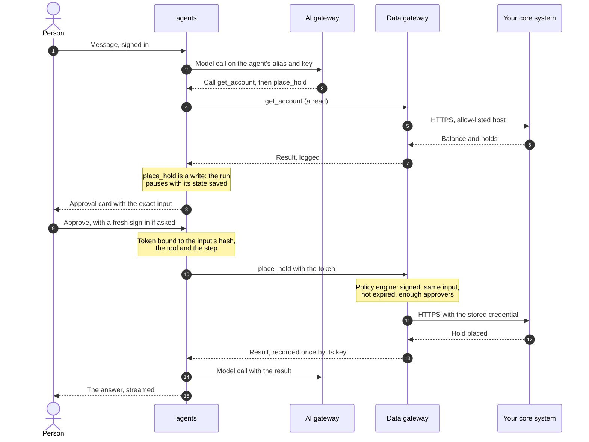
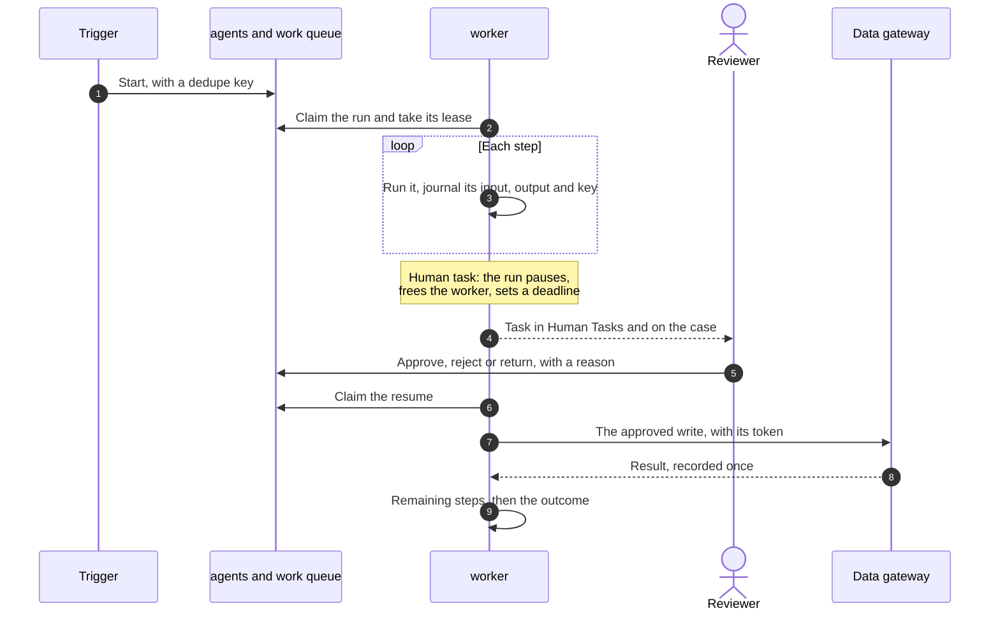
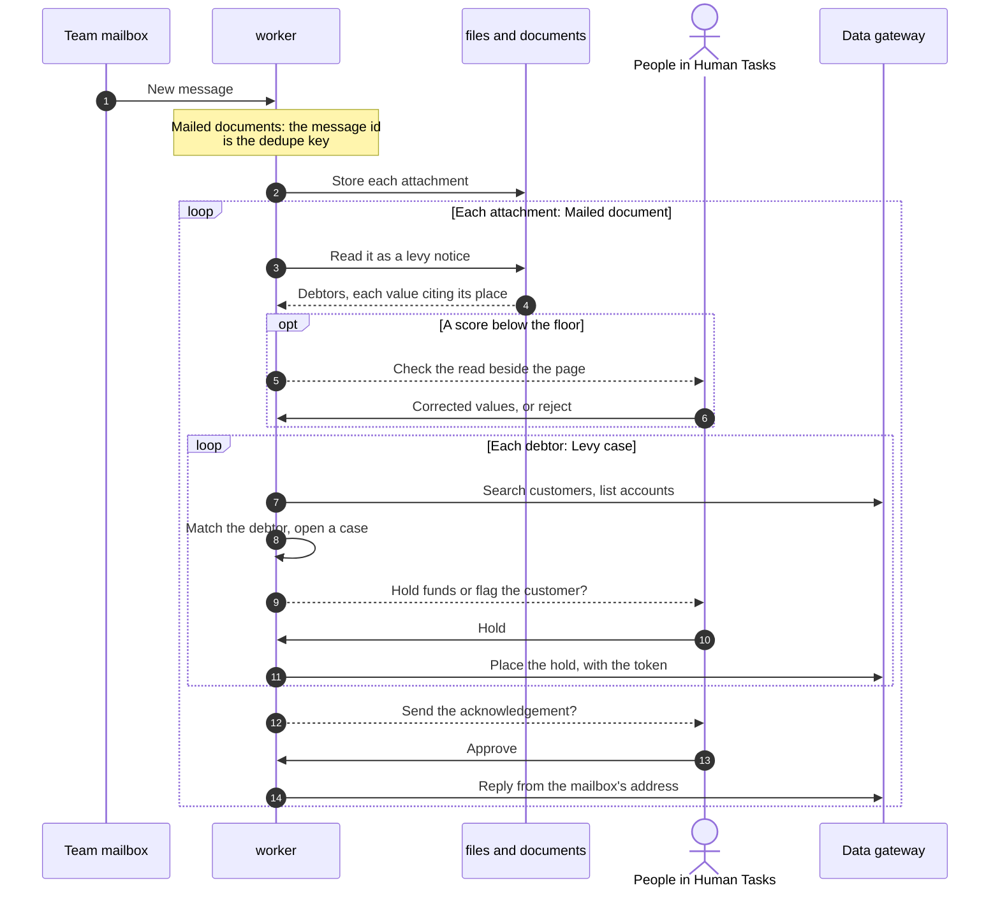

# How work flows

Status: current. Each flow below is exercised end to end by the release's automated use cases.

Three flows cover most of what Ops AI does: a person chats with an agent that wants to change something, a workflow
pauses for a person and resumes days later, and an email becomes cases that people decide. In each one the same three
rules hold: a write waits for an approval bound to its exact input, every outside call leaves through a gateway, and a
run's state is saved after every step so a crash or a restart loses nothing.

## A chat turn with a tool approval

A member of the operations team asks the team's agent to place a hold on an account. Reading is free; the hold is a
write, so the agent drafts it and a person approves it before anything reaches the core system.

*The person sees the input that will be sent before approving it. Who may approve is the operation's policy: the
number of approvers, the team they belong to, whether a fresh sign-in is needed, and whether the person who asked may
decide.*

| Step | What protects it |
|---|---|
| The message | The person's sign-in token names the tenant and team; nothing in the message can change them |
| The model call | The AI gateway checks the agent's key, its budget and the data's sensitivity before it calls your model endpoint |
| The pause | The approval waits in the conversation with its state saved; closing the browser loses nothing |
| The write | The data gateway refuses a call whose input differs from what was approved by a single character, a token past its 15 minutes, or a token from a run that another process has since taken over |
| A repeat | A retried call with the same idempotency key returns the first result and writes nothing |

## A workflow run with a human task

A workflow starts from an API call, an email or an event from another service. The worker runs its steps in order
and saves each one. When a step needs a person, the run pauses and holds no worker; the person's decision puts it back
on the queue.

*A waiting run costs nothing but its saved rows, whether the person answers in a minute or in a week.*

| Situation | What happens |
|---|---|
| A worker dies mid-step | Its lease expires after 15 seconds. Another worker takes the run, raises the lease generation, and continues from the last saved step. A write the first worker already made is found by its key and not made again; anything the first worker sends afterwards is refused as stale |
| The task's deadline passes | The task shows as overdue, or, when the step says so, the run leaves on its timeout path, for example to escalate. A timeout never approves anything |
| A step fails three times | The run fails with the error on its record, and its case shows the failure to people |
| The workflow is republished mid-run | The run keeps the version it started on; new runs take the new version |

## Email to case: a tax levy notice

This is one worked example. A team connects its mailbox, publishes three workflows through review, and from then on
each notice a court or tax authority emails is read, checked, turned into cases and answered. Nothing in it is code
written for levies: the document type, the workflows, the tools and the task types are configuration.

*The checker corrects what was read; the correction is kept as an example for the next read of that document type.
Each debtor gets a case whatever happens to the others, and an unmatched debtor gets a case of its own for a person.*

| Configuration | What it holds |
|---|---|
| The mailbox | Provider, folder, the credential's name in the credential store, and the address replies come from |
| A document type, "levy notice" | The fields to read, their checks, the score floor, and the examples corrections have taught it |
| Three workflows | Mailed documents (one run per message), Mailed document (one per attachment), Levy case (one per debtor) |
| Tools | Search customers, list accounts, place hold, add a note, send a reply: operations on your systems with their approval policies |
| Task types | Check the read, hold or flag, send the acknowledgement: what the person sees and the actions they can take |

Other worked examples in the release use the same parts: complaint email triage, a hold requested through the API,
and a customer summary built from the core system and an agent.
