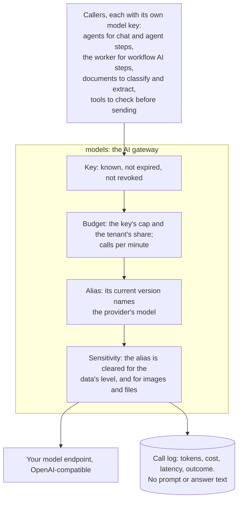

# Models

Status: current. Checked against the release's models service and agents service.

Every model call in Ops AI, from an agent's turn, a workflow's AI step or a document read, goes through one internal
service: the AI gateway (models-service). It knows which key is calling, what that key may still spend, which model a
name points at, and how sensitive the data is that the model may receive. Services hold a model key; none holds your
provider's credential.

*A refusal at any check answers with a code (for example `key_budget_exhausted`) and is logged like a call.*

## Aliases

An alias is a name such as `default` that agents, workflows and document types use instead of a provider's model id.
Each alias has versions; the newest current version serves. A version names the provider connection, the provider's
model, its price per million input and output tokens, the highest data sensitivity it is cleared for, and whether it may
receive images and files. Moving an alias to another model is a new version; no agent changes.

| Item | Status |
|---|---|
| OpenAI-compatible endpoints: any provider or private gateway that serves the OpenAI chat completions API, streamed or not, with tool calls | Built |
| Chat and embedding aliases, versioned, with prices and clearance | Built |
| Binding an alias at install with the connect-model command | Built |
| Anthropic's own API as a provider | Planned: a connection can be registered, but the gateway does not serve it yet |
| Failover between providers | Planned |
| A console page for aliases and keys | Planned: today the operator manages them with the connect-model command |

## Keys, budgets and spend caps

| Control | What holds | Status |
|---|---|---|
| One key per caller | Keys are issued per identity: per service purpose (agents, documents), per agent, per workflow or per person. Only a hash of the secret is stored; it is shown once | Built |
| Budget per key | A spending cap in money; the call that would pass it is refused with `key_budget_exhausted` | Built |
| Budget per tenant on a shared key | A tenant's share of a key's budget, refused with `tenant_budget_exhausted` | Built |
| Rate limit per key | Calls per minute | Built |
| Expiry and rotation | A key can expire; a rotated key's old secret keeps working for an overlap (15 minutes by default) | Built |
| Admission before work starts | The agents service asks the gateway before it opens a thread, so a spent key stops new work up front | Built |
| Budget per conversation | Caps on model calls, tokens and cost per chat or thread; a spent budget pauses the thread until a person raises it or ends it | Built |
| Budget per team | | Planned |

## Data sensitivity

Each alias version is cleared for a level: public, internal, confidential or restricted. A call may name the level of
the data it carries, and the gateway refuses it when the alias is not cleared for that level. Images and file parts are
refused by an alias not cleared for them, and every call records how many it carried.

| Item | Status |
|---|---|
| The gateway's check of a call's level against the alias's clearance | Built |
| Callers marking each call with the level of its data | Planned: today every call is treated as internal, so an alias must be cleared for internal to serve |
| Page images for document reads only where the document type, the team's policy and the alias all allow them | Built |

## The test model

The release package includes a stand-in model endpoint that speaks the same OpenAI-compatible API and answers from
fixed rules: plain text, or a tool call when a rule matches the message. It calls no provider and costs nothing. Use
it to try the platform before your model endpoint is ready, and for automated checks; it is not for production. The
automated use cases of each release run on it, so no real model call is made in testing.
