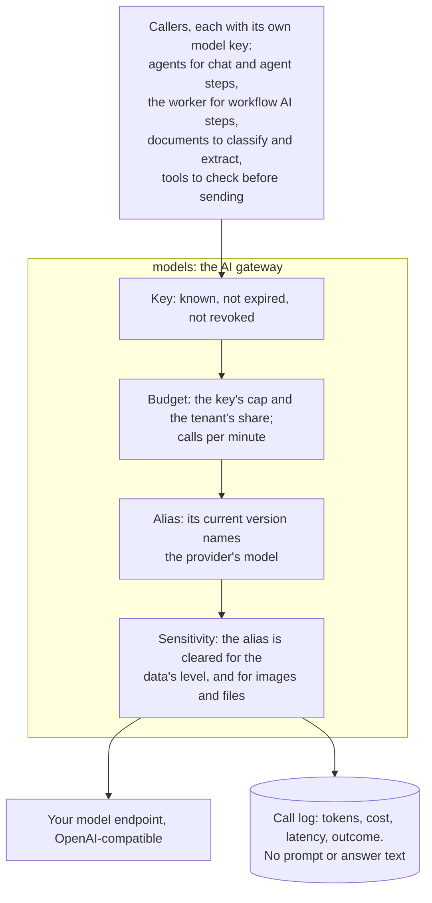

# Models

Status: current. Checked against the release's models service and agents service.

This page shows you how to point every agent at your own model endpoint, and how to cap what each agent may spend and
which data it may receive.

## Why one provider key per agent is hard to manage

If your team gives each agent its own provider key, you cannot easily tell what one chat cost, which agent used up the
budget, or whether a confidential document went to a model that was never cleared for it. Teams also want different
models for different work. A lending team may want a private model for borrower files, while a marketing team is happy
with a cheaper public one. And when a key leaks, rotating it means finding every agent that held it.

Ops AI avoids this by sending every model call through one internal service, the AI gateway (models-service). That
covers an agent's turn, a workflow's AI step and a document read alike. For each call, the gateway knows which key is
calling, what that key may still spend, which model a name points at, and how sensitive the data is that the model may
receive. Each service holds a model key, and no service holds your provider's credential.

## How to set it up

<!-- site: steps -->
1. **Connect your endpoint.** Your operator binds an alias such as `default` to a model on any OpenAI-compatible
   endpoint, and records its price and the highest data level it may receive.
2. **Save the provider's key once.** Your account admin saves it under **Settings › Model providers**. No team can see
   it after that.
3. **Issue a capped key per caller.** Agents, documents and each workflow get their own model key, each with its own
   budget and rate limit.
4. **Read the call log.** Every call records its tokens, cost, latency and outcome. The log never stores the prompt or
   the answer text.

## Trying it before you have a provider

You can try the platform without a provider or a key, because the release package includes a
[test model](#the-test-model) that answers from fixed rules. When you are ready for a real endpoint, your operator binds
the alias with the connect-model command ([Connect a model](../deploy/compose.md#connect-a-model)). The command prints a
model key once, so save it when it appears.

*When a call fails any of these checks, the gateway answers with a code (for example `key_budget_exhausted`) and logs
the refusal in the same way as a call.*

## Aliases

An alias is a name such as `default` that agents, workflows and document types use instead of a provider's model id.
Connections and aliases belong to one account: no account sees, changes or calls another's.

**Upgrading to this release clears every model connection and alias**, because they had no account to keep them in.
An account admin connects a provider and makes the aliases again on Settings › Workspace › Models.

Each alias has versions, and the newest current version is the one that serves calls. A version records:

- the provider connection and the provider's model
- its price per million input and output tokens
- the highest data sensitivity it is cleared for
- whether it may receive images and files

To move an alias to another model, you add a new version. No agent needs to change, because agents refer to the alias
rather than the model.

| Item | Status |
|---|---|
| OpenAI-compatible endpoints: any provider or private gateway that serves the OpenAI chat completions API, streamed or not, with tool calls | Built |
| Chat and embedding aliases, versioned, with prices and clearance | Built |
| Embeddings through the same keys, budgets and clearance as chat (`POST /v1/models/embeddings`) | Built |
| One embedding model per environment (`OPS_EMBEDDING_ALIAS`, `OPS_EMBEDDING_WIDTH`, at most 1,998 wide) | Built |
| Binding an alias at install with the connect-model command | Built |
| OpenAI, Anthropic, Google Gemini, Azure OpenAI and Amazon Bedrock as provider types, each with its own fields | Built: the console's Connect a provider lists them from the registry |
| Failover between providers | Planned |
| Live calls to Amazon Bedrock, Google Gemini and Anthropic | **Unverified**: these adapters were tested against fakes only and never called with a real key; try one with a real key before relying on it |
| A console page for connections, aliases and keys | Built: Settings › Workspace › Models (Connections, Aliases; an account admin changes both, as the roles matrix gives `settings.manage`, and anyone else is told who does); an agent's Model dialog offers only the settings its alias's model takes, with defaults and Reset |

## Keys, budgets and spend caps

| Control | What holds | Status |
|---|---|---|
| One key per caller | Keys are issued per identity: per service purpose (agents, documents), per agent, per workflow or per person. Only a hash of the secret is stored; it is shown once | Built |
| Budget per key | A spending cap in money; the call that would pass it is refused with `key_budget_exhausted` | Built |
| Budget per tenant on a shared key | A tenant's share of a key's budget, refused with `tenant_budget_exhausted` | Built |
| Rate limit per key | Calls per minute | Built |
| Expiry and rotation | A key can expire; a rotated key's old secret keeps working for an overlap (15 minutes by default) | Built |
| Admission before work starts | The agents service asks the gateway before it opens a thread, so a spent key stops new work up front | Built |
| Budget per conversation | Caps on model calls, tokens and cost per chat or thread; a spent budget pauses the thread until a person raises it or ends it | Built |
| Budget per team | | Planned |

## Data sensitivity

Each alias version is cleared for one level: public, internal, confidential or restricted. A call may name the level of
the data it carries, and the gateway refuses the call when the alias is not cleared for that level. The same applies to
images and file parts: an alias that is not cleared for them refuses them. Every call records how many images and files
it carried.

| Item | Status |
|---|---|
| The gateway's check of a call's level against the alias's clearance | Built |
| Callers marking each call with the level of its data | Planned: today every call is treated as internal, so an alias must be cleared for internal to serve |
| Page images for document reads only where the document type, the team's policy and the alias all allow them | Built |

## With and without the gateway

Your agents answer through the alias `default`, and a reviewer's questions about cost and data are answered from one log.

<!-- site: before-after caption="Agents holding provider keys directly, and agents calling through the AI gateway" -->
- **Agents hold provider keys**: Each agent carries a key to your provider.
  - A single leaked key exposes the whole provider account
  - You cannot cap spend per caller
  - Nothing checks whether confidential data is going to a model that was never cleared for it
- **Through the AI gateway**: Agents hold only a capped model key, and the provider's key is held in one place.
  - Moving the alias to another model is one new version, and no agent changes
  - A key at its cap is refused with `key_budget_exhausted` and the refusal is logged
  - What a chat cost is answered from the call log

## The test model

The release package includes a stand-in model endpoint. It speaks the same OpenAI-compatible API and answers from fixed
rules, either with plain text or with a tool call when a rule matches the message. Because it calls no provider, it
costs nothing. Use it to try the platform before your model endpoint is ready, and for automated checks, but not in
production. Each release's automated use cases run on it, so testing makes no real model calls.

| It answers | When |
|---|---|
| A rule's tool call or text | The person's message matches a rule's `when` pattern and the rule's tool is offered. Each rule is `{when, tool, arguments}` or `{when, text}`, with `after` and `result` to chain a step after a tool's result |
| A call of the tool named | No rule matches and the message says `call <tool>` for a tool the agent holds: `call <tool> {json}` calls it with that JSON object as its input, `call <tool>` alone with none. Arguments that are not one JSON object are answered as text saying so |
| The gist of a tool's result | The last message is a tool's result and no rule follows it |
| A sentence naming the agent and the message | Anything else |

You can try a new tool without writing a rule for it. Open a chat with an agent that holds the tool and type
`call <tool> {json}`.
