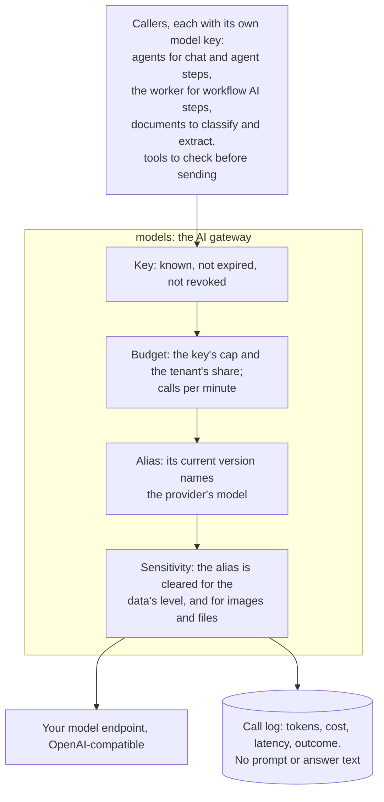

# Models

Status: current. Checked against the release's models service and agents service.

**Point every agent at your own model endpoint, and cap what each one may spend and which data it may receive.**

## A model key in every agent is a bill nobody owns

A team that gives each agent its own provider key cannot say what one chat cost, which agent ran away with the budget, or
whether a confidential document went to a model that was never cleared for it. A lending team wants a private model for
borrower files, and a marketing team is happy with a cheaper public one. Rotating a leaked key means finding every agent
that held it.

Every model call in Ops AI, from an agent's turn, a workflow's AI step or a document read, goes through one internal
service: the AI gateway (models-service). It knows which key is calling, what that key may still spend, which model a
name points at, and how sensitive the data is that the model may receive. Services hold a model key; none holds your
provider's credential.

## The plan

<!-- site: steps -->
1. **Connect your endpoint.** The operator binds an alias such as `default` to a model on any OpenAI-compatible
   endpoint, with its price and the highest data level it may receive.
2. **Save the provider's key once.** An account admin saves it under **Settings › Model providers**. No team sees it.
3. **Issue a capped key per caller.** Agents, documents and each workflow hold a model key with its own budget and rate.
4. **Read the call log.** Every call records tokens, cost, latency and outcome, with no prompt or answer text.

## Try it

Try the platform with no provider and no key: the release package includes a [test model](#the-test-model) that answers
from fixed rules. When you are ready for a real endpoint, bind the alias with the connect-model command
([Connect a model](../deploy/compose.md#connect-a-model)); it prints a model key once.

*A refusal at any check answers with a code (for example `key_budget_exhausted`) and is logged like a call.*

## Aliases

An alias is a name such as `default` that agents, workflows and document types use instead of a provider's model id.
Each alias has versions; the newest current version serves. A version names the provider connection, the provider's
model, its price per million input and output tokens, the highest data sensitivity it is cleared for, and whether it may
receive images and files. Moving an alias to another model is a new version; no agent changes.

| Item | Status |
|---|---|
| OpenAI-compatible endpoints: any provider or private gateway that serves the OpenAI chat completions API, streamed or not, with tool calls | Built |
| Chat and embedding aliases, versioned, with prices and clearance | Built |
| Embeddings through the same keys, budgets and clearance as chat (`POST /v1/models/embeddings`) | Built |
| One embedding model per environment (`OPS_EMBEDDING_ALIAS`, `OPS_EMBEDDING_WIDTH`, at most 1,998 wide) | Built |
| Binding an alias at install with the connect-model command | Built |
| OpenAI, Anthropic, Google Gemini, Azure OpenAI and Amazon Bedrock as provider types, each with its own fields | Built: the console's Connect a provider lists them from the registry |
| Failover between providers | Planned |
| Live calls to Amazon Bedrock, Google Gemini and Anthropic | **Unverified**: these adapters were tested against fakes only and never called with a real key; try one with a real key before relying on it |
| A console page for connections, aliases and keys | Built: Settings › Workspace › Models (Connections, Aliases; only the workspace owner changes aliases, since they apply to every team); an agent's Model dialog offers only the settings its alias's model takes, with defaults and Reset |

## Keys, budgets and spend caps

| Control | What holds | Status |
|---|---|---|
| One key per caller | Keys are issued per identity: per service purpose (agents, documents), per agent, per workflow or per person. Only a hash of the secret is stored; it is shown once | Built |
| Budget per key | A spending cap in money; the call that would pass it is refused with `key_budget_exhausted` | Built |
| Budget per tenant on a shared key | A tenant's share of a key's budget, refused with `tenant_budget_exhausted` | Built |
| Rate limit per key | Calls per minute | Built |
| Expiry and rotation | A key can expire; a rotated key's old secret keeps working for an overlap (15 minutes by default) | Built |
| Admission before work starts | The agents service asks the gateway before it opens a thread, so a spent key stops new work up front | Built |
| Budget per conversation | Caps on model calls, tokens and cost per chat or thread; a spent budget pauses the thread until a person raises it or ends it | Built |
| Budget per team | | Planned |

## Data sensitivity

Each alias version is cleared for a level: public, internal, confidential or restricted. A call may name the level of
the data it carries, and the gateway refuses it when the alias is not cleared for that level. Images and file parts are
refused by an alias not cleared for them, and every call records how many it carried.

| Item | Status |
|---|---|
| The gateway's check of a call's level against the alias's clearance | Built |
| Callers marking each call with the level of its data | Planned: today every call is treated as internal, so an alias must be cleared for internal to serve |
| Page images for document reads only where the document type, the team's policy and the alias all allow them | Built |

## What success looks like

An agent answers through the alias `default`. Moving that alias to another model is one new version, and no agent
changes. A key that reaches its cap is refused with `key_budget_exhausted` and the call is logged. A reviewer who asks
what a chat cost reads the call log, and the provider's key is held in one place.

## What skipping it costs

Without the gateway, each agent holds a provider key. One leak exposes the provider account, spend cannot be capped per
caller, and nothing stops confidential data reaching a model that was never cleared for it.

## The test model

The release package includes a stand-in model endpoint that speaks the same OpenAI-compatible API and answers from
fixed rules: plain text, or a tool call when a rule matches the message. It calls no provider and costs nothing. Use
it to try the platform before your model endpoint is ready, and for automated checks; it is not for production. The
automated use cases of each release run on it, so no real model call is made in testing.

| It answers | When |
|---|---|
| A rule's tool call or text | The person's message matches a rule's `when` pattern and the rule's tool is offered. Each rule is `{when, tool, arguments}` or `{when, text}`, with `after` and `result` to chain a step after a tool's result |
| A call of the tool named | No rule matches and the message says `call <tool>` for a tool the agent holds: `call <tool> {json}` calls it with that JSON object as its input, `call <tool>` alone with none. Arguments that are not one JSON object are answered as text saying so |
| The gist of a tool's result | The last message is a tool's result and no rule follows it |
| A sentence naming the agent and the message | Anything else |

A new tool needs no rule to be tried: `call <tool> {json}` in a chat with an agent that holds it.
