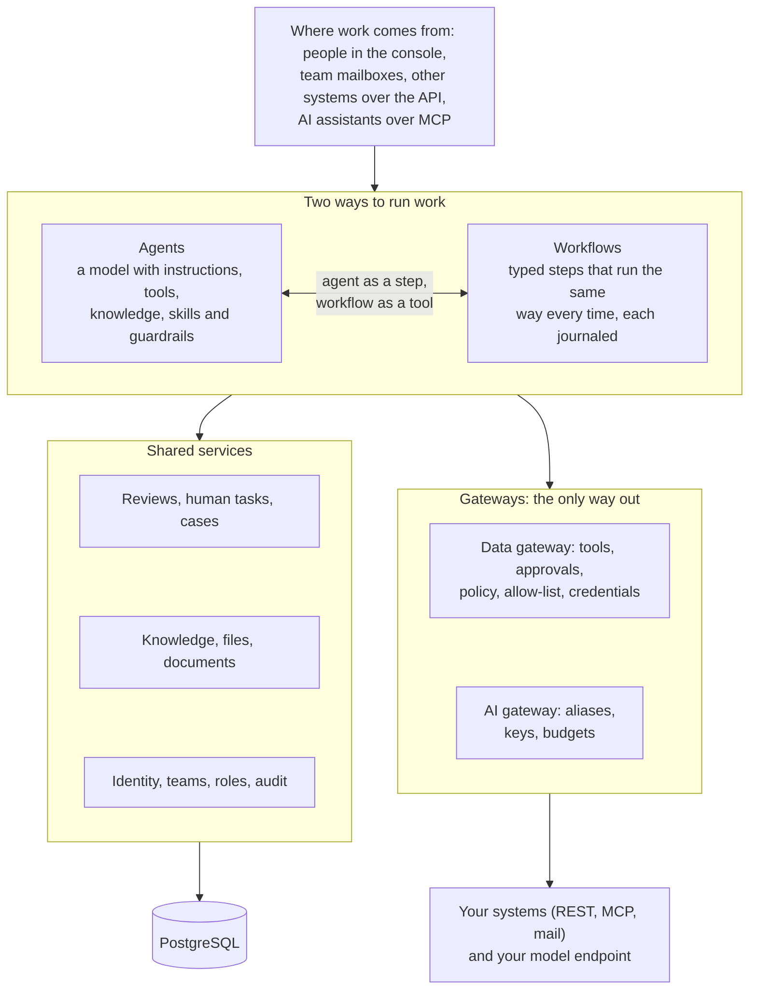

# Overview

Status: current. Checked against the code of this release.

## What Ops AI does

Ops AI is an operational AI platform. A bank's or other regulated business's operations teams use it to hand routine
back-office work to software: reading a court notice and opening a case, triaging a complaint email, placing a hold on
an account, answering a staff question from the team's own procedures. A person approves anything that moves money or
changes a record in another system, and every step leaves a record an auditor can read.

It runs on your own infrastructure, against a database your DBA controls and a model endpoint you choose. Nothing
calls home.

## In three parts

<!-- site: cards -->
- **Agents**: a configured model with instructions, tools, knowledge, skills and guardrails. It decides its own next step inside the limits it was given. People reach it through chat, other systems through the API.
- **Workflows**: a versioned graph of typed steps that runs the same way every time and journals each step. It survives a crash without repeating a write, and waits days for a person at no cost.
- **Shared services and gateways**: reviews and human tasks, cases, knowledge, files, documents, identity and audit, used by both. Every call to your systems leaves through the data gateway, every model call through the AI gateway.

## Who uses it

| Person | What they do in Ops AI |
|---|---|
| Operations staff | Chat with the team's agents, open cases, answer the tasks a workflow hands them |
| Reviewer | Approves or rejects what an agent or a workflow wants to write, with a fresh sign-in for payments |
| Operations manager | Owns a process: its cases, its waiting tasks, its cost |
| Builder | Configures agents, workflows, tools, knowledge bases and document types, and publishes them through a review |
| Security admin | Controls which hosts the platform may call, the stored credentials, storage and sign-in |
| Operator | Installs, upgrades, backs up and watches the platform |

## The platform in one picture

*What runs today. Work arrives from people, mailboxes, other systems and AI assistants; agents and workflows run it on
the shared services. Every call to one of your systems leaves through the data gateway, and every model call through the
AI gateway.*

## Ideas the design rests on

| Idea | What it means for you |
|---|---|
| Agents and workflows are two ways of running work | An agent decides its own next step inside the limits it was given. A workflow runs fixed steps and survives a crash without repeating a write. Each works without the other, and they meet only through their public APIs: a workflow step can call an agent, and an agent can start a published workflow as a tool |
| A person approves every write | A write to one of your systems needs an approval token bound to the exact input the reviewer saw. Changing one character of the input after approval voids it |
| Two gateways are the only way out | Tool calls go through the data gateway, which checks the approval, the policy and an allow-list of hosts. Model calls go through the AI gateway, which checks the caller's key, budget and the data's sensitivity |
| Use cases are configuration | A new process is workflows, document types, agents, tools and settings that a builder configures and publishes. No use case needs new code or a new screen. The court order notice used in this guide is one worked example among several |
| A team is the data boundary | Agents, workflows, knowledge and the work they produce belong to a team. Roles decide what a person may do inside the teams they belong to |
| Every change is versioned and reviewed | Agents, workflows, skills, guardrails, task types and tool modules are published as immutable versions through a review by a second person. A running case keeps the version it started on |

## Words used in this guide

| Word | Meaning |
|---|---|
| Tenant | Your organisation's installation boundary. Every row of data carries its tenant |
| Team | A group of people that owns agents, workflows, knowledge and cases |
| Agent | A configured model with instructions, tools, knowledge, skills and guardrails |
| Workflow | A versioned graph of typed steps: triggers, data steps, AI steps, human tasks, tool calls, cases |
| Run | One piece of work by an agent or a workflow, with a status, a budget and a journal |
| Thread | A conversation or a case's history; holds the saved state a run resumes from |
| Review, human task | A request for a person to decide something; the decision resumes the waiting run |
| Case | The record of one piece of work for people: what it is about, what it waits on, what happened |
| Tool | One operation on one of your systems, such as "get account" or "place hold", with its access class (read or write) and approval policy |
| Alias | A name such as `default` that points at a provider's model; changing the alias changes the model without changing an agent |
