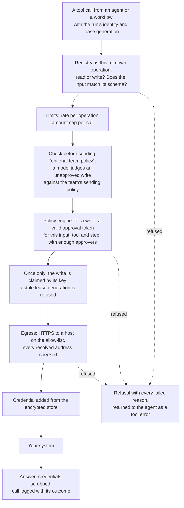

# Security and governance

Status: current. Checked against the release's sign-in, gateway, policy and storage code.

Ops AI is built so that software can draft any change and only a person can let one through. The controls below are
layered: who you are (sign-in), what you may do in a team (roles), what a single write needs (approvals), where a call
may go (the gateways and the allow-list), and what is kept as evidence (audit).

## Sign-in and SSO

| Method | How it works | Status |
|---|---|---|
| OIDC single sign-on | Authorization code flow with PKCE (S256); asymmetric signing algorithms only; the issuer is pinned. Works with any OIDC provider, such as Microsoft Entra ID or Okta, configured as a generic OIDC provider | Built |
| SAML 2.0 single sign-on | Service-provider-initiated; signed responses required, signed requests and encrypted assertions supported | Built |
| Which provider a person uses | Chosen by their email domain, once the domain is proven with a DNS TXT record | Built |
| Multi-factor authentication | Through your identity provider | Built (by the provider) |
| Password | For an installation with no identity provider: PBKDF2-SHA256 with 600,000 iterations, at least 12 characters, a lockout after 5 failures in 15 minutes, reset links by mail | Built |
| Fresh sign-in for sensitive decisions (step-up) | A payment approval needs a sign-in less than five minutes old, by password or through the same identity provider; the decision keeps a fingerprint of it | Built |
| Invites | An admin invites by email; the invite holds a hashed single-use token; a person who already has an account signs in first | Built |

Sessions: platform-service signs a short-lived access token (Ed25519, 15 minutes) and renews it with a rotating
refresh token for a session of 8 hours. A reused refresh token is refused and recorded in the audit log. Every service
checks tokens itself against platform-service's published public keys.

## Roles

A person holds a role in each team they belong to. A role is a grid of 19 areas (agents, workflows, tools, secrets and
egress, files, documents, reviews, cases, settings, access, audit and others) by 8 actions (view, create, edit, publish,
delete, run, decide, manage). Every check in every service goes through that grid; no code checks a role's name.

| Role | What it may do in the team |
|---|---|
| Admin | Everything in the team. Actions reserved for the Security team still need a role there |
| Builder | Reads the team's work; creates, edits, tests and publishes its agents, workflows, tools and knowledge |
| Reviewer | Reads the team's work and decides its reviews and tasks; in the Security team, decides tool module security reviews |
| Viewer | Reads the team's work and chats with its agents |
| Security admin | Changes the outbound allow-list, credentials and storage for every team, and decides tool module security reviews |
| Chat user | Chats with the team's agents |

| Item | Status |
|---|---|
| The six built-in roles, seeded per tenant, and the grid behind them | Built |
| A page that shows each role's grid and why an action is refused | Built |
| Custom roles built from the grid | Planned |

## Approvals

| Rule | Status |
|---|---|
| Every write to one of your systems needs an approval token, minted only after a person decides | Built |
| The token is bound to the tool, the run's step and the hash of the exact input the approver saw; any change to the input voids every approval of it | Built |
| A token lives 15 minutes; a late resume renews it from the recorded approvals of that exact call for up to 24 hours, so a reviewer is never asked twice | Built |
| Each operation's policy sets how many distinct people must approve, which team they come from, and whether each needs a fresh sign-in; the same person cannot approve twice | Built |
| Whether the person who asked may also decide is a team policy | Built |
| Publishing an agent, workflow, skill, guardrail, task type or widget needs a second person's review, unless the team's publish policy says otherwise; a major change to a tool module needs the Security team's review | Built |
| Approval tokens are signed with a shared key that the agents and tools services both hold. Signing with an asymmetric key that only the reviews code holds | Planned |

## The tool gateway

Every call to one of your systems, read or write, goes through the tools service. Agents and workflows hold no
credentials and open no connections of their own.

*A refusal lists every condition that failed. An agent sees it as a tool error and can explain it to the person.*

| Control | What holds | Status |
|---|---|---|
| Registry | Operations come from tool modules: imported from OpenAPI 3.0 or 3.1, discovered from an MCP server, or written by a builder. A module's major change opens a Security review; calls keep the published shape until the new version is published | Built |
| Connections | How the platform signs in to a system, per test and production: API key, basic or bearer, OAuth client credentials, OAuth authorization code with PKCE, client certificate (mutual TLS). Tokens are stored encrypted and refreshed one at a time | Built |
| Each person signing in to a system with their own account | A run would use only the token of the person it acts for | Planned |
| Test and production | Live runs and chats call production; tests call the test environment, and writes in a test always answer from the operation's mock | Built |
| Outbound allow-list | HTTPS only, to hosts on your tenant's list. Every address a host resolves to is checked inside the connection, so DNS cannot be used to redirect a call. Private ranges are allowed only when listed; loopback, link-local and cloud metadata addresses never. No redirects are followed and no cookies kept. The list starts empty: nothing is reachable until a Security admin adds a host | Built |
| Your internal certificate authority | Trusted for outbound calls when you provide its certificate | Built |
| MCP for AI assistants | Your team's read tools served over MCP through the same gateway, to a person or an API key of that team | Partial: reads only, test environment |
| Code tools | Transforms and formulas run in a bounded child process with no network or files; no general code runtime | Partial |

## Secrets

| Item | What holds | Status |
|---|---|---|
| Credentials for your systems | Entered once by a Security admin in the console; encrypted with AES-256-GCM under `OPS_SECRETS_KEY`, bound to the tenant and the credential's name; never returned by any API; scrubbed from answers and logs; every create, rotate, delete and use audited; limited to the teams it is shared with | Built |
| The model provider's key | Stored the same way, by name; the AI gateway reads it at call time. Outside development the AI gateway refuses provider keys from its environment | Built |
| Storage credentials | Sealed with the same key | Built |
| Installation keys | One signing key per service, the sign-in token key, the approval key and the secrets key, generated at install. Each service receives only the keys it uses; each may be a file under `/run/secrets` | Built |
| A hardware or cloud key manager for these keys | | Planned |

Keep `OPS_SECRETS_KEY` with your backups: stored credentials cannot be read without it.

## Data masking

| Item | What holds | Status |
|---|---|---|
| What people see | Email addresses, national ID numbers, card numbers, phone numbers and account numbers are masked in streamed answers, tool call records and citations. A per-agent setting, on by default | Built |
| What the model sees | Real values, so the agent can act on them; the data sensitivity gate on the AI gateway decides which model may receive them ([Models](models.md)) | Built |
| Names | Not masked | Planned |
| Document corrections | Values an extraction learned from are shown masked | Built |

## Audit and evidence

Every security-relevant change and every call to the outside is recorded: the audit log, the tool call log, the
credential, allow-list, connection and storage audits, the run journal, each review decision and the model call log.
Details and status are in [Data and database](data-and-database.md#the-audit-trail).

## Platform hardening

| Item | What holds |
|---|---|
| Network | Only the entry point publishes a port. On Kubernetes, a network policy admits platform-service's private port only from the other services |
| Containers | Non-root (uid 10001). On Kubernetes: every capability dropped, no privilege escalation, read-only root filesystem except the console, the runtime's default seccomp profile |
| Database | One login per service with row rights on its own tables only; no running container can change the schema when your DBA applies it |
| Service calls | Each service signs its calls with its own Ed25519 key, and a callee accepts only the calls that caller is allowed to make |
| Policy engine | The gateway writes its policy into the policy engine at start and reports unhealthy if the engine serves a different one; token expiry is judged by the gateway's clock |
| Telemetry | None. Nothing in the platform calls home |
