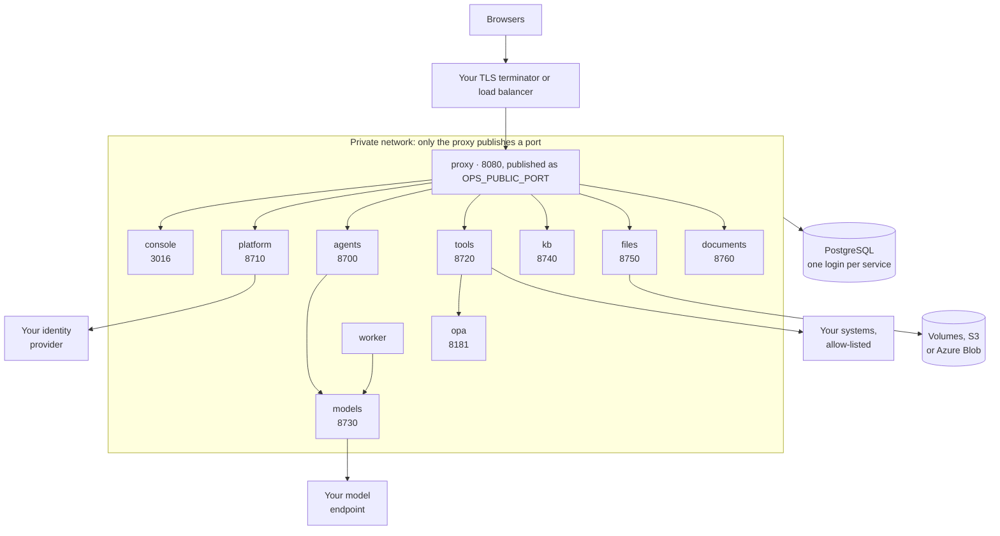

# System components

Status: current. Checked against the release's Compose file, images and services.

Ops AI ships as eleven long-running containers and one one-shot job. Seven are Python services built from one base
image, plus the workflow worker (the agents image with another command), the web console, a policy engine (Open Policy
Agent) and one entry point (Caddy). PostgreSQL is yours and runs outside them. Kubernetes runs the same images as the
same workloads.

<!-- diagram: deployment -->

*One machine with Docker Compose. The proxy is the only container that publishes a port; the worker, models-service
and the policy engine are never reached from a browser. Every service checks sign-in tokens itself against
platform-service's public keys, and each has its own database login.*

## The containers

| Container | What it does | Port | What it stores | What it calls |
|---|---|---|---|---|
| proxy | The one entry point: the console at `/`, each browser-facing API at `/api/<service>/` | 8080 inside, published as `OPS_PUBLIC_PORT` (8890 by default) | Nothing | console, platform, agents, tools, kb, files, documents |
| console | The web console people use | 3016 | Nothing | The APIs, from the browser through the proxy |
| platform | Sign-in and sessions, tenants, teams, members, roles, API keys, team policies, the audit log. The only issuer of sign-in tokens | 8710; 8711 for API key checks, private | Tenants, teams, users, members, roles, sessions, API keys, sign-in providers and domains, password hashes, audit entries | Your identity provider (OIDC or SAML); your mail server for invites and password resets |
| agents | Agents, workflows and their versions, chat, runs, reviews and human tasks, cases, channels (mailboxes, the API, chat widgets), service events | 8700 | Definitions and versions, threads, runs, workflow steps, saved run state, reviews and decisions, cases, mailboxes, budgets, agent memories | tools, models, kb, files, documents, platform |
| worker | Runs workflow steps from the work queue, resumes runs after a decision, fires timers, reads team mailboxes | none | Same database as agents | Same as agents |
| tools | The data gateway: tool modules and their operations, connections, the approval check, the outbound allow-list, stored credentials, the call log, an MCP endpoint for AI assistants | 8720 | Tool modules and versions, connections and their tokens, credentials (encrypted), allow-list, call log | Your systems (only hosts on the allow-list); opa; models, for the optional check before sending; platform, for team policies |
| models | The AI gateway: aliases, model keys, budgets, rate limits, the call log | 8730, private | Provider connections, aliases and their versions, model keys and spend, a metadata-only call log | Your model endpoint; tools, to read the provider's key from the credential store |
| kb | Knowledge bases: sources, ingestion, search with page and section citations | 8740 | Sources, items and versions, searchable chunks | files, agents |
| files | File bytes: upload, download, type judged from the bytes, malware scan hook, retention class, legal hold | 8750 | File records, versions, references, holds, storage settings; the bytes on its volume or in S3 or Azure Blob | agents, to report events such as a deleted file |
| documents | Reading documents: layout, classify, extract fields with the place on the page each came from, corrections | 8760 | Document types and versions, samples, extractions, corrections, page layouts. Never the bytes | files, models, platform, agents |
| opa | Open Policy Agent with the gateway's policy built in | 8181, private | Nothing; tools loads the approval key into it at start | Nothing |
| migrate | One-shot job: applies every service's schema in order, then creates the first tenant, its Security team and the first admin | none | Nothing | PostgreSQL |

Every image runs as a non-root user (uid 10001). The seven Python images share one base layer of about 626 MB; the
console image is about 440 MB.

## Rules every service follows

| Rule | Consequence |
|---|---|
| A service reads only its own tables | Each service has its own database login and its own migration history. Data from another service comes through that service's API |
| Calls between services carry a signed service token | Each service signs with its own key and is trusted only for the calls it is allowed to make. A service holds only the keys it uses |
| Every request is authenticated | Each service checks the caller's token against platform-service's published keys, so a request that skips the proxy is still refused |
| Every service refuses a schema behind it | A service whose database has not been upgraded to its version stops at start and says which upgrade is missing |
| Settings come from the environment or a secrets file | Any setting may be a file under `/run/secrets` named after it. No image holds a secret |

## Not in the containers

| Item | State |
|---|---|
| The database | Yours: PostgreSQL 15 or newer, or Azure Database for PostgreSQL 16 or newer. Azure SQL is in [Azure SQL](azure-sql.md) |
| A malware scanner | The files service has a hook a scanner calls back on, and a built-in test engine that recognises only the EICAR test file. A production scanner is yours to connect |
| The app that serves chat widgets on your other sites | Planned as its own image. Widgets are configured and published in the console today |
| One process with no container runtime | Planned. The services already run together in one process inside an all-in-one image, which the release package does not include |
