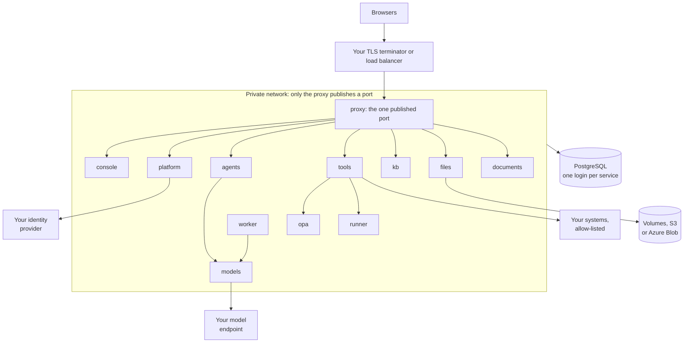

# What runs in an Ops AI install

Status: current.

Your network team, your security reviewers and your operations team will each want to know what an Ops AI install puts
on your machines, which parts talk to which, and what each part stores. This page lists every container, what it does
and what it calls, and the rules every service follows. It is checked against the release's Compose file, images and
services.

Ops AI ships as twelve long-running containers and one job that runs once. Eight of the containers are Python services
built from one base image. The others are the workflow worker (the agents image with a different command), the web
console, a policy engine (Open Policy Agent) and one entry point (Caddy). PostgreSQL is yours and runs outside them.
Kubernetes runs the same images as the same workloads.

<!-- diagram: deployment -->

*One machine with Docker Compose. The proxy is the only container that publishes a port, so a browser never reaches the
worker, the code runner or the policy engine, and it reaches the models service only for its settings routes (provider
keys, connections and aliases). Every service checks sign-in tokens itself against the
platform service's public keys, and each has its own database login.*

## The containers

| Container | What it does | What it stores | What it calls |
|---|---|---|---|
| proxy | The one entry point. It serves the console at `/` and each browser-facing API at `/api/<service>/` | Nothing | console, platform, agents, tools, models (settings routes only), kb, files, documents |
| console | The web console people use | Nothing | The APIs, from the browser through the proxy |
| platform | Sign-in and sessions, tenants, teams, members, roles, API keys, team policies and the audit log. It is the only issuer of sign-in tokens | Tenants, teams, users, members, roles, sessions, API keys, sign-in providers and domains, password hashes, audit entries | Your identity provider (OIDC or SAML), and your mail server for invites and password resets |
| agents | Agents, workflows and their versions, chat, runs, reviews and human tasks, cases, and channels (mailboxes, the API and chat widgets) | Definitions and versions, threads, runs, workflow steps, saved run state, reviews and decisions, cases, mailboxes, budgets, agent memories | tools, models, kb, files, documents, platform |
| worker | Runs workflow steps from the work queue, resumes runs after a decision, fires timers and reads team mailboxes | The same database as agents | The same services as agents |
| tools | The data gateway: tool modules and their operations, connections, the approval check, the outbound allow-list, stored credentials, the call log, and an MCP endpoint that AI assistants such as Claude Desktop connect to | Tool modules and versions, connections and their tokens, credentials (encrypted), the allow-list, the call log | Your systems (only hosts on the allow-list), opa, runner (for code tools), models (for the optional check before sending) and platform (for team policies) |
| runner | Runs a code tool's Python function in a WebAssembly sandbox with a memory cap, a time limit, no network, no files and no secrets. The function reaches other systems only by calling a tool back through tools | Nothing | tools, and only tools calls it |
| models | The AI gateway: aliases, model keys, budgets, rate limits and the call log | Provider connections, aliases and their versions, model keys and spend, and a call log that holds metadata only | Your model endpoint, and tools, to read the provider's key from the credential store |
| kb | Knowledge bases: sources, ingestion, and search with page and section citations | Sources, items and versions, searchable chunks | files, agents |
| files | File bytes: upload, download, type judged from the bytes, the malware scan hook, retention class and legal hold | File records, versions, references, holds and storage settings, with the bytes on its volume or in S3 or Azure Blob | agents, to report events such as a deleted file |
| documents | Reading documents: layout, classification, field extraction with the place on the page each came from, and corrections | Document types and versions, samples, extractions, corrections and page layouts. It never stores the bytes | files, models, platform, agents |
| opa | Open Policy Agent with the gateway's policy built in | Nothing. The tools service loads the approval key into it at start | Nothing |
| migrate | A job that runs once: it applies every service's schema in order, then creates the first tenant, its Security team and the first admin | Nothing | PostgreSQL |

Every image runs as a non-root user (uid 10001).

## Rules every service follows

| Rule | What it means for you |
|---|---|
| A service reads only its own tables | Each service has its own database login and its own migration history. Data from another service comes through that service's API |
| Calls between services carry a signed service token | Each service signs with its own key and is trusted only for the calls it is allowed to make. A service holds only the keys it uses |
| Every request is authenticated | Each service checks the caller's token against the platform service's published keys, so a request that skips the proxy is still refused |
| Every service refuses a schema behind it | A service whose database has not been upgraded to its version stops at start and says which upgrade is missing |
| Settings come from the environment or a secrets file | Any setting may be a file under `/run/secrets` named after it. No image holds a secret |

## What you provide

| Item | State |
|---|---|
| The database | PostgreSQL 15 or newer, or Azure Database for PostgreSQL 16 or newer. Azure SQL is covered in [Azure SQL](azure-sql.md) |
| A malware scanner | The files service has a hook that a scanner calls back on, and a built-in test engine that recognises only the EICAR test file. You connect a production scanner yourself |
| The app that serves chat widgets on your other sites | Planned as its own image. Widgets are configured and published in the console today |
| One process with no container runtime | Planned. The services already run together in one process inside an all-in-one image, which the release package does not include |
